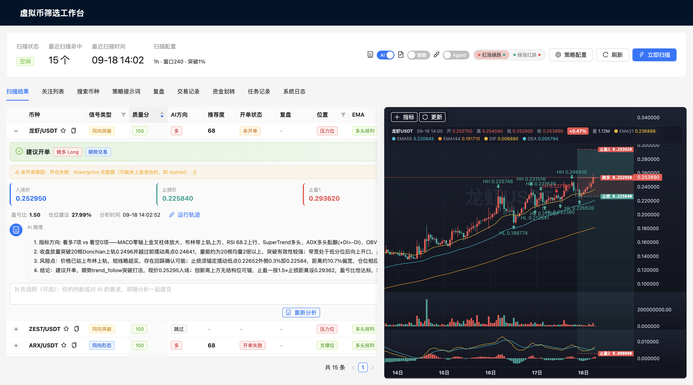

# Trading Workbench | 交易工作台

[English](#english) | [中文](#中文)

> ⚠️ **免责声明 / Disclaimer**
> 本软件仅供学习与研究使用，**不构成任何投资建议**。加密货币合约交易风险极高，可能导致全部本金损失。请自行研究并自负盈亏。
> This software is for educational and research purposes only and is **NOT financial advice**. Cryptocurrency futures trading carries substantial risk and may result in the total loss of capital. Always do your own research.

---

<a id="english"></a>

## English

A cryptocurrency futures trading workbench with an indicator-driven screening pipeline, AI-assisted trade analysis, and automated order execution on Binance USDT-M perpetual futures. An hourly scan funnels the full contract market through a 7-indicator majority vote + trigger confirmation, ranks candidates by a quality score, sends the top ones to an LLM for structured trade plans, and can place and manage real orders (SL/TP, partial take-profits, trailing stops) on Binance Futures testnet/mainnet.

<p align="center">
  
</p>

### Features

- **Indicator-driven screening pipeline** — Every hour (after the 1h candle closes), all USDT-M perps are scored by 7 technical indicators voting on direction: MACD(12,26,9), Bollinger(20,2), RSI(14), SuperTrend(10,3), ADX(14), OBV(20), and a 4h EMA21/55 background check. The majority vote decides direction; two-stage 4h fetching keeps API cost low.
- **Trigger confirmation** — A candidate needs both direction and a trigger: T1 Donchian(20) channel breakout, T2 one of 12 golden candlestick patterns at a matching key level, or T3 an EMA21 pullback hold. Direction-only candidates stay in the watch pool (not persisted).
- **Quality score quota** — Passing candidates are ranked by a 0-100 quality score (vote margin + modifiers: 4h alignment, breakout-with-ADX, overbought/oversold penalty, OBV divergence penalty). Only the top N (`AI_MAX_PER_SCAN`, default 10) go to AI analysis.
- **AI trade analysis** — Sends K-lines + indicator votes + swing structure to an OpenAI-compatible LLM. Returns a structured plan (direction, entry, SL, TP1/TP2, RR, position size). Two pipelines: P0 single-call with a programmatic risk guard (RR ≥ 1.5 iron rule, direction-price consistency), P1 agent pipeline with tool calls; optional dual-judge debate. Results cached by price-bucket fingerprint.
- **Automated trading (optional)** — With a Binance API key, `suggest` decisions above the recommendation threshold can be auto-executed: isolated margin with configurable leverage, fixed risk budget sizing (SL distance × position = fixed % of account), SL as MARK_PRICE stop, TP batches (50%/25% with TP2, or 75% with TP1 only), trailing 25% runner via 3-bar low/high after TP1, breakeven SL move, hourly settlement loop.
- **Risk gates** — Liquidation-margin gate using the symbol's real leverage-bracket MMR (prevents "liquidated before SL" trades on high-MMR alts), direction-price consistency re-check against live price, balance floor, max open trades, min recommendation threshold.
- **Trade records & replay** — Every order lifecycle is persisted with an event timeline (OPEN / TP1_FILL / TP2_FILL / SL_MOVE / SL_FILL / SETTLE), realized PnL including fees and funding, and a K-line replay modal showing entry/SL/TP zones plus the current (trailing) stop.
- **Review system** — Actual-trade attribution: win rate, payoff, per-trade expectancy (R multiples), plan-vs-actual gap (fees + funding + slippage), grouped by trade type / direction / exit reason / Beijing session. AI error attribution tags losing trades (chasing, too-wide/narrow stops, counter-vote entries…) and can draft rule patches (prompt overlays or gate parameters) with human-in-the-loop merge, effectiveness metrics and one-click rollback.
- **Watchlist & manual search** — Persistent watchlist with manual refresh using the same pipeline; manual symbol search with on-demand AI analysis.
- **Fund transfer log** — Hourly sync of futures-account transfers from Binance `income` records.
- **Web UI** — React + Ant Design dashboard: scan status/trigger, result table sorted by quality score with per-row AI analysis and expandable K-line chart, trade records, transfers, review tabs, strategy config panel, dark/light and up/down color schemes.

### Tech Stack

| Layer | Stack |
| --- | --- |
| Frontend | React 18, TypeScript, Vite 5, Ant Design 5, Zustand, axios, dayjs, lightweight-charts |
| Backend | FastAPI, SQLAlchemy 2.0, Pydantic 2, Celery 5, Redis, httpx, numpy, openai |
| Database | PostgreSQL 15 |
| Task Queue | Celery + Redis 7 (broker + backend) |
| Deployment | Docker, Docker Compose |
| Data Source | Binance USDT-M futures API (public market data; trading via API key) |

### Project Structure

```
trading-workbench/
├── backend/
│   ├── app/
│   │   ├── api/              # FastAPI routers (scan, trades, watchlist, ops, health)
│   │   ├── models/           # SQLAlchemy models (scan, trade, system_config)
│   │   ├── schemas/          # Pydantic schemas
│   │   ├── services/
│   │   │   ├── scanner.py          # Indicator-vote screening orchestrator
│   │   │   ├── strategy/           # Indicators, swing detection, triggers
│   │   │   ├── ai_analyzer.py      # P0 pipeline + prompt builder
│   │   │   ├── ai_agent.py         # P1 agent pipeline
│   │   │   ├── risk_guard.py       # RR iron rule + direction-price consistency
│   │   │   ├── trade_engine.py     # Order placement, SL/TP management, settlement
│   │   │   ├── binance_trader.py   # Binance futures trading client
│   │   │   ├── actual_review.py    # Actual-trade attribution stats
│   │   │   ├── ai_attribution.py   # AI error tagging for losing trades
│   │   │   └── exchange_pool.py    # Multi-exchange kline failover (Binance/OKX/Bitget)
│   │   ├── tasks/            # Celery tasks (scan_tasks, ai_tasks, trade_tasks, review_tasks)
│   │   ├── celery_app.py     # Celery + beat schedule
│   │   ├── config.py         # Settings from env vars
│   │   ├── database.py       # Engine + idempotent migrations
│   │   └── main.py
│   ├── requirements.txt
│   └── .env.example
├── frontend/
│   ├── src/
│   │   ├── pages/ScanResult.tsx
│   │   ├── components/        # ResultTable, KlineChart, TradeReplayChart, TradesPanel,
│   │   │                      # ReviewPanels, WatchlistPanel, TransfersPanel, ScanConfigPanel...
│   │   ├── stores/scanStore.ts # Zustand store
│   │   ├── api/scan.ts
│   │   └── types/index.ts
│   └── package.json
├── docs/                      # Requirements + strategy docs (Chinese)
├── docker-compose.yml
├── deploy.sh                  # One-click deploy script
└── LICENSE
```

### Prerequisites

- Docker 20.10+ and Docker Compose v2 (or `docker-compose` v1)
- A Binance-reachable network (public market data needs no key; trading needs futures API key/secret)
- *(Optional)* An OpenAI-compatible API key for AI analysis

### Installation

#### Option A: Docker (recommended)

```bash
# 1. Clone
git clone <your-repo-url> trading-workbench
cd trading-workbench

# 2. Configure backend env
cp backend/.env.example backend/.env
# Edit backend/.env — at minimum set AI_API_KEY for AI analysis.
# For auto trading set BINANCE_API_KEY / BINANCE_SECRET_KEY (TRADING_TESTNET=true by default).
# Defaults point at the docker-compose service names (db:5432, redis:6379).

# 3. Build & start all services
./deploy.sh up
# Or: docker compose up -d --build

# 4. Open the app
# Frontend:  http://localhost:8088
# Backend:   http://localhost:8082
# API docs:  http://localhost:8082/docs
```

Other `deploy.sh` commands:

```bash
./deploy.sh status   # show container status
./deploy.sh logs     # tail logs (Ctrl+C to exit)
./deploy.sh restart  # restart all services
./deploy.sh build    # rebuild images without starting
./deploy.sh down     # stop and remove containers
```

#### Option B: Local development

**Backend** (Python 3.9+):

```bash
cd backend
python -m venv .venv && source .venv/bin/activate
pip install -r requirements.txt
cp .env.example .env        # edit to point at localhost postgres/redis
# Make sure PostgreSQL (5432) and Redis (6379) are running locally.
uvicorn app.main:app --reload --port 8000
# In a second terminal:
celery -A app.celery_app worker --loglevel=info --concurrency=2
celery -A app.celery_app beat --loglevel=info
```

**Frontend** (Node 18+):

```bash
cd frontend
npm install
npm run dev          # Vite dev server at http://localhost:5173
```

### Configuration

All backend configuration is via environment variables (see `backend/.env.example`). Key variables:

| Variable | Default | Purpose |
| --- | --- | --- |
| `DATABASE_URL` | `postgresql://postgres:postgres@db:5432/trading_workbench` | PostgreSQL DSN |
| `REDIS_URL` / `CELERY_BROKER_URL` / `CELERY_RESULT_BACKEND` | redis service names | Redis / Celery |
| `BINANCE_FUTURES_URL` | `https://fapi.binance.com` | Binance futures API base |
| `KLINE_INTERVAL` | `1h` | Scan timeframe (also 4h used for background votes) |
| `KLINE_WINDOW` | `240` | K-lines fetched per symbol |
| `REPEAT_WINDOW_HOURS` | `3` | Repeat-hit dedup window |
| `AI_API_KEY` / `AI_BASE_URL` / `AI_MODEL` | *(empty)* / openai / gpt-4o-mini | LLM endpoint |
| `AI_MAX_PER_SCAN` | `10` | Per-scan AI quota (top quality scores) |
| `AI_RR_MIN` | `1.5` | Risk-reward iron rule enforced by risk guard |
| `RISK_BUDGET_PCT` | `3.0` | Fixed per-trade loss budget (% of account) |
| `BINANCE_API_KEY` / `BINANCE_SECRET_KEY` | *(empty)* | Futures trading keys |
| `TRADING_ENABLED` | `false` | Auto-trading master switch |
| `TRADING_TESTNET` | `true` | Binance testnet first — verify the chain before mainnet |
| `TRADING_MIN_RECOMMENDATION` | `60.0` | Min AI score to open a trade |
| `TRADING_LEVERAGE` | `20` | Isolated-margin leverage |

Most runtime toggles (AI on/off, pipeline P0/P1, dual judge, trade-strategy switches, scan params, trading gates) live in the `system_config` DB table and are editable from the UI. DB schema changes are applied by idempotent `_run_migrations` at startup.

### Services & Ports (Docker)

| Service | Container port | Host port |
| --- | --- | --- |
| Frontend (nginx) | 80 | 8088 |
| Backend (uvicorn) | 8000 | 8082 |
| PostgreSQL | 5432 | 5433 |
| Redis | 6379 | 6380 |
| Celery worker | — | — |
| Celery beat | — | — |

### License

Released under the [MIT License](./LICENSE). © 2026 Trading Workbench contributors.

> **Disclaimer**: This software is for educational and research purposes only and is **not financial advice**. Cryptocurrency trading carries substantial risk. Always do your own research.

---

<a id="中文"></a>

## 中文

一个带指标驱动筛选管线、AI 辅助交易分析与自动下单执行的加密货币合约工作台，交易标的为币安 USDT-M 永续合约。每小时定时扫描全量合约：方向票（MACD/布林带/RSI）多数决定向 + 触发双确认筛选候选，按质量分排序后送 LLM 生成结构化交易计划，并可自动在币安合约（测试网/正式网）开单与管理持仓（止损/分批止盈/跟踪止损）。

<p align="center">
  
</p>

### 功能特性

- **指标驱动筛选管线** — 每小时（等 1h K 线收盘后）扫描全量 USDT-M 永续合约，7 个技术指标各投方向票：MACD(12,26,9)、布林带(20,2)、RSI(14)、SuperTrend(10,3)、ADX(14)、OBV(20)、4h EMA21/55 背景。多数决（谁多以谁为主，平票回退 K 线量能）定方向；4h K 线两阶段拉取控制请求成本。
- **触发双确认** — 候选需要「方向 + 触发」双确认：T1 Donchian(20) 通道突破 / T2 12 种黄金 K 线形态在关键位匹配 / T3 回踩 EMA21 企稳。只有方向、没有触发的币进观察池不落库，下轮全量重算。
- **质量分配额** — 通过双确认的候选按 0-100 质量分排序（票差 + 修饰项：4h 同向加分、突破伴随 ADX 强趋势加分、超买超卖追入扣分、OBV 背离扣分），只有前 N 名（`AI_MAX_PER_SCAN`，默认 10）进入 AI 分析。
- **AI 交易分析** — 把 K 线 + 指标票数 + 摆动结构发给 OpenAI 兼容 LLM，返回结构化交易计划（方向、入场、止损、TP1/TP2、盈亏比、仓位）。双管线：P0 单次调用 + 程序风控复核（盈亏比 ≥1.5 铁律、方向-价格一致性），P1 Agent 工具调用管线；可选双评委辩论。按价格分桶指纹缓存复用。
- **自动交易（可选）** — 配置币安 API Key 后，推荐度过门槛的 suggest 结论可自动执行：逐仓 + 可配杠杆，固定风险预算仓位（止损距离 × 仓位 = 固定 % 账户资金），止损挂 MARK_PRICE 触发价，分批止盈（有 TP2：50%/25%；无 TP2：TP1 一次 75%），TP1 后保本 + 剩余 25% 尾仓按 3 根 K 线高低点跟踪止损，每小时结算巡检。
- **风控闸门** — 强平保证金闸门（按币种真实杠杆档位 MMR 计算，杜绝小币「强平先于止损」的单子）、方向-价格可挂性复核、可用余额下限、在跑上限、最低推荐度门槛。
- **交易记录与复盘回放** — 每笔订单全生命周期事件时间线（OPEN / TP1_FILL / TP2_FILL / SL_MOVE / SL_FILL / SETTLE），净盈亏含手续费与资金费，K 线复盘弹窗展示入场/止损/止盈区域与现止损（跟踪移动后）位置。
- **复盘系统** — 实盘归因：胜率、盈亏比、每笔期望（R 倍数）、计划 vs 实际差值（手续费 + 资金费 + 滑点归因）、按打法/方向/出场原因/北京时段分组。AI 错误归因给亏损单打标签（追高追空、止损过宽过窄、逆指标多数…），可生成规则补丁草稿（提示词覆盖段或闸门参数），人工确认合入、效果度量、一键回滚。
- **关注列表与手动搜索** — 关注币种持久保存，手动刷新走与扫描完全同一套管线；手动搜索任意币种即时 AI 分析。
- **资金划转** — 每小时从币安 income 记录同步合约账户划转流水。
- **Web 界面** — React + Ant Design 仪表盘：扫描状态/触发、按质量分排序的结果表（行级 AI 分析 + 可展开 K 线图）、交易记录、资金划转、复盘多页签、策略配置面板、深浅色与涨跌配色方案。

### 技术栈

| 层 | 技术栈 |
| --- | --- |
| 前端 | React 18、TypeScript、Vite 5、Ant Design 5、Zustand、axios、dayjs、lightweight-charts |
| 后端 | FastAPI、SQLAlchemy 2.0、Pydantic 2、Celery 5、Redis、httpx、numpy、openai |
| 数据库 | PostgreSQL 15 |
| 任务队列 | Celery + Redis 7（broker + backend） |
| 部署 | Docker、Docker Compose |
| 数据源 | 币安 USDT-M 合约 API（公开行情；交易需 API Key） |

### 项目结构

```
trading-workbench/
├── backend/
│   ├── app/
│   │   ├── api/              # FastAPI 路由（scan、trades、watchlist、ops、health）
│   │   ├── models/           # SQLAlchemy 模型（scan、trade、system_config）
│   │   ├── schemas/          # Pydantic schema
│   │   ├── services/
│   │   │   ├── scanner.py          # 指标投票筛选编排
│   │   │   ├── strategy/           # 指标、摆动点、触发器
│   │   │   ├── ai_analyzer.py      # P0 管线 + 提示词构建
│   │   │   ├── ai_agent.py         # P1 Agent 管线
│   │   │   ├── risk_guard.py       # 盈亏比铁律 + 方向价格一致性
│   │   │   ├── trade_engine.py     # 下单、止损止盈管理、结算
│   │   │   ├── binance_trader.py   # 币安合约交易客户端
│   │   │   ├── actual_review.py    # 实盘归因统计
│   │   │   ├── ai_attribution.py   # 亏损单 AI 错误标签
│   │   │   └── exchange_pool.py    # 多交易所 K 线故障转移（币安/OKX/Bitget）
│   │   ├── tasks/            # Celery 任务（scan_tasks、ai_tasks、trade_tasks、review_tasks）
│   │   ├── celery_app.py     # Celery + beat 调度
│   │   ├── config.py         # 环境变量配置
│   │   ├── database.py       # 引擎 + 幂等迁移
│   │   └── main.py
│   ├── requirements.txt
│   └── .env.example
├── frontend/
│   ├── src/
│   │   ├── pages/ScanResult.tsx
│   │   ├── components/        # ResultTable、KlineChart、TradeReplayChart、TradesPanel、
│   │   │                      # ReviewPanels、WatchlistPanel、TransfersPanel、ScanConfigPanel 等
│   │   ├── stores/scanStore.ts # Zustand store
│   │   ├── api/scan.ts
│   │   └── types/index.ts
│   └── package.json
├── docs/                      # 需求与策略文档（中文）
├── docker-compose.yml
├── deploy.sh                  # 一键部署脚本
└── LICENSE
```

### 环境要求

- Docker 20.10+ 与 Docker Compose v2（或 `docker-compose` v1）
- 能访问币安的网络（公开行情无需 Key；自动交易需合约 API Key）
- *（可选）* 一个 OpenAI 兼容 API Key，用于 AI 分析功能

### 安装步骤

#### 方式一：Docker 部署（推荐）

```bash
# 1. 克隆仓库
git clone <your-repo-url> trading-workbench
cd trading-workbench

# 2. 配置后端环境变量
cp backend/.env.example backend/.env
# 编辑 backend/.env —— 若要使用 AI 分析，至少填写 AI_API_KEY。
# 若要自动交易，配置 BINANCE_API_KEY / BINANCE_SECRET_KEY（默认 TRADING_TESTNET=true 先走测试网）。
# 默认值已指向 docker-compose 内的服务名（db:5432、redis:6379）。

# 3. 构建并启动所有服务
./deploy.sh up
# 或：docker compose up -d --build

# 4. 访问
# 前端:  http://localhost:8088
# 后端:  http://localhost:8082
# 接口文档: http://localhost:8082/docs
```

`deploy.sh` 其它命令：

```bash
./deploy.sh status   # 查看容器状态
./deploy.sh logs     # 跟随日志（Ctrl+C 退出）
./deploy.sh restart  # 重启所有服务
./deploy.sh build    # 仅重新构建镜像（不启动）
./deploy.sh down     # 停止并移除容器
```

#### 方式二：本地开发

**后端**（Python 3.9+）：

```bash
cd backend
python -m venv .venv && source .venv/bin/activate
pip install -r requirements.txt
cp .env.example .env        # 改为指向本机 postgres/redis
# 确保本地 PostgreSQL（5432）和 Redis（6379）已运行
uvicorn app.main:app --reload --port 8000
# 另开终端：
celery -A app.celery_app worker --loglevel=info --concurrency=2
celery -A app.celery_app beat --loglevel=info
```

**前端**（Node 18+）：

```bash
cd frontend
npm install
npm run dev          # Vite 开发服务器，访问 http://localhost:5173
```

### 配置说明

后端所有配置均通过环境变量（见 `backend/.env.example`），关键变量：

| 变量 | 默认值 | 说明 |
| --- | --- | --- |
| `DATABASE_URL` | `postgresql://postgres:postgres@db:5432/trading_workbench` | PostgreSQL 连接串 |
| `REDIS_URL` / `CELERY_BROKER_URL` / `CELERY_RESULT_BACKEND` | redis 服务名 | Redis / Celery |
| `BINANCE_FUTURES_URL` | `https://fapi.binance.com` | 币安合约 API 基址 |
| `KLINE_INTERVAL` | `1h` | 扫描 K 线周期（另拉 4h 作背景投票） |
| `KLINE_WINDOW` | `240` | 每币种拉取 K 线数量 |
| `REPEAT_WINDOW_HOURS` | `3` | 重复命中去重窗口 |
| `AI_API_KEY` / `AI_BASE_URL` / `AI_MODEL` | *(空)* / openai / gpt-4o-mini | LLM 端点 |
| `AI_MAX_PER_SCAN` | `10` | 单次扫描 AI 分析配额（按质量分取前 N） |
| `AI_RR_MIN` | `1.5` | 盈亏比铁律（风控复核下限） |
| `RISK_BUDGET_PCT` | `3.0` | 单笔固定亏损预算（% 账户资金） |
| `BINANCE_API_KEY` / `BINANCE_SECRET_KEY` | *(空)* | 合约交易 API Key |
| `TRADING_ENABLED` | `false` | 自动交易总开关 |
| `TRADING_TESTNET` | `true` | 先走币安测试网验证链路，再切正式网 |
| `TRADING_MIN_RECOMMENDATION` | `60.0` | 开单最低推荐度 |
| `TRADING_LEVERAGE` | `20` | 逐仓杠杆 |

大部分运行时开关（AI 开关、P0/P1 管线、双评委、打法开关、扫描参数、交易闸门参数）存于 `system_config` 表，可在前端界面修改。数据库结构变更由启动时的幂等迁移 `_run_migrations` 自动应用。

### 服务与端口（Docker）

| 服务 | 容器端口 | 宿主端口 |
| --- | --- | --- |
| 前端（nginx） | 80 | 8088 |
| 后端（uvicorn） | 8000 | 8082 |
| PostgreSQL | 5432 | 5433 |
| Redis | 6379 | 6380 |
| Celery worker | — | — |
| Celery beat | — | — |

### 开源协议

基于 [MIT License](./LICENSE) 发布。© 2026 Trading Workbench 贡献者。

> **免责声明**：本软件仅供学习与研究使用，**不构成投资建议**。加密货币交易风险极高，请自行研究并自负盈亏。
