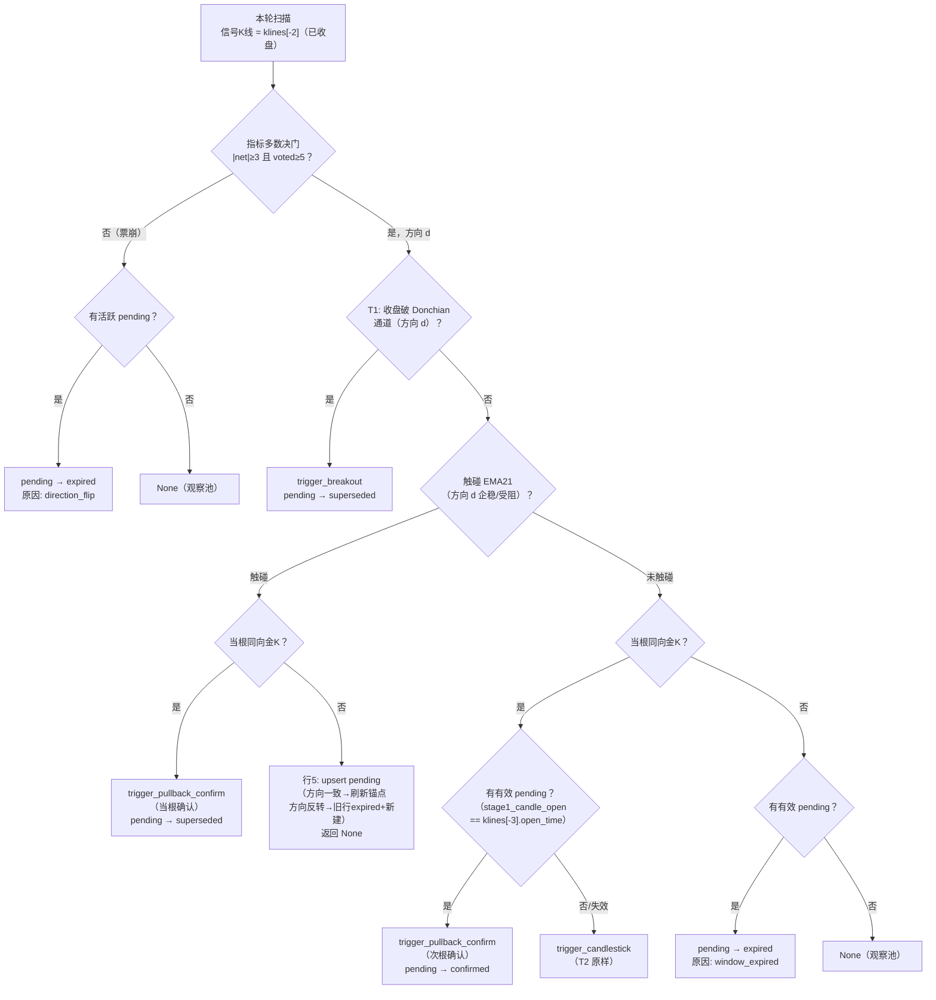

# 19 - 回踩金K两段式确认设计

> 状态：设计稿（未实装）｜ 2026-09-25
> 关联：docs/09（触发器与摆动锚定）、docs/13（BCD 过滤）、docs/flow/合约系统.md（扫描管线）

## 1. 背景与动机

现行指标驱动筛选（2026-09-17 上线）中，回踩触发器 T3 的语义是**当根即触发**：已收盘 K 线触及 EMA21 企稳（多头 `low ≤ EMA21 ≤ close`、空头 `close ≤ EMA21 ≤ high`）且指标多数决同向，立即落库并进 AI 分析。

两个问题：

1. **未确认信号消耗 AI 配额**：回踩当根只是一次"触碰"，趋势未必延续。触碰后下一根走弱的情况没有任何二次确认，AI 分析（LLM 成本）已经花出去了。
2. **无归因区分**：回踩后若下一根出现同向金 K，该单会以 `trigger_candlestick`（K线形态触发）落库，回踩上下文完全丢失——复盘时无法回答"回踩确认型开单的胜率是否更好"。

**线上数据佐证**（2026-09-25 查询，近 14 天）：

| 触发器                 | 进 AI | AI suggest 率 | 已平仓胜率 | 均笔盈亏          |
| ---------------------- | ----- | ------------- | ---------- | ----------------- |
| T2 trigger_candlestick | 395   | 74%           | 34.8%      | +6.91             |
| T3 trigger_pullback    | 238   | 65%           | 47.1%      | **+3.48**（最小） |
| T1 trigger_breakout    | 523   | 68%           | 30.4%      | -7.88             |

T3 胜率最高但均笔最小——"低吸"特征明显。若只让**经过次根金 K 确认**的回踩进入开单流程，期望用少量信号换取更高的单笔质量。

## 2. 关键事实澄清（避免重复造轮子）

**「下一根 K 线出现同向金 K」今天已经能触发**：每轮扫描对最新已收盘 K 线全量重算，T2（`trigger.py` 黄金12形态检测）在次根出现同向 GOLDEN_12 且多数决通过时，会以 `trigger_candlestick` 命中并进 AI。

因此本方案**不是**补触发路径，而是三件事：

| 增量             | 说明                                                                                               |
| ---------------- | -------------------------------------------------------------------------------------------------- |
| ① 入场时机后移   | 回踩当根不再立即进 AI（省掉未确认信号的 LLM 成本），等次根金 K 确认才分析开单                      |
| ② 信号归因独立   | 确认型信号以新类型 `trigger_pullback_confirm`（回踩金K确认）落库，可单独复盘胜率，与纯形态触发区分 |
| ③ pending 可观测 | 回踩待确认池持久化（新表），后续可做页面展示与转化率统计                                           |

## 3. 术语与现状速览

- **信号 K 线**：每轮扫描取 `klines[-2]`（最近一根**已收盘**K 线）；`klines[-1]` 为未收盘根，仅取现价。1h K 线，定时扫描每小时 ：02。
- **GOLDEN_12**：实为 6 形态清单（`candlestick.py`）——看涨 3：锤形线 / 看涨吞没 / 启明星；看跌 3：上吊线 / 看跌吞没 / 黄昏星。组合形态（启明星/黄昏星）跨 3 根 K 线判定，与"上一根刚回踩"天然兼容。
- **指标多数决门**：6 票预筛（`|net6|<2` 淘汰）→ 补 4h 第 7 票 → `|net|≥3 且 voted≥5` 才有方向。
- **观察池现状**：无触发返回 `None`，**不落库、不持久化**，下轮全量重算。
- **重复抑制**：仅定时扫描，同 `(symbol, signal_type)` 在 `REPEAT_WINDOW_HOURS=3` 内已落库则本轮不落库。
- **共用方**：`detect_indicator_candidate` 同时被定时扫描与 watchlist.refresh 调用，改动对两者生效。

## 4. 两段式状态机

### 4.1 触发判定决策矩阵（核心）

T1 突破优先级最高、最先判定（现状不变）。此后按「触碰 EMA21 × 当根金K × pending」决策：

| #   | 触碰EMA21（当根） | 当根同向金K | pending 状态 | 判定结果                                                                          |
| --- | ----------------- | ----------- | ------------ | --------------------------------------------------------------------------------- |
| 1   | —（T1 命中）      | —           | 任意         | `trigger_breakout`，pending → superseded                                          |
| 2   | ✓                 | ✓           | 任意         | `trigger_pullback_confirm`（**当根确认**：触碰+金K同根），pending → superseded    |
| 3   | ✗                 | ✓           | 有效         | `trigger_pullback_confirm`（**次根确认**：上根触碰+本根金K），pending → confirmed |
| 4   | ✗                 | ✓           | 无/失效      | `trigger_candlestick`（T2 原样不变）                                              |
| 5   | ✓                 | ✗           | 任意         | **不触发**：upsert pending（已有则刷新），返回 None（观察池）                     |
| 6   | ✗                 | ✗           | 有效         | pending → expired（次根无确认，严格窗口到期）                                     |
| 7   | ✗                 | ✗           | 无/失效      | None（观察池，现状）                                                              |

另有一条**前置过期路径**：指标多数决门未过（`|net|<3` 或 `voted<5`）时，存在有效 pending → expired（原因：方向失守）。该项在投票门早退分支处理。

**判定顺序**：T1 突破 → 行 2 当根确认 → 行 3 次根确认 → 行 4 纯金K → 行 5 触碰转 pending → 行 6/7。行 2 优先于行 3（当根既有触碰又有金K 是更强的确认）。

#### 4.1.1 单币判定流程图



#### 4.1.2 流程图与决策矩阵对照

| 矩阵行   | 流程图节点 | 终态去向                            |
| -------- | ---------- | ----------------------------------- |
| 前置过期 | B1→B2      | expired(direction_flip)             |
| 行 1     | C→C1       | 落库 + pending superseded           |
| 行 2     | D→E→E1     | 落库(当根确认) + pending superseded |
| 行 3     | D→F→G→G1   | 落库(次根确认) + pending confirmed  |
| 行 4     | D→F→G→G2   | 落库(纯金K)                         |
| 行 5     | D→E→E2     | upsert pending / 刷新 / 反转重建    |
| 行 6     | D→F→H→H1   | expired(window_expired)             |
| 行 7     | D→F→H→H2   | 观察池                              |

### 4.2 pending 生命周期

```
touch(回踩命中,当根无金K)
        │ upsert
        ▼
   ┌─────────┐   次根同向金K+多数决复验通过   ┌───────────┐
   │ pending │ ───────────────────────────▶ │ confirmed │（落 scan_results，进 AI）
   └─────────┘                               └───────────┘
        │ 次根无金K / 多数决方向失守 / T1或当根确认抢先
        ▼
   expired / superseded（终态，不落 scan_results）
```

- **每币至多一条活跃 pending**（unique symbol）。再次触碰（行 5 且已有 pending）→ 刷新 `stage1_candle_open` 等字段，重新计时。
- **重复触碰的 upsert 语义**：
  - **方向一致** → UPDATE 刷新（不 insert）：`stage1_candle_open` 换到新触碰根（等待窗口重新计时）、`ema21` / `quality_score` / `votes_json` / `updated_at` 同步覆盖。贴着 EMA21 爬的趋势币每根都触碰、每根都刷新，pending 持续存活——每次触碰都是一次新的 Stage-1，窗口始终是「下一根」。
  - **方向反转**（旧 pending 多头、本轮触碰时多数决翻空）→ 旧行置 `expired`（原因 `direction_flip`），同轮事务内建新方向 pending。不原地改写 `direction`——保留审计链，避免「多头 pending 被静默改成空头」的不可追溯跳变。
  - **双入口幂等**：手动扫描与定时扫描共用检测逻辑，同一根已收盘 K 线触发两次 upsert（:02 定时 + 用户手动）时 `stage1_candle_open` 相同 → UPDATE 命中同一行、字段值不变，无副作用。
- **严格窗口**：pending 仅在"恰好下一根 K 线"的扫描轮有效。判定用 K 线开盘时间精确比对（`stage1_candle_open == 本轮 klines[-3] 的 open_time`），免疫扫描时刻漂移与轮次缺失——错过即过期，不跨轮等待。
- **多数决复验**：次根确认仍要求投票门同阈值通过且方向与 pending 一致。回踩上下文是 Stage-1 证据，但方向共识消失时不入场（保守口径）。

### 4.3 行为变化声明（相对现状）

- `trigger_pullback`（当根直接触发）**不再产生新记录**——回踩命中一律先入 pending。旧数据保留，历史行不受影响。
- 确认型入场价 = 次根金 K 确认后的现价，可能已离开 EMA21：按普通单走开仓闸门现价偏离容差（1%），超容差被拒单属预期（质量换数量）。
- 回踩路径 AI 分析量将下降（14 天 238 次 → 只剩确认子集），LLM 成本同步下降。

## 5. 存储方案

### 5.1 新表 `pullback_pendings`（推荐）

模型放 `app/models/scan.py`（扫描域），`create_all` 自动建表（新表无需 `database.py` ALTER 迁移；新增列才需要）：

| 字段                                  | 类型                | 说明                                                     |
| ------------------------------------- | ------------------- | -------------------------------------------------------- |
| id                                    | UUID PK             |                                                          |
| symbol                                | String(30) unique   | 每币一条（活跃 pending 语义），确认/过期后被下次触碰覆盖 |
| direction                             | SmallInteger        | 1 多 / -1 空（Stage-1 多数决方向）                       |
| stage1_candle_open                    | DateTime            | Stage-1 信号 K 线开盘时间（有效期判定锚点）              |
| ema21                                 | Float               | 触碰时 EMA21 值（展示/复盘用）                           |
| quality_score                         | Integer             | Stage-1 质量分快照                                       |
| votes_json                            | JSON                | Stage-1 投票快照（含 4h 背景）                           |
| status                                | String(20)          | pending / confirmed / expired / superseded               |
| confirm_pattern                       | String(30) nullable | 确认形态（confirmed 时回填）                             |
| confirmed_scan_result_id              | UUID nullable       | 确认后落库的 scan_results.id（可回溯）                   |
| created_at / updated_at / resolved_at | DateTime            |                                                          |

**理由**：a) 页面可见性（后续可加"回踩观察池"面板，符合本项目每个状态都有处可看的惯例）；b) 与 scan_results 同库，confirmed 行可直接外键回溯；c) pending 生命周期仅 1 小时，量极小（活跃数 ≪ 50），无性能顾虑。

### 5.2 备选 Redis + TTL（不推荐）

免迁移、自动过期，但无页面可见性、Redis 重启丢失、confirmed 回溯要跨存储拼装。不取。

## 6. 开关（不设）

不做配置开关，两段式直接作为 T3 的唯一语义上线。理由：

- 回退路径已天然存在：出问题时把 `PULLBACK_CONFIRM_ENABLED` 之类开关关掉的需求，本质是回到「当根直触发」——但那段代码会被本次重构删除，留着等于维护两套触发逻辑
- 真需要紧急回退时，走 git revert 单提交即可（本方案改动集中、无数据迁移）
- pending 表为纯增量，旧数据不受影响；回退后 pending 行成为死数据，无副作用

## 7. 注册点清单（实装阶段照此改）

| 位置                                    | 改动                                                                                                                                                                                     |
| --------------------------------------- | ---------------------------------------------------------------------------------------------------------------------------------------------------------------------------------------- |
| `app/services/strategy/trigger.py`      | 重构 `detect_trigger` 为 §4.1 决策矩阵：触碰与金K并行计算（现状 T3 在最后、早退，需前移）；新增 `trigger_pullback_confirm` 常量；pending 作为可选参数传入                                |
| `app/services/scanner.py`               | `detect_indicator_candidate` / `Scanner.run`：批量预取活跃 pending（每轮一次查询，勿逐币查）；行 5 upsert pending、行 3 构造确认候选、行 1/2/6 终态回写；投票门早退分支补 pending 过期   |
| `app/models/scan.py`                    | 新增 `PullbackPending` 模型                                                                                                                                                              |
| `app/services/ai_analyzer.py`           | `SIGNAL_TYPE_LABELS` 增加 `"trigger_pullback_confirm": "指标同向·回踩EMA21后金K确认"`（P0 提示词 L210 与展示共用）                                                                       |
| `frontend/src/constants/labels.ts`      | `SIGNAL_TYPE_MAP` 增加（建议 label「回踩金K确认」、color `geekblue`，与回踩 cyan 区分）；`SIGNAL_TYPE_FILTERS` 自动带上；ResultTable / WatchlistPanel / ReviewStatsPanel 经 map 自动生效 |
| `compute_quality_score`（technical.py） | 无需改动：突破专属修饰项按 trigger_type 判等跳过，确认型自然复用回踩的计分路径                                                                                                           |
| `docs/flow/合约系统.md`                 | 扫描管线章节补两段式说明                                                                                                                                                                 |
| 技能库 use_when                         | 无需改动（structure-break 等引用的是信号语义而非 signal_type 枚举）                                                                                                                      |

预估改动 7 个代码文件 + 1 个流程文档，新增 1 表，无既有表结构变更。

## 8. 场景推演（用户原始场景回放）

多头候选 XYZUSDT，第 X 根已收盘 K 线回踩 EMA21 企稳、当根无金K、多数决 net=+4：

| 轮次           | K 线                                       | 判定           | 结果                                                                                     |
| -------------- | ------------------------------------------ | -------------- | ---------------------------------------------------------------------------------------- |
| 轮 N           | X：touch ✓、金K ✗                          | 行 5           | pending 建立（不落库、不进 AI），前端本轮看不到该币                                      |
| 轮 N+1         | X+1：阳线+锤形线（同向金K）、多数决 net=+3 | 行 3           | **次根确认**：以 `trigger_pullback_confirm` 落库 → 质量分排序 → AI 分析 → suggest 则开单 |
| 轮 N+1（替代） | X+1：普通阳线                              | 行 6           | pending → expired，回到观察池                                                            |
| 轮 N+1（替代） | X+1：阴线砸穿，多数决 net=-3               | 投票门前置过期 | pending → expired（方向失守）                                                            |
| 轮 N+1（替代） | X+1：又触碰 EMA21、仍无金K                 | 行 5           | pending 刷新（stage1 锚点改到 X+1），重新等下一根                                        |
| 轮 N+1（替代） | X+1：收盘破 Donchian 上轨                  | 行 1           | `trigger_breakout` 照常触发，pending → superseded                                        |

## 9. 风险与边界条件汇总

| 风险/边界                                         | 处理                                                                                                             |
| ------------------------------------------------- | ---------------------------------------------------------------------------------------------------------------- |
| 确认后价格已离开 EMA21，开仓闸门现价偏离 >1% 拒单 | 预期行为（质量换数量）；拒单率作为灰度观察指标                                                                   |
| 信号量下降（回踩路径不再当根进 AI）               | 可接受；设计预期（质量换数量），灰度数据不达标再议放宽等待窗口                                                   |
| 扫描轮次缺失（服务重启等）导致错过确认窗口        | K 线开盘时间精确比对，错过即过期，不补触发                                                                       |
| 手动扫描                                          | 同一决策矩阵（同根K线同结果）；upsert 幂等（同 stage1_candle_open 重复刷新无副作用）；手动不受重复抑制的现状不变 |
| 满仓跳过 AI 分析（`_slots_full`）                 | pending 照常建立与确认（落库不受影响），仅 AI 分析按现状跳过                                                     |
| 重复抑制交互                                      | 新类型独立，不与 `trigger_pullback` 撞 `(symbol, signal_type)`；pending 本身不落 scan_results，无抑制问题        |
| watchlist.refresh 共用检测逻辑                    | pending 读写同样生效且幂等；实现时批量预取避免 N+1 查询                                                          |
| confirmed 后 AI skip                              | 正常流程（skip 也落 ai_analyses）；pending 已 confirmed，不回滚重试                                              |

## 10. 验证方案（实装阶段）

1. **单测**：决策矩阵 7 行全覆盖 + pending 四终态（confirmed/expired/superseded/刷新）+ 有效期开盘时间比对边界（恰差一根）+ 重复触碰 upsert 三分支（同向刷新 / 反向 expired+新建 / 同根双入口幂等）。
2. **历史回放**：取近期 7 天 1h K 线，回放对比新旧触发差异——预期两段式下回踩路径 AI 分析次数显著减少、新增 confirm 类型命中。
3. **灰度上线**：先在测试网环境跑 2~3 天，观察三项指标：
   - pending → confirmed 转化率（过低说明金K确认太苛刻）
   - confirm 信号 AI suggest 率（对照回踩旧值 65%）
   - confirm 开单的胜率/均笔（对照回踩旧值 47.1% / +3.48，以及形态触发 34.8% / +6.91）
     达标后切正式网；不达标按数据决定放宽（如允许 2 根等待窗口，见 §11）或 git revert 回退。

## 11. 可选扩展（本期不做）

- **等待窗口 N 根**（`PULLBACK_CONFIRM_MAX_WAIT_CANDLES`，默认 1）：确认时限放宽到 N 根内出现金K，信号量与质量的折中，等灰度数据再定。
- **回踩观察池前端面板**：展示活跃 pending（触碰价/方向/等待中），挂扫描面板旁。
- **确认型质量分加权**：若灰度证实 confirm 信号更优，给 `trigger_pullback_confirm` 加质量分修饰项提高 AI 配额优先级。
