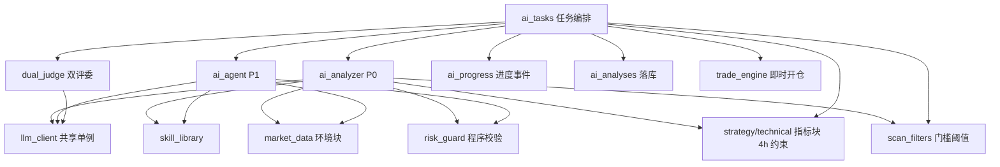
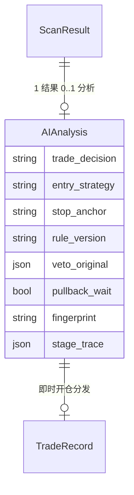
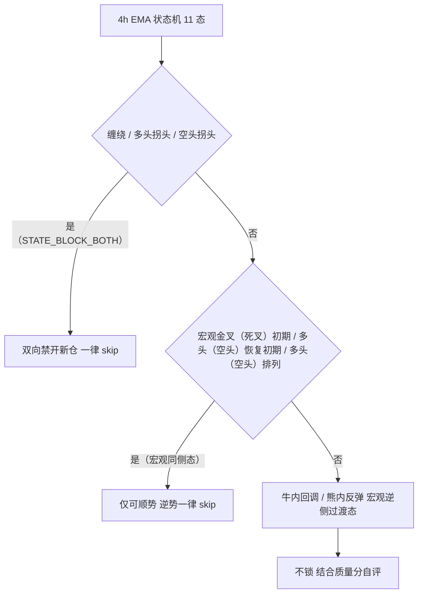
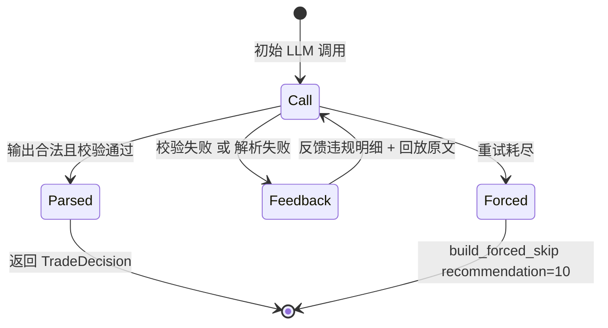
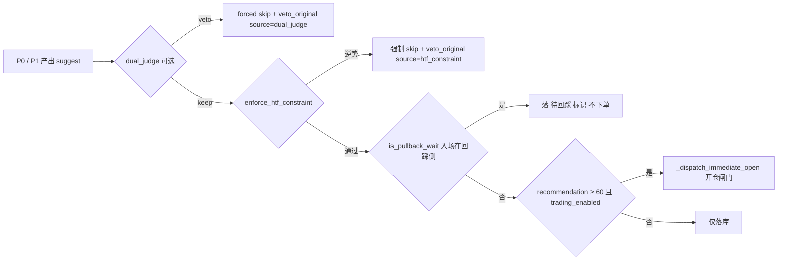

# 技术文档 03 — AI分析（对照 功能流程/03-AI分析.md）

> 现行版本：RULE_VERSION v2026-10-18（2026-10-18）。本文从功能文档 03 提炼**技术实现细节**，以代码为准；功能口径与拍板记录见 [功能文档](../功能流程/03-AI分析.md)。

## 1. 模块与分层

AI 分析位于扫描命中之后、开仓之前，核心是「任务编排 → 双管线 LLM 调用 → 程序校验 → 增强复核 → 落库 → 即时开仓分发」。

| 模块 | 文件 | 职责 |
|---|---|---|
| 任务编排 | `backend/app/tasks/ai_tasks.py` | `run_ai_analysis_task` / `run_ai_analysis_single`：Celery group 并行、闸门/配额/指纹缓存、管线选择、落库、`_dispatch_immediate_open` |
| P0 单次调用管线 | `backend/app/services/ai_analyzer.py` | `SYSTEM_PROMPT` / `render_system_prompt`、`_build_messages`、`render_signal_gate_block`、`analyze_with_guard` 校验回炉 |
| P1 Agent 工具循环 | `backend/app/services/ai_agent.py` | `analyze_coin_agent`（`MAX_ROUNDS`）、`_build_user_msg`、`_resolve_price` / `_resolve_from_swings` / `_nth_swing`、`_dispatch_tool`、`submit_decision` 校验即工具 |
| 程序校验器 | `backend/app/services/risk_guard.py` | `TradeDecision` Pydantic、`parse_and_validate`、`validate_decision`、`build_forced_skip`、`is_pullback_wait` |
| 双评委辩论 | `backend/app/services/dual_judge.py` | `run_dual_judge`：多空评委并行 + 裁判，仅 keep / veto |
| 技能库 | `backend/app/services/skill_library.py` | `build_facts`、`render_matched`、`render_index`、SKILL.md 加载 |
| LLM 客户端 | `backend/app/services/llm_client.py` | `get_client`（共享单例）、`stream_completion`、`parse_llm_json` |
| 市场环境数据 | `backend/app/services/market_data.py` | `build_market_context`（资金费率 / BTC 状态 / 恐贪工具源） |
| 进度事件 | `backend/app/services/ai_progress.py` | Redis list 事件流，前端轮询展示分析过程 |
| 指标块 / 4h 约束 | `backend/app/services/strategy/technical.py` | `render_indicator_block`、`enforce_htf_constraint` |
| 筛选参数组 | `backend/app/services/scan_filters.py` | 门槛阈值生效值（注入 AI 门槛块） |

模块依赖与调用关系：



## 2. 数据结构

### 2.1 P0 输出契约 `risk_guard.TradeDecision`（Pydantic）

| 字段 | 类型 / 取值 | 说明 |
|---|---|---|
| `trade_decision` | `suggest` / `skip` | 必填 |
| `skip_reason` | 文本 | skip 必填，`1. 2. 3.` 序号最多 3 条 |
| `direction` | `long` / `short` | skip 时空 |
| `trade_type` | `trend_follow` / `structure_break`（`TRADE_TYPES`） | 123 / N字 已并入 structure_break；**2026-10-20 下线 range_edge（移入 `LEGACY_TRADE_TYPE_LABELS` 仅历史展示）**，白名单收敛为二选一 |
| `stop_anchor` | `structure` / `near` | 全信号类型可输出 near；省略 / null 按 structure 理解 |
| `tactic_name` / `tactic_reason` | 文本 | 战法命中标注，name 逐字取自注入清单，reason ≤60 字，未命中空串 |
| `entry_price` / `stop_loss` / `take_profit_1` / `take_profit_2` | float | 三价 + 可选第二止盈，skip 时 0；s2 时 TP2 强制清零 |
| `tp_mode` | `ladder` / `trail` | 由 `entry_strategy` 程序推导，AI 不再自选，程序无条件覆盖 |
| `entry_strategy` | `s1` / `s2` | 双入场策略胜出方，默认 s1，非法值归 None 按 s1 落库 |
| `strategy2_decision` | `suggest` / `skip` | 策略二结论审计字段 |
| `strategy2_reason` | 文本 ≤60 字 | 策略二判定依据 |
| `risk_reward_ratio` | float | AI 声称值，落库前被程序复算值覆盖 |
| `position_pct` | float / None | fixed 模式置 None |
| `recommendation` | 0-100 | skip ≤30，suggest ≥50 |
| `analysis` | 文本 ≤500 字 | 节标题逐字固定：`公共检查：` → `决策结论：` |

P1 经 `submit_decision` 工具提交锚点（`entry_ref` / `stop_ref` / `tp1_ref` / `tp2_ref` + `offset_pct`，另有 `tp_mode` enum、`entry_strategy`、`strategy2_decision`、`strategy2_reason`），程序 `_resolve_price` 换算绝对价后构造同一 `TradeDecision`——两管线落库结构一致。

### 2.2 `ai_analyses` 落库列（`_upsert_ai_analysis`，latest-wins）

决策字段（含 `entry_strategy` / `strategy2_decision` / `strategy2_reason`）+ `rule_version`（RULE_VERSION 快照，复盘按版本分组）+ `veto_original`（被否决建议三价快照）+ `pullback_wait` + `fingerprint` + `stage_trace`（P1 轮次 / 工具 / 耗时）+ `htf_phase`（4h 状态）+ `volume_ratio`。

### 2.3 进度事件 JSON（`ai:progress:{scan_result_id}`，Redis list，TTL 1h）

事件类型 `start`（symbol + pipeline）、`gate`、`round`（P1 轮次）、`tool`（P1 工具调用）、`llm`（P0 流式计数，≥2s 一条）、`done`（decision + note）、`error`。典型形态：

```json
{"t":"start","symbol":"XXXUSDT","pipeline":"agent"}
{"t":"round","round":0,"tools":[],"note":"单次调用管线思考中…"}
{"t":"llm","attempt":0,"reasoning_chars":18432,"content_chars":912,"elapsed_s":46.3}
{"t":"done","decision":"suggest","note":"1. EMA多头排列…（截断80字）"}
```

### 2.4 `llm_client.StreamResult`

字段：`content`（仅拼 `delta.content`，`reasoning_content` 增量不进正文）+ `finish_reason` + `first_token_s`（首正文增量耗时，-1=全程无正文）+ `total_s` + `tool_calls`（流式 tool_call 增量按 `delta.tool_calls[].index` 聚合的 OpenAI 消息形状；不传 tools 的调用方恒空）。



## 3. 核心流程

### 3.1 批量分析主链路

```mermaid
sequenceDiagram
    autonumber
    participant Task as ai_tasks.run_ai_analysis_task
    participant Single as run_ai_analysis_single
    participant Sem as Redis LLM 信号量
    participant AA as ai_analyzer P0 / ai_agent P1
    participant MD as market_data + technical
    participant LLM as llm_client
    participant RG as risk_guard
    participant DJ as dual_judge
    participant DB as PostgreSQL

    Task->>Single: Celery group 按币种并行
    Single->>Single: 开关闸门 ai_analysis_enabled / AI_API_KEY
    Single->>Single: 配额裁剪 quality_score 降序 前 ai_max_per_scan
    Single->>Sem: 获取并发额度 上限 LLM_CONCURRENCY 超时 900s 放行
    Single->>Single: 指纹缓存 compute_fingerprint 命中且结论仍有效则 _copy 沿用
    Single->>MD: 500根K线 现价更新 recent_swings 4h背景 resolve_risk_budget
    alt 批量 或 非 force
        Single->>AA: analyze_with_guard P0
    else 手动单币 force 且 ai_pipeline_enabled
        Single->>AA: analyze_coin_agent P1 工具循环
    end
    AA->>LLM: stream_completion 系统提示词 + 上下文
    LLM-->>AA: StreamResult content tool_calls
    AA->>RG: parse_and_validate 校验 违规则反馈回炉 ≤3轮
    RG-->>AA: TradeDecision 或 build_forced_skip
    opt dual_judge_enabled 且 suggest
        Single->>DJ: 多空辩论 + 裁判
        DJ-->>Single: keep / veto
    end
    Single->>Single: enforce_htf_constraint 4h 硬约束兜底
    Single->>Single: is_pullback_wait 标记
    Single->>DB: _upsert_ai_analysis latest-wins 快照 rule_version
    Single->>Single: push_done
    opt suggest 且 recommendation ≥ 60 且 trading_enabled
        Single->>DB: _dispatch_immediate_open 分发开仓
    end
```



### 3.2 4h 方向约束分类（`_RULE_HTF_HARD` + `enforce_htf_constraint`）

4h EMA 状态机 11 态（`tangle` / `turn_*` / `macro_cross_*` / `*_recover` / `aligned_*` / `bull_dip` / `bear_rally`）按约束强度分三类：



程序兜底 `enforce_htf_constraint`：强多背景下开空 / 强空背景下开多 → 强制 skip，写 `veto_original`（source=htf_constraint）。

### 3.3 P0 校验回炉状态（`analyze_with_guard`：1 次初始 + 2 次重试，共 3 轮）



### 3.4 suggest 之后的程序级裁决



## 4. 关键算法与常量

### 4.1 指纹缓存（`compute_fingerprint`）

= `symbol` + `signal_type` + `position` + `pattern` + `touch_ref` + 价格 0.5% 对数分桶；`FINGERPRINT_TTL_MIN`（60min）内同指纹沿用旧结论（`_copy` 复制落库）。**价格区失效不沿用**：现价越过旧结论止盈一 / 止损（`_conclusion_still_valid`）时重新分析；手动重分析（force）不短路。

### 4.2 `parse_and_validate` 校验链（risk_guard.py:524）

`parse_and_validate` = `normalize_raw`（字符串数字转 float、direction 空串→None、非法 stop_anchor→None）→ Pydantic 校验 → `validate_decision`：

1. **skip 基本项**：skip_reason 非空；recommendation 超 30 仅修正不打回。
2. **suggest 基本项**：direction / trade_type / 三价为正，缺一打回。
3. **方向-价格一致性**：多单 SL<entry<TP1、空单 TP1<entry<SL（交易所可挂性铁律）。
4. **近锚一致性**：`stop_anchor=near` 时止损须贴金K窗口极值锚（最近 5 根已收盘 K 线共同极值，`klines[-6:-1]`）外 `NEAR_ANCHOR_BUFFER`(0.3%)，容差 ±`NEAR_ANCHOR_TOLERANCE`(0.5%)；数据异常放行仅记 warning。
5. **盈亏比铁律**：RR = |TP1−入场| ÷ |入场−SL| ≥ `AI_RR_MIN`(1.5)；**豁免仅策略二**（s2 无条件豁免）。策略二另有三道程序闸——资格闸（touch_ref=ema21）、优先级闸（s2 复算 RR ≥1.5 达标改标 s1，tp_mode 翻 ladder）、一致性闸（suggest 须触点 ema21；s2 须 strategy2_decision=suggest）。
6. **战法白名单闸门**（非打回型）：`tactic_name` 不在本次注入清单 → 清空不落库；无白名单一律清空。
7. **止盈二贴档保护**（非打回型·静默撤档）：TP2>0 时若与 TP1 间距 `d ≤ gap_min` 直接 `take_profit_2=0`；方向距离 d =（多）TP2−TP1 /（空）TP1−TP2；`gap_min = max(TP2_MIN_GAP_ATR×ATR14, TP2_MIN_GAP_R×止损距离, 2×TAKER_FEE_RATE×入场价)`；两配置均 0 时整条保护失效。

### 4.3 仓位复算（固定亏损法）

仓位% = 风险预算 ÷ 止损距离%。pct 模式（默认）预算 = `RISK_BUDGET_PCT`(3%)；fixed 模式 position_pct 置 None。落库值：三价 round 8 位、RR 复算值、recommendation clamp 50~100、stop_anchor 归一。

### 4.4 阈值 / 常量表

| 常量 | 值 | 说明 |
|---|---|---|
| `AI_RR_MIN` | 1.5 | 盈亏比复算下限（铁律，注入提示词 `{rr_min}` 槽位） |
| `TRADING_MIN_RECOMMENDATION` | 60.0 | 即时开仓分发评分门槛 |
| `RISK_BUDGET_PCT` | 3.0 | 单笔止损预算 % |
| `FINGERPRINT_TTL_MIN` | 60 | 指纹缓存复用窗口（0=关闭） |
| `AI_MAX_PER_SCAN` | 10 | 单次扫描批量分析上限（scan_filters 可覆盖） |
| `LLM_CONCURRENCY` | 4 | LLM 全局并发上限（Redis zset 信号量） |
| `NEAR_ANCHOR_BUFFER` / `NEAR_ANCHOR_TOLERANCE` | 0.3% / ±0.5% | 近锚一致性校验 |
| `NEAR_ANCHOR_RISK_FACTOR` | 0.7 | 近锚单风险预算折价 |
| `BTC_CRASH_PAUSE_PCT` | 1.0 | BTC 1h 近 3 根急跌警示阈值 |
| `AI_CALL_TIMEOUT_S` | 300 | 单次 LLM 调用超时 |
| `MAX_ROUNDS`（ai_agent） | 5 | P1 工具循环轮次上限 |
| `_CONTEXT_BUDGET_CHARS`（ai_agent） | 120000 | P1 上下文正文预算，超限压摘要 |
| max_tokens（双评委 / 主调用） | 32000 | GLM 思考型 reasoning 配额对齐 |
| `TP1_MAX_ATR` | 2.0 | 止损分档线 `TP1_MAX_ATR÷rr_min`≈1.33×ATR |
| 校验回炉轮次 | 1 + 2 | `analyze_with_guard` 共 3 轮 |

### 4.5 `_build_messages` 用户消息 12 块

币种 / 信号类型 / 价格 / 突破幅度 / 形态 / 理由 → 回踩触点行 → 程序入场门槛块 → 形态出现位置 → 量能 → 均线形态 → 技术指标块 → 【市场环境】块 → 近期摆动结构 → 【战法库判定】块 → K 线 CSV（最近 40 根已收盘 `klines[-41:-1]`）→ 用户补充说明。指标块逐行 = MACD(12,26,9) / 布林带(20,2) / RSI(14) / SuperTrend(10,3) / ADX(14) / OBV(20) + 4h 背景(EMA21/55) + ATR(14) 分位 + 末尾「方向票」多数决行。

## 5. API 契约

`backend/app/api/scan.py`：

| 端点 | 说明 |
|---|---|
| `POST /scans/{scan_id}/ai-analyses` | 触发 AI 分析（全量批量或单币重分析，body.scan_result_id 非空=单币） |
| `GET /scans/{scan_id}/ai-analyses` | 列出该扫描的所有 AI 结果 |
| `GET /scans/ai-trace/{analysis_id}` | Agent 工具循环 trace（P0 为 null） |
| `GET /scans/ai-progress/{scan_result_id}` | 进度事件流（status: done/running/idle/error） |
| `GET /scans/skills`、`GET /scans/skills/{name}` | 技能库索引 / 详情 |
| `POST /scans/analyze` | 手动分析任意币种（signal_type=manual_search，同步 `analyze_coin`） |

## 6. 配置项

### 6.1 环境变量（`backend/app/config.py`）

| env | 默认 | 说明 |
|---|---|---|
| `AI_ENABLED` | false | 总开关占位（运行时以 system_config 为准） |
| `AI_API_KEY` | "" | LLM API Key（未配置=AI 全链路不可用） |
| `AI_BASE_URL` | https://api.openai.com/v1 | OpenAI 兼容网关地址 |
| `AI_MODEL` | gpt-4o-mini | 模型名（生产用 GLM 思考型） |
| `AI_CALL_TIMEOUT_S` | 300 | 单次 LLM 调用超时 |
| `LLM_CONCURRENCY` | 4 | LLM 全局并发上限 |
| `LLM_JSON_MODE` | false | response_format=json_object 开关 |
| `AI_RR_MIN` | 1.5 | 盈亏比复算下限 |
| `RISK_BUDGET_PCT` | 3.0 | 单笔止损预算 % |
| `FINGERPRINT_TTL_MIN` | 60 | 指纹缓存复用窗口（分钟） |
| `AI_MAX_PER_SCAN` | 10 | 单次扫描批量分析上限 |
| `MIN_VOLUME_24H` | 3000000 | 候选池 24h 成交额下限 |
| `MARKET_CONTEXT_ENABLED` | true | 【市场环境】块注入总开关 |
| `BTC_CRASH_PAUSE_PCT` | 1.0 | BTC 1h 近 3 根急跌阈值 %（仅 AI 警示行） |
| `TRADING_MIN_RECOMMENDATION` | 60.0 | 即时开仓分发评分门槛 |
| `NEAR_ANCHOR_RISK_FACTOR` | 0.7 | 近锚单风险预算折价 |

### 6.2 `system_config` 表（页面可改，运行时权威）

| 字段 | 默认 | 说明 |
|---|---|---|
| `ai_analysis_enabled` | false | 筛选后自动 AI 分析开关（只拦批量；手动单币不受限；与 trading_enabled 解耦） |
| `ai_pipeline_enabled` | false | P1 Agent 管线开关（仅手动单币重分析生效） |
| `dual_judge_enabled` | true | 双评委辩论复核开关 |
| `strategy_prompt_enabled` / `strategy_prompt` | false / "" | 用户自定义策略（优先级最高：用户策略 > 技能规则 > 默认纪律） |
| `kline_interval` | 1h | K 线周期（取数与 CSV 表头口径） |
| `max_stop_pct` | NULL | 止损宽度硬上限（NULL=不限制不注入） |
| `swing_order` | 3 | 摆动点阶数（触发层 / 事实包 / 锚点解析共用） |
| scan_filters 组 | — | breakout_threshold / breakout_max_pct / breakout_vol_ratio / breakout_channel_bars / structure_touch_band_pct / ai_max_per_scan（门槛块与扫描闸门同源） |

## 7. 并发、幂等与异常处理

- **并发**：Celery group 按币种并行子任务；LLM 侧 Redis zset 信号量（全局上限 `LLM_CONCURRENCY`，等待超时 900s 降级放行）；双评委 `ThreadPoolExecutor` 并行调用多空评委；P1 轮内多工具 `ThreadPoolExecutor` 并行、结果按 tool_call 顺序回填（单条截断 12000 字符）。
- **幂等**：指纹缓存同指纹沿用旧结论（`_copy`）；`_upsert_ai_analysis` latest-wins；P1 `submit_decision` **单 submit 语义**（一轮仅接受首个成功提交）；子任务重试幂等；父任务分发失败自动重试 countdown=30。
- **降级**：市场环境任一数据源失败静默不注入；4h K 线拉取失败降级无 4h 背景；双评委任何异常降级 keep（裁判解析失败先反馈回炉 ≤2 次，3 次不可解析才降级）；进度 push 异常静默失败。
- **失败兜底**：校验回炉重试耗尽 → `build_forced_skip`（recommendation=10，skip_reason 附违规明细前 3 条、截断 500 字符）；网关超时（"timed out"/"timeout"）90s 后自动重试（max_retries=2，推 gate 事件），额度用尽推 error；其他异常推 error + rollback。
- **上下文预算**（P1）：messages 正文总字符超 `_CONTEXT_BUDGET_CHARS`(120000) 时，把较早 tool 结果压成头尾各 600 字摘要，保留最近 4 条原文。
- **工具级护栏**（P1）：args JSON 非法 → 明确错误文本回喂；`_dispatch_tool` 异常 catch 转工具结果文本，不再穿出整个循环。

## 8. 测试覆盖（`backend/tests/`）

| 测试文件 | 覆盖点 |
|---|---|
| `test_llm_stream.py` | stream_completion 拼接 / finish / reasoning 隔离 / 空内容、on_progress 首发即触发 + 节流、剥 markdown、llm 事件推送 |
| `test_ai_guard_retry_feedback.py` | JSON 模式挂接、解析失败 / 空内容反馈构造、重试耗尽强制 skip、双评委仅裁判挂 JSON 模式 |
| `test_dual_judge_facts.py` | 事实包增厚向后兼容 / 字段注入、增厚事实到达评委提示词 |
| `test_ai_agent_anchors.py` | LEVEL_REFS 无 key_ 前缀、结构 / 线外 / market 锚解析、offset 应用、signal_low/high 解析到金K窗口共同极值 |
| `test_ai_agent_loop.py` | P1 循环控制流（流式桩件回放 tool_calls）：增量聚合、首轮 submit 收敛 + round/tool 事件、违规回喂、耗尽 forced skip + nudge、工具异常护栏、单 submit 首到生效、上下文预算裁剪 |
| `test_parse_llm_json.py` | 合法透传、未转义引号 / 尾逗号 / markdown 修复、不可修复抛原始异常 |
| `test_signal_gate_block.py` | 门槛块动态阈值、突破 / 趋势突破 / 回踩分支、近锚链注入、stop_cap 注入、触点行注入 |
| `test_market_context.py` | 资金费率 / BTC 行 / 急跌警示、分段降级 / 全失败返回 None、messages 注入与开关关闭不注入 |
| `test_near_stop_anchor.py` | 近锚容差通过 / 偏离打回、空头对称、数据缺失放行、回踩类 near 贴极值落 near / 远离打回、Agent stop_ref 推导、近锚预算折价 |
| `test_tactics_api.py` | 战法 CRUD（trade_count 聚合）、重名 / 枚举 / 超长校验、启停、被引用 409 拒删 |
| `test_ai_tactic_gate.py` | 战法装载 scope 过滤、渲染块与白名单、normalize 截断、白名单闸门、_build_messages 注入位置、Agent schema 契约 |
| `test_risk_budget.py` | pct/fixed 解析回落、fixed 模式 position_pct=None、RR 铁律仍强制、P0/P1 提示词 risk_label 注入 |
| `test_touch_refs.py` | 触点体系命中 / 优先级 / 窗口 / 数据门、两段式确认与 pending 池 |
