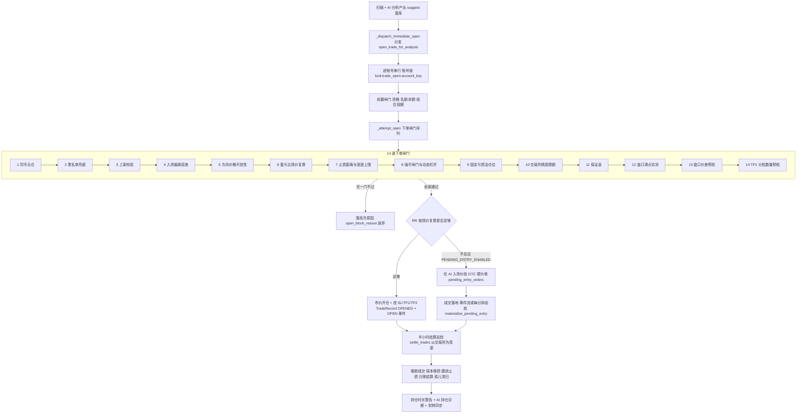
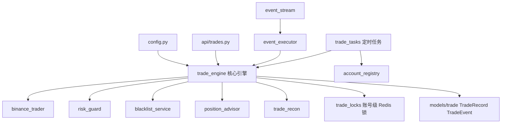
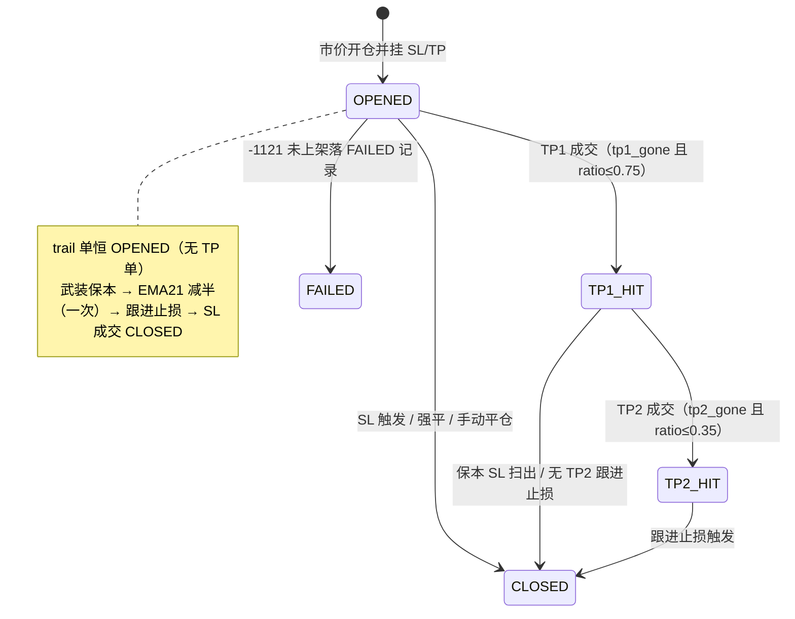
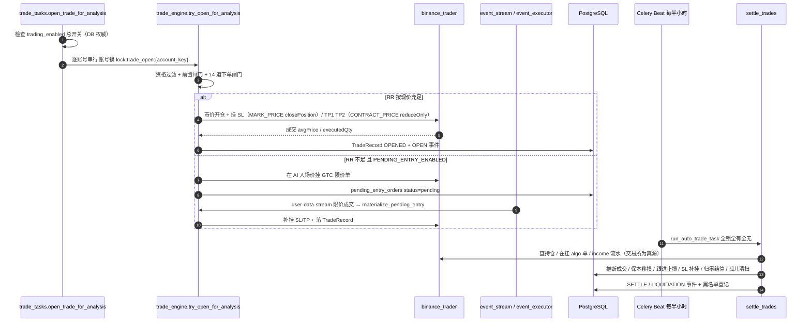
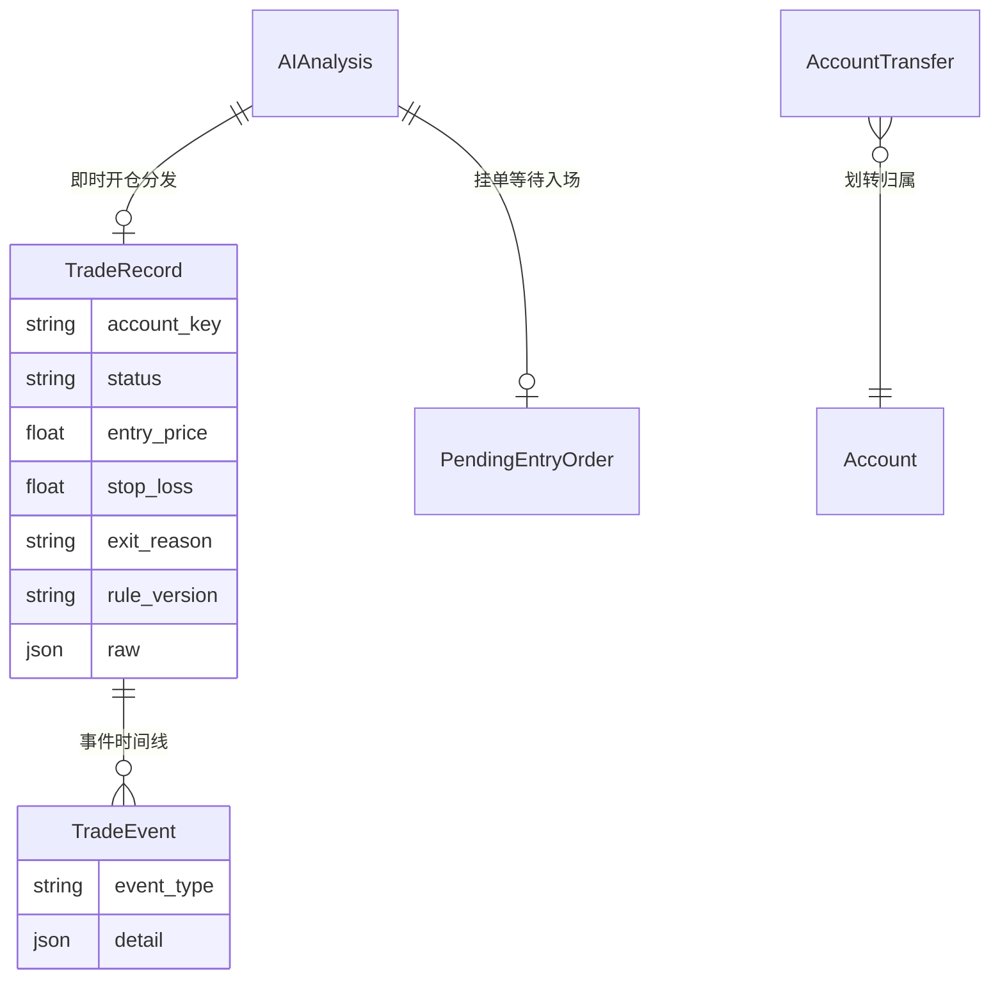

# 04-交易执行与多账号

> 现行版本：RULE_VERSION v2026-10-18（2026-10-18）。本文对照代码整理，以代码为准；历史拍板记录见 docs/archive/。
>
> 本文为原 `功能流程/04-交易执行与多账号.md` 与 `技术实现/04-交易执行与多账号.md` 于 2026-10-21 合并而成：功能口径与拍板以业务规则为准，实现细节以代码为准。

## 功能流程图

> 本图概括本文所述功能的整体流程（Mermaid 渲染）。



## 1. 概览

### 1.1 执行链路

```
定时扫描（每小时 :02，celery beat）
  → 指标筛选/黑名单/重复抑制（信号层，一次）
  → AI 分析（一次，产出 suggest 结论）
  → 分析落库即分发 celery 任务 open_trade_for_analysis（即时开仓，2026-09-14 起唯一通道）
      → try_open_for_analysis：资格过滤 + 风控闸门（按账号逐一）
      → _attempt_open：闸门序列 → 固定亏损法定仓位 → 市价开仓
      → 挂 SL（STOP_MARKET closePosition）+ TP1/TP2（TAKE_PROFIT_MARKET reduceOnly）
      → TradeRecord 落库（status=OPENED）+ OPEN 事件
  → 结算巡检 run_auto_trade_task（每半小时 :00/:30）
      → settle_trades：以交易所为真源推断 TP1/TP2/SL 成交、保本移损、跟进止损、
        SL 丢失补挂、仓位归零结算、孤儿条件单清扫
      → 自动导入手动持仓（正式网）→ 持仓时长警告 → 锁外派发 AI 持仓诊断
      → 逐账号同步资金划转
```

执行链路为「即时开仓（分析落库即分发，唯一通道）→ 下单闸门序列 → 挂 SL/TP → 半小时结算巡检」，全链路以交易所为真源、多账号按 `account_key` 隔离。

### 1.2 模块与分层

| 模块 | 文件 | 职责 |
|---|---|---|
| 核心引擎 | `backend/app/services/trade_engine.py` | 开仓闸门与下单序列、止损/止盈挂单管理、跟进止损、结算巡检、持仓导入、当日亏损熔断、划转同步、测试网清空；`try_open_for_analysis` / `_attempt_open` / `settle_trades` / `_trailing_stop` / `_move_sl_breakeven` / `_ema21_half_cut` / `_rehang_lost_sl`、`adopt_position` / `auto_adopt_positions`、`_daily_closed_pnl` / `_daily_loss_cap`、`sync_account_transfers`、`materialize_pending_entry` |
| 币安封装 | `backend/app/services/binance_trader.py` | 多账号构造、交易规则/精度、杠杆分档（MMR）、市价 / algo 条件单、income 流水、`market_slippage_estimate`、`fill_tranche_pnls` |
| 账号注册表 | `backend/app/services/account_registry.py` | .env 配置驱动、账号解析回落链、`enabled_accounts` 扇出依据、`spot_enabled_accounts` |
| 逐笔对账 | `backend/app/services/trade_recon.py` | `reconcile_trade` 计划 vs 实际，R 泄漏五项分解 |
| 持仓建议 | `backend/app/services/position_advisor.py` | `advice_due` 触发判定、`build_facts`、`diagnose_trade`、飞书推送 |
| 风控 | `backend/app/services/risk_guard.py` | 强平闸门公式、滑点/价差等风控常量 |
| 黑名单 | `backend/app/services/blacklist_service.py` | 开仓前兜底核对 + 结算后自动登记 |
| 定时任务 | `backend/app/tasks/trade_tasks.py` | 结算巡检、即时开仓扇出、AI 诊断子任务、账号锁、手动平仓、挂单入场兜底巡检 `watch_pending_entries` |
| 事件驱动 | `backend/app/services/event_stream.py` / `event_executor.py` | 每配置账号 user-data-stream（listenKey WS）+ 每 WS 域 mark price 市场流，捕获限价成交/撤单事件；`materialize_pending_entry` 秒级落库 |
| API | `backend/app/api/trades.py` | 交易记录/资金分析/手动开单/平仓/导入/对账等 API |
| 数据模型 | `backend/app/models/trade.py` | `TradeRecord` / `TradeEvent` / `AccountTransfer` / `pending_entry_orders` |
| 配置 | `backend/app/config.py` | 交易相关 settings（熔断、风险预算、杠杆、费率、RULE_VERSION 等） |

模块依赖与调用关系：



### 1.3 关键设计口径

- **开仓唯一通道 = 即时开仓**：AI 结论 `suggest` 且推荐度 ≥60（`TRADING_MIN_RECOMMENDATION`）在分析落库后立即尝试开仓，无批次重试；闸门未过即放弃，等该币下次信号重新分析（`backend/app/services/trade_engine.py` 模块 docstring）。
- **下单方式 = 市价开仓为主 + 挂单入场（pending entry）**：即时开仓默认市价；但当「RR 按现价复算不足」时，若 `PENDING_ENTRY_ENABLED`（默认 True）则改在 AI 入场价挂 GTC 限价单等待回踩成交（见 §2.7）。与 2026-09-15 整体回退的限价 OTOCO 方案（archive/10）不同，区别见 §2.6。
- **结算以交易所为真源**：持仓量、在挂条件单、income 流水（已实现盈亏/手续费/资金费/强平清算）全部以交易所为准，DB 记录只是推断结果。
- **并发互斥**：开仓与结算共用 Redis 账号级锁 `lock:trade_open:{account_key}`（`backend/app/tasks/trade_tasks.py`），同一账号串行，不同账号互不阻塞。

## 2. 下单流程

### 2.1 资格快速过滤（`try_open_for_analysis`）

进入闸门序列前先做廉价过滤（`trade_engine.py`）：

| # | 检查 | 依据 |
|---|---|---|
| 1 | `trade_decision == "suggest"`、方向 long/short、三价（entry/SL/TP1）齐全 | AI 结论 |
| 2 | 推荐度 ≥ `TRADING_MIN_RECOMMENDATION`（默认 60） | config.py |
| 3 | 分析在 1 小时内（过期作废，落拒开原因「信号过期」） | 代码写死 |
| 4 | 本账号未用此分析开过仓（按 `account_key` 判定，同一 AI 分析允许多账号各开一单） | docs/17 P1 |
| 5 | 连损降速软熔断（`CONSECUTIVE_LOSS_DERATE`，**默认 False 已关闭**）：连损 ≥3 提评分门槛至 85、连损 2 提至 75 | docs/24 A3，2026-09-30 拍板关闭 |

### 2.2 资金与名额闸门

- **在跑单上限** `system_config.max_open_trades`（0=不限）：已移动止损的单（TP1_HIT/TP2_HIT）风险已锁定，**不占名额**（2026-09-25）。
- **余额风控**：可用余额（钱包 − 已占保证金）≥ 钱包 × `trading_min_free_pct`（默认 50%，`TRADING_MIN_FREE_PCT` 兜底；2026-09-15 由 70% 放宽）。
- **风险基数下限**：`_capital_base(wallet) <= 0`（钱包 ≤ 0）不开仓；钱包 >0 时基数 = min(首位取整, 本金)，**不再向下限 100 抬升**（2026-10-27 F2，50 U 账户单笔风险回到 3% 权益）。
- **组合热度上限** `PORTFOLIO_HEAT_CAP`（默认 0 关闭）与**同向持仓上限** `SAME_DIRECTION_CAP`（默认 0 关闭）：代码保留，env 置正数可启用（docs/24 A3'）。
- **当日亏损熔断**（§4 详述）。

### 2.3 闸门速查表（进入下单序列前）

| 层 | 闸门 | 参数/来源 | 未过动作 |
|---|---|---|---|
| 资格 | suggest + 三价 + 评分 ≥60 + 1h 内 + 本账号未开过 | AIAnalysis / 代码 | 静默返回（非 suggest 类不落因） |
| 节奏 | 连损降速（默认关） | `CONSECUTIVE_LOSS_DERATE` | 落因「连损N笔降速」 |
| 名额 | 在跑单上限（移损单不占） | `max_open_trades` | 落因「已达上限」 |
| 资金 | 余额风控 + 风险基数下限 | `trading_min_free_pct` / `_capital_base` | 落因「可用余额低于…」 |
| 组合 | 热度/同向上限（默认关） | `PORTFOLIO_HEAT_CAP` / `SAME_DIRECTION_CAP` | 落因对应文案 |
| 熔断 | 当日亏损熔断（§4） | `DAILY_LOSS_STOP_ENABLED` + `PCT` | 落因「当日亏损熔断」 |
| 下单序列 | 同币/黑名单/上架/偏离/可挂性/RR/止损宽度/强平杠杆/精度/保证金/滑点/价差/TP1 预检 | 见 §2.4 第 1~14 条 | 落因对应文案 |

进入闸门序列时会先清掉沿用/上一轮残留的拒开原因，本次成败由闸门重新裁定。

### 2.4 14 道下单闸门序列（`_attempt_open`）

按顺序，任一不过即放弃并落拒开原因 `ai_analyses.open_block_reason`：

1. **同币无仓**：交易所已有该 symbol 持仓 → 跳过。
2. **黑名单兜底**：扫描宇宙过滤与开仓之间有时间差，开仓前最后核对一次（手动拉黑/连续止损自动冷却）。
3. **上架校验**：`listed_symbols()`（exchangeInfo，24h 缓存）确认下单环境可交易，防 -1121（ARX 案例）。
4. **入场偏离容差**：现价对 AI 入场价偏离 ≤ `pullback_market_pct`（补丁参数，NULL=默认 1%）。一兼两职：普通单的漂移上限（超限打回）；待回踩单（`pullback_wait`）距离 ≤ 容差时市价入场（超容差打回，见 §2.7 分支）。
5. **方向-价格可挂性复核**：多单须 `SL < 现价 < TP1`（空单反之），否则条件单会被 -2021 拒单，开完仓挂 SL 必败。
6. **盈亏比现价复算**：`|TP1−现价| / |现价−SL| ≥ AI_RR_MIN`（1.5，铁律）——市价成交价就是现价，漂移后 RR 退化则**不进市价**；但若 `PENDING_ENTRY_ENABLED`（默认 True）且落在「不足」侧（现价 RR < 铁律下限 − 容差），则改在 AI 入场价挂 GTC 限价单等待回踩（转入挂单入队，见 §2.7）；`PENDING_ENTRY_ENABLED=False` 时才直接打回。**本道闸门是 14 道中唯一可转「挂单入场」的分支**，其余闸门不通过即直接放弃并落原因。
7. **止损距离 > 0** 显式防零；**止损宽度上限** `max_stop_pct`（复盘补丁参数，NULL=不限）。
8. **强平闸门 → 动态杠杆**：闸门口径 `liquidation_gate_pct = 1/杠杆 − MMR − 缓冲`（缓冲 `liq_gate_buffer` 补丁可覆盖）；`_adaptive_leverage` 从 `TRADING_LEVERAGE`（20）向下搜索首个「强平距离 > 止损距离」的杠杆（MMR 按币种名义档位实际取），低于下限 `TRADING_LEVERAGE_MIN`（8，`min_adapt_leverage` 可页面覆盖）才放弃。闸门比较的止损距离为**含双边 taker 费的有效距离 + `max_slippage_pct` 滑点余量**（2026-10-27 F1，防止损市价滑点导致强平先于止损）。名义确定后按精确档复验：杠杆超档位 `initialLeverage` 封顶（-2027 修复）、名义超最大档 `notionalCap` 放弃。
9. **仓位计算（固定亏损法）**：`risk_budget = 风险基数 × TRADING_RISK_PCT(3%)`；`pct` 模式风险基数按钱包余额首位数取整（`_capital_base`：上限 5000 且 ≤ 本金，4800→4000、980→900、5200→5000）；`fixed` 模式取 `risk_fixed_amount` 固定 USDT（2026-09-27）。`notional = risk_budget ÷ stop_pct_eff`，`stop_pct_eff = (|ref−sl| + fee×(ref+sl)) / ref` **计入双边 taker 费**（2026-10-27 F1；`risk_amount` 仍按价格风险记录）。近锚单（`stop_anchor=near`）预算 ×`NEAR_ANCHOR_RISK_FACTOR`（0.7）折价（`_near_discounted_budget`，docs/23）。
10. **交易所精度与限额**：`round_qty` 按 stepSize 向下取整（Decimal 防 FP 噪声）；低于 `min_qty`/`min_notional` 放弃；超单笔上限取 `min(LOT_SIZE, MARKET_LOT_SIZE)` 缩减（-4005 案例）。
11. **保证金**：所需保证金（qty×价÷杠杆）≤ 可用余额。
12. **盘口滑点实测**：按本单数量走订单簿逐层吃（`market_slippage_estimate`，50 档深度），超 `max_slippage_pct`（补丁参数，默认 0.3%）放弃（GRIFFAIN 案例）；簿异常不阻断。
13. **盘口价差预检**：bookTicker bid-ask 价差/中间价超 `SPREAD_MAX_PCT`（0.3%）放弃；查询异常放行走滑点兜底；0=关闭（docs/24 A4'）。
14. **TP1 分批数量预检**：TP1 数量低于 `min_qty` 时整单放弃——开完仓才被拒单会走紧急平仓且不落记录，造成「开仓→拒单→平仓」每小时空转（docs/07 §8-A1）。

### 2.5 下单序列与成交确认

全在保护块内，任何一步失败都紧急撤单 + reduceOnly 平仓，不留裸仓：

1. `setup_leverage`：设置杠杆 + 逐仓 ISOLATED（-4046 已是逐仓忽略）。
2. `market_order`：市价开仓（`/fapi/v1/order`）。
3. **成交回报**：下单响应为 ACK 不含均价，市价单成交后查 `GET /fapi/v1/order` 取 `avgPrice`/`executedQty` 作为实际成交价/量；查询失败按参考价记账不阻断。滑点 = 成交价对参考价偏离；实际止损风险超预算 115% 时告警（不放弃，已成交）。
4. 挂 SL：`stop_market_close`（STOP_MARKET + `closePosition=true`，触发后市价全平；**标记价格触发** `workingType=MARK_PRICE`——防薄订单簿 last price 打飞误触发）。
5. 挂 TP1/TP2：`take_profit_reduce`（TAKE_PROFIT_MARKET + reduceOnly 带数量；**最新成交价触发** `CONTRACT_PRICE`——到止盈位说明行情真到了，last price 更贴近实际可成交价）。TP2 挂单条件：AI 给了 TP2 且数量 ≥ min_qty 且两档合计 < 总量。**止盈模式分支**（tp_mode 三态，2026-10-10，docs/19 §3.4）：生效模式 = system_config 强制（ladder/trail）> AI 的 `a.tp_mode` > 默认 ladder；**trail 时不挂任何 TP 档**，代之以开仓快照 `entry_atr = atr_series(1d, period=22)`（与 `_chandelier_sl` 同口径，ExchangePool 日线）存 raw，供巡检武装线用（缺失退化 1R=risk_amount）。
6. 落库 `TradeRecord`（status=OPENED，含 `ai_snapshot`、`rule_version`、`risk_budget_mode` 快照、`raw` 中的 algoId/分批数量/书签/`tp_mode`/`entry_atr`）+ `OPEN` 事件（含 fill_price/slippage_pct/actual_risk/tp_mode）。
7. 开仓失败：`-1121`（未上架）落 FAILED 记录（同 symbol 只落一次）；其余失败落拒开原因（PUMPUSDT 案例：testnet 对未上架币返回空 ticker 而非 -1121）。

### 2.6 限价委托的现状说明

archive/10 曾于 2026-09-15 完整实施限价 OTOCO 挂单（`order_type` 字段、12h TTL、PENDING 状态巡检、超时撤单/部分成交平仓），用户拍板当日主动放弃并整体回退。**该 OTOCO 方案与现行「挂单入场」（§2.7，2026-10-18）不同**：OTOO 是「三价齐挂 OTOCO」的完整委托模型（放弃），现行挂单入场仅在现价 RR 不足时被动挂**一张入场限价单**、成交后再补挂 SL/TP。现行代码：

- `trade_records` 无 `order_type`/`expires_at` 逻辑（DB 旧列按惯例保留为无害空列）；挂单状态落在独立表 `pending_entry_orders`（§2.7）；
- 「pending 订单巡检」现指**在挂 algo 条件单（SL/TP）的巡检**：SL 存活补挂（`_rehang_lost_sl`）与孤儿条件单清扫（`_sweep_orphan_algo_orders`），见 §6.1；
- 手动开单按钮（`POST /api/trades/open-from-analysis`）以 `force_market=True` 语义部分吸收了「按当下价格入场」的需求：跳过入场偏离/待回踩时机闸门、以现价市价立即入场，其余风控闸门全保留（2026-09-28）。

### 2.7 挂单入场（pending entry，2026-10-18）

> 场景：AI 结论 `suggest` 且 **AI 入场价口径的 RR 达标**，但开仓时现价已向有利侧漂移、**RR 按现价复算 < 铁律下限 − 容差** → 此刻市价进场盈亏比退化。`PENDING_ENTRY_ENABLED=True`（默认）时不再直接拦，改为在 AI 入场价挂 GTC 限价单等待回踩成交。

- **下单**：`binance_trader` 挂 GTC 限价单（返回 `orderId`）；成交价即限价 → 仓位/风险按入场价（`ref_price`）口径自洽。多头挂单落在现价下方、空头落在上方（`rr_now<rr_ai ⟺ 现价>入场价`），天然在回踩侧、不会立即成交。
- **登记**：落 `pending_entry_orders` 行（`status=pending`、`limit_order_id`、`symbol`、`ai_analysis_id`、`margin_used`、`account_key`/`testnet`），**不落 TradeRecord、不占在跑名额**；前端交易记录显示「挂单中」。挂单哨兵幂等：同一分析重复点击返回既有 pending，一币一挂单。
- **成交落地**（两条路径，幂等）：① 实时——`event_stream.py` 的 user-data-stream 捕获限价成交 → `event_executor.materialize_pending_entry` 秒级补挂 SL/TP 并落 TradeRecord（`EVENT_EXEC_ENABLED` 默认 False 时此路关，仅巡检兜底）；② 兜底——每分钟 beat `watch_pending_entries` 巡检 `status=pending`。
- **超时清除**：挂单 **1 小时**（`PENDING_ENTRY_TTL_MINUTES=60`）未成交 → 撤单、标记失效、释放占用额度。
- **闸门关系**：本节只改变「何时、以何价入场」；其余风控闸门（评分/在跑上限/余额/熔断/黑名单等）在即时开仓阶段已先行把关。**活跃挂单计入组合热度与同向上限**（2026-10-27 F3，排除本分析自身挂单）；成交落地 `materialize_pending_entry` 再复核热度/同向/当日熔断，越线记 `GATE_BREACH` 事件 + warning，**保护单照常挂出**（绝不留裸仓）。
- API：`GET /api/trades/pending-entries`（挂单清单）、`POST /api/trades/pending-entries/{id}/cancel`（手动撤单，与巡检同源）。

## 3. 止损与分批止盈

### 3.1 三价挂单与程序挂单价

- 挂单价 = AI 三价经 `trader.round_price` 按 tickSize 向下取整，**无程序改价**（不改 AI 的 SL/TP 计划价）。
- SL 用 closePosition 全平 + 标记价格；TP 用 reduceOnly 定量 + 最新价——见 §2.5，触发源差异是刻意设计。
- SL/TP 均为 Algo Order API 条件单（2025-12-09 迁移，`/fapi/v1/algoOrder`，以 `algoId` 标识，经典接口对这些类型返回 -4120）。

### 3.2 分批止盈比例（`_tp_quantities`，ladder 模式）

| AI 是否给 TP2 | TP1 档 | TP2 档 | 剩余仓退出方式 |
|---|---|---|---|
| 有 TP2（>0） | 50% | 25% | TP2 成交后跟进止损 |
| 无 TP2（AI 未报/前方无结构位回退清零） | 一次止盈 75% | — | TP1 成交起即启用跟进止损（与 TP2 后同机制） |

> **trail 模式不适用本表**（2026-10-10）：`tp_mode=trail` 纯跟踪不挂 TP 档，出场全靠巡检（§3.4）；TP1 价 AI 仍必须给，仅作盈亏比铁律校验参考。

### 3.3 持仓状态机



ladder 单按上图跃迁；`trail` 单无 TP 挂单、状态恒 `OPENED`，出场全靠巡检（§3.4），SL 成交后经仓位归零结算进 `CLOSED`。

### 3.4 止损演进与纯跟踪巡检

**纯跟踪巡检（`_trail_mode_patrol`，tp_mode=trail 专用）**

- **武装保本**：浮盈峰值 `peak_total_pnl` ≥ 1×`entry_atr`(22,1d)×qty（开仓快照，缺失退化 1R=`risk_amount`）→ `_move_sl_breakeven`；武装判定以 SL 现值为准（已不差于保本价才落 `raw.trail_armed` 旗标），挂上即触发不落旗标下轮重试，幂等。
- **EMA21 减半仓**（`_ema21_half_cut`，2026-10-10 四次拍板）：武装后每小时巡检查最近 1h 已收盘 K 线（剔尾）：多单收盘 < EMA21(1h) / 空单收盘 > → 市价 reduceOnly 减掉一半仓位（`raw.ema21_cut` 旗标一次性），减半后 `rec.qty` 同步剩余量、已实现盈亏按 income 实录落账（`_record_realized`，与 TP1 同口径）；**双刀竞态防护**——交易所持仓已明显小于记录数量（<0.7 倍：commit 回滚/响应超时/外部部分平仓）视为上一刀已成交，只补旗标不再下第二刀；剩余仓继续跟进、SL closePosition 全平单不变。事件 `CUT_EMA21`。
- **跟进止损**：武装后每轮 `_move_sl_trailing`（同下，trail 单无 TP1 价夹紧锚定项）。

**ladder 单止损演进**

- **TP1 成交 → 保本止损**（`_move_sl_breakeven`）：SL 移到「成本价 ± 往返费用缓冲」（`_breakeven_stop_price`：buffer = entry × 2 × `TAKER_FEE_RATE` 0.0005）。docs/24 A1''——窄止损下费用/R 被名义杠杆放大，纯成本价保本被扫时仍亏往返手续费。幂等（SL 已不差于保本价不动作）；新 SL 挂上即触发时跳过本轮保留原 SL 下轮再试。
- **跟进止损**（`_trailing_stop`，只收紧不放松）：多单 = max(当前SL, 最近 3 根已收盘K线最低价)，空单反之；TP2_HIT 状态额外以 TP1 价夹紧（保本锚定，极值越过 TP1 也不放松到保本价之外）。新 SL 会立即触发时跳过本轮（旧 SL 仍有效保护），避免 -2021 拒单导致整轮结算回滚。
- **SL 移动**（`_replace_sl`）：撤旧挂新，写 `SL_MOVE` 事件；-4130（同方向已有 closePosition 单）兜底——清残留再挂一次。`rec.raw` 必须赋新 dict（SQLAlchemy 变更判定，docs/07 §8-A2 教训）。
- **SL 丢失补挂**（`_rehang_lost_sl`）：SL algo 单消失（手动撤/交易所异常）时按当前止损价补挂（reason=`sl_rehang`）；现价已被止损价越过时疑似刚触发，跳过留待仓位归零路径确认。
- **出场原因推导**（`_derive_exit_reason` / `_zero_pos_exit_reason`）：ladder 单 `sl` / `tp1_then_sl`（OPENED 下 TP1 消失=同巡检间隔 TP1+SL 先后成交）/ `breakeven_sl`（SL 仍贴保本价）/ `tp1_trail`（SL 已收紧越过保本价）/ `trail_sl`（TP2_HIT 后）/ `liquidation`（INSURANCE_CLEAR≠0，强平时 TP1 挂单消失≠TP1 成交，不能误判）/ `manual`；**trail 单三态**（2026-10-10）：`sl`（未武装被扫）/ `breakeven_sl`（武装后 SL 贴保本价）/ `trail_sl`（SL 越过保本价=跟进止损扫出）。

### 3.5 近锚止损衔接（docs/23）

突破类信号 AI 可声明 `stop_anchor=near`（止损贴突破K极值，risk_guard 校验真实性）。开仓侧衔接点：`_near_discounted_budget` 将风险预算 ×0.7 折价——止损窄 → 名义仓位放大 → 手续费/滑点磨损绝对额放大，观察期先缩敞口；`risk_amount` 随 qty 同步变小，复盘 R 口径自洽。折价系数 `NEAR_ANCHOR_RISK_FACTOR=0.7`，复盘胜率验证后可调回 1.0 放开。

### 3.6 事件类型与巡检写库约定

`trade_events` 是止损/止盈演进过程的唯一历史载体（三价现值只存最新）。完整 `event_type` 枚举：`OPEN` / `TP1_FILL` / `TP2_FILL` / `SL_MOVE` / `SL_FILL` / `CANCEL` / `ERROR` / `SETTLE` / `SKIP` / `LIQUIDATION` / `MANUAL_CLOSE` / `AI_ADVICE` / `CUT_EMA21`。

| 事件 | 写入时机 | detail 要点 |
|---|---|---|
| `OPEN` | 开仓成功（含导入持仓 adopted=true） | price/qty/三价/risk_amount/fill_price/slippage_pct/actual_risk |
| `TP1_FILL` / `TP2_FILL` | 巡检推断该档止盈成交 | qty/pnl（本档价差）/cum_pnl（累计） |
| `CUT_EMA21` | EMA21 减半仓成交（一次性，`raw.ema21_cut` 旗标） | 减半数量；已实现盈亏按 income 实录落账 |
| `SL_MOVE` | 保本/跟进/补挂移动止损 | from/to/sl_order_id/reason（tp1_breakeven、sl_rehang 等） |
| `SETTLE` | 仓位归零结算 | realized_pnl/pnl_pct/exit_reason/fee_total/funding_total |
| `LIQUIDATION` | income 含 INSURANCE_CLEAR | insurance_clear/realized_pnl |
| `MANUAL_CLOSE` | 手动市价平仓 | qty/realized_pnl/exit_reason=manual |
| `AI_ADVICE` | 持仓诊断落库 | action/reason/trigger/total_pnl |
| `ERROR` | -1121 等 FAILED 落记录 | message/fail_reason |

复盘K线（`GET /{id}/klines`）的初始三价取 `OPEN` 事件 detail——记录上的 `stop_loss` 是现值，跟进后已非开仓计划价。

## 4. 当日亏损熔断

### 4.1 规则（代码为准）

位置：`trade_engine.py` 的 `try_open_for_analysis`（`_daily_closed_pnl` / `_daily_loss_cap`）+ `config.py`。

- **双条件**：`settings.DAILY_LOSS_STOP_ENABLED`（默认 `True`）**且** `settings.DAILY_LOSS_STOP_PCT > 0`（默认 `9.0`）。任一不满足即关闭。
- **阈值**：`当日亏损熔断线 = 风险基数(_capital_base) × 9%`，随账户金额动态缩放（1000 账户 90、5000 账户 450；9% ≈ 3 笔满损）。
- **口径**：本账号（`account_key`，NULL 旧行按 testnet 回落）UTC 当日已平仓（status=CLOSED 且 closed_at 在今日）`realized_pnl` 合计 ≤ −阈值 → 停开仓。
- **语义**：只停开仓，AI 分析/结算巡检/持仓诊断照常；触发时落拒开原因「当日亏损熔断：已平仓净亏 X USDT 达 -Y 阈值」。

### 4.2 开关化历史

| 时间 | 变化 |
|---|---|
| 2026-09-27 | 正式网复盘（archive/20 复盘 C 项）引入：09-26 全天 13 笔全灭仍持续开单；当时阈值写死 30 USDT |
| 2026-09-29 | 阈值改按账户动态：风险基数 × `DAILY_LOSS_STOP_PCT`（原写死 30 USDT 不随账户缩放） |
| 2026-09-30 | 用户拍板开关化：`DAILY_LOSS_STOP_ENABLED` 默认 True=保持现行为，False=关闭；PCT 置 0 亦关闭（阈值语义） |

与软熔断的区别：`CONSECUTIVE_LOSS_DERATE`（连损提评分门槛，默认 False）只降速不停摆；本开关管的是停开仓的硬闸门。

## 5. 多账号扇出

### 5.1 账号注册表（`account_registry.py`，docs/17 P0）

纯 .env 配置驱动、无新表、密钥不落库：

```
BINANCE_TESTNET_API_KEY / SECRET_KEY      → testnet-1（单账号，显示名「测试网」）
BINANCE_LIVE_{N}_API_KEY / SECRET_KEY     → live-N（N≥1 不限数量，可选 _NAME 显示名）
# live-1 未配置 LIVE_1 写法时回落旧变量 BINANCE_API_KEY/SECRET_KEY（存量部署零改动）
```

- 启动时（uvicorn lifespan 与 celery worker 各自进程内）构建并校验：配了 `_API_KEY` 缺 `_SECRET_KEY` 直接抛错，防半配置账号上线。
- `Account` dataclass：`key`（稳定标识，trade_records.account_key 记录归属）/ `name`（纯展示）/ `testnet`（**账号属性**而非环境开关）/ 凭据。
- **当前账号解析链**（`resolve_current_account`）：正式网模式优先 `system_config.current_account_key`，失效回落 live-1；测试网模式取 testnet-1；任何配置状态下都有可用账号。
- **启用账号清单**（`enabled_accounts`，扇出依据）：测试网模式 → 全部测试网账号；正式网模式 → `live_trading_keys`（逗号分隔配置串）∩ 注册表，空回落 live-1。
- `BinanceTrader(account)` 构造：str=账号 key；bool/None=兼容旧调用（解析链回落）；账号已从 .env 移除时回落当前配置账号并告警。
- 现货复用同一注册表（`spot_enabled_accounts`，与合约 `live_trading_keys` 互不影响；现货测试网 key 不互通，可用 `BINANCE_SPOT_TESTNET_*` 覆盖）。

### 5.2 信号共享 + 每账号执行（docs/17 P1）

`open_trade_for_analysis`（celery 任务，`trade_tasks.py`）：

1. 以 DB 为运行时权威检查 `trading_enabled` 总开关（env 仅首次建行注入初始值）。
2. 取 `enabled_accounts(db)`，**逐账号串行**：每账号构造 `BinanceTrader(acc.key)`，拿账号锁 `lock:trade_open:{key}`（等锁 45s 超时放弃并落因），独立跑完整 `try_open_for_analysis`——闸门按各自钱包、风险基数、在跑上限判定，互不干扰。
3. 单账号失败（交易所瞬断等）不中断其余账号扇出；等锁超时/异常兜底落 `open_block_reason` 防「悬案」（SENTUSDT 案例）。
4. 任一账号成交即清除拒开原因残留（避免「已开单仍显示拒开文案」）。

配套口径：

- **归属**：`trade_records.account_key` 记录开单账号；NULL 旧行读路径按 `testnet` 布尔回落（`_adopt_acc_cond`，全局统一）。
- **结算**：`settle_trades` 按记录自带 account_key 选 trader 逐账号结算；账号已移除回落环境默认账号。
- **手动开单**（`open-from-analysis`）仅当前账号、**不做扇出**——手动点击是单行明确意图（2026-09-27）。
- **孤儿清扫/划转同步**均逐账号执行；划转同步仅正式网（2026-09-29 写死）。
- **查询**：交易记录/划转/资金分析 API 的 `scope` 参数支持 `live`/`testnet`/`all`/账号 key（`_account_scope_filter`）。
- 测试网账号不自动导入手动持仓、不做孤儿清扫（2026-09-29 写死，防误撤 App 手动单）。

## 6. 巡检、对账与导入

### 6.1 结算巡检（`settle_trades`，每半小时 :00/:30）

调度：celery beat `auto-trade`（`crontab(minute="0,30")`，2026-09-24 由每小时加密为每半小时；`celery_app.py` 为准，trade_engine 模块 docstring 中「每小时 :42」为过时注释）。任务流程（`trade_tasks.run_auto_trade_task`）：

1. 取启用账号 ∪ 存量在跑单账号（切走的账号其存量单仍要结算），**全锁全有全无**：任一账号拿锁失败则整轮跳过。
2. 锁内：`settle_trades` → 正式网自动导入手动持仓 → 其余启用账号孤儿清扫与导入 → 持仓时长警告判定（锁内只做 DB 标记）。
3. 锁外：预警卡发送、AI 诊断派发、划转同步（飞书 HTTP 与 LLM 调用绝不进开仓锁）。

`settle_trades` 逐单处理（以交易所为真源），按记录状态分流：

| 现状态 | 巡检判定 | 动作 |
|---|---|---|
| 任意在跑 | 仓位归零（qty≤0 或 amt < qty×5%） | 撤残留挂单 → income 结算 → CLOSED + SETTLE/LIQUIDATION → 黑名单登记 |
| OPENED | tp1_gone 且 ratio≤0.75 | TP1_FILL → TP1_HIT → 保本移损；无 TP2 再启用跟进止损 |
| OPENED | tp2_gone 且 ratio≤0.35 | 同轮双档成交：成交明细拆分双档盈亏 → 连写 TP1_FILL+TP2_FILL → TP2_HIT → 跟进止损 |
| TP1_HIT | tp2_gone 且 ratio≤0.35 | TP2_FILL → TP2_HIT → 跟进止损 |
| TP1_HIT | 其余 | 旧单 realized 回填 + 保本兜底（幂等）；无 TP2 跟进止损 |
| TP2_HIT | 每轮 | 跟进止损（只收紧不放松，TP1 价夹紧） |
| 任意在跑 | SL algoId 不在在挂集合 | SL 丢失补挂（§3.4）；单笔异常 rollback 跳过不阻断其余 |

其他细节：

- **仓位归零 → 结算**：清理残留挂单 → income 流水（起点回拨 5s 容时钟偏差）拆分手续费/资金费 → 净盈亏 = REALIZED_PNL+COMMISSION+FUNDING_FEE+INSURANCE_CLEAR 求和 → `SETTLE` 事件 → **黑名单自动登记**（实际止损 ≥1.5 倍预算 → 冷却 14 天；≥1.8 倍 → 永久；强平按倍数定档，见 docs/05 §6）。
- **浮动盈亏快照**：`unrealized_pnl` 每轮刷新；`pnl_pct =（已实现+浮动）/risk_amount`（docs/16 全程口径）；`peak_total_pnl` 峰值跟踪（浮盈回撤触发诊断的参照）。
- **成交事件推断**：`tp1_gone/tp2_gone`（挂单 algoId 不在在挂集合）+ 仓位比例（ratio ≤0.75 / ≤0.35）判定 TP1/TP2 成交 → `TP1_FILL`/`TP2_FILL` 事件（携带本档盈亏与累计）。同一巡检间隔两档都成交时按交易所成交明细时间序+数量精确拆分（`fill_tranche_pnls`，userTrades.realizedPnl，TP1 先成交按 qty_tp1 分界；失败回退合计口径）。
- **本档盈亏书签**：`_tranche_pnl` 用 `raw.realized_bookmark`（REALIZED_PNL 累计，仅价差不含费用）差值算单档收益。
- **保本兜底**：TP1_HIT 状态每轮幂等补保本（部署前旧单/上次失败的补偿）；无 TP2 的单 TP1 后每轮跟进止损；TP2_HIT 每轮跟进止损。
- **孤儿条件单清扫**（`_sweep_orphan_algo_orders`）：交易所在挂 algo 委托但既无持仓也无在跑记录 → 撤销（DB 重置前历史单、手动平仓残单）；只动本系统交易过的符号。

### 6.2 持仓导入与手动平仓

- **导入持仓**（`adopt_position` / `auto_adopt_positions`，2026-09-24）：交易所非零持仓未被系统接管的 = App 手动单，SL/TP 取 App 现挂条件单原值（STOP_MARKET→SL、TAKE_PROFIT→TP1/TP2 预填）接管；撤原手动条件单按系统规则重挂（SL 挂失败尽力恢复原价，绝不留裸仓）；裸仓（App 未设 SL）不入册；接管前盈亏不回溯（`opened_at`=接管时刻）。正式网巡检自动执行 + `POST /api/trades/adopt-now` 手动触发。**止盈模式分叉（2026-10-10）**：有 TP1 按 ladder 分批接管；仅 SL 无 TP1 按 trail 纯跟踪接管（`raw.tp_mode="trail"` + entry_atr 快照，缺省退化 1R 武装线）——巡检武装保本→EMA21 减半→跟进止损与原生 trail 单同路径，仅 SL 方向校验（无 RR 闸门，尊重用户既定计划）。
- **手动市价平仓**（`close_market_now` / `manual_close_market`，2026-09-25）：网页与飞书卡片按钮同源。先平仓后撤单（平仓期间 SL/TP 原封在场，无裸奔窗口；reduceOnly 互斥保证不双重平仓）→ income 口径立即结算落终态（exit_reason=`manual`）。

### 6.3 逐笔 R 泄漏对账（`trade_recon.py`，docs/24 A1）

背景：`tp1_then_sl` 出场单理论约 +0.75R、实际仅约 +0.04R，需逐笔查因。`reconcile_trade` 对照「计划 vs 实际」，把泄漏拆为五项（每项 USDT + R 双口径，R = 金额/risk_amount，成本口径不利=正）：

| 项 | 口径 |
|---|---|
| a) 入场滑点 | (实际成交 − 计划 entry) × 数量 × 方向符号 |
| b) 手续费 | `fee_total` 绝对值（缺失时查 income 回补） |
| c) 资金费 | 交易所 funding 负=支付 → 正成本 |
| d) SL 穿价 | (触发价 − 成交价) × 数量（SL_FILL 明细，当前结算流程常缺 → gaps 提示） |
| e) TP1 滑点 | 分档盈亏反推实际成交均价（implied fill）vs 计划 TP1 |

汇总：理论 R（TP1 档位占比 × RR1）vs 实际 R → 总泄漏 = 理论 − 实际；covered = a~e 可得项之和；unexplained 超 0.05R 在 `gaps` 提示可能有未入账成本。防御式：任一数据缺失对应项 null 不抛异常；交易所查询仅在有缺口时惰性发起。入口：`GET /api/trades/{trade_id}/reconciliation`。

### 6.4 持仓时长警告

`check_hold_warnings`（2026-09-27，随巡检）：在跑单 >12h 黄色预警卡、>24h 红色预警卡（跨级直接发红卡不补黄卡）；`hold_warn_level` 只升级不重发（幂等去重）；判定在锁内、卡片在锁外发送。

### 6.5 资金划转同步

`sync_account_transfers`：逐正式网账号拉 income TRANSFER（账户级流水），增量拉取（库内最新 transfer_time 前移 60s 重叠窗口，首次 7 天前）；`tran_id` 唯一约束 + on_conflict_do_nothing 幂等（测试网 tranId 恒 0 时用时间+资产+金额组合键；附加账号加 key 前缀防跨账号撞号）；测试网不同步，支持一键清空水位（`testnet_transfer_purge_at`）防删除后回灌。

## 7. 持仓建议与浮动收益（`position_advisor.py`，docs/16）

- **自动触发**（`advice_due`，随巡检判定、锁外派发子任务执行）：
  - 浮亏：首次浮亏 / 3h 冷却到期 / 较上次诊断恶化 ≥0.5R；
  - 浮盈回撤（2026-09-26）：峰值（`peak_total_pnl`）回撤 ≥0.6R，修复浮盈回吐盲区；
  - 滞留：持仓 ≥24h 且从未触发 TP1（status 仍 OPENED），首诊后每 24h 复诊。
- **诊断**（`diagnose_trade`）：程序算事实（事实包：开仓逻辑快照 + MFE/MAE + 入场区间位置 + EMA/ATR + 剩余仓位比例 + 近 72 根K线），单次 LLM 结构化输出，词表校验 `action ∈ {hold, tighten, reduce, exit}`；**AI 只做判断不越权**：禁止输出具体委托价，永不自动执行平仓。结论落 `trade_records.ai_advice` + `AI_ADVICE` 事件；LLM 执行期间（最长 1~18 分钟）仓位已结算则竞态丢弃不落库。
- **推送**：滞留诊断每次推飞书卡片（24h 一次不刷屏）；浮亏诊断仅 `exit` 且同单不连续重复时推送；`exit` 卡片带「市价平仓」按钮（`FEISHU_ACTION_TOKEN` 校验，feishu_bot 回调执行）。
- **与浮动收益的衔接**：巡检每轮把交易所浮动盈亏写入 `unrealized_pnl`，全程收益率 `(已实现+浮动)/risk_amount` 展示在交易记录列表；`manual_close_market` / AI 建议平仓共享 `close_market_now` 一条执行路径。
- **调度约束**：LLM 调用只在 Redis 开仓锁外执行（`run_position_advice` 子任务）；手动诊断 `POST /api/trades/{trade_id}/advice` 异步派发、无视冷却。

## 8. 技术实现

### 8.1 开仓与巡检时序



### 8.2 数据结构（`backend/app/models/trade.py`）

- **TradeRecord**（trade_records）：溯源（`scan_result_id` / `ai_analysis_id`，`ai_analysis_id + account_key + testnet` 复合唯一 `uq_trade_analysis_account`——同一 AI 结论每账号最多开一次仓，DB 级防重；导入持仓无 AI 行故 nullable）、`account_key`/`testnet` 归属、`ai_snapshot`（开单时 AI 结论快照，自持不随 ai_analyses 清理断链）、开仓组（entry_price 实际成交均价/qty/notional/leverage/margin_used/risk_amount/`risk_budget_mode` 快照）、三价现值（stop_loss 随跟进更新，历史在 events）、状态组（OPENED/TP1_HIT/TP2_HIT/CLOSED/FAILED + realized_pnl/unrealized_pnl/pnl_pct/exit_reason/fee_total/funding_total）、AI 归因组（error_tags/error_lesson）、AI 建议组（ai_advice/ai_advice_at/ai_advice_pnl/peak_total_pnl）、`hold_warn_level`、`rule_version`（开单时规则集快照，复盘按版本分组，NULL=legacy）、`raw`（订单号/分批数量/书签/基数快照；FAILED 另存 fail_reason）。
- **TradeEvent**（trade_events）：操作历史，`event_type` 见 §3.6，detail JSON。
- **AccountTransfer**（account_transfers）：划转流水（amount 正=转入/负=转出），`tran_id` 唯一幂等，`account_key` 归属。
- **pending_entry_orders**（挂单入场，独立表）：`status` / `limit_order_id` / `symbol` / `ai_analysis_id` / `margin_used` / `account_key` / `testnet`。



**`ai_snapshot` 关键字段**：`id` / `symbol` / `trade_decision` / `direction` / `trade_type` / `analysis` / 三价 / `risk_reward_ratio` / `recommendation` / `stop_anchor` / `tactic_name` / `tactic_reason` / `htf_phase`（4h 状态）/ `volume_ratio`。

### 8.3 API 契约（`backend/app/api/trades.py`）

| 端点 | 说明 |
|---|---|
| `GET /api/trades` | 交易记录列表（status/scope 过滤，附 4h 方向与 TP 分批数量） |
| `GET /api/trades/account-summary` | 当前账号资金概览（钱包/浮盈/今日口径按北京自然日切） |
| `GET /api/trades/transfers`、`/transfer-stats` | 划转明细/统计（net、初始资金补齐、多账号钱包合计） |
| `GET /api/trades/analytics` | 资金分析聚合（权益曲线/盈亏分布/出场原因/币种盈亏，docs/14） |
| `POST /api/trades/open-from-analysis` | 手动开单：当前账号、force_market、不受 trading_enabled 约束 |
| `POST /api/trades/{id}/close-market` | 手动市价平仓（与飞书按钮同源） |
| `POST /api/trades/adopt-now`、`/inspect-now` | 手动触发导入持仓/结算巡检 |
| `GET /api/trades/pending-entries` | 挂单入场清单（§2.7） |
| `POST /api/trades/pending-entries/{pending_id}/cancel` | 手动撤销挂单（与兜底巡检同源） |
| `GET /api/trades/{id}/events`、`/{id}/klines` | 操作历史 / 复盘K线（初始三价取 OPEN 事件） |
| `GET /api/trades/{id}/reconciliation` | 逐笔 R 泄漏对账 |
| `POST /api/trades/{id}/advice` | 手动 AI 持仓诊断（异步） |
| `POST /api/trades/purge-testnet` | 一键清空测试网交易数据（两阶段确认） |

### 8.4 配置项与常量

`backend/app/config.py`（运行时部分以 `system_config` 表为准）：

| 配置 | 默认 | 说明 |
|---|---|---|
| `RULE_VERSION` | v2026-10-18 | 开仓/分析落库快照，复盘按版本分组 |
| `TRADING_MIN_RECOMMENDATION` | 60 | 开单评分门槛 |
| `TRADING_RISK_PCT` | 3.0 | 止损金额占风险基数 %（fixed 模式走 risk_fixed_amount） |
| `NEAR_ANCHOR_RISK_FACTOR` | 0.7 | 近锚单风险折价 |
| `AI_RR_MIN` | 1.5 | 盈亏比现价复算下限 |
| `TRADING_LEVERAGE` / `TRADING_LEVERAGE_MIN` | 20 / 8 | 动态杠杆上/下限 |
| `TRADING_MIN_FREE_PCT` | 0.5 | 余额风控下限（可用余额 ≥ 钱包 × 50%） |
| `DAILY_LOSS_STOP_ENABLED` / `DAILY_LOSS_STOP_PCT` | True / 9.0 | 当日亏损熔断开关与阈值（§4） |
| `CONSECUTIVE_LOSS_DERATE` | False | 连损降速软熔断（连损 ≥3 提至 85、2 提至 75） |
| `PORTFOLIO_HEAT_CAP` / `SAME_DIRECTION_CAP` | 0 / 0 | 组合热度/同向上限（默认关闭） |
| `SPREAD_MAX_PCT` | 0.003 | 盘口价差预检（0=关闭） |
| `TAKER_FEE_RATE` | 0.0005 | 保本止损往返费缓冲 |
| `PENDING_ENTRY_ENABLED` / `PENDING_ENTRY_TTL_MINUTES` | True / 60 | 挂单入场开关与超时（分钟） |
| `EVENT_EXEC_ENABLED` | False | 事件驱动结算叠加层开关（关时仅巡检兜底） |
| `BTC_CRASH_PAUSE_PCT` | 1.0 | BTC 急跌 AI 提示词警示阈值（不再拦截开单，2026-10-13 移除闸门语义） |
| 成交推断比例 | ratio ≤0.75 / ≤0.35 | TP1 / TP2 成交推断比例 |
| `BINANCE_API_KEY/SECRET`、`BINANCE_TESTNET_*`、`BINANCE_LIVE_{N}_*` | — | 账号凭据（注册表扫 os.environ，§5.1） |

页面补丁参数（`system_config` 列，NULL 回落 env）：`min_adapt_leverage`、`liq_gate_buffer`、`max_stop_pct`、`max_slippage_pct`、`pullback_market_pct`、`ai_rr_tol`、`leverage_max`、`risk_pct`、`near_anchor_factor`、`trading_min_free_pct`、`max_open_trades`、`current_account_key`、`live_trading_keys`、`tp2_enabled`、`tp_mode`。

### 8.5 并发、幂等与异常处理

- **并发互斥**：开仓与结算共用 Redis 账号级锁 `lock:trade_open:{account_key}`（`trade_locks`），同一账号串行、不同账号互不阻塞；扇出逐账号串行、等锁 45s 超时放弃并落因；结算巡检取启用账号 ∪ 存量在跑单账号，**全锁全有全无**（任一账号拿锁失败整轮跳过）。
- **锁外执行**：飞书 HTTP 与 LLM 调用（持仓诊断）绝不在开仓锁内——持仓时长警告判定在锁内、卡片发送在锁外，AI 诊断派发在锁外。
- **幂等**：`trade_records` 复合唯一索引 `uq_trade_analysis_account`（ai_analysis_id + account_key + testnet，同一 AI 结论每账号最多开一次仓，DB 级防重）；`materialize_pending_entry` 与「每分钟 `watch_pending_entries` 巡检」双入口幂等；挂单哨兵同分析重复点击幂等返回 pending、一币一挂单；保本兜底幂等；`hold_warn_level` 只升级不重发；划转 `tran_id` 唯一约束 + on_conflict_do_nothing（测试网 tranId 恒 0 用时间+资产+金额组合键，附加账号加 key 前缀）。
- **失败兜底**：下单在保护块内，任何一步失败紧急撤单 + reduceOnly 平仓，不留裸仓；实际止损风险超预算 115% 告警不放弃；单账号失败不中断其余账号扇出；单笔结算异常 rollback 跳过不阻断其余；`-1121` 落 FAILED 记录（同 symbol 只落一次）；孤儿条件单 `_sweep_orphan_algo_orders` 只动本系统交易过的符号；测试网账号不自动导入手动持仓、不做孤儿清扫。
- **诊断竞态**：LLM 执行期间（最长 1~18 分钟）仓位已结算则竞态丢弃不落库。

## 9. 测试覆盖（`backend/tests/`）

| 测试文件 | 覆盖点 |
|---|---|
| `test_open_gates_v2.py` | 开仓闸门序列（上限/余额/黑名单/滑点/动态杠杆等） |
| `test_open_gates_rr.py` | RR 现价复算拦截 / 挂单入场分支（legacy 路径 `PENDING_ENTRY_ENABLED=False`） |
| `test_daily_loss_stop.py` | 当日亏损熔断双条件与阈值 |
| `test_near_stop_anchor.py` | 近锚折价与 risk_guard 校验 |
| `test_risk_budget.py` | 风险基数/固定亏损法仓位 |
| `test_open_from_analysis.py` | 手动开单 API（force_market 语义） |
| `test_trade_recon.py` | 对账泄漏分解与 gaps |
| `test_advice_triggers.py` | AI 持仓诊断触发（浮亏/回撤/滞留） |
| `test_hold_warnings.py` | 持仓时长 12h/24h 预警 |
| `test_pending_ops_db.py` | DB pending 操作（现货侧，非合约 PENDING 单） |

## 10. 历史演进

| 归档文档 | 与本文的关系 |
|---|---|
| archive/06-自动交易设计需求 | 自动交易最初设计：闸门清单、结算以交易所为真源、即时开仓改造（2026-09-14 取消 :42 批量开仓）的起点 |
| archive/10-限价委托开单设计 | 限价 OTOCO 挂单方案，2026-09-15 实施当日放弃并回退——现行无 OTOCO 委托模型，独立于其上的挂单入场见 §2.7 |
| archive/17-正式网多账号支持设计 | 多账号 P0（.env 注册表/account_key 回落）与 P1（信号扇出/账号锁）的拍板记录，本文 §5 的完整背景 |
| archive/24-系统逻辑审查与胜率优化路线 | 保本费缓冲 A1''、连损软熔断 A3、热度/同向上限 A3'、A4① 环境注入与 A4' 价差预检（A4② BTC 急跌闸门 2026-10-13 移除）、RULE_VERSION A0、R 泄漏对账 A1 的出处 |
| archive/20-正式网复盘 | 当日亏损熔断（复盘 C 项）来源 |
| archive/23-突破止损近锚方案 | stop_anchor=near 与风险折价设计 |
| archive/16-在跑单浮动收益与AI持仓建议设计 | unrealized_pnl 全程口径与持仓诊断框架 |
| archive/07-全链路逻辑梳理 | SL 补挂、raw 更新等巡检教训（§8-A1/A2） |

（原文对照代码整理于 2026-10-01，合并于 2026-10-21，后续以代码为准。）

## 11. 相关文档

- [01 币种筛选与扫描](../扫描与筛选/01-币种筛选与扫描.md)：扫描宇宙与信号产出，本文开仓的上游。
- [02 信号触发器](../信号与形态/02-信号触发器.md)：信号与形态条件。
- [03 AI 分析](../AI决策/03-AI分析.md)：`suggest` 结论、三价与 `ai_snapshot` 来源。
- [05 风控体系](../风控/05-风控体系.md)：强平、滑点、黑名单分档等风控口径。
- [06 复盘归因](../复盘归因/06-复盘归因.md)：`rule_version` 分组复盘与 R 口径。
- [07 现货屯币](../现货屯币/07-现货屯币.md)：复用同一账号注册表（`spot_enabled_accounts`）。
- [08 前端界面](../前端与查询/08-前端界面.md)：交易记录、挂单中状态与手动平仓入口。
- [09 基建与通知](../基建与通知/09-基建与通知.md)：飞书卡片、预警与按钮回调。
- [12 交易系统总览](../总览与索引/12-交易系统总览.md)：端到端链路总览。
- [文档地图](../00-文档地图.md)：全量文档索引。
