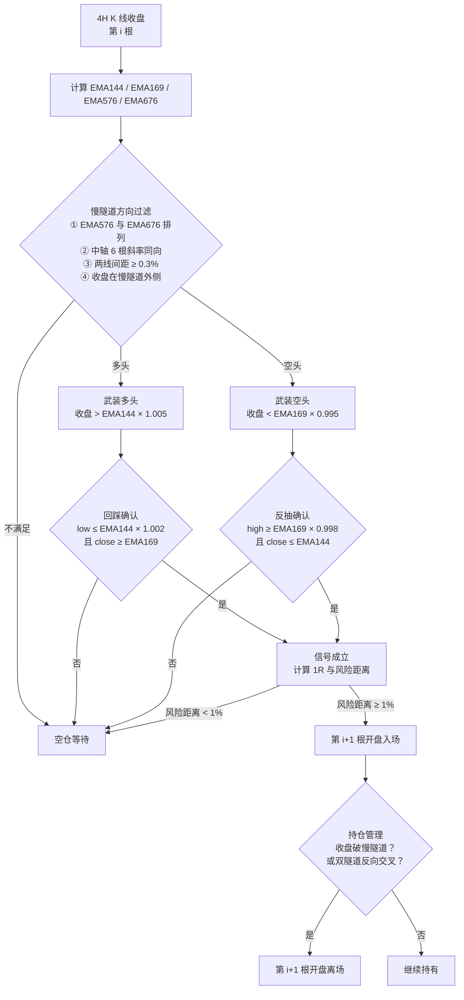

# 01-Vegas 双 EMA 隧道交易系统

> 规则口径：2026-10-24 研究版本
> 样本：Binance 现货 4H，BTC / ETH / BNB，2018-10-12 → 2026-10-24
>
> 这是一套**研究用、纯规则**的 4H 趋势回调系统，当前**不在生产交易链路里**。文末所有收益数字均为历史样本内回测，不构成任何实盘预期。

---

## 一、系统定位

**一句话**：用慢隧道（EMA576/676）判定 4H 级别趋势方向，用快隧道（EMA144/169）承接回踩入场，用慢隧道收盘破位作为离场，1R 以入场到慢隧道的距离计量。

| 维度 | 定位 |
| --- | --- |
| 策略风格 | 趋势跟随 + 回调入场（Trend-Following Pullback） |
| 周期 | 4H 单周期，信号在已收盘 K 线确认，下一根开盘成交 |
| 方向 | 多空双向（`direction_mode=both`） |
| 入场 | 价格回踩快隧道，收盘仍守住快隧道，顺势入场 |
| 离场 | 收盘跌破/升破慢隧道；叠加双隧道反向交叉 |
| 仓位 | 回测主曲线为每币 1x 名义等权；另有 1% 风险串行复利研究口径 |
| 决策 | 纯规则，无 AI、无自主参数调整 |
| 品种 | BTC / ETH / BNB 三个主流币 |

### 1.1 核心思想

Vegas 隧道本质是**两条均线带**（快带与慢带各由两条 EMA 构成）：快带代表短期成本区，慢带代表长期趋势与价值区。

- 慢带决定「能不能做、做哪边」——排列、斜率、间距、价格位置四重过滤；
- 快带决定「在哪里上车」——价格回到快带附近且收盘不破，视为趋势中的健康回踩；
- 慢带同时是「什么时候下车」——收盘有效跌破慢带，说明长期趋势结构已被破坏；
- 因为入场贴近快带、离场远在慢带，单笔盈利空间天然很大，胜率低但盈亏比高。

这也解释了回测的形态：**胜率约 35%，盈亏比约 9.8，利润高度集中在少数几笔大趋势**。

---

## 二、规则链



**方向失效即解除武装**：`dir_long` / `dir_short` 一旦不成立，对应的 `armed` 状态当根清除；入场成交后也清除武装，避免连续加仓。

---

## 三、参数表

| 参数 | 默认值 | 含义 |
| --- | --- | --- |
| `ema_fast_a` / `ema_fast_b` | 144 / 169 | 快隧道两条 EMA |
| `ema_slow_a` / `ema_slow_b` | 576 / 676 | 慢隧道两条 EMA |
| `slope_k` | 6 | 慢隧道中轴斜率回看根数（4H 下约 1 天） |
| `min_spread_pct` | 0.003 | 慢隧道两线最小间距 0.3%，防粘合 |
| `arm_buffer` | 0.005 | 收盘离开快隧道 0.5% 才允许下一次入场 |
| `entry_grab` | 0.002 | 快隧道触点容差 0.2% |
| `min_risk_pct` | 0.01 | 入场到慢隧道的最小风险距离 1% |
| `direction_mode` | `both` | 排列 + 斜率同时满足 |
| `exit_mode` | `tunnel2` | 收盘破慢隧道离场 |
| `regime_exit` | `True` | 叠加双隧道反向交叉离场 |
| `fee` | 0.0005 | 单边 taker 手续费 0.05% |
| `warmup_mult` | 3.0 | EMA676 预热倍数（约 2028 根） |

参数不是拟合出来的：144/169/576/676 是 Vegas 隧道通行参数，6 根斜率约等于 4H 的一天，0.3%/0.5%/0.2% 是工程化的「防粘合 / 防追高 / 触点容差」阈值。

---

## 四、逐条规则

### 4.1 方向判定（慢隧道）

以第 `i` 根**已收盘** 4H K 线计算：

```
慢隧道中轴 mid_slow = (EMA576 + EMA676) / 2
慢隧道间距 spread  = (EMA576 - EMA676) / mid_slow
斜率 slope         = (mid_slow[i] - mid_slow[i-6]) / mid_slow[i]

多头方向 = EMA576 > EMA676
         ∧ slope > 0
         ∧ |spread| ≥ 0.3%
         ∧ close[i] > max(EMA576, EMA676)

空头方向 = EMA576 < EMA676
         ∧ slope < 0
         ∧ |spread| ≥ 0.3%
         ∧ close[i] < min(EMA576, EMA676)
```

四重条件分别过滤：**排列**（趋势方向）、**斜率**（趋势还在推进）、**间距**（均线没有粘合）、**价格位置**（价格确实在慢隧道外侧）。

### 4.2 武装

```
多头武装：dir_long ∧ close[i] > EMA144 × (1 + 0.5%)
空头武装：dir_short ∧ close[i] < EMA169 × (1 - 0.5%)
```

武装的含义是「价格曾经离开过快隧道足够远」。没有这一步，价格贴着快隧道震荡时会反复触发假回踩。

### 4.3 入场

```
多头：dir_long ∧ armed_long
      ∧ low[i] ≤ EMA144 × (1 + 0.2%)
      ∧ close[i] ≥ EMA169

空头：dir_short ∧ armed_short
      ∧ high[i] ≥ EMA169 × (1 - 0.2%)
      ∧ close[i] ≤ EMA144
```

多头要求**影线探到快隧道上沿、收盘仍站在快隧道下沿之上**；空头对称。`entry_confirm=True` 的变体会额外要求收盘重新站回 EMA144（多头），回测中收益略降、回撤略增，因此默认关闭。

### 4.4 1R 与风险距离

```
多头 1R 距离 = 入场价 − min(EMA576, EMA676)   （取信号根的值）
空头 1R 距离 = max(EMA576, EMA676) − 入场价

risk_pct = 1R 距离 / 入场价
风险距离 < 1% → 不入场
```

风险距离不足 1% 说明价格已经贴到慢隧道，盈亏比结构不成立，直接放弃。

> **重要口径**：回测里 1R 只是**入场时刻的风险计量单位**，不是硬止损。系统没有在 1R 处挂止损，离场条件是「收盘破慢隧道、下一根开盘成交」。慢隧道会随时间移动，跳空也会穿透，所以实际亏损可以超过 1R。

### 4.5 离场

| 条件 | 多头 | 空头 |
| --- | --- | --- |
| 主离场 | 收盘 < min(EMA576, EMA676) | 收盘 > max(EMA576, EMA676) |
| 反向交叉（叠加） | EMA576 < EMA676 | EMA576 > EMA676 |
| 样本结束 | 最后一根收盘平仓（`eod`） | 同左 |

信号在第 `i` 根收盘确认，第 `i+1` 根**开盘价**成交。样本中 115 笔信号离场全部由「破慢隧道」触发（另 3 笔为样本结束平仓），反向交叉从未抢先触发。

### 4.6 执行时序（无前视）

```
第 i 根 4H 收盘
  → 用 i 及之前的已收盘数据计算全部指标和信号
  → 第 i+1 根开盘价成交
  → 持仓期间逐根 4H 收盘盯市
```

指标不使用未来数据，信号不使用当根未收盘价，成交不使用信号根收盘价。

---

## 五、回测结果

### 5.1 口径说明

- 数据：Binance 现货 4H K 线，BTC / ETH / BNB；
- 组合：每币一个独立 sleeve，**1x 名义本金、等权、不再平衡**，逐 4H 盯市；
- 费用：双边各 0.05%（taker），未计资金费、滑点、冲击成本；
- 样本：2018-10-12 → 2026-10-24，约 8.04 年，118 笔交易；
- 基准：三币等权买入持有（B&H）。

### 5.2 主结果

| 配置 | 笔数 | 胜率 | 总收益 | CAGR | 最大回撤 | Sharpe | Calmar |
| --- | ---: | ---: | ---: | ---: | ---: | ---: | ---: |
| **base（破慢隧道离场）** | 118 | 34.8% | **+767.8%** | 30.8% | −62.9% | 0.80 | 0.49 |
| stop_tunnel1（破快隧道离场） | 483 | 24.4% | +1417.2% | 40.3% | −42.4% | 1.03 | 0.95 |
| 三币等权 B&H | — | — | +3318.9% | 55.2% | −73.7% | 0.99 | 0.75 |

**怎么读这张表**：

- base 的绝对收益和 Sharpe 都**不如**买入持有——在一轮大牛市里，任何低暴露的趋势系统都会跑输 1x 持有；
- base 的价值在**暴露更低**（60.7% 时间在场）和**回撤更浅**（−62.9% vs −73.7%），但幅度有限；
- stop_tunnel1 的风险调整后表现更好（Sharpe 1.03、回撤 −42.4%），代价是交易频率约为 base 的 4 倍（20 笔/币/年），利润被切得更碎；
- **不要把 base 当作「跑赢持有」的策略**，它更像「用更低暴露换取相近量级收益」的择时框架。

### 5.3 交易分布

| 指标 | base | stop_tunnel1 |
| --- | ---: | ---: |
| 平均单笔收益 | +20.2% | +3.2% |
| 单笔收益中位数 | −3.2% | −1.4% |
| 平均盈利 / 平均亏损 | +71.8% / −7.3% | +20.1% / −2.3% |
| 盈亏比（金额） | 9.81 | 8.67 |
| Profit Factor（金额） | 5.22 | 2.80 |
| 总 R | 407.5 | 727.3 |
| 平均 R | 3.45 | 1.51 |
| 平均持仓 | 45.9 天 | 7.7 天 |
| 持仓中位数 | 21.6 天 | 1.8 天 |
| 最长持仓 | 280.2 天 | 84.8 天 |
| 在场时间 | 60.7% | 42.4% |

### 5.4 分币结果

| 币 | 策略总收益 | CAGR | 最大回撤 | Sharpe | B&H 总收益 | B&H 回撤 |
| --- | ---: | ---: | ---: | ---: | ---: | ---: |
| BTC | +1455.0% | 39.4% | −57.1% | 0.95 | +940.9% | −77.0% |
| ETH | +255.6% | 16.6% | −83.9% | 0.56 | +410.7% | −82.9% |
| BNB | +801.1% | 31.5% | −77.3% | 0.75 | +7667.7% | −78.0% |

**单币层面差异极大**：BTC 是唯一明确跑赢自身买入持有的品种；ETH 回撤 −83.9%，几乎与持有 ETH 一样差；BNB 则远远跑输买入持有（+801% vs +7668%）。三币等权组合靠 BTC 和少数 BNB 大单撑住了整体。

### 5.5 年度收益

| 年份 | base | 三币等权 B&H |
| --- | ---: | ---: |
| 2018（10 月起） | +30.1% | −36.7% |
| 2019 | −5.0% | +70.7% |
| 2020 | +47.2% | +278.4% |
| 2021 | +185.8% | +551.0% |
| 2022 | +21.0% | −56.6% |
| 2023 | −6.7% | +47.7% |
| 2024 | +56.7% | +106.8% |
| 2025 | −3.8% | +13.5% |
| 2026（至 10 月） | −2.0% | −14.5% |

收益高度集中在 2020–2021 的强趋势段和 2022 的下跌段；2023 之后基本走平或小亏。**这不是一台全市场全天候的机器，而是「大趋势出现时赚钱、震荡年份磨损」的典型趋势系统。**

### 5.6 集中度与尾部风险（最重要的一组数字）

| 指标 | base | 含义 |
| --- | ---: | --- |
| 前 5 笔盈利占总盈利 R | 77.2% | 利润极度集中 |
| 前 5 笔 R 合计 | 370.7 | 总 R 407.5 的 91% |
| 剔除前 5 笔后的总 R | 36.8 | 剩余 113 笔几乎不赚钱 |
| 剔除前 5 笔后的 PF | 1.50 | 边际正期望 |
| 亏损笔数 | 77 / 118 | 胜率 34.8% |
| 亏损超过 1R 的笔数 | 33 / 77 | 1R 不是硬止损 |
| 最差单笔 | −4.13R | 隧道移动 + 快速反转 |
| 平均 MAE | −1.00R | 多数交易先浮亏约 1R |

**结论**：这套系统的期望值几乎全部来自极少数超级趋势单。任何一笔大单被错过、提前离场、或实盘滑点吃掉，整体结果都会大幅退化。`risk_sizing_1pct` 研究口径更直白：base 按 1% 风险串行复利总收益 +1678.7%、CAGR 41.9%、回撤 −16.3%；**剔除前 5 笔后只剩 +39.8%、CAGR 4.2%**。

### 5.7 参数敏感性

| 变体 | 改动 | 笔数 | CAGR | 最大回撤 | Sharpe | 剔除前 5 笔总 R |
| --- | --- | ---: | ---: | ---: | ---: | ---: |
| base | — | 118 | 30.8% | −62.9% | 0.80 | 36.8 |
| `grab0` | 触点容差 0.2% → 0 | 116 | 31.8% | −62.5% | 0.82 | 31.4 |
| `dir_slope` | 仅用斜率定方向 | 220 | 32.0% | −61.6% | 0.82 | 38.2 |
| `dir_ma` | 仅用排列定方向 | 128 | 29.8% | −64.1% | 0.79 | 31.5 |
| `slope24` | 斜率回看 6 → 24 | 116 | 26.8% | −62.3% | 0.74 | 20.8 |
| `slope60` | 斜率回看 6 → 60 | 116 | 27.7% | −62.4% | 0.76 | 13.7 |
| `spread0` | 取消间距门槛 | 128 | 30.2% | −64.9% | 0.79 | 55.7 |
| `spread0.6%` | 间距门槛 0.6% | 107 | 28.0% | −61.6% | 0.76 | 25.5 |
| `grab1%` | 触点容差 1% | 129 | 28.2% | −66.5% | 0.76 | 22.9 |
| `fast_order` | 快隧道也要求排列 | 87 | 27.8% | −59.5% | 0.76 | 15.7 |
| `entry_confirm` | 要求收盘站回 EMA144 | 120 | 28.5% | −63.4% | 0.76 | 34.3 |
| `exit_regime_only` | 只用反向交叉离场 | 44 | 4.0% | −91.5% | 0.37 | −24.0 |
| `stop_tunnel1` | 破快隧道离场 | 483 | 40.3% | −42.4% | 1.03 | 222.7 |

**稳健性判断**：

- 方向过滤、间距、触点容差在合理范围内改动，CAGR 都在 27%–32%，回撤都在 −60% 上下，**没有出现「换个参数就崩」的悬崖**；
- 唯一崩掉的是「只用反向交叉离场」（`exit_regime_only`）：回撤 −91.5%，说明**慢隧道价格破位才是有效离场信号**，交叉太慢；
- 但所有变体的**剔除前 5 笔总 R 都偏低**，说明集中度不是参数选择造成的，而是策略结构本身。

---

## 六、案例

### 6.1 盈利案例：BNB 2020-12 多头（+1200%，174.9R）

| 项 | 值 |
| --- | --- |
| 信号时间 | 2020-12-13 20:00 |
| 入场时间 / 价格 | 2020-12-14 00:00 / 29.1599 |
| 离场时间 / 价格 | 2021-05-19 16:00 / 379.14 |
| 收益 / R | +1200.1% / 174.9R |
| 持仓 | 156.7 天 |
| MAE / MFE | −0.25R / +331.2R |
| 入场时 1R 距离 | 6.86% |

机制：慢隧道多头排列且斜率向上，价格远离快隧道后武装；12 月 13 日回踩 EMA144 附近、收盘守住 EMA169，次日开盘入场。此后 BNB 进入主升浪，价格始终没有收盘跌破慢隧道，直到 2021-05-19 才触发离场。**这是一笔「入场后几乎没回头」的趋势单，也是全样本最大利润来源之一。**

### 6.2 盈利案例：BTC 2022-04 空头（+56.3%，52.1R）

| 项 | 值 |
| --- | --- |
| 信号时间 | 2022-04-07 12:00 |
| 入场时间 / 价格 | 2022-04-07 16:00 / 43331.82 |
| 离场时间 / 价格 | 2023-01-12 20:00 / 18885.35 |
| 收益 / R | +56.3% / 52.1R |
| 持仓 | 280.2 天（样本最长） |
| MAE / MFE | −1.41R / +59.4R |
| 入场时 1R 距离 | 1.08% |

机制：慢隧道空头排列、斜率向下，价格反抽 EMA169 后收盘仍在 EMA144 下方，次日开盘做空。2022 年全年下跌，持仓期间最大浮亏 1.41R，但从未收盘升破慢隧道，一直持有到 2023-01 才离场。**风险距离只有 1.08%，是典型的「窄风险、长趋势」交易。**

### 6.3 亏损案例：ETH 2024-07 多头（−5.9%，−4.13R）

| 项 | 值 |
| --- | --- |
| 信号时间 | 2024-07-24 16:00 |
| 入场时间 / 价格 | 2024-07-24 20:00 / 3362.99 |
| 离场时间 / 价格 | 2024-07-25 04:00 / 3168.31 |
| 收益 / R | −5.9% / −4.13R |
| 持仓 | 8 小时（2 根 4H） |
| MAE | −4.90R |
| 入场时 1R 距离 | 1.42% |

机制：入场时 1R 距离只有 1.42%，但价格在两根 4H 内快速下跌 5.9%，收盘直接跌破慢隧道，按规则在下一根开盘离场。**这笔交易暴露了系统的核心风险：1R 不是硬止损，慢隧道会移动，快速反转时实际亏损可以是 1R 的数倍。** 若实盘使用，必须在 1R 附近另设硬止损，或在入场时用更宽的缓冲过滤窄风险单。

---

## 七、与 Pine「EMA+Vegas+布林带+SuperTrend」指标的关系

用户提供的 Pine Script 与本系统共用同一套 Vegas 色带构造，但**用途完全不同**：

| 维度 | Pine 指标 | 本系统 |
| --- | --- | --- |
| 快带 | `fill(EMA144, EMA169)` | EMA144 / EMA169 |
| 慢带 | `fill(EMA576, EMA676)` | EMA576 / EMA676 |
| 色带构造 | 一致 | 一致 |
| 方向判定 | 无（仅画图） | 慢隧道排列 + 斜率 + 间距 + 价格位置 |
| 入场 | 无 | 回踩快隧道 + 收盘守住 |
| 离场 | 无 | 收盘破慢隧道 + 反向交叉 |
| 仓位 | 无 | 1R 风险距离 + 1% 最小风险门槛 |
| 其他指标 | 布林带、SuperTrend、ZigZag | 不参与 |
| 视觉差异 | 颜色/透明度/虚线、K 线 | 报表用收盘价折线、色带高亮 |

**结论**：如果你在 TradingView 上看到这套色带，它只是「把隧道画出来」；要变成可执行的系统，必须补上本文件第四节的方向、武装、入场、1R、离场五组规则。Pine 里的布林带和 SuperTrend 不属于本系统的决策链。

---

## 八、失效条件与已知局限

### 8.1 策略层面的失效条件

1. **长期震荡 / 慢速磨顶**：慢隧道反复缠绕，方向过滤会频繁开关，回踩单被反复扫损。2023、2025、2026 的年度收益为负就是这种环境的体现。
2. **V 型反转**：价格跌破慢隧道后立刻拉回，系统在最低点附近离场，随后错过反弹。
3. **窄风险单**：入场时价格已贴近慢隧道（风险距离接近 1%），任何快速波动都会造成数倍 R 的亏损（见 6.3）。
4. **超级趋势缺失**：收益高度依赖前 5 笔大单；如果样本期没有 2020–2021 和 2022 这种大趋势，系统期望值会大幅下降。

### 8.2 回测口径的局限

- **样本选择偏差**：只回测 BTC/ETH/BNB 三个「事后已知成功」的主流币，未包含归零币、下架币；
- **无资金费**：永续合约的真实持仓成本未计入；
- **无滑点/冲击**：按下一根开盘价成交，未模拟盘口深度；
- **无杠杆/强平**：1x 名义本金，不涉及保证金和强平；
- **参数非样本外**：144/169/576/676 是通行参数，但「选这三个币、这段样本」本身包含事后选择；
- **1R 不是止损**：亏损尾部可以到 −4R，不能把「平均亏损 −0.95R」理解为「最大亏损 1R」；
- **利润集中**：剔除前 5 笔后 CAGR 仅 4.2%，实盘错过任何一笔大单都会显著改变结果。

### 8.3 如果要做成实盘，必须先补的三件事

1. **硬止损**：在 1R 或 1.2R 处挂 STOP_MARKET，防止慢隧道移动导致的超额亏损；
2. **仓位模型**：按「单笔风险 = 账户 × 固定比例 ÷ 1R 距离」定仓，而不是 1x 等权；
3. **样本外验证**：加入更多币种、加入资金费与滑点、做滚动前向验证，再谈实盘。

---

## 九、与当前合约系统的关系

本系统是**独立研究策略**，与生产中的合约系统没有代码或资金链路：

| 维度 | Vegas 双 EMA 隧道 | 当前合约系统（[02](02-规则与AI混合的合约趋势突破系统.md)） |
| --- | --- | --- |
| 周期 | 4H | 1H 信号 + 4H 背景 |
| 决策 | 纯规则 | 规则 + LLM 提议 + 程序否决 |
| 入场 | 回踩快隧道 | T1a 结构突破 / T1b Donchian / T3 回踩金K |
| 离场 | 破慢隧道 | SL + TP1/TP2 分批 + 保本 + 跟进止损 |
| 仓位 | 1x 等权 / 1% 风险研究口径 | 固定比例风险 + 动态杠杆 + 逐仓 |
| 风控 | 仅方向过滤和风险距离 | 20+ 道开仓闸门 + 三层熔断 |
| 状态 | 研究完成，未上生产 | 生产系统，测试网默认开、正式网默认关 |

两者可以互相借鉴的点：

- Vegas 的「慢隧道定方向、快隧道定入场」可以作为一个**4H 背景过滤器**，与当前系统的 `gate_4h` / 4H 状态机做对照实验；
- Vegas 的「1R = 入场到慢隧道」与当前系统的「固定比例风险 + 止损宽度定仓」是同一族思想，但当前系统有硬止损，风险闭环更完整；
- Vegas 的集中度问题提醒当前系统：**必须持续监控「剔除前 N 笔后的期望」**，否则容易把少数大单的运气误判为系统能力。

---

## 十、一句话总结

**Vegas 双 EMA 隧道是一套「低胜率、高盈亏比、利润极度集中」的 4H 趋势回调系统：慢隧道给你方向和离场，快隧道给你入场，1R 给你风险刻度。它在 2020–2022 的大趋势里表现很好，在 2023 年之后的震荡里走平甚至小亏；它的最大价值不是收益数字，而是一套可以复用的「趋势过滤 + 回调入场 + 结构离场」规则框架。**
