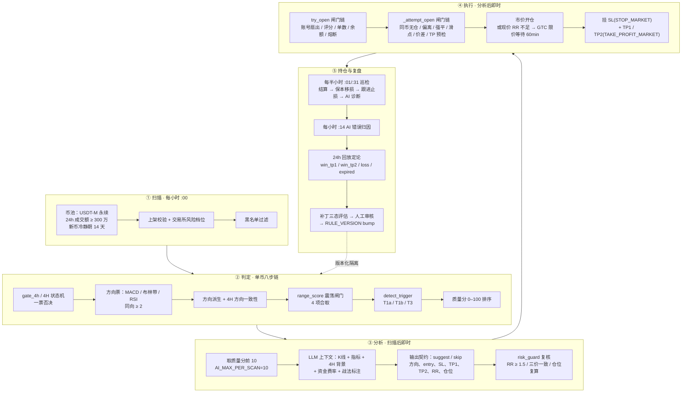
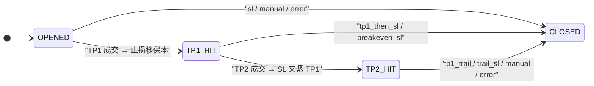

# 02-规则与AI混合的合约趋势突破系统

> 现行规则版本：`v2026-10-21-1`（2026-10-21）
> 文档快照：2026-10-24。**代码与编号文档为准，本文是系统级整合视角**；参数默认值来自 [`config.py`](../../backend/app/config.py)，流程细节以 01–06 编号文档为准。
> 适用市场：Binance USDT-M 永续合约（逐仓），多空双向，测试网默认开、正式网默认关。

---

## 一、系统定位

**一句话**：AI 增强的系统化短线趋势跟随 / 突破交易系统——规则引擎掌握否决权与仓位权，LLM 负责信号裁决与参数生成，固定比例风险模型管理仓位，三层风控闭环。

### 1.1 分类学定位

| 维度 | 分类 | 依据 |
| --- | --- | --- |
| 策略风格 | 趋势跟随 + 突破入场 | T1a 结构突破、T1b Donchian 突破、T3 回踩确认；无均值回归、无套利、无做市 |
| 持仓周期 | 短线波段 | 1H 信号，持仓数小时至 1–2 天，24h 回放定论 |
| 决策架构 | 规则 + AI 混合 | LLM 提议，规则闸门持有否决权，AI 无法绕过 |
| 仓位模型 | 固定比例风险 | 单笔风险 = 风险基数 × 3%（或固定金额），止损宽度反比定名义 |
| 风控架构 | 三层闭环 | 事前 20+ 闸门 / 事中保本+跟进 / 事后熔断+复盘补丁 |
| 执行方式 | 市价 + 限价等待 + 条件单 | 市价开仓；RR 不足挂 GTC 限价；SL/TP 为条件单 |

### 1.2 它不是什么

- **不是黑箱 AI 交易**：AI 输出只是提案，三价、RR、仓位全部过程序复算；
- **不是高频/日内刷单**：每小时一轮信号、半小时巡检，持仓以小时计；
- **不是全自主机器学习**：无在线训练；策略进化发生在盘后「复盘 → 补丁 → 人工审核 → 版本 bump」；
- **不是网格/均值回归**：方向性趋势系统，震荡市靠 `range_score` 主动回避。

---

## 二、全链路



### 2.1 时序表

| 时刻 | 任务 | 内容 |
| --- | --- | --- |
| 每小时 `:00` | `hourly-scan` | 全量扫描、落库、触发 AI 分析 |
| 每小时 `:00` | `trade-review` | 处理超过 24h 的 AI 建议决策 |
| 每小时 `:14` | `ai-attribution` | 对已平仓交易做 LLM 错误归因 |
| 每半小时 `:01/:31` | `auto-trade` | 结算、保本移损、跟进止损、手动仓导入、AI 持仓诊断 |
| 每分钟 | `pending-entry-sweep` | 挂单入场兜底、保护事故对账恢复 |
| 每日 `11:40`（北京） | `patch-trigger` | 标签热度检查 → 补丁草稿 |
| 每日 `11:45`（北京） | `patch-evaluate` | 活跃补丁三态评估 |

> 注：扫描时刻以 `SCAN_BEAT_MINUTE=0` 为准。旧文档中的「第 2 分钟」是历史口径，已过时。

---

## 三、扫描与信号层

### 3.1 币池

```
USDT-M 永续，状态 TRADING
剔除稳定币基础资产与 EXCLUDE_KEYWORDS
24h 成交额 ≥ MIN_VOLUME_24H = 3,000,000 USDT
上市未满 NEW_COIN_COOLDOWN_DAYS = 14 天不进扫描（0=关闭）
上架校验 + 交易所风险档位（最大杠杆 ≥10×）
黑名单：手动永久 / 止损超预算自动冷却 14 天 / ≥1.8R 永久
repeat 窗口去重：REPEAT_WINDOW_HOURS = 3
```

### 3.2 单币八步判定链

以 `klines[-2]`（最后一根**已收盘** 1H K 线）为信号根，`klines[-1]` 只取现价。

1. **4H 趋势闸门 `gate_4h` + 4H 状态机**（2026-10-20 合并为 `htf_context` 单入口）
   - `flat`：EMA144 走平（20 根斜率 < 0.5%）
   - `tangle`：ADX < 20 ∪ EMA21–55 间距 < 0.1% ∪ 21×55 锯齿 ∪ 价格穿越 144 > 2 次
   - `adx`：ADX 不可用（fail-closed）
   - `undetermined`：位置与斜率不同号
   - `data`：4H 历史 < 200 根
   - 命中任一 → 直接否决，不跑票数、不触发、不进候选；
   - 状态机前置门：只有 `aligned_bull` / `aligned_bear` 放行；非排列态（拐头、交叉初期、恢复初期、过渡态）对全部 1H 候选一票否决；排列态下另有逆势锁。
2. **方向票**（1H 三张）：MACD(12,26,9) / 布林带(20,2) / RSI(14)，同向 ≥ 2 张才成候选。
   - ADX、SuperTrend、OBV、4H EMA21/55 已退出方向票，改作背景/质量分；
   - `direction_vote_gate_enabled` 可关闭本关（默认 True）。
3. **方向派生 + 4H 方向一致性**：`net` 符号定方向；与 `gate_4h` 方向冲突即否决（`direction_conflict_gate_enabled` 可关，默认 True）。
4. **1H 结构门**：已从筛选链退役，仅作 EMA21 触点的软校验；不过不否决，质量分 −15。
5. **震荡闸门 `range_score`**：任一命中即不入场——
   - 1H EMA21/55/144 非同向排列；
   - 近 12 根最大 `|EMA55−EMA144| / ATR < 1.0`；
   - 1H ADX < 18；
   - 波动过度扩张（Donchian 或布林带宽在当前 100 根分位 ≥ 0.80）。
6. **触发器 `detect_trigger`**：T1a / T1b / T3，互斥按优先级短路，每币至多 1 个候选。
7. **触发类型白名单**：白名单外类型不产生候选，连 AI 都不进。
8. **质量分排序 → 落库 → 取前 10 送 AI**。

### 3.3 三类触发器

| 触发器 | 判定 | 关键参数 |
| --- | --- | --- |
| **T1a 结构突破** | 收盘突破最近摆动前高/低；顺向长实体；未追高 | 摆动 `order=3`，前 `n=10`；幅度 ≥0.2%；追高上限 1.5% |
| **T1b Donchian 突破** | 收盘突破前 20 根 Donchian 轨 ≥0.2% | 通道 20 根，不含信号 K 与未收盘根 |
| **T3 回踩两段式** | 六类触点（EMA21/55/144、4H EMA21、retest、swing）+ 同向金K | 触点容差 3%；pending 窗口 4 根；金K白名单 8 种 |

**金K**：现行白名单 8 种（看涨 4 + 看跌 4）。纯金K触发已下线，金K只作为回踩确认证据。三根形态（启明星/黄昏星）允许在触碰后 1..N 根内确认，`PENDING_CONFIRM_WINDOW_BARS=4`。

### 3.4 质量分与 AI 配额

- 质量分 0–100：票数差 + 4H 对齐 + 突破带 ADX + 量比 ≥1.2（+5）− 超买超卖 − OBV 背离（−6）− 结构门不过（−15）等；
- 按质量分降序，取前 `AI_MAX_PER_SCAN=10` 进入 AI 分析；
- 正式网在跑单达到 `max_open_trades` 上限时，本轮不再送 AI（省成本）；测试网不限单数。

---

## 四、AI 分析层

### 4.1 上下文

- 1H K 线 + 指标票 + 摆动结构 + 4H 背景；
- 本币资金费率 + BTC 状态（`MARKET_CONTEXT_ENABLED=True`）；
- 战法库只做「借鉴标注」，不构成开单门槛，输出经白名单闸门防幻觉；
- 缓存：价格桶指纹，`FINGERPRINT_TTL_MIN=60`。

### 4.2 输出契约

LLM 必须输出结构化 JSON：

```
decision: suggest / skip
direction: long / short / none
entry_price / stop_loss / take_profit_1 / take_profit_2
risk_reward / position_pct / recommendation (0–100)
stop_anchor: 结构锚 / 近锚等
```

### 4.3 程序复核（risk_guard）

| 校验 | 规则 |
| --- | --- |
| RR 铁律 | 三价复算 RR ≥ 1.5（`AI_RR_MIN`），容差 0.02 |
| 三价一致性 | 方向、入场、止损、止盈的几何关系必须自洽 |
| 仓位复算 | 按固定比例风险重算数量，不采信 LLM 的仓位数字 |
| 止损宽度 | ≥ 0.3×ATR14（`SL_MIN_ATR`），近锚豁免 |
| 止盈一上限 | 距入场 ≤ 2×ATR14（`TP1_MAX_ATR`），超限打回或用兜底价 |
| TP2 间距 | 与 TP1 间距 ≥ max(0.5×ATR, 0.5R, 2×手续费)，过近静默撤档 |

校验失败进入 **Reflection 回炉**（把违规原因回传 LLM 重出），多次失败则 forced skip。

**AI 没有绕过闸门的能力**：即使 LLM 给出 suggest，后续任何一道程序闸门都可以否决。

---

## 五、开仓执行层

### 5.1 两道闸门链

| 层 | 闸门 | 默认 |
| --- | --- | --- |
| 组合 | 在跑单上限 | 5（TP1/TP2 已锁险单不占名额；测试网不限） |
| 组合 | 组合热度 Σ(剩余风险×β) / 钱包 | 20%，`PORTFOLIO_HEAT_CAP=0` 当前关闭 |
| 组合 | 同向持仓上限 | `SAME_DIRECTION_CAP=0` 当前关闭 |
| 组合 | 最低可用余额 | 钱包 × 50% |
| 账户 | 当日亏损熔断 | 风险基数 × 9%，UTC 日，自动恢复 |
| 账户 | 连损降速软熔断 | 连损 2 → 评分 ≥75；≥3 → ≥85（当前默认关） |
| 单笔 | 评分门槛 | recommendation ≥ 60 |
| 单笔 | RR 现价复算 | ≥ 1.5（容差 0.02） |
| 单笔 | 入场偏离 | ≤ 1% |
| 单笔 | 同币无仓 | 已有持仓/挂单即拒绝 |
| 单笔 | 强平闸门 + 动态杠杆 | 8×–20×，超下限放弃 |
| 单笔 | 最小数量/名义、保证金、TP 分批预检 | 交易所 filters |
| 执行 | 滑点实测（本单数量走簿 VWAP） | ≤ 0.3% |
| 执行 | 盘口价差预检 | ≤ 0.3% |
| 执行 | 上架校验、黑名单兜底 | — |

### 5.2 两种入场方式

```
现价 RR ≥ 1.5 且入场偏离 ≤1%
  → MARKET 市价开仓
  → 立即挂 SL / TP1 / TP2

现价 RR 不足
  → 在 AI 入场价挂 LIMIT GTC
  → TTL 60 分钟，未成交自动撤单
  → 成交后补挂保护单并落 TradeRecord
  → 成交前不建记录、不占在跑名额
```

### 5.3 订单结构

| 单 | 类型 | 触发基准 | 语义 |
| --- | --- | --- | --- |
| 入场（市价） | MARKET | — | 立即成交 |
| 入场（限价） | LIMIT GTC | AI 入场价 | 等回踩，60 分钟未成交撤单 |
| 止损 | STOP_MARKET + closePosition | **标记价格** MARK_PRICE | 触发即市价全平，防插针 |
| 止盈 | TAKE_PROFIT_MARKET + reduceOnly | **最新成交价** CONTRACT_PRICE | 分批减仓 |

### 5.4 保护事故兜底

保护单挂出失败 → `protection_incidents` 状态机：

```
pending → closing → awaiting_reconcile → resolved / manual_review
```

活跃事故期间该账号**禁止新开仓**，不依赖人工先响应；先确认真实仓位，再决定平仓或恢复保护。

---

## 六、仓位与风险模型

### 6.1 单笔风险预算

```
风险基数 = 钱包首位取整，夹在 [100, 5000]
          （4800→4000，980→900，65→100，5200/15000→5000）

单笔风险预算 = 风险基数 × risk_pct%（默认 3%）
             或 fixed 模式：固定 USDT 金额

近锚折价 = ×0.7（止损贴突破K极值的单，观察期敞口折价）
```

### 6.2 仓位推导

```
名义仓位 notional = 风险预算 ÷ 止损宽度 stop_pct
数量 qty = notional ÷ 现价（按交易所 filters 取整）
```

止损越宽 → 仓位越小；止损越窄 → 仓位越大；打止损时亏损恒等于风险预算（固定亏损法）。

### 6.3 杠杆

```
动态杠杆 = 从上限 20× 向下搜索
          首个「强平距离 > 止损距离」的杠杆
          下限 8×
杠杆取三者最小：
  配置上限 / 该名义档位最大杠杆 / 精确档 MMR 强平安全杠杆
```

杠杆只决定保证金占用与强平距离，**不改变止损亏损额**。止损距离超过 8× 下限的强平闸门 → 直接放弃。

### 6.4 组合与账户级限制

| 限制 | 规则 |
| --- | --- |
| 在跑单上限 | 5（正式网）；TP1/TP2 已锁险单不占名额 |
| 组合热度 | Σ(剩余风险×β) > 钱包×20% → 拦截（当前默认关） |
| 同向上限 | 同方向在跑单数上限（当前默认关） |
| 最低可用余额 | 可用 < 钱包×50% → 停开 |
| 当日熔断 | UTC 日已平仓净亏 ≤ −基数×9% → 停开仓，次日自动恢复 |
| 周回撤 | ≥ 基数×15% → 本周单笔预算减半 |
| 月回撤 | ≥ 基数×25% → 停开新仓，人工 ack 后恢复 |
| 黑名单 | 止损超预算 1.5× → 冷却 14 天；≥1.8× → 永久 |

### 6.5 四个风险口径

| 字段 | 定义 | 更新时机 |
| --- | --- | --- |
| `planned_risk` | 下单前计划风险（参考价/限价 × 数量） | 开仓/挂单时 |
| `initial_risk` | 成交后按实际成交价与止损计算的初始 1R | 成交落库时 |
| `remaining_risk` | 剩余仓 × 入场价至当前止损的亏损距离 | TP/减仓/移损/结算 |
| `realized_pnl` | 交易所 income 口径，含手续费/资金费/清算 | 平仓结算 |

复盘 R 分母统一用 `risk_unit`（优先 `initial_risk`）。

---

## 七、持仓管理

### 7.1 分批止盈

| 场景 | TP1 | TP2 | 剩余 |
| --- | ---: | ---: | ---: |
| 有 TP2 | 60% | 20% | 20% 跟进 |
| 无 TP2 | 80% | — | 20% 跟进 |

### 7.2 状态机



### 7.3 持仓期动作

1. **TP1 后保本移损**：止损移到成本价 ± 往返 taker 费缓冲（0.05%×2），只收紧不放松；
2. **TP2 夹紧**：TP2 成交后，SL 以 TP1 价为锚夹紧；
3. **跟进止损**：
   - 摆动低/高点跟进取更紧者；
   - ATR 腿：持仓期极值 ∓ 3×ATR(22,D1)（`ATR_TRAIL_K=3`）；
   - 两条腿取更紧，只收紧；
4. **AI 持仓诊断**：唯一自动动作是 **tighten**（只收紧止损）；`exit` / `reduce` 永不自动执行，落 `ai_advice` + 飞书卡片，由交易所 SL/TP 兜底；
5. **手动仓导入**：App 手动开的仓自动接管；
6. **结算**：每半小时按交易所 income 口径平仓结算，含手续费/资金费。

### 7.4 自动与人工边界

| 事项 | 系统行为 | 人工响应 |
| --- | --- | --- |
| AI 建议 exit / reduce | 落建议 + 推送卡片 | 目标 30 分钟内响应；不自动平仓 |
| 规则补丁 draft | 只生成草稿与证据 | 人工审核后合入/回滚 |
| 周/月熔断确认 | 停开/减速并写 ack 时刻 | 人工复盘后确认 |
| 正式网开关 | 默认关 | 页面显式开启 |
| 异常持仓 manual_review | 持续告警、封锁新开仓 | 人工确认仓位与保护状态 |

**无人响应策略**：除保护事故状态机外，系统不设「超时替人决策」；持仓保持、条件单兜底、新开仓按闸门继续受控。

---

## 八、复盘与版本闭环

```
每小时 :00  trade-review
  → 24h 回放定论：win_tp1 / win_tp2 / loss / expired
每小时 :14  ai-attribution
  → LLM 错误归因（追高、止损过窄/过宽、逆票入场等）
  → 标签热度统计
每日 11:40  patch-trigger
  → 生成规则补丁草稿（prompt overlay / 闸门参数）
每日 11:45  patch-evaluate
  → 三态评估：回放通过 / 警告 / 失败
人工审核
  → 合入或回滚
  → RULE_VERSION bump
  → 按版本分组隔离复盘口径
```

**设计原则**：交易时段行为完全确定（可回放、可对账）；策略进化只发生在盘后，且必须经过人工闸门与版本化。

---

## 九、已知限制与风险

以下问题来自 [系统定位与端到端逻辑审计（2026-10-21）](../系统定位与端到端逻辑审计-2026-10-21.md)，按严重度归纳。**阅读本文时不要把「设计上存在」误当成「已完全验证」。**

### 9.1 P0 级

1. **缓存复制丢失近锚风险属性**：`stop_anchor` 未随缓存复制，执行层看不到 `near`，近锚折价可能从 0.7× 恢复到 1.0×，风险预算相对增加约 42.9%；同时丢失战法、4H 阶段等归因字段。
2. **保护失败缺少最终闭环**：紧急平仓再失败主要记日志；SL 被拒且现价越过 SL 时存在仅告警、等待人工的路径。正常路径有保护 ≠ 异常路径保证平掉或重新受保护。

### 9.2 P1 级

3. **缓存有效性不足**：指纹只含币种、信号类型、形态、触点、价格桶，缺少方向、信号根、配置/提示词版本、4H 上下文；复用后可能跳过新分析约束。
4. **回放不等价于真实收益**：24h 回放不校验入场是否成交，未覆盖分批止盈、保本、跟进、费用与成交过程；查询窗口过窗可能无结论。
5. **固定风险预算不是最大亏损**：滑点、手续费、资金费、跳空、保护失败都会造成预算外损失；成交滑点超预算 15% 目前主要告警。
6. **组合热度不是当前最大损失**：热度用原始风险×β，不能直接代表部分止盈/移损后的剩余风险；且当前默认关闭。

### 9.3 规则口径问题

7. **评分档位是软契约**：提示词要求 60/70/85 三档，程序接受 50–100 连续分数，可能出现 58 分 suggest 被静态门槛挡住；
8. **4H 数据缺失处理不一致**：扫描阶段无 4H 方向直接拒绝；分析阶段失败只打降级标记；执行阶段可能原样返回 suggest；
9. **质量排序与健康回踩有张力**：回踩不再因 1h 反向票直接拒绝，但同向票、OBV/ST、结构门、震荡扣分仍可能让它在 AI 配额前落后。

### 9.4 能力缺口

10. **缺少完整决策快照**：每笔决策应能还原行情时点、信号根、配置、提示词、模型、缓存来源、各层否决；当前版本标记覆盖不全；
11. **缺少分层对照体系**：没有系统比较「规则基线 / +AI / +双评委 / 不同质量排序 / 不同退出」的增量价值；
12. **订单与资金安全状态机不完整**：订单已提交但响应丢失、成交后保护失败、紧急平仓失败、落库失败等状态缺少持续恢复与对账；
13. **自动/人工边界需产品化**：exit/reduce 交人工，但缺少响应时限、无人响应策略、异常状态的明确产品定义。

### 9.5 运行与数据风险

- **LLM**：超时（300s）、限流、输出不合契约、幻觉；Reflection 可缓解但不能消除；
- **交易所**：API 限流、-1121 未上架、盘口深度不足、滑点超限、保护单被拒；
- **数据**：K 线缺失、4H 快照不完整、整点取数竞态（已有「末根已收盘即视作信号根」兜底）；
- **环境**：测试网与正式网行为差异；正式网默认关，需显式开启；
- **回测/研究**：当前没有与实盘同口径的资金费、滑点、强平建模，历史回放不能直接当作策略收益证明；
- **文档漂移**：README 与部分旧文档仍保留历史参数（如 7 指标投票、50/25 分批、:02 扫描）。**以 `config.py` 和 01–06 编号文档为准。**

---

## 十、关键参数速查

| 参数 | 默认值 | 出处 |
| --- | --- | --- |
| 扫描周期 | 每小时 `:00` | `SCAN_BEAT_MINUTE=0` |
| K 线窗口 | 240 根 1H | `KLINE_WINDOW` |
| 24h 成交额门槛 | 300 万 USDT | `MIN_VOLUME_24H` |
| 新币冷静期 | 14 天 | `NEW_COIN_COOLDOWN_DAYS` |
| 突破幅度 / 追高上限 | ≥0.2% / ≤1.5% | `BREAKOUT_THRESHOLD` / `BREAKOUT_MAX_PCT` |
| Donchian 通道 | 20 根 | `BREAKOUT_CHANNEL_BARS` |
| 放量加分 | 量比 ≥1.2 | `BREAKOUT_VOL_RATIO` |
| 方向票 | MACD / 布林 / RSI 同向 ≥2 | `DIR_VOTE_MIN` |
| 回踩待确认 | 4 根 | `PENDING_CONFIRM_WINDOW_BARS` |
| AI 每轮配额 | 10 | `AI_MAX_PER_SCAN` |
| RR 铁律 | ≥1.5，容差 0.02 | `AI_RR_MIN` / `AI_RR_TOL` |
| 评分门槛 | ≥60 | `TRADING_MIN_RECOMMENDATION` |
| 单笔风险 | 基数×3% 或固定金额 | `RISK_BUDGET_PCT` / `TRADING_RISK_PCT` |
| 风险基数 | 首位取整 ∈ [100, 5000] | `_capital_base` |
| 近锚折价 | ×0.7 | `NEAR_ANCHOR_RISK_FACTOR` |
| 杠杆 | 动态 8–20×，逐仓 | `TRADING_LEVERAGE` / `TRADING_LEVERAGE_MIN` |
| 滑点上限 | 0.3% | `MAX_SLIPPAGE_PCT` |
| 价差上限 | 0.3% | `SPREAD_MAX_PCT` |
| 在跑单上限 | 5（正式网） | `max_open_trades` |
| 最低可用余额 | 50% | `TRADING_MIN_FREE_PCT` |
| 当日熔断 | 基数×9% | `DAILY_LOSS_STOP_PCT` |
| 周/月回撤 | 15% / 25% | `WEEKLY_DD_STOP_PCT` / `MONTHLY_DD_STOP_PCT` |
| TP 分批 | 60/20/20 或 80/20 | `TP1_QTY_PCT_WITH_TP2` / `TP2_QTY_PCT` / `TP1_QTY_PCT_NO_TP2` |
| ATR 跟进 | 3×ATR(22,D1) | `ATR_TRAIL_K` |
| 挂单 TTL | 60 分钟 | `PENDING_ENTRY_TTL_MINUTES` |
| 巡检 | 每半小时 `:01/:31` | `AUTO_TRADE_BEAT_MINUTES` |

---

## 十一、与 Vegas 隧道系统的对比

| 维度 | 当前合约系统 | [Vegas 双 EMA 隧道](01-Vegas双EMA隧道交易系统.md) |
| --- | --- | --- |
| 市场 | USDT-M 永续，逐仓，多空 | 现货 4H，研究口径 |
| 信号周期 | 1H 信号 + 4H 背景 | 4H 单周期 |
| 方向判定 | 4H 闸门/状态机 + 3 张 1H 方向票 | 慢隧道排列 + 斜率 + 间距 + 价格位置 |
| 入场 | T1a 结构突破 / T1b Donchian / T3 回踩金K | 回踩快隧道 + 收盘守住 |
| 离场 | SL + TP1/TP2 分批 + 保本 + 跟进止损 | 收盘破慢隧道 + 反向交叉 |
| 仓位 | 固定比例风险 + 动态杠杆 | 1x 等权 / 1% 风险研究口径 |
| 执行 | 市价 + GTC 限价 + 条件单 | 信号下一根开盘 |
| 决策 | 规则 + LLM 提议 + 程序否决 | 纯规则 |
| 风控 | 20+ 闸门 + 三层熔断 + 保护事故状态机 | 方向过滤 + 1% 最小风险距离，无硬止损 |
| 频率 | 每小时扫描，前 10 送 AI，在跑单 ≤5 | 4.9 笔/币/年（base） |
| 状态 | 生产系统，正式网默认关 | 研究完成，未上生产 |

**共同点**：都是趋势跟随，都用「大周期定方向、小周期定入场」，都用「风险距离定仓位」的思想。
**关键差异**：当前系统有硬止损和完整风控闭环；Vegas 系统的 1R 只是计量单位，尾部亏损可以到 −4R。反过来，Vegas 的规则更简单、可解释性更强，适合作为当前系统 4H 背景过滤器的对照实验。

---

## 十二、相关文档与代码

### 12.1 权威文档

| 主题 | 文档 |
| --- | --- |
| 币种筛选与扫描 | [01-币种筛选与扫描](../扫描与筛选/01-币种筛选与扫描.md) |
| 信号与触发器 | [02-信号触发器](../信号与形态/02-信号触发器.md) |
| AI 分析 | [03-AI分析](../AI决策/03-AI分析.md) |
| 交易执行与多账号 | [04-交易执行与多账号](../交易执行/04-交易执行与多账号.md) |
| 风控体系 | [05-风控体系](../风控/05-风控体系.md) |
| 复盘归因 | [06-复盘归因](../复盘归因/06-复盘归因.md) |
| 战法模块 | [10-战法模块](../战法/10-战法模块.md) |
| 系统总览 | [12-交易系统总览](../总览与索引/12-交易系统总览.md) |
| 端到端审计 | [系统定位与端到端逻辑审计](../系统定位与端到端逻辑审计-2026-10-21.md) |

### 12.2 核心代码

| 模块 | 路径 |
| --- | --- |
| 配置与默认参数 | [`backend/app/config.py`](../../backend/app/config.py) |
| 扫描与判定链 | [`backend/app/services/scanner.py`](../../backend/app/services/scanner.py) |
| 指标与质量分 | [`backend/app/services/strategy/technical.py`](../../backend/app/services/strategy/technical.py) |
| 触发器 | [`backend/app/services/strategy/trigger.py`](../../backend/app/services/strategy/trigger.py) |
| AI 分析任务 | [`backend/app/tasks/ai_tasks.py`](../../backend/app/tasks/ai_tasks.py) |
| 程序复核 | [`backend/app/services/risk_guard.py`](../../backend/app/services/risk_guard.py) |
| 开仓与持仓管理 | [`backend/app/services/trade_engine.py`](../../backend/app/services/trade_engine.py) |
| 定时任务 | [`backend/app/celery_app.py`](../../backend/app/celery_app.py) |

---

## 十三、一句话总结

**这是一套「1H 趋势突破/回踩 + AI 裁决 + 固定比例风险 + 20 余道闸门 + 三层闭环」的 USDT-M 永续短线系统。它的核心不是 LLM，而是「风险额先于仓位、规则持有否决权、进化只在盘后」这三条工程纪律；它的主要风险不在策略逻辑，而在异常路径的闭环、缓存/回放的严格性，以及文档与代码的漂移。**
