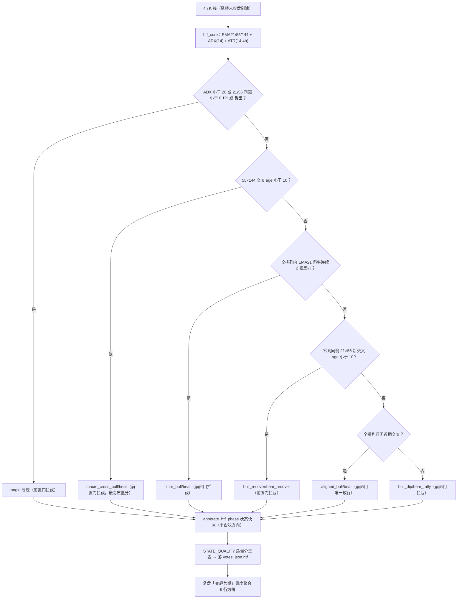
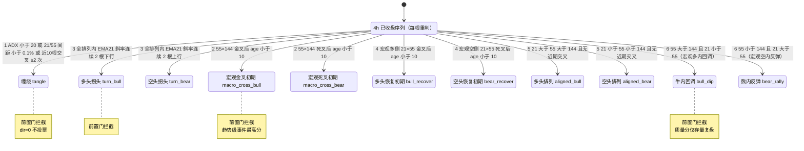
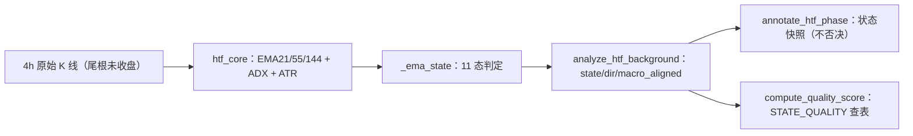
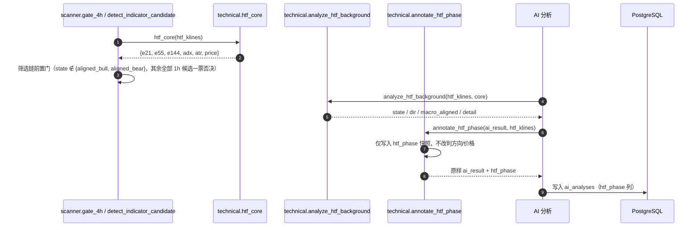

# 13-4H背景排列强度判定

> 现行版本：RULE_VERSION v2026-10-21-2（2026-10-21）。本文对照代码整理，以代码为准；历史拍板记录见 docs/archive/。
>
> 本文为原 `功能流程/13-4H背景排列强度判定.md` 与 `技术实现/13-4H背景排列强度判定.md` 于 2026-10-21 合并而成：功能口径与拍板以业务规则为准，实现细节以代码为准。
>
> **口径分层（2026-10-20 收紧，2026-10-21 再收敛）**：4h 方向配对**只存在于筛选层**——`technical.htf_context.block_both` = **`state ∉ {aligned_bull, aligned_bear}`（仅排列放行）**，`macro_cross_*` / `*_recover` / `bull_dip`·`bear_rally` / `tangle` / `turn_*` 在候选产生前即被一票否决。**AI 侧不再限制方向**（2026-10-21 用户拍板）：提示词只注入 `state`/`macro` 数据行，`annotate_htf_phase` 仅落 `htf_phase` 快照，不做双向禁开/锁逆势/过渡态影子 veto。下文「行为」列按**筛选层语义**理解。

## 功能流程图

> 本图概括本文所述功能的整体流程（Mermaid 渲染）。



## 1. 为什么四度换轴

同日四版演进，每一版都在修上一版的误判洞：

| 版本 | 主轴 | 误判洞 |
| --- | --- | --- |
| 强/弱背景（09-24） | 间距（空间量）：≥1% 强 / <1% 弱 | 间距是波动率的函数，跨币语义不一；熊内反弹误标强多 |
| 趋势年龄（10-09 r2） | 交叉后根数（时间量）：前/中/后/衰竭 | 年龄量的是「趋势存在了多久」，不是「趋势有多强」——强度与年龄倒挂 |
| 排列强度（10-10 五次拍板） | 排列角度（发散度）+ 过热/冷却 | 角度阈值分档语义模糊（稳态下 strong 与不过热近乎互斥）；过热是预警非事实，禁开误杀面大 |
| **EMA 状态机（10-11 再重构）** | **三线交叉状态（金叉/死叉/拐头/排列/缠绕/过渡）** | —— |

强度口径的核心教训：锁单矩阵真正想要的量是「趋势状态处于哪个阶段」，而阶段是**离散事件**（交叉刚发生/排列稳态/拐头/缠绕），不是连续量（角度/年龄/间距）的阈值切分。状态名直接编码行为（金叉初期锁逆势、拐头禁开、排列与恢复初期放行、过渡态禁开），判据即语义，无二次解释层。

### 1.1 演进链与拍板注记

**2026-10-10 五次拍板换轴并实施**：上一版主轴「趋势年龄四档」（同日早前拍板，RULE_VERSION `v2026-10-09r2`）被本版替换；更早为「强/弱背景」间距口径（2026-09-24，docs/16 §N-06）。

**2026-10-11 衰竭期退役**：原第五档 `exhausted` 衰竭期（MACD 柱线翻向凌驾于强度分档）整链退役——`analyze_htf_background` 删 momentum/shrinking/衰竭判定与动能注记、`enforce_htf_constraint` 删衰竭期双向禁开分支、`compute_quality_score` 删衰竭分值、`_RULE_HTF_HARD` 删衰竭禁开行与「动能同向定义」段、复盘「4h趋势期」分桶相应调整。退役动机：①单根柱线翻向即判死，噪声门槛过低；②动能维度与结构维度混装进同一枚举；③双向禁开是全系统最高优先级硬闸，却建立在最脆的信号上。1h MACD 指标投票 / macd_zero_state 企稳加分不受影响。

**2026-10-11 分级重构（同日晚，外部 4H 闸门方案第 2/3 层采纳，已被下一段替换）**：extreme 档退役；新增 overheat 过热期 / cooling 冷却期两档（斜率/距离/加速三条件 + 20 根回看，双向禁开）。细节见 git 历史，此处保留标题作演进链索引。

**2026-10-11 再重构（深夜第四次换轴）**：4h 背景改为 EMA 状态机 11 态，现行口径以本段为准。过热期/冷却期删除，div 强度分档退役，背景状态直接由三线（EMA21/55/144）的金叉/死叉/拐头/排列定名。

**删除缘由（用户拍板「没有过期热的，只有拐头」）**：过热是**预警**——抛物线可能继续走很久（真数据 ETH/DOGE 上午判「距离过热」但趋势未完），禁开误杀面大；拐头是**事实发生**——EMA21 斜率连续 2 根反向才警戒。警戒职责统一收敛到 turn 态，预警类判定全部退役。

**三线交叉层级**（用户追问「金叉死叉需要考虑在哪个位置嘛，三条均线呢」引出）：

| 交叉对 | 层级 | 语义 |
| --- | --- | --- |
| 55×144 | 宏观 | 趋势级事件，独享最高质量分（+12/−14），交叉后 ≤10 根定名 macro_cross_* |
| 21×55 | 中周期 | 位置定语义：宏观同侧的新交叉=恢复初期（锁逆势）、宏观逆侧的新交叉=过渡态（放行）——**同一交叉在不同位置行为相反，状态名必须编码位置**（bull_recover vs bear_rally），不能共用外挂判断 |
| 21×144 | 推论冗余 | 21 必经 55 与 144 的关系传递，不设态不判据 |

**div（排列角度）退役为纯注记证据**：角度阈值分档语义模糊（稳态下 strong 与「不过热」近乎互斥的定标教训），div 原始值随 `dict["div"]` 保留进 detail（「排列角度X.XXATR（仅注记）」）。

## 2. 11 态状态机

### 2.1 状态表与判定优先级

判定优先级即 `_ema_state` 代码顺序，完备分割无第五落点。`state` 现行值域（11 态）：**tangle / turn_bull / turn_bear / macro_cross_bull / macro_cross_bear / bull_recover / bear_recover / aligned_bull / aligned_bear / bull_dip / bear_rally**。

| # | 状态 | 判据 | 行为 |
| --- | --- | --- | --- |
| 1 | **tangle 缠绕** | ADX<20 ∨ 21/55间距<0.1% ∨ 近10根21×55交叉≥2次（锯齿），三道任一 | dir=0 不投票；前置门拦截 |
| 2 | **macro_cross_bull/bear 宏观交叉初期** | 55×144 交叉后 age<CROSS_FRESH_BARS(10)（严格小于，age=10 不算初期） | 趋势级事件优先定名（深V双叉不误判恢复）；前置门拦截（未到排列） |
| 3 | **turn_bull/bear 拐头** | 仅全排列内 EMA21 斜率连续 TURN_CONFIRM_BARS(2) 根反向（幅度确认吸收单根翻向噪声，同衰竭期退役教训） | 趋势衰竭警戒；前置门拦截 |
| 4 | **bull_recover/bear_recover 恢复初期** | 宏观同侧的 21×55 新交叉 age<10（金叉+宏观多=多头恢复 / 死叉+宏观空=空头恢复） | **前置门放行**（2026-10-29 起，与排列同权）；方向仍锁逆势（多头侧只放多） |
| 5 | **aligned_bull/bear 排列稳态** | 全排列（21>55>144 或反向）且无近期交叉 | **前置门放行**；方向=状态方向（aligned_bull 只放多、aligned_bear 只放空） |
| 6 | **bull_dip/bear_rally 过渡态** | 宏观逆侧（55>144 内 21<55=牛内回调 / 55<144 内 21>55=熊内反弹），21×55 关系定名，任意龄 | 前置门拦截（2026-10-20 收紧）；质量分逆宏观 −4 仅用于存量复盘排序 |

- 缠绕三道合一（2026-10-10 的 ranging/mixed 语义被吸收为 tangle 单态）；锯齿道 `_sign_changes` 近 10 根交叉计数（NaN 种子区自动剔除）。
- 拐头前置条件「仅全排列内」：还没全排列过就无「头」可拐；交叉初期回踩天然落 recover/过渡态，不与拐头混淆。
- 宏观交叉/恢复初期判据位不重复补对应交叉年龄注记（21×55 年龄、55×144 年龄在 detail 各出现一次）。
- `age_bars`=21×55 交叉年龄注记、`macro_cross_age`=55×144 交叉年龄，随返回 dict 透出（前端 Tooltip / 复盘归因用）。
- **过渡态语义**：`bull_dip`（牛内回调）/`bear_rally`（熊内反弹）描述「宏观同侧排列里的反向短周期偏移」（55>144 内 21<55＝牛内回调；55<144 内 21>55＝熊内反弹），即宏观多头里的 4h 回调。它是趋势跟随的天然回踩区，但在 **2026-10-20 筛选收紧后不再产生候选**（仅 aligned_* 与 *_recover 放行）；AI 侧见 4h 数据行后仍可自行判断方向，不受状态名限制。
- **2026-10-20 影子 A/B（已于 2026-10-21 退役）**：正式网数据（仅正式网、剔除测试网异常单）曾显示过渡态 `trigger_pullback_confirm` 74 笔均值 −0.29R、同侧 +0.16R，遂对「过渡态 × 回踩确认」做定向程序 veto 影子对比。2026-10-21 用户拍板：AI 层不再做方向兜底，该影子分支随 `enforce_htf_constraint` 一并退役；历史 `veto_original` / `ab_bucket` 行保留供复盘。

### 2.2 状态图（每根 4h 收盘后重判）



### 2.2.1 状态之间的转换步骤

状态**不是持久化对象**：每根 4h 收盘后由 `_ema_state` 从头重算一次，所谓「转换」只是相邻两根的状态名不同。转换方向由 §2.1 的优先级顺序（缠绕 → 宏观交叉 → 拐头 → 恢复 → 排列 → 过渡）唯一决定，不存在显式转移表。

常见转换及其触发条件（多/空镜像，下表只列多头侧）：

| # | 转换 | 触发条件 | 含义 |
|---|---|---|---|
| 1 | 任意 → **tangle** | `detect_tangle` 四道任一命中：ADX<20 / 21-55 间距<0.1% / 近 10 根 21×55 交叉≥2 / 近 10 根价格穿越 144 >2 次 | 趋势失效归零，任何状态都能掉进来 |
| 2 | tangle → **macro_cross_bull** | 脱离缠绕，且 55×144 金叉年龄 <10 | 优先级 2 高于 3/4，趋势级事件优先定名 |
| 3 | tangle → **aligned_bull** | 脱离缠绕，21>55>144，且 55×144、21×55 两个交叉年龄均 ≥10 | 从震荡直接进入排列（慢趋势） |
| 4 | tangle → **turn_bull** | 脱离缠绕，仍满足 21>55>144，但 EMA21 斜率连续 2 根下行 | 罕见：缠绕解除瞬间排列已在拐头 |
| 5 | tangle → **bull_dip / bear_rally** | 脱离缠绕但不成全排列（21/55 与 55/144 不同号） | 落入过渡态 |
| 6 | aligned_bull → **turn_bull** | 仍满足 21>55>144，EMA21 斜率连续 2 根为负 | 排列内衰竭警戒，**退出放行集** |
| 7 | turn_bull → **aligned_bull** | EMA21 斜率恢复，仍为全排列 | 警戒解除，**回到放行集** |
| 8 | turn_bull → **bull_dip** | 排列被破坏：21 跌破 55，但 55 仍在 144 上方 | 转入宏观多头内的回调区 |
| 9 | turn_bull → **macro_cross_bear** | 期间发生 55×144 死叉，年龄 <10 | 优先级 2 高于 3，直接跳到宏观死叉初期 |
| 10 | aligned_bull → **bull_dip** | 21 跌破 55，55 仍 >144 | 最典型的「趋势还在、短周期走坏」 |
| 11 | bull_dip → **bull_recover** | 21×55 重新金叉，年龄 <10，且 55>144 | 回调结束的第一阶段，**进入放行集**（2026-10-29 起） |
| 12 | bull_dip → **aligned_bull** | 恢复 21>55>144 全排列，且交叉年龄 ≥10 | **回到排列**（从过渡态经恢复初期到排列） |
| 13 | bull_dip → **bear_rally** | 55 跌破 144（宏观翻空），此时 21>55 | 宏观方向已反转，反弹属逆势 |
| 14 | macro_cross_bull → **aligned_bull** | 交叉年龄 ≥10 且仍全排列 | 初期结束，**进入放行集** |
| 15 | macro_cross_bull → **bull_dip** | 年龄 ≥10 但未全排列，21<55 且 55>144 | 交叉后未能完成排列 |

镜像规则：`aligned_bear` / `turn_bear` / `macro_cross_bear` / `bear_recover` 的条件把 `>` 与 `<` 互换、`bull_dip` 换 `bear_rally`。

对筛选的实际意义（放行集 = `aligned_bull` / `aligned_bear` / `bull_recover` / `bear_recover`）：

- **进入放行集**三条路：交叉年龄 ≥10 后完成全排列；从 `tangle` 直接落进排列（第 3 行）；21×55 在宏观同侧重新交叉（第 11 行，恢复初期）。
- **离开放行集**四种：斜率拐头（→ turn_*）、21 跌破 55（→ 过渡态）、55×144 反向交叉（→ macro_cross_*）、四道缠绕任一命中（→ tangle）。
- 因此「4h状态禁开」把关的实质是：**等宏观同侧结构成型（排列或恢复初期），短周期结构一被破坏就退出**。恢复初期与排列的差别只在 21×55 交叉年龄，方向锁逆势对两者同样生效。

### 2.3 宏观守卫（已吸收，历史记录）

~~`macro_aligned = (EMA55 > EMA144) == (dir > 0)` 独立分支~~ → 被状态机自然吸收（`_STATE_MACRO` 查表）：锁逆势态恒 True、过渡态恒 False、tangle/turn None。三线堆叠 6 种枚举表（V型反转中期/熊内反弹/牛内回调注记）由状态名+detail 直接承载，不再需要独立小节。**144 的位置决定「能不能做」的原则不变**——只是实现从二值守卫分支改为状态编码。

### 2.4 动能修正器（MACD，已随衰竭期退役，历史记录）

MACD 柱线翻向判定整链删除（见 §1.1）；1h 侧 MACD 指标投票与 macd_zero_state 企稳加分不受影响。

## 3. 方向限制矩阵（仅筛选层）

**2026-10-21 用户拍板：4h 方向配对只保留在筛选层。** AI 提示词只接收 `state`/`macro` 数据行，出结果后的程序层也不再改判（原 `enforce_htf_constraint` → `annotate_htf_phase`，仅落 `htf_phase` 快照）。

| 状态组 | 常量 / 字段 | 筛选层行为（scanner 前置门） |
| --- | --- | --- |
| **非 aligned_\***（tangle / turn_\* / macro_cross_\* / \*_recover / bull_dip·bear_rally） | `htf_context.block_both = state ∉ STATE_ALIGNED` | **一票否决**：不产生 1h 候选，映射漏斗关卡 `htf_state_lock`（tangle 由 `reject_reason` 先行映射 `gate_4h`） |
| **aligned_bull** | `STATE_ALIGNED` | 放行，且仅放行 **long** 候选（逆势 short 由 `STATE_LOCK_CONTRA` + `dir` 前置拦截） |
| **aligned_bear** | `STATE_ALIGNED` | 放行，且仅放行 **short** 候选 |

AI 层：`annotate_htf_phase(ai_result, htf_klines)` 在 suggest 且有 4h 数据时写入 `htf_phase`（=状态 key）供 `AIAnalysis` / 复盘统计，**不做任何方向否决或价格改判**；无 4h 数据或非 suggest 原样返回。历史 `veto_original`（source=htf_constraint）行仅存于旧数据。渲染层 `render_indicator_block` 只输出一条数据行：

```
- 4h背景: state=<key>（<中文标签>） macro=同侧|逆侧
```

不再输出「状态约束（硬性）」「方向约束（硬性）」等限制行（2026-10-21 删除）。

## 4. 质量分矩阵（`STATE_QUALITY`）

| 状态 | 同向 | 逆向 | 备注 |
| --- | --- | --- | --- |
| tangle | 0 | 0 | dir=0 不进方向分支 |
| turn_bull/bear | −8 | −4 | 前置门已拦截，仅存量复盘/排序兜底 |
| macro_cross_bull/bear | **+12** | −14 | 趋势级事件独享最高档（原 extreme 语义被吸收） |
| bull_recover/bear_recover | +8 | −10 | |
| aligned_bull/bear | +10 | −12 | |
| bull_dip/bear_rally | +5 | −6 | 过渡态 macro_aligned=False 额外 −4（天然只作用过渡态） |
| 退役旧档兜底 | +5 | −8 | weak/medium/strong/extreme/exhausted/overheat/cooling 存量行（`_STATE_LEGACY_NEUTRAL`），旧 `phase` 键兼容读取 |

矩阵落在 `compute_quality_score` 查表；`STATE_QUALITY` 定义见 `technical.py`。2026-10-21 起该分**不参与 AI 方向判断**（AI 只拿 4h 数据行），仅用于筛选层候选排序与复盘统计。

## 5. 复盘维度「4h趋势期」

### 5.1 落库链路与 6 桶聚合

分析落库链路：`annotate_htf_phase` 落 `htf_phase`（=状态 key，suggest 且有 4h 数据时；2026-10-21 起只快照、不否决）→ `AIAnalysis.htf_phase`（VARCHAR(20)，2026-10-11 扩列）→ 开单时 `_ai_snapshot` 随快照自持进 `trade_records` → `build_actual_review` 有序维度。**11 态按行为聚合 6 桶（直接铺 11 桶过散，复盘可读性优先）**：turn 两态→拐头、macro_cross 两态→宏观交叉、recover 两态→恢复初期、aligned 两态→排列、dip/rally→过渡；加缠绕共 6 行为桶 + 未知兜底（退役旧档/无 4h 数据 NULL），有序输出空桶不占行；**维度名保留「4h趋势期」**（前端列名与既有引用不动）。

分组验证目标：非排列态被筛选层拦截后不应再产生新开仓样本（历史 veto 快照保留反事实现索）；宏观交叉初期的趋势级事件质量（+12 档历史样本胜率/EV）；aligned 双态的实际表现对比。AI 层不再按 4h 方向改判后，`htf_phase` 只用于观察「AI 在何种 4h 背景下给出何种结论」，不再有隔离变量。

### 5.2 影子 A/B 可读出口（2026-10-20，2026-10-21 退役）

原过渡态×回踩确认的影子 veto 分支随 `enforce_htf_constraint` 退役，不再产生新行；历史 `TradeReview.ab_bucket='transition_pbc'` 与 `/review/stats` 的 `shadow_ab` 组保留可读，供存量复盘。

### 5.3 样本与可复现口径（2026-10-20 复核，历史）

入库快照口径（仅正式网、剔除异常单；`trade_records.ai_snapshot->>'htf_phase'`，该列 2026-10-09 起写入）下，过渡态×回踩确认**平仓单仅 n=3**（均值 −0.334R、最佳 +1.07R；long 2 / short 1），同侧对照 n=186（long 81 均 −0.165R / short 105 均 +0.128R，方向差异 t≈1.4、**p≈0.16 不显著**）——**样本远不足以单独判读**。原拍板依据的「74 笔均值 −0.29R / 最佳 +2.4R，同侧 +0.16R / 最佳 +6.3R」无法按上述快照列复现。2026-10-21 用户拍板直接退役 AI 层方向兜底，不再按该影子实验收窄方向。

## 6. 行为影响推演

以下为 10-10 强度口径的推演存档（现行行为以 §2/§3 状态机口径为准）：

| 场景 | 旧（强度口径） | 新（状态机口径） |
| --- | --- | --- |
| 抛物线加速 | 过热期双向禁开（预警） | **趋势内继续走 → aligned（前置门放行）；EMA21 斜率连续 2 根反向 → turn（前置门拦截，事实发生）** |
| 深V 急拉双叉同步 | strong/overheat 视角度 | macro_cross_bull（55×144 优先定名；前置门拦截） |
| 牛内回调 fresh 死叉 | weak/medium 视角度 | bull_dip 过渡态（前置门拦截，宏观多头侧的回调，位置语义） |
| 21×55 金叉 ∧ 宏观多头 | 视角度分档 | bull_recover（前置门拦截，fresh）或 aligned（age≥10，放行） |
| ADX<20 / 锯齿 | ranging/mixed 两态 | tangle 单态（前置门拦截） |
| 新上市币（4h<155根） | 返回 None，4h 整票消失 | 不变 |
| 存量旧行 | — | 退役枚举复盘归「未知」、质量分中性兜底 ±5/−8 |

## 7. 影子窗口与注意项

### 7.1 RULE_VERSION 与影子窗口

本次变更含**评分函数**（STATE_QUALITY 矩阵替换 div 分档矩阵）与筛选层放行口径。按 docs/14 §七 CARD-09 惯例已执行：RULE_VERSION 现行 **`v2026-10-21-2`**（config.py；2026-10-21 方向职责收敛再见 changelog）；REC70_START 重置 → **2026-10-11**（shadow.py，前向窗口从重构上线日起算）；CARD-09 锁定期顺延 → **2026-11-08**。重构上线后的新样本与旧样本按 RULE_VERSION 天然分层，旧版本样本统计不受影响。

### 7.2 EMA144 收敛注意项（不变）

200 根窗口内 EMA144 仅 ~55 步递推，SMA 种子偏差残留 ~47%，宏观刚翻转时可能滞后错判。当前窗口已按 300 根拉取（残留 ~12%）；后续若发现宏观交叉判定在翻转初期钝化，优先加长拉取窗口而非改判据。

## 8. 技术实现

### 8.1 模块与分层

实现集中于 `backend/app/services/strategy/technical.py`：

| 函数 | 行号 | 职责 |
| --- | --- | --- |
| `_sign_changes` | 634-640 | 近 n 根内 f−m 符号变号次数（缠绕锯齿道计数） |
| `_htf_cross_age` | 717-733 | 两 EMA 最后一次交叉的 (距最新根数, 交叉后方向)，NaN 种子区自动剔除 |
| `htf_core` | 736-775 | 4h 共享计算核心：一次算好 EMA21/55/144 + ADX(14) + ATR(14,4h) |
| `_ema_state` | 643-714 | 4h EMA 状态机 11 态（判定优先级即代码顺序） |
| `analyze_htf_background` | 778-846 | 对外入口：返回 state / dir / macro_aligned / 年龄 / div / detail |
| `annotate_htf_phase` | 1020-1036 | 4h 状态快照（仅写 `htf_phase`，不做方向否决；原 `enforce_htf_constraint` 2026-10-21 退役） |
| `compute_quality_score` | 1252-1395 | STATE_QUALITY 矩阵查表（含过渡态逆宏观 −4） |



### 8.2 数据结构

**`analyze_htf_background` 返回 dict**：

| 字段 | 说明 |
| --- | --- |
| `state` | 11 态 key（值域见 §2.1） |
| `state_label` | `STATE_LABELS[state]` 中文名 |
| `dir` | 状态方向（1 多 / -1 空 / 0 不投票），`_STATE_DIR` 查表 |
| `macro_aligned` | True 同侧 / False 逆侧 / None 未评估，`_STATE_MACRO` 查表 |
| `age_bars` | 21×55 交叉年龄（`_htf_cross_age`） |
| `macro_cross_age` | 55×144 交叉年龄 |
| `div` | 排列角度（min of 21/55 与 55/144 的 ATR 距离），仅注记 |
| `detail` | 证据文本（EMA 值 + 交叉年龄注记 + ADX） |

**关键常量**（`technical.py`）：

| 常量 | 行号 | 值 / 内容 |
| --- | --- | --- |
| `CROSS_FRESH_BARS` | 585 | 10（交叉「初期」窗口，55×144 与 21×55 共用，严格小于） |
| `TURN_CONFIRM_BARS` | 586 | 2（拐头确认：EMA21 斜率连续反向根数） |
| `TANGLE_CROSS_LOOKBACK` | 588 | 10（缠绕锯齿道：近 10 根 21×55 交叉 ≥2 次） |
| `STATE_LABELS` | 590-597 | 11 态中文名映射 |
| `STATE_BLOCK_BOTH` | 598 | `("tangle", "turn_bull", "turn_bear")` |
| `STATE_LOCK_CONTRA` | 599-603 | `macro_cross_*` / `*_recover` / `aligned_*`（宏观同侧，锁逆势） |
| `STATE_QUALITY` | 606-613 | 11 态（同向, 逆向）质量分矩阵 |
| `_STATE_LEGACY_NEUTRAL` | 614 | `(5, -8)`——退役旧档存量行兜底 |
| `_STATE_DIR` | 616-623 | 11 态方向查表 |
| `_STATE_MACRO` | 624-631 | 11 态宏观对齐查表 |

### 8.3 消费端时序



### 8.4 API 契约

无独立端点，随分析/复盘链路透出：

| 端点 | 方法 | htf 字段 |
| --- | --- | --- |
| `/api/scans/{id}/results` | GET | `votes_json.htf`（state / dir / detail 等）供前端 Tooltip 与 AI 上下文 |
| `/api/scans/{id}/ai-analyses` | GET | `htf_phase`（4h 状态 key） |
| `/api/scans/review/stats` | GET | 「4h趋势期」6 桶有序维度 |

### 8.5 配置项

| 配置 | 位置 | 说明 |
| --- | --- | --- |
| `RULE_VERSION` | `config.py`（现行 v2026-10-21-2） | 状态机/筛选放行/质量分矩阵变更须 bump |
| `REC70_START` | `shadow.py` | 影子前向窗口起点（随重构重置，现行 2026-10-11） |
| 4h 拉取窗口 | scanner 侧按 300 根拉取 | EMA144 收敛（残留 ~12%） |
| 判据常量 | `technical.py` 代码常量 | `CROSS_FRESH_BARS` / `TURN_CONFIRM_BARS` / `TANGLE_CROSS_LOOKBACK` 非运行时常开配置 |

### 8.6 并发、幂等与异常处理

- **共享计算去重**：`htf_core` 一次算好 EMA/ADX/ATR，`gate_4h` 与 `analyze_htf_background` 共用（第 1/2 步去重不改行为）。
- **异常降级**：ADX 计算失败降级 None（状态机跳过该道判据）；`annotate_htf_phase` 整体 `try/except`，异常时仅告警、原样返回（不阻塞分析）。
- **样本不足**：已收盘 <155 根（EMA144 种子 + 收敛余量）返回 None，4h 整票消失（新上市币）。
- **幂等**：状态判定为纯函数，同一 4h 序列结果确定。
- **历史 veto**：2026-10-21 前 `enforce_htf_constraint` 否决的 suggest 曾快照 `veto_original`；现仅存量数据保留，复盘代码继续兼容读取。

## 9. 测试与回滚

- `backend/tests/test_htf_trend_age.py`：11 态分类全覆盖（缠绕三道：间距/ADX 管件级+锯齿道纯函数直测；拐头连续 2 根边界纯函数直测；宏观交叉 age=10 严格小于边界+双叉优先级纯函数直测；恢复/过渡位置语义）+ `_htf_cross_age` 纯函数（幻影交叉防护）+ `annotate_htf_phase` 全状态×双向不否决 + 仅 suggest 且有 4h 数据落快照 + 质量分矩阵全枚举（含过渡态逆宏观 −4、tangle 不进分支、退役旧档 phase 键兜底）+ 4h 数据行渲染
- `backend/tests/test_prompt_invariants.py`：不变量 8（结构化行 `state=` 键）、不变量 9（提示词声明 4h 仅数据参考；不出现状态约束/方向约束/双向禁开/程序强制改判）
- `backend/tests/test_htf_ranging_filter.py`：4h 背景与震荡过滤联动
- `backend/tests/test_review_batch3.py`：复盘「4h趋势期」7 桶有序维度 + 退役旧档归未知 + `annotate_htf_phase` 快照夹具（aligned 排列形态；多头背景开空不被改判）+ 历史影子 A/B `shadow_ab` 分组（存量行）
- `backend/tests/test_rec70_shadow.py`：窗口起点断言同步 2026-10-11
- 回滚 = revert 提交 + RULE_VERSION/REC70_START 回滚；账本/回测/实盘三端同函数，无口径漂移

## 相关文档

- [02-信号触发器](02-信号触发器.md)：1h 触发器与候选链路；4h 状态机前置门位于筛选链。
- [11-金K形态库](11-金K形态库.md)：回踩两段式确认中的金K证据。
- [01-币种筛选与扫描](../扫描与筛选/01-币种筛选与扫描.md)：筛选链前置门 `htf_context.block_both` 与候选产生。
- [03-AI分析](../AI决策/03-AI分析.md)：AI 层 4h 数据行消费与 `annotate_htf_phase` 快照。
- [06-复盘归因](../复盘归因/06-复盘归因.md)：复盘「4h趋势期」维度与影子 A/B 对照。
- [04-交易执行与多账号](../交易执行/04-交易执行与多账号.md)：`htf_phase` 随开单快照落 `trade_records`。
- 历史拍板存档：`docs/archive/`。
