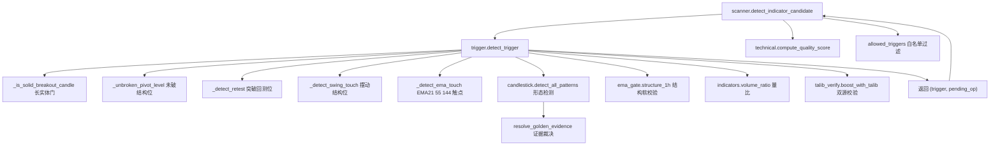
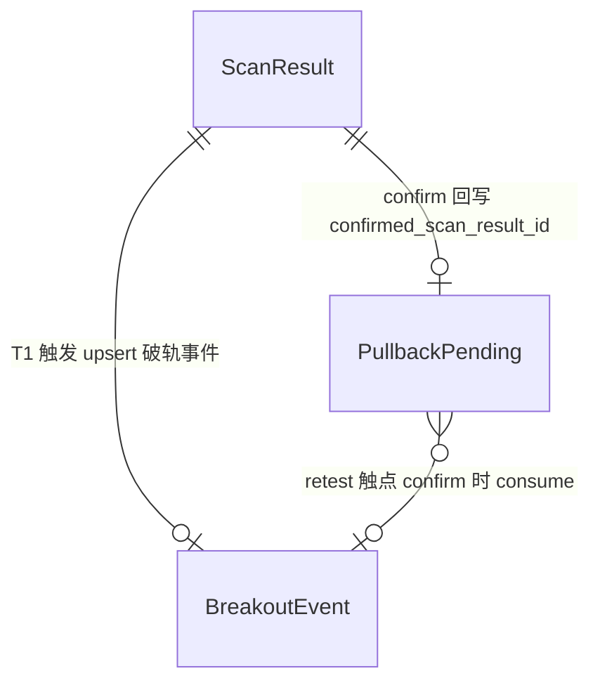
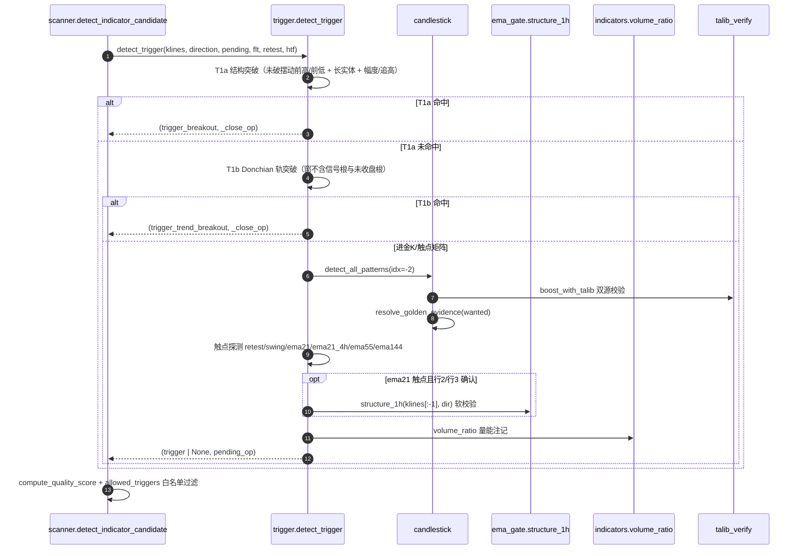
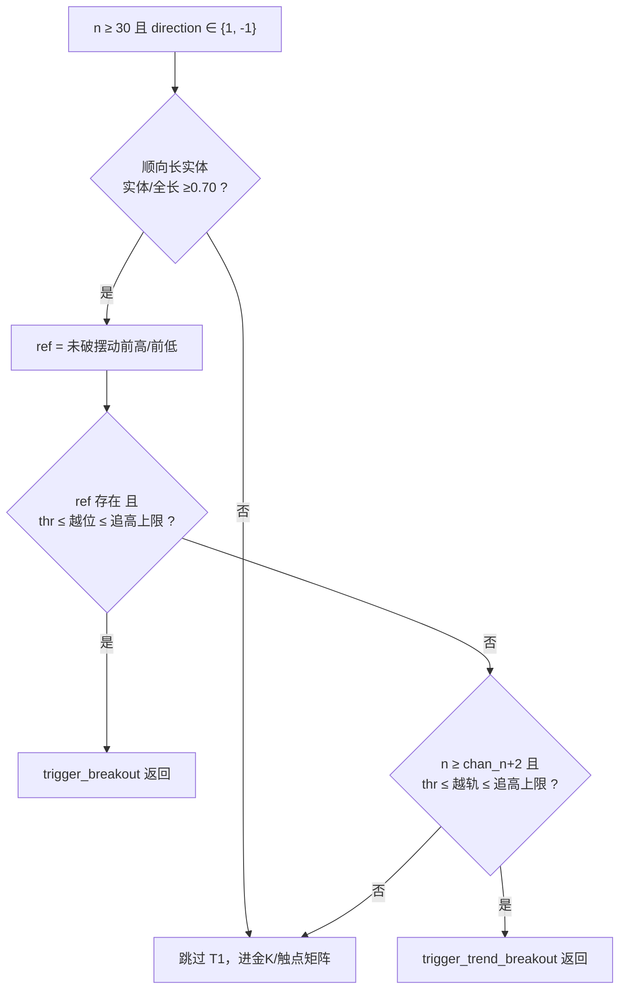
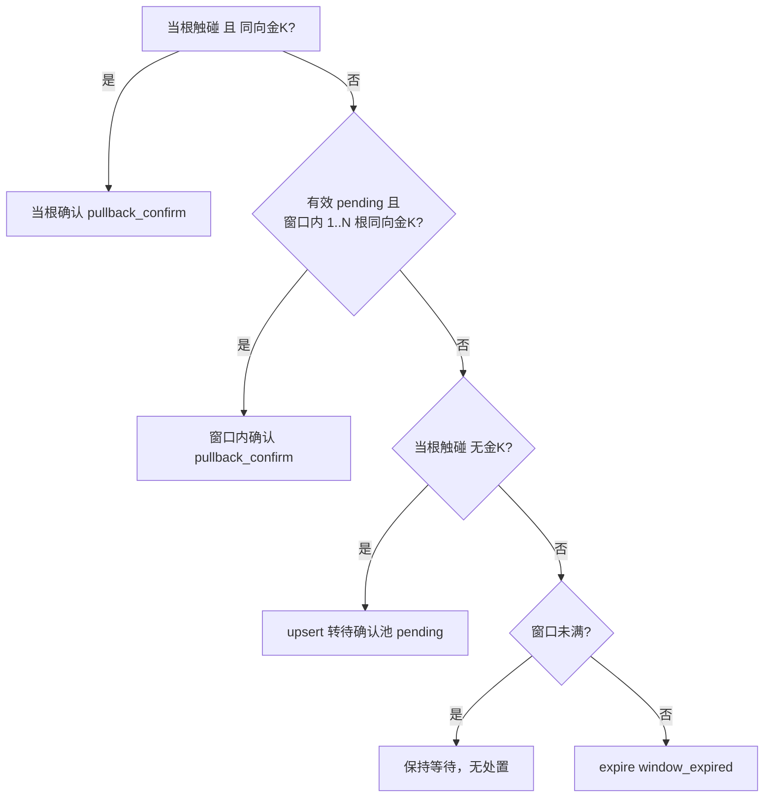
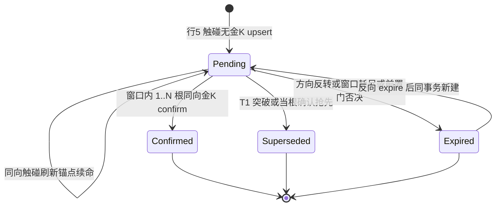

# 技术文档 02 — 信号触发器（对照 功能流程/02-信号触发器.md）

> 现行版本：RULE_VERSION v2026-10-18（2026-10-18）。本文从功能文档 02 提炼**技术实现细节**，以代码为准；功能口径与拍板记录见 [功能文档](../功能流程/02-信号触发器.md)。

## 1. 模块与分层

触发器为策略层纯函数模块：接收上游（scanner）透传的 `klines` / `direction` / `pending` / `flt` / `retest` / `htf`，返回 `(trigger, pending_op)`，**不读 DB、不落库**；落库由 scanner 编排层完成。

| 模块 | 文件 | 职责 |
|---|---|---|
| 总入口 | `backend/app/services/strategy/trigger.py` | `detect_trigger`（571-888）、`_is_solid_breakout_candle`（133-154）、`_unbroken_pivot_level`（537-557）、`_close_op`（560-568）、`_detect_ema_touch`（267）、`_detect_retest`（443）、`_detect_swing_touch`（498）、`_pullback_volume_note`（244-264）、`_touch_ref_label`（92-99）、`_position_ref_of`（102-104） |
| 形态证据 | `backend/app/services/strategy/candlestick.py` | 检测器、`GOLDEN_PATTERNS`（662-674）、`resolve_golden_evidence`（752-823）、`detect_solid_trend_candle`（726）、`decision_shadow_bonus`（157）、`detect_all_patterns`（826-857）、`PATTERN_LABEL_MAP`（684-701） |
| 摆动结构 | `backend/app/services/strategy/__init__.py` / `swing.py` | `recent_swings`（收盘价摆动点 + HH/HL/LH/LL 标注，无前视）；`find_swing_points`/`merge_swings`/`classify_structure` |
| EMA 门 | `backend/app/services/strategy/ema_gate.py` | `structure_1h`（132-221，ema21 触点软校验用）、`gate_4h`（75-131，上游前置） |
| EMA 工具 | `backend/app/services/strategy/ema.py` | `calc_ema`（SMA 种子标准 EMA）、`analyze_ema` |
| 指标 | `backend/app/services/strategy/technical.py` | `compute_indicator_votes`（1112）、`DIR_VOTE_SHORTS`(942)、`DIR_VOTE_MIN`(943)、`STATE_BLOCK_BOTH`(598)、`compute_quality_score`（1252） |
| 量能与 ATR | `backend/app/services/strategy/indicators.py` | `volume_ratio`（33-46）、`BREAKOUT_VOL_RATIO`(14)、`calc_atr` |
| 双源校验 | `backend/app/services/strategy/talib_verify.py` | `boost_with_talib`（方向一致时 strength +0.1，封顶 1.0） |
| 位置枚举 | `backend/app/services/strategy/types.py` | `position`=support/resistance |
| 参数透传 | `backend/app/services/scan_filters.py` | `ScanFilters`（DB > env > 代码默认）、`ALL_TRIGGERS`/`ALL_TOUCH_REFS`/`DEFAULT_TOUCH_REFS` |
| 上游编排 | `backend/app/services/scanner.py` | `detect_indicator_candidate`（210-508）调用 `detect_trigger`，落库 pending（1265-1332）与破轨事件（1176-1232） |



## 2. 数据结构

### 2.1 触发类型常量（trigger.py:72-75）

| 常量 | signal_type | 状态 |
|---|---|---|
| `BREAKOUT` | `trigger_breakout` | 现行：T1a 结构突破 |
| `TREND_BREAKOUT` | `trigger_trend_breakout` | 现行：T1b 趋势突破 |
| `PULLBACK` | `trigger_pullback` | 历史类型（不再产生新记录；pending upsert 时仍按此口径计质量分，scanner.py:456） |
| `PULLBACK_CONFIRM` | `trigger_pullback_confirm` | 现行：回踩两段式确认 |

`scan_filters.ALL_TRIGGERS`（scan_filters.py:28）收敛为现行三类；`trigger_trend_pullback`、`trigger_candlestick` 已下线（历史行前端标签保留）。

### 2.2 总入口签名与返回契约（trigger.py:571-579）

```python
detect_trigger(klines, direction, pending=None, flt=None, retest=None, htf=None)
  -> (trigger, pending_op)
```

| 入参 | 类型 | 语义 |
|---|---|---|
| `klines` | list[list] | 1h K 线；`klines[-2]` 为信号根（已收盘），`klines[-1]` 未收盘仅取现价 |
| `direction` | int | 1 多 / -1 空（方向票多数决 `net` 的符号） |
| `pending` | dict\|None | 该币活跃 pending 快照 `{id, direction, stage1_candle_open, touch_ref}` |
| `flt` | `ScanFilters`\|None | 参数组；None 时按 `resolve_scan_filters(None)` 解析 |
| `retest` | dict\|None | 活跃破轨事件快照 `{price, direction, candle_open}`（naive UTC） |
| `htf` | list\|None | 4h 原始 K 线（ema21_4h 触点与趋势门用；None/过短静默跳过） |

命中 `trigger` dict（做多突破示例）：

```python
{
  "type": "trigger_breakout", "direction": 1, "position": "resistance",
  "breakout_level": ref, "candle_open": <信号K线开盘时间>,
  "pattern": None, "position_ref": "破前高 {ref:.6g}",
  "breakout_pct": (close - ref) / ref * 100,
  "reason": "指标同向·[放量X.X倍·]长实体收盘突破前高({ref:.6g})",
}
```

> 注：突破类 `position_ref` 现值取自代码（`破前高`/`破前低`/`破轨高`/`破轨低`，trigger.py:681/691/714/725），以代码为准。

`pending_op` 为 None 或 `{"op": "upsert"|"confirm"|"supersede"|"expire", ...}`；upsert/expire 由 scanner 结合 DB 行补全（方向反转拆两步、quality/votes 快照填充），trigger 层保持无 DB 依赖。

### 2.3 表字段（backend/app/models/scan.py）

- **ScanResult**（`scan_results`，scan.py:31）：触发器相关列 `signal_type`、`pattern`、`touch_ref`、`position_ref`、`position`、`breakout_pct`（回踩恒 0.0）、`quality_score`、`votes_json`（含 `htf` 子对象）、`signal_reason`（截断 120 字）、`strength`=quality/100。
- **PullbackPending**（`pullback_pendings`，scan.py:219）：`status ∈ {pending, confirmed, superseded, expired}`、`direction`、`stage1_candle_open`（触碰根开盘，有效期锚）、`ema21`（历史命名的 Stage-1 位价）、`touch_ref`、`quality_score`/`votes_json`（PULLBACK 口径快照）、`confirm_pattern`、`confirmed_scan_result_id`、`resolve_reason`、`resolved_at`。
- **BreakoutEvent**（`breakout_events`，scan.py:198）：`status ∈ {active, consumed, expired}`、`direction`、`level_price`（= `breakout_level`）、`candle_open`。



### 2.4 金K白名单常量（candlestick.py）

| 常量 | 值 | 语义 |
|---|---|---|
| `GOLDEN_BULLISH` | (hammer, bullish_engulfing, morning_star, piercing_line) | 看涨 4（candlestick.py:662-667） |
| `GOLDEN_BEARISH` | (shooting_star, bearish_engulfing, evening_star, dark_cloud_cover) | 看跌 4（candlestick.py:668-673） |
| `GOLDEN_PATTERNS` | 上述 8 种并集（candlestick.py:674） | 现行信号白名单 |
| `SINGLE_SHADOW_PATTERNS` | {shooting_star}（candlestick.py:717） | 唯一走复合确认的形态 |

## 3. 核心流程（时序/状态图）

### 3.1 单币触发判定主链路（一轮扫描内）



### 3.2 突破互斥归类（T1a → T1b 回退）



### 3.3 回踩两段式决策矩阵（7 行，docs/19 §4.1）

| # | T1 突破 | 当根触碰 | 当根金K | 有效 pending | 判定 | pending 处置 |
|---|---|---|---|---|---|---|
| 1 | ✓ | — | — | 任意 | T1a/T1b 突破 | 同向 supersede / 反向 expire(flip) |
| 2 | ✗ | ✓ | ✓ | 任意 | 当根确认 | 同向 supersede(same_candle_confirm) / 反向 expire(flip) |
| 3 | ✗ | ✗ | ✓ | ✓（锚∈前 1..N 根） | 窗口内确认 | confirm |
| 4 | ✗ | ✗ | ✓ | ✗ | 不触发（纯金K已下线） | 有无效 pending → expire |
| 5 | ✗ | ✓ | ✗ | 任意 | 不触发，转 pending | upsert |
| 6 | ✗ | ✗ | ✗ | ✓ | 不触发 | 窗口未满保持等待 / 耗尽 expire |
| 7 | ✗ | ✗ | ✗ | ✗ | 不触发（观察池） | 无 |



### 3.4 pending 状态机（trigger.py 决定 → scanner 落库，scanner.py:1265-1332）



## 4. 关键算法与常量

### 4.1 T1a 结构突破（trigger.py:653-694）

- 结构取材 `recent_swings(klines[:-1], order=flt.swing_order, n=10)`——取信号根**之前**的已收盘 K 线，摆动点收盘价口径、两侧各 `swing_order` 根确认、无前视。
- 突破位 `_unbroken_pivot_level`：从最新向最旧扫描摆动高/低点，判定区间 `klines[idx+1:-2]`，任一收盘越位即已破，继续向旧找；全破返回 None。
- 做多 `close ≥ ref × (1 + thr)` 且 `thr ≤ 越位 ≤ breakout_max_pct`；做空镜像。追高拦截后**会**回落 T1b 判定。

### 4.2 T1b 趋势突破（trigger.py:695-729）

- 窗口 `klines[-2 - chan_n : -2]`（`chan_n = flt.breakout_channel_bars`，默认 20，min 5），不含信号根与未收盘根；要求 `n ≥ chan_n + 2`。
- `chan_high = max(high)` / `chan_low = min(low)`；做多 `close ≥ chan_high × (1 + thr)` 且未超追高上限，做空镜像。

### 4.3 共享闸门

| 闸门 | 常量 | 判据 | 位置 |
|---|---|---|---|
| 最小幅度 | `BREAKOUT_THRESHOLD`=0.002 | 收盘越位 ≥0.2%，毛边不算 | config.py:43 |
| 追高上限 | `BREAKOUT_MAX_PCT`=1.5（0=关闭） | T1a 按结构位、T1b 按轨价各自衡量 | config.py:49 |
| 长实体门 | `BREAKOUT_BODY_RANGE_MIN`=0.70 | 顺向实体 + `|close-open|/(high-low) ≥0.70`；`rng≤0`/`body≤0` 拒绝 | trigger.py:130 |
| 放量加分 | `BREAKOUT_VOL_RATIO`=1.2（非硬门） | 量比 ≥1.2 → reason 前缀 + 质量分 +5 | indicators.py:14 |
| 趋势K实体门 | `TREND_CANDLE_BODY_RANGE_MIN`=0.60 | 与突破门 0.70 各自独立改版（2026-10-10-4 解除同步） | candlestick.py:723 |

量比口径 `indicators.volume_ratio`（indicators.py:33-46）= 信号 K 线量 ÷ 近 20 根已收盘**中位**量（需 ≥22 根，否则返回 0）。

### 4.4 触点体系（`TOUCH_ORDER`，trigger.py:79-81）

| 优先级 | touch_ref | 门控要点 |
|---|---|---|
| 1 | `retest` | 方向一致 + 事件窗口（`retest_window_bars`=24）+ 带宽触碰（`low ≤ lvl×(1+band)` 且 `close ≥ lvl`） |
| 2 | `swing` | 只认最近 3 个 HL/LH + 时效门 `SWING_MAX_BARS_AGO`=40（trigger.py:108）+ 带宽触碰 |
| 3 | `ema21` | 无门；命中后须过 `structure_1h` 软校验（不过门不否决，−15） |
| 4 | `ema21_4h` | 4h EMA21 触点；`htf` 缺失/过短时静默跳过 |
| 5 | `ema55` | 数据门 `ema_touch_min_bars`=200 + 排列门 `ema21>ema55` + 斜率门（近 5 根同向） |
| 6 | `ema144` | 数据门 + 走平/顺势门（`SLOPE_BARS`=20、`SLOPE_FLAT_PCT`=0.005 容差带）+ 4h 上下文门（`htf_dir` 缺失 fail-closed） |

同根多触点按 `TOUCH_ORDER`（trigger.py:79-81）优先级标注，中文标签 `TOUCH_LABELS`（trigger.py:82-89）。带宽 `structure_touch_band_pct`=0.3%。

### 4.5 金K证据裁决 `resolve_golden_evidence`（candlestick.py:752-823，wanted=bullish/bearish）

0. 方向优先过滤；同向双报直通优先（先取非单影线直通形态，再回落 strength 序首个走复合）。
1. 非单影线金K直通：当根 ∈ `GOLDEN_PATTERNS` 且 ∉ `SINGLE_SHADOW_PATTERNS`（吞没/启明星/黄昏星/锤形线）且方向匹配 → 直接确认。
2. 双流星：当根流星方向匹配 + 前根同形态 → note=`双流星组合`。
3. 流星+趋势K：当根无金K 时前根锤/流星方向匹配 + 当根顺向趋势K（`detect_solid_trend_candle`，实体 ≥60%）→ 组合确认，pattern 落前根形态。

### 4.6 金K形态因子常量（candlestick.py）

| 常量 | 值 | 语义 |
|---|---|---|
| `ENGULF_BODY_LOOKBACK` | 20 | 吞没实体基线回看根数 |
| `ENGULF_BODY_MIN_RATIO` | 0.6 | 吞没K线（body2）实体须 ≥ 基线中位数 × 0.6 |
| `ENGULF_BODY_MIN_BARS` | 10 | 基线样本下限 |
| `DECISION_SHADOW_BONUS_GRADES` | ((0.10, 5), (0.20, 3), (0.30, 1)) | 决断K线影线梯度加分档（>30% 不加分） |
| `MORNING_STAR_MID_BODY_MAX_RATIO` | 0.3 | 启明/黄昏星中K实体上限 |

## 5. API 契约

触发器无独立端点；其输出现值经 `/api/scans`（backend/app/api/scan.py）暴露：

| 方法 | 路径 | 触发器相关出参要点 | 代码位置 |
|---|---|---|---|
| GET | `/api/scans/latest/results` | `signal_type`/`pattern`/`touch_ref`/`position_ref`/`quality_score`（filter：signal_type/position/pattern/ema_state） | api/scan.py:141-170 |
| GET | `/api/scans/{scan_id}/results` | 同上，指定扫描 | api/scan.py:171-193 |
| GET | `/api/scans/pullback-pendings` | pending 池：`status`/`direction`/`stage1_candle_open`/`touch_ref`/`resolve_reason` | api/scan.py:1419-1459 |
| GET | `/api/scans/hit-history` | 跨轮次命中历史（全 signal_type，前端标注命中K线/开单区间） | api/scan.py:1514-1620 |
| GET | `/api/scans/klines/{symbol}` | K 线 + 摆动点标注（1h/4h） | api/scan.py:1685-1744 |
| POST | `/api/scans/analyze` | 手动搜索 AI 分析（symbol=manual_search） | api/scan.py:1745-1851 |

## 6. 配置项

触发器消费的 `ScanFilters` 键（`scan_filters.py`，优先级 DB > env > 代码默认）：

| 键 | 默认（env） | 消费闸门 |
|---|---|---|
| `breakout_channel_bars` | 20（min 5） | §4.2 T1b Donchian 窗口 |
| `breakout_threshold` | 0.002 | §4.3 最小突破幅度 |
| `breakout_vol_ratio` | 1.2 | §4.3 放量加分门槛 |
| `breakout_max_pct` | 1.5（0=关闭） | §4.3 追高上限 |
| `allowed_triggers` | 全 3 类（`ALL_TRIGGERS`） | scanner 命中后过滤（白名单外不产生候选，pending 处置照常） |
| `pullback_touch_refs` | 6 类（`DEFAULT_TOUCH_REFS`） | §4.4 触点探测启用白名单 |
| `retest_window_bars` | 24（0=关闭） | §4.4 retest 事件窗口 |
| `pending_confirm_window_bars` | 4（config.py:56、scan_filters.py:99） | §3.4 pending 确认窗口 |
| `structure_touch_band_pct` | 0.3 | §4.4 retest/swing 触碰带宽 |
| `ema_touch_min_bars` | 200 | §4.4 ema55/144 数据门 |
| `swing_order` | 3（SystemConfig 顶层列） | 摆动点阶数（swing 触点 / T1a pivot 取材） |

白名单解析（scan_filters.py:140-161）：`allowed_triggers` 全不勾/全非法回落全量（防静默空转整轮扫描）；`pullback_touch_refs` 过滤非法项后须非空，否则回落 `DEFAULT_TOUCH_REFS`（静默全空会让回踩管线停摆）。

> 口径：`pending_confirm_window_bars` 默认 **4**（config.py:56 / scan_filters.py:99「2026-10-14 默认 3→4」）；2026-10-13 初版 N=3，次日放宽为 4，功能文档 02 §5.2 / §8 已对齐。

## 7. 并发、幂等与异常处理

- **无状态纯函数**：`detect_trigger` 及子探测器不读写 DB、不持锁、无全局可变状态；同一 `(klines, direction, pending, flt, retest, htf)` 输入恒得同一输出，天然并发安全（scanner 在线程池内并发调用，各币互不共享状态）。
- **幂等/无前视**：全部判定基于已收盘 K 线（`klines[-2]`），同根 K 线同结果；结构取材 `klines[:-1]` 排除信号根自身，摆动点无前视（`__init__.py`）。
- **有效期锚定**：pending 以 `stage1_candle_open` 逐根比对开盘时间判定（落在信号根前 1..N 根已收盘 K 线内有效），免疫扫描时刻漂移与轮次缺失。
- **失败兜底 / 降级**：金K单检测器异常静默跳过（`detect_all_patterns`）；`volume_ratio` 数据不足（<22 根）返回 0、注记段静默省略；`htf=None`/过短时 ema21_4h 触点静默跳过、趋势门不升级；TA-Lib 未安装或不一致整体跳过、不降权；量能注记除零/越界按项降级，不影响主判定。
- **前置过期路径**：票数不足 / 4h 闸门否决 / 4h 方向冲突 / 4h 状态机禁开时，scanner 在进入 `detect_trigger` 之前直接对活跃 pending 发 `expire(direction_flip|ranging|htf_state_lock)`——pending 仅在方向与多数决一致时有意义。

## 8. 测试覆盖

backend/tests/ 下相关测试：

| 文件 | 覆盖点 |
|---|---|
| `test_trigger_two_stage.py` | **CI 一票否决**：7 行决策矩阵全分支、pending 有效期锚点边界（恰 klines[-3]，-2/-4 失效）、突破三重收紧（幅度毛边拒绝、缩量放行、长实体 0.70 边界）、追高上限（含 0 关闭 / 空头对称）、T1b 趋势突破（强趋势、结构优先互斥、有未破结构未越位回落、通道根数可配）、复合确认（单锤直通、单倒锤转 pending、双流星、锤+趋势K、流星+趋势K空头）、`resolve_golden_evidence` 直测、量能注记双口径 |
| `test_golden_candle.py` | GOLDEN 白名单清单（看涨/看跌各 4）、流星线形状与同形双报语义、吞没影线质量门、启明/黄昏星中K与影线门 |
| `test_touch_refs.py` | 三类触点探测器（retest 方向/窗口/带宽、swing 只认 HL/LH + 40 根时效、ema55 数据/排列/斜率门）、优先级标注、白名单与 `resolve_scan_filters` 接线、`PUT /config` 校验 |
| `test_scan_filters.py` | 参数解析优先级、逐键容错、白名单回落 |
| `test_pending_ops_db.py` | pending 四类处置落库（upsert 刷新 / 方向反转拆两步 / confirm 回写 / 终态） |
| `test_quality_score.py` | 质量分修饰项（4h 提权/放量加分/追高杀低等） |
| `test_strategies.py` | `structure_1h` 正反路径 + ema21 触点过门/不过门照常出信号 / pending 照常确认 / 豁免 |
| `test_no_future.py` | 信号判定无前视（只用已收盘 K 线） |
