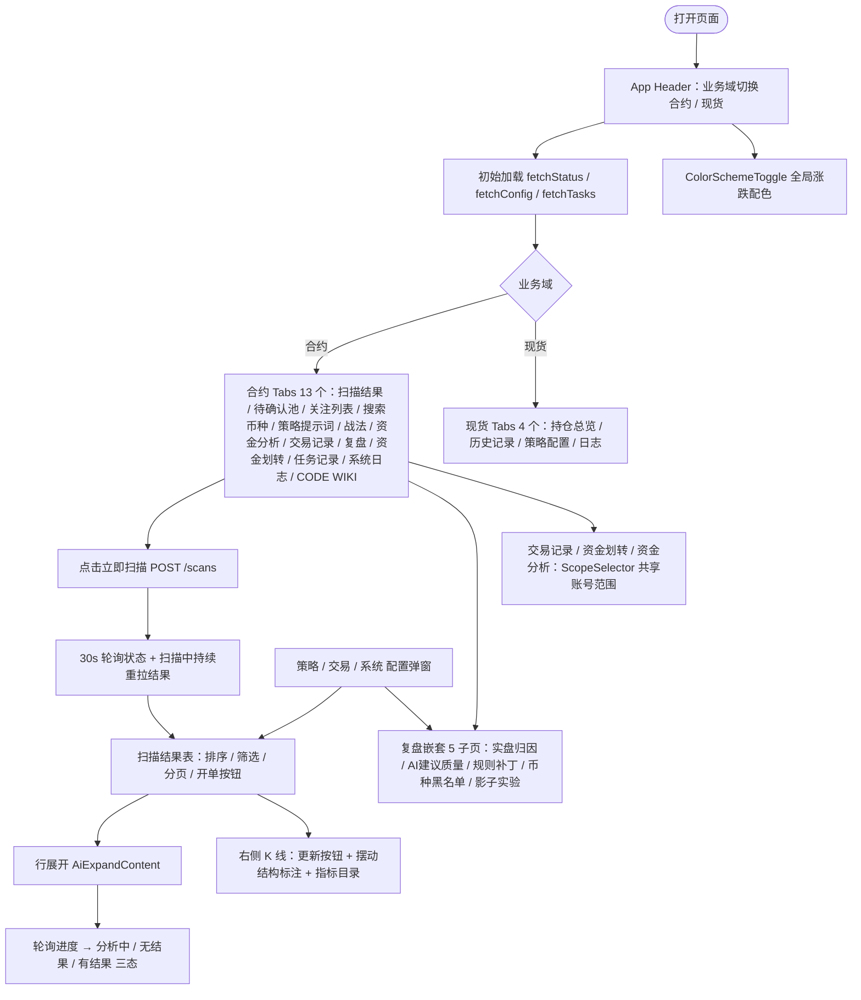
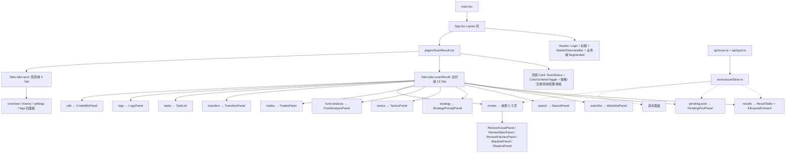
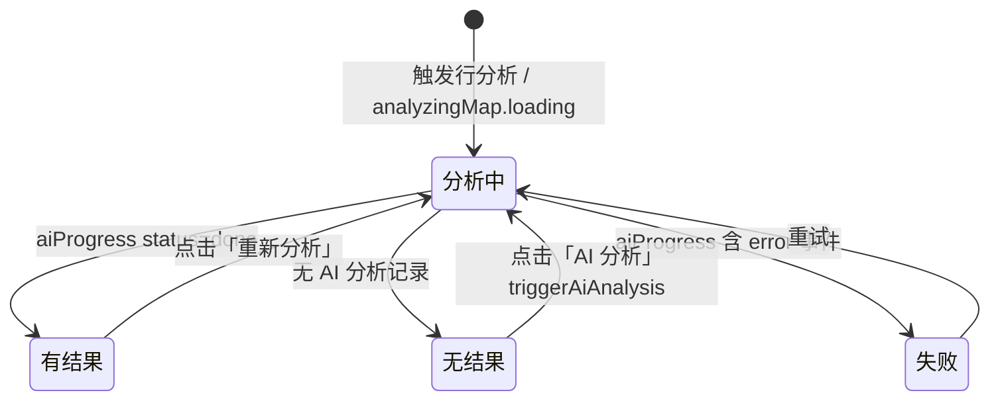
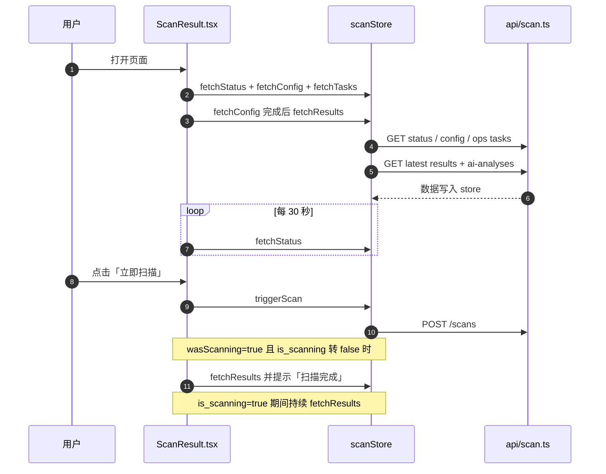

# 08-前端界面

> 现行版本：RULE_VERSION v2026-10-18（2026-10-18）。本文对照代码整理，以代码为准；历史拍板记录见 docs/archive/。
>
> 本文为原 `功能流程/08-前端界面.md` 与 `技术实现/08-前端界面.md` 于 2026-10-21 合并而成：功能口径与拍板以业务规则为准，实现细节以代码为准。

## 功能流程图

> 本图概括本文所述功能的整体流程（Mermaid 渲染）。

## 1. 概览

### 1.1 技术栈与入口

- **技术栈**：React 18 + TypeScript + Vite 5 + Ant Design 5（`frontend/`）；状态管理 Zustand（`src/stores/scanStore.ts`）；HTTP 走 axios（`src/api/scan.ts`、`src/api/spot.ts`，baseURL `/api`）。
- **图表**：K 线用 lightweight-charts（`ChartCore.tsx` + `klineShared.ts`），统计图用 ECharts（`EChart.tsx` 薄封装）；AI 推理气泡/轨迹用 Ant Design X（Bubble / ThoughtChain）。
- **入口链路**：`main.tsx` → `App.tsx`（Layout + 深色 Header「虚拟币筛选工作台」）→ `pages/ScanResult.tsx`（唯一页面，单页 Tabs 结构）；数据契约与标签常量见 §1.3。
- **全局配色**：`ColorSchemeToggle`（红涨绿跌 / 绿涨红跌）切换后写入 store，涨跌色经 `utils/scheme.ts`（`schemeTag` / `schemeValueColor`）在全部表格与图表同步翻转；Tab/业务域记忆用 `utils/tabMemory.ts`。

### 1.2 页面结构（pages/ScanResult.tsx）

顶部 Card 一行：左「合约 / 现货」Segmented（业务域，`tabs.mode`）+ `ScanStatus`（仅合约）；右 `ColorSchemeToggle` + 三个配置弹窗按钮（策略 / 交易 / 系统）+ `EnvironmentTag`。下方 Tabs（`tabs.scanResult` / `tabs.spot` 分 key 记忆）。

**合约域 Tabs（13 个）**：

| key | 标签 | 组件 | 说明 |
|---|---|---|---|
| results | 扫描结果 | ResultTable | 「立即扫描」按钮置于表头右侧刷新左边 |
| pending-pool | 待确认池 | PendingPoolPanel | 回踩两段式（docs/19） |
| watchlist | 关注列表 | WatchlistPanel | 行展开共用 AiExpandContent |
| search | 搜索币种 | SearchPanel | 手动单币 AI 分析（`POST /scans/analyze`） |
| strategy | 策略提示词 | StrategyPromptPanel | Markdown 编辑 + 技能库只读列表 |
| tactics | 战法 | TacticsPanel | 自建战术剧本库（启用/分环境），docs/10 |
| fund-analysis | 资金分析 | FundAnalysisPanel | docs/14 |
| trades | 交易记录 | TradesPanel | docs/06，含 AI 持仓建议（docs/16） |
| review | 复盘 | 嵌套 Tabs | 实盘归因 / AI建议质量 / 规则补丁 / 币种黑名单 / 影子实验（5 子页） |
| transfers | 资金划转 | TransfersPanel | 每小时 :10 巡检同步 |
| tasks | 任务记录 | TaskList | 任务粒度运行历史 |
| logs | 系统日志 | LogsPanel | WARNING 及以上 |
| wiki | CODE WIKI | CodeWikiPanel | 代码架构只读文档（`docs/CODE_WIKI.md`） |

**现货域 Tabs（4 个，docs/07 独立屯币系统）**：

| key | 标签 | 组件 | 说明 |
|---|---|---|---|
| overview | 持仓总览 | SpotOverviewPanel | — |
| history | 历史记录 | SpotHistoryPanel | react-chrono 时间轴 |
| settings | 策略配置 | SpotSettingsPanel | — |
| logs | 日志 | SpotLogsPanel | 直连 `/logs?logger=app.spot` |

页面加载后 `fetchStatus/fetchConfig/fetchTasks`，`fetchConfig` 完成后 `fetchResults`；每 30s 刷新状态；扫描由进行中转完成时自动重拉结果（时序见 §8）。

> 码内观察：`ScanResult.tsx` 的 `tabs.scanResult` 记忆 key 数组为 12 项（未含 `tactics`），按 `useTabMemory` 规则存储值不在 `keys` 内时回落首个 key。

### 1.3 模块与分层

| 层 | 文件 / 组件 | 职责 |
|---|---|---|
| 入口渲染 | `main.tsx` → `App.tsx` | Layout（Header + Content）；Header 含 Logo、标题、`MarketOverviewBar`、业务域 Segmented（`tabs.mode`） |
| 页面 | `pages/ScanResult.tsx` | 唯一页面；顶部 Card（`ScanStatus` + `ColorSchemeToggle` + 三个配置弹窗）+ 合约 / 现货两套 Tabs |
| 状态 | `stores/scanStore.ts` | 全量页面状态与动作（`useScanStore()`） |
| HTTP | `api/scan.ts`（合约域）、`api/spot.ts`（现货域）、`api/tactics.ts`、`api/market.ts`、`api/shadow.ts` | axios 实例 `baseURL=/api` |
| 类型 | `types/index.ts`、`types/spot.ts` | 全量前端类型（65 个导出 interface/type） |
| 标签常量 | `constants/labels.ts`、`constants/indicators.ts` | 信号/位置/形态/EMA/开单类型标签映射；指标目录（`INDICATOR_CATALOG`） |
| 工具 | `utils/dayjs.ts`（`bj()`）、`utils/scheme.ts`、`utils/tabMemory.ts`、`utils/clipboard.ts` | 北京时间换算、涨跌配色、Tab 记忆 |
| 图表 | `components/ChartCore.tsx`、`klineShared.ts`、`KlineChart.tsx`、`EChart.tsx` | lightweight-charts K 线内核 / ECharts 薄封装 |

### 1.4 组件模块表（src/components/）

| 组件 | 职责 / 对应位置 | 备注 |
|---|---|---|
| App.tsx / Logo.tsx / MarketOverviewBar.tsx | 顶层壳 + 大盘条 + 业务域切换 | 见 §1.3 |
| ResultTable | 扫描结果表 + 右侧 K 线（55%/45% 分栏） | 详见 §2 |
| PendingPoolPanel | 待确认池 | 详见 §3 |
| HitHistoryPanel | 待确认池「命中历史」分段（跨轮次全量命中 + K 线标注命中K线/开单区间） | 详见 [14-命中历史查询](14-命中历史查询.md) |
| FunnelPanel | 待确认池「筛选漏斗」分段（该轮各关卡被拒计数 + symbol→关卡映射，消费 `GET /scans/{id}/funnel`） | — |
| ScanConfigPanel | 「策略配置」弹窗 | 详见 §4.1 |
| TradingConfigPanel | 「交易配置」弹窗（2026-09-20 拆分自 ScanConfigPanel） | 详见 §4.2 |
| SystemConfigPanel | 「系统配置」弹窗（环境/账号/总开关） | 详见 §4.2 |
| ScanStatus | 顶部运行状态一览 | 详见 §4.3 |
| EnvironmentTag | 当前交易环境徽标 | 详见 §4.3 |
| TradesPanel | 交易记录（含浮动收益与 AI 持仓建议） | 详见 §5.2 |
| TransfersPanel | 资金划转（转入/转出明细 + 概览五项） | 详见 §5.4 |
| FundAnalysisPanel | 资金分析 | 详见 §5.3 |
| ScopeSelector | 账号范围选择器（多页共享） | 详见 §5.1 |
| ReviewActualPanel | 实盘归因 | 详见 §6.1 |
| ReviewStatsPanel | AI 建议质量（复盘统计） | 详见 §6.2 |
| ReviewPatchesPanel | 规则补丁 | 详见 §6.3 |
| BlacklistPanel | 币种黑名单 | 详见 §6.4 |
| ShadowPanel | 影子实验（复盘第 5 子页） | 详见需求文档 02-影子模式方案 |
| KlineChart / ChartCore / klineShared / TradeReplayChart | K 线图族 | 详见 §7.1 |
| AiAnalysisCard / AiExpandContent | AI 结论卡片 / 行展开区 | 详见 §7.2、§7.3 |
| StatCard | 指标卡（资金分析概览用） | — |
| EChart | ECharts 薄封装（按需注册 + ResizeObserver 自适应） | — |
| CodeWikiPanel | CODE WIKI（代码架构只读文档） | — |
| LogsPanel / TaskList | 系统日志 / 任务记录 | 详见 §7.4 |
| WatchlistPanel / SearchPanel | 关注列表 / 搜索币种 | 详见 §7.4 |
| StrategyPromptPanel | 策略提示词 + 技能库 | 详见 §7.4 |
| TacticsPanel | 战法库（自建/启停/分环境） | 详见 [10-战法模块](../战法/10-战法模块.md) |
| ColorSchemeToggle | 全局涨跌配色切换 | 红涨绿跌 / 绿涨红跌 |
| SpotOverviewPanel / SpotHistoryPanel / SpotSettingsPanel / SpotLogsPanel | 现货屯币系统四页 | docs/07 |

### 1.5 状态切片与本地存储

**Zustand store 状态切片（`stores/scanStore.ts`）**，全部页面经 `useScanStore()` 读写：

| 字段 | 类型 | 说明 |
|---|---|---|
| `status` | `ScanStatus \| null` | 顶部状态（`last_scan` / `is_scanning` / `open_trades` / `open_tp_hit` / `max_open_trades` / `trading_enabled`） |
| `aiConfig` | `SystemConfig \| null` | 系统配置（AI 开关、`scan_filters_effective`、`accounts`、`trading_testnet`） |
| `results` / `total` | `ScanResult[]` / `number` | 结果表数据与总数 |
| `resultsPage` / `resultsPageSize` | `number` | 分页（默认 1 / 20） |
| `filters` | `ResultFilters` | 服务端过滤条件 |
| `currentScanId` | `string \| null` | 当前批次 ID |
| `aiAnalyses` | `AIAnalysis[]` | 当前批次 AI 分析 |
| `analyzingMap` | `Record<string, {loading, error}>` | 按 `scanResultId` 跟踪行级分析状态 |
| `tasks` / `tasksTotal` / `tasksPage` / `tasksPageSize` / `tasksType` | — | 任务记录（默认 pageSize 10） |
| `logs` / `logsTotal` / `logsPage` / `logsPageSize` / `logLevel` / `logQuery` | — | 系统日志 |
| `watchlist` | `WatchlistItem[]` | 关注列表 |
| `colorScheme` | `'red-up' \| 'green-up'` | 全局涨跌配色 |
| `indicatorSettings` | `Record<string, {enabled, inputs}>` | 图表指标开关与参数（按插件 id 键控，全局共享） |

**localStorage 持久化键**：

| 键 | 写入方 | 内容 |
|---|---|---|
| `chart-color-scheme` | `setColorScheme` | 涨跌配色（默认 `red-up`） |
| `chart-indicator-settings` | `persistIndicatorSettings` | 指标开关与参数；含一次性迁移标记 `chart-indicator-settings-migrated-v1`（清理遗留宿主 EMA/MA key） |
| `tabs.mode` | `useTabMemory` | 业务域（`futures` / `spot`） |
| `tabs.scanResult` / `tabs.spot` | `useTabMemory` | 合约 / 现货内部 Tab |

`useTabMemory(storageKey, keys)`：初始读 `localStorage`，存储值不在 `keys` 内或读取失败则回落 `keys[0]`；切换时写回（写失败静默）。

## 2. 扫描结果表（ResultTable.tsx）

### 2.0 信号类型标签映射（constants/labels.ts）

| signal_type | 标签 | 色 | 说明 |
|---|---|---|---|
| trigger_breakout | 同向突破 | gold | 多指标同向 + 突破触发 |
| trigger_trend_breakout | 趋势突破 | volcano | Donchian 滚动轨口径（2026-09-29 与结构突破并存区分） |
| trigger_pullback | 同向回踩 | cyan | 历史行 |
| trigger_pullback_confirm | 回踩金K确认 | geekblue | 两段式确认（2026-09-25，docs/19） |
| trigger_candlestick | 同向形态 | blue | 纯金K已 2026-09-29 下线，仅历史行 |
| uptrend/downtrend/trend_reversal/range_bound/breakout/unknown | 上涨趋势/下跌趋势/趋势反转/震荡区间/放量突破/未分类 | green/red/purple/orange/gold/default | 旧结构分类兼容展示 |
| downtrend_breakout / uptrend_pullback | 下跌突破 / 上涨回调 | red / green | 旧值兼容 |

EMA 形态（EMA_STATE_MAP）：多头排列 green / 空头排列 red / 金叉 cyan / 死叉 magenta / 拐头向上 lime / 拐头向下 volcano / 纠缠 default。开单类型（TRADE_TYPE_MAP）：顺势交易 blue / 结构破位回踩 purple / 区间边缘反转 gold；历史类型 rule_123 / n_structure / rule_2b 标注「已并入」。

### 2.1 列详表（scroll.x = 1444，tableLayout fixed，改列宽须同步总宽）

| 列名 | 宽 | 数据来源 | 渲染规则 |
|---|---|---|---|
| 操作 | 76 | aiMap + tradeMap | 「开单」link 按钮；置灰条件（Tooltip 说明）：AI 分析中 / 无 AI 分析 / AI 建议跳过（skip_reason）/ 缺完整开单位 / 推荐度 <60 / 信号过期（分析 >1h，UTC 补 Z 解析）/ 已有开单尝试（FAILED 不支持重试）。点击 Modal.confirm 展示入场/止损/止盈一/推荐度/上次拦截，走 `POST /trades/open-from-analysis`；钱包与在跑上限等运行时条件由后端闸门权威判定 |
| 币种 | 150 | symbol | `X/USDT` 加粗 + 关注星标（StarFilled 金色）+ 复制按钮（复制 `X.P`） |
| 质量分 | 80 | quality_score | 默认降序；≥75 green、≥60 gold、其余 default；悬停 votes_json 方向票明细（MACD/布林带/RSI 多/空票数、净票、全部指标条目） |
| 信号类型 | 108 | signal_type | SIGNAL_TYPE_MAP 标签 + 色；服务端 filter；悬停 signal_reason |
| 位置 | 150 | position_ref / touch_ref | 双口径，见 §2.2 |
| 4h | 60 | votes_json.htf | 高周期背景短标签：震荡 / 纠缠 / 强·弱多·空；多空色随配色方案；悬停完整 label |
| K线形态 | 116 | pattern | patternStyle：多头绿 / 空头红 / 其他蓝；服务端 filter；悬停 signal_reason |
| EMA | 100 | ema_state | EMA_STATE_MAP（多头排列/空头排列/金叉/死叉/拐头/纠缠）；服务端 filter |
| AI方向 | 72 | aiMap | 分析中 processing / 跳过（悬停 skip_reason）/ 多·空（随配色） |
| 推荐度 | 64 | ai.recommendation | 0-100 取整加粗；仅 suggest 有值；与质量分口径不同（悬停说明） |
| 开单状态 | 100 | tradeMap（ai_analysis_id→status） | 已开单 green / 开单失败 red（均提示详见交易记录 Tab）；被闸门拦下 → orange「⏳ 待回踩 / 未开单」，悬停 open_block_reason |
| 当前价格 | 104 | current_price | <1 六位 / <100 四位 / 其余两位小数 |
| 24h成交额 | 104 | volume_24h | B/M/K 缩写；客户端排序 |
| K线量能 | 92 | volume_type | 倍量红 / 放量橙 / 平量默认 / 缩量蓝 / 地量灰 |
| 状态 | 68 | is_repeat | 新 green / 重复 default |

通用行为：分页/筛选在 Table onChange 按 `extra.action` 分发（filter 走 `setFilters`，paginate 走 `fetchResults`，排序纯客户端）；点击行 = 聚焦右侧图表并展开该行（单开）；展开行渲染 AiExpandContent（§7.2）。

### 2.2 「位置」列双口径（position_ref，2026-10-01）

- **回踩确认**（`position_ref.startsWith("回踩")`）：显示回踩企稳的触点位，Tag 颜色/悬停说明取 `TOUCH_TAG_MAP[record.touch_ref]`，文案按方向生成。
- **突破触发**：显示突破/跌破的结构前高、前低或 20 根 Donchian 轨并附突破位价格，统一 geekblue 色，悬停说明「信号K线收盘越过该位触发」。
- **旧行兼容**：`position_ref` 为 NULL 时回退 `touch_ref → touchLabel()`——EMA 触点直接显周期；retest/swing 按 votes_json.net 多数决推断方向（净票为 0 时 trend_slope 符号兜底），给出「前高回测 / 前低回测 / 摆动低点 / 摆动高点」。
- **触点五色映射**（`TOUCH_TAG_MAP`，与后端 trigger.TOUCH_LABELS 同源，docs/22）：

| touch_ref | 色 | 悬停说明 |
|---|---|---|
| retest | geekblue | 突破回测位：破轨后横向验证，结构意义最强 |
| swing | purple | 摆动结构位：最近 HL（多）/LH（空）防守位 |
| ema21 | gold | 回踩 EMA21 趋势价值区企稳 |
| ema55 | orange | 回踩 EMA55 深回撤价值区 |
| ema144 | volcano | 回踩 EMA144 大周期深回撤价值区 |

## 3. 待确认池面板（PendingPoolPanel.tsx，docs/19）

- **状态分段（Segmented + 计数，默认「待确认」；2026-10-13 由「已确认/已卡掉/全部」三 tab 收敛为 4 项）**：待确认（pending，计数）/ 后续结果（待确认币种的终态结论——confirmed 已确认 + expired·superseded 卡掉合并，行内「状态」列区分，**仅保留最近三天**，按 `resolved_at` 缺失回落 `updated_at`）/ 无触发（FunnelPanel 预置 no_trigger 关）/ 筛选漏斗（FunnelPanel）。数据源 `GET /scans/pullback-pendings?status=all&limit=500` 一次拉全量前端过滤。
- **状态语义（悬停提示）**：pending=回踩触碰但当根无金K，进入 N 根确认窗口（默认 3 根）等同向金K；confirmed=窗口内金K出现，以「回踩金K确认」落库进 AI；expired / superseded 的成因见 resolve_reason。
- **resolve_reason 映射（「结果」列）**：window_expired=窗口内无金K、direction_flip=方向失守、breakout=突破抢先、same_candle_confirm=当根确认抢先；confirmed 行显示绿色「已进 AI 分析」。
- **列（scroll.x=1140，pageSize 20）**：

| 列 | 宽 | 渲染规则 |
|---|---|---|
| 币种 | 130 | Link 点击弹 980px KlineChart 弹窗（最新K线，limit 500） |
| 方向 | 90 | 1=看多 / -1=看空，Tag 随全局配色 |
| 状态 | 110 | 四态 Tag + 悬停语义提示（见上） |
| 等待确认 | 170 | 仅 pending 行显示「窗口内看涨金K·触点摆动低点」（触点方向化措辞与后端 `trigger._touch_ref_label` 同口径：retest=前高/前低、swing=摆动低点/摆动高点、ema*=EMA N；旧行无 touch_ref 只显示「窗口内看涨金K」）；非 pending 行「-」 |
| 结果 | 120 | confirmed 显绿字「已进 AI 分析」；否则 REASON_LABEL 中文 |
| 确认形态 | 110 | confirmed 行的 pattern → patternStyle Tag |
| 触碰EMA21 | 110 | toPrecision(6)，右对齐 |
| 质量分 | 80 | 右对齐 |
| 触碰K线 | 110 | Stage-1 开盘时间（北京 MM-DD HH:mm），悬停说明确认窗口为其后 N 根已收盘K线（默认 3 根） |
| 更新时间 | 110 | 北京 MM-DD HH:mm |

- 空态文案区分：待确认页签提示「回踩触碰且当根无金K时会出现在这里」，其余页签「暂无记录」。
- API 返回 `touch_ref`（2026-10-01 增补，取自 `pullback_pendings` 表 docs/22 列）。

## 4. 扫描配置与状态

### 4.1 ScanConfigPanel（策略配置弹窗）

- **扫描基础**：K线周期固定 1 小时（整点小时级调度，页面不再提供选择，保存时归一化为 1h）/ K线数量（300-1500，后端扫描实际取下限 300）/ 重复命中窗口（小时）/ 摆动点阶数。
- **筛选参数组**（2026-09-28 上页面，DB > env > 代码默认，仅提交有改动的键、后端键级合并保留未提交键；「恢复默认」提交 `scan_filters=null` 回落 env）：min_volume_24h（24h 成交额门槛）/ new_coin_cooldown_days（新币冷静期）/ breakout_threshold（最小突破幅度）/ breakout_max_pct（突破幅度上限防追高）/ breakout_channel_bars（Donchian 根数，仅趋势突破）/ ai_max_per_scan（AI 单轮分析上限）。
- **触发类型白名单**（Checkbox，docs/22 后 3 项）：结构突破 / 趋势突破 / 回踩金K确认；全部不勾视为配置错误，后端按全选处理。
- **回踩反向腿门（只读）**：反向腿门开关 / 腿回看根数（24）/ 腿最少根数（2）/ 腿最小幅度（0.5 ATR）；后端已生效参数，弹窗内仅展示、禁止修改。
- **AI 开关区**：筛选后自动 AI 分析（未配置 AI_API_KEY 时禁用）/ 策略开关（需先在「策略提示词」页签保存）。

### 4.2 TradingConfigPanel / SystemConfigPanel

- TradingConfigPanel：自动交易参数 + 开仓闸门补丁参数（止损金额模式 pct=风险基数分档×3% 或 fixed 固定 USDT、max_stop_pct 止损宽度上限、liq_gate_buffer 强平闸门缓冲、入场偏离容差、滑点上限等）。
- SystemConfigPanel：账号清单 + 自动成交开关（测试网/正式网独立，2026-10-03 拆分双总开关）+ 多账号扇出 `live_trading_keys`（docs/17）+ 飞书通知（测试网合约单据推送开关 `feishu_testnet_notify_enabled`，2026-10-15）+ 一键清空测试网数据。原 `trading_enabled` 总开关 2026-09-28 收窄（仅控 AI 分析后自动开新单，手动开单/AI 分析不受限）、2026-10-03 拆分为双网独立开关后不再读写。
  - 飞书通知开关关闭后，测试网合约单据相关推送（开仓成功卡、持仓时长预警、AI 持仓建议、止损收紧结果、滞留复诊、开单受阻提示）在发送层被静默丢弃；扫描命中卡、满仓跳过卡、结构监控告警、日报、现货卡片、按钮回调回执不受控。

### 4.3 ScanStatus（顶部状态一览）与 EnvironmentTag

- ScanStatus 三项：自动成交（运行中/已关闭 Tag）、最近扫描（完成时间 + 命中数）、在跑单——主数字=占上限名额笔数（OPENED），已进止盈止损（TP1_HIT/TP2_HIT 止损移保本）以绿色「已保本 N」Tag 单列不占名额；满仓红 / 差一满橙分级预警，上限 ≤0 视为不设限。
- EnvironmentTag：常驻徽标，测试网橙 / 正式网红（多账号时显示账号名），悬停说明自动成交口径与切换入口。

### 4.4 配置来源与读取口径

- **后端 `config.py`**：前端可读写并回显的关键项有 `SCAN_BEAT_MINUTE`、`KLINE_INTERVAL` / `KLINE_WINDOW`、`MIN_VOLUME_24H`、`AI_MAX_PER_SCAN`、`AI_RR_MIN`、`TRADING_MIN_RECOMMENDATION`、`TRADING_LEVERAGE`、`RULE_VERSION`（config.py:293，现行 `v2026-10-18`）。
- **`system_config` 表（页面可改）**：AI 开关、`scan_filters` JSONB（筛选参数组 + 触发类型白名单）、`trading_testnet` / `trading_enabled_live`（双网自动成交开关）、`feishu_testnet_notify_enabled`、多账号 `live_trading_keys`、风控参数（止损金额模式 pct/fixed、`max_stop_pct`、`liq_gate_buffer` 等）。
- **前端 localStorage**：见 §1.5。
- 读取口径：`aiConfig` 由 `GET /scans/config` 回填；「恢复默认」提交 `scan_filters=null` 回落 env。

## 5. 交易与资金面板

### 5.1 ScopeSelector（账号范围选择器，docs/17）

交易记录 / 资金划转 / 资金分析 / 实盘归因四页共享。单 live 账号：Segmented 正式网/测试网；多 live 账号：Select 下拉（正式网聚合 / 具体账号 / 测试网）。`defaultScopeOf()` 默认跟随当前交易环境，面板被 Tabs 保活、环境切换后自动跟随。

### 5.2 TradesPanel（交易记录，docs/06 + docs/16）

- **概览条**：两组面板不分卡——账户资金 5 项（保证金/钱包余额、未实现盈亏、今日已实现盈亏、今日盈亏，`GET /trades/account-summary`）+ 交易统计 5 项（运行中/盈利单/亏损单/胜率/平均盈亏比）；平均盈亏比 = 全部已结算单的 R 均值（净盈亏÷risk_amount，含止盈止损，2026-10-12 由仅计盈利单改口径）。异常单（`excluded`）在跑单自 2026-10-22 起同口径剔除：不计入「运行中」，其交易所浮动盈亏不计入概览（保证金余额/未实现盈亏/今日盈亏）；钱包余额为交易所现金口径不含浮动，保持原值。
- **主列表列**（排序：进行中（开仓时间倒序）→ 已平仓（平仓时间倒序）→ 失败殿后；状态筛选为胶囊按钮组，进行中=运行中/TP1/TP2 三态聚合带计数）：

| 列 | 渲染要点 |
|---|---|
| 币种 / 方向 | 方向 Tag 随全局配色 |
| 环境 | 测试网·正式网（account_key 多账号，docs/17） |
| 持仓时间 | 开仓至当前/平仓时长 |
| 信号类型 / K线形态 | 触发信号（trigger_*）与形态（hammer 等，突破类为 null） |
| 评分 | 开单时 AI 推荐度 |
| 状态 | 三态标签 + 「移动止损」改判（见下） |
| 收益 | 运行中=已实现+浮动合计，悬停拆分明细 |
| AI 建议 | 见下方 AI 持仓建议 |
| 收益率 | pnl_pct（相对止损金额 %），带符号着色 |
| 盈亏比 | R 口径（净盈亏÷risk_amount），仅结算后显示 |
| 出场原因 | EXIT_REASON_MAP 中文标签 |
| 开仓价 / TP1 / TP2 / 止损（现值） | 三价与跟踪止损现值 |
| 数量 / 保证金 / 开仓时间 / 平仓时间 | 分批数量 qty_tp1/qty_tp2 旧记录按比例回退 |
| 操作 | 市价平仓 / 复盘K线 / 对账等 |

- **状态渲染**：OPENED 运行中蓝 / TP1_HIT 青 / TP2_HIT 蓝紫 / CLOSED 默认 / FAILED 红；TP2 后（或无 TP2 的 TP1 后）跟踪止损价已过末档止盈价时改显「移动止损」。
- **在跑单浮动收益（docs/16）**：每小时 :10 巡检刷新 unrealized_pnl（收益列与悬停拆分明细见上表）。
- **AI 持仓建议列（docs/16）**：浮亏在跑单显示 `ai_advice.action` Tag——hold 继续持有（blue）/ tighten 收紧止损（orange）/ reduce 建议减仓（gold）/ exit 建议离场（red，`ADVICE_ACTION_META`）；点击弹诊断详情（thesis_valid/trend_broken/reason/detail），支持手动重诊（`POST /trades/{id}/advice`）。
- **展开行**：左 AI 分析结论快照（AiAnalysisCard）+ 右操作历史 Timeline（OPEN/TP1_FILL/TP2_FILL/SL_MOVE/SL_FILL/CANCEL/SETTLE/LIQUIDATION/ERROR/AI_ADVICE/MANUAL_CLOSE）；可打开交易复盘 K 线弹窗与 R 泄漏对账（docs/24 A1：入场滑点/手续费/资金费/SL穿价/TP1滑点五项分解 + 理论R vs 实际R）。另有导入持仓 / 市价平仓（`close-market`）。

### 5.3 FundAnalysisPanel（资金分析，docs/14）

- **筛选条**：ScopeSelector + Segmented 全部/本周/本月/自定义（RangePicker，本周按北京周一归一）+ 刷新；seq 竞态守卫只渲染最新一批响应。数据源 `GET /trades/analytics`（已闭单按北京时间自然日落桶，划转按 transfer_time）。
- **概览 6 卡**：区间净收益 / 胜率（≥50% 涨色）/ 手续费 / 资金费 / 净流入 / 盈亏比R（止盈单）——盈亏类颜色全部随全局涨跌配色。
- **2×3 图表栅格（ECharts，各 300 高）**：① 资金曲线（累计净收益，面积渐变 + dataZoom + 0 基线）② 每日净收益（柱色按当日盈亏）③ 币种盈亏 Top10（横向柱 + 金额 label）④ 出场原因分布（环形图，EXIT_REASON_MAP 中文：止损离场/TP1后止损/TP1后跟踪止损/TP2后跟踪止损/保本止损/强平/手动平仓/异常平仓）⑤ 盈亏分布（笔数柱，负档跌色）⑥ 资金流水（转入/转出柱 + 累计净流入线，无划转时局部空态）。

### 5.4 TransfersPanel（资金划转）

合约账户转入/转出记录，数据来自每小时 :10 结算巡检从币安 income TRANSFER 同步（`GET /trades/transfers?scope=`）。概览五项（初始资金 / 当前账户资金 / 累计转入 / 累计转出 / 净流入，`GET /trades/transfer-stats` 服务端全量聚合，钱包余额查询全部失败时降级「--」）；明细表带符号金额着色（正=转入涨色，负=转出跌色），环境切换与资金分析页一致默认跟随当前交易环境。

## 6. 复盘子页（review 嵌套 Tabs，5 个子页）

实盘归因 / AI建议质量 / 规则补丁 / 币种黑名单 / 影子实验；ShadowPanel（第 5 子页）见需求文档 02-影子模式方案。

### 6.1 ReviewActualPanel（实盘归因）

- 顶部：ScopeSelector + 7/30/90 天 Radio + 「AI 归因」按钮（每轮 ≤5 笔，按钮带待归因计数）+ 刷新；主数据 `GET /scans/review/actual`，漏斗 `GET /scans/review/funnel`（失败不阻断）。
- **全漏斗条（docs/24 A5c）**：信号命中 → AI 分析 → suggest → 过评委 → 开仓 → 盈利，逐级显示数量与相对转化率 + 闸门拦截原因 Top3（橙 Tag）。
- **限价成交率（审计 7.2）**：漏斗卡内单列成交率 `(filled+failed)/已定论`（pending 不计分母；failed=已成交但保护失败并紧急平仓，成交数含 failed 并单列）、成交耗时 P50/P90；无挂单时不显示。
- **异常保护（审计 7.2）**：独立卡片（有事故才显示）：事故数 / 未解除·人工复核 / 累计封锁小时 / P90·最长封锁小时，Tooltip 标注「窗口内创建 + 全部未解除事故」。
- **总览 6 卡**：已平仓 / 胜率 / 总盈亏 / 盈亏比（payoff）/ 期望值每笔 / 平均持仓。
- **计划 vs 实际对照**：计划风险合计 / 实际盈亏 / 手续费 / 资金费 / 最大回撤 / 最大回撤(R) / 风险超额（超预算笔数 + 超幅合计）/ 单笔最大亏损(R)；亏超计划 >0.5U 时橙色提示（费用+资金费吃掉超预算）；回撤 Tooltip 注明「仅闭单、跨窗口不可比」，风险超额 Tooltip 注明「按 planned_risk 预算，旧行回落 1R」。
- **分组归因表**：维度（开单类型/方向/出场原因/开仓时段/规则版本/决策版本/错误标签）rowSpan 合并单元格（点排序后自动失效）；列含笔数/胜/负/胜率/盈亏/盈亏比/期望值。
- **逐笔明细**：计划→实际（-risk_amount → realized_pnl）/ 费用 / 持仓 / 错误标签（待归因置灰），展开行显示 AI 教训与计划三价；「K线」按钮弹 1080px TradeReplayChart。

### 6.2 ReviewStatsPanel（AI建议质量）

- 7/30/90 天窗口；`GET /scans/review/stats`。汇总 7 卡：复盘总数 / 胜率 / 胜·TP1 / 胜·TP2 / 负·止损 / 超时 / 期望值（R）。
- **胜率口径（docs/24 A2）**：expired（超时）不计入胜率分母；`win_rate_note` 说明「建议质量口径 vs 实盘净胜率」。
- **分组统计表**：后端按（信号类型，touch_ref）联合分组——docs/22 起同类型再按触点细分（如「同向回踩·EMA21」）；列含总数/胜率/胜率区间/胜TP1/胜TP2/负/超时/期望值/EV 区间（费用假设：taker 往返 0.1% + 资金费 0.03%/8h）。
- **区间读数（审计 7.2）**：胜率列为 Wilson 95% 置信区间、EV 列为正态近似 95% 区间；区间跨 50%（胜率）或跨 0（EV）= 样本不足，不能据此判定优劣；样本不足显示「--」。
- **规则版本分组（docs/24 A0）**：每版本一行，legacy=版本标记上线前旧行（仅参考）；列同上含胜率/EV 区间。
- **决策版本分组（审计 7.2）**：按 `system_config.decision_version` 切分，补丁/配置/提示词变更切点；与规则版本分组并列展示，同为「同版本内对比才有证明力」。
- **双评委否决对比（docs/24 A5a）**：被否决建议假想回放（否决单样本/胜率/期望值）vs 通过单；veto 组成绩反更好=评委在错杀好单，`veto_note` 给对比结论。

### 6.3 ReviewPatchesPanel（规则补丁，docs/12 §10）

- **恶化告警置顶**：verdict=「恶化告警」(worse) 的补丁以红色 Alert 置顶并提示回滚。
- **实时窗口统计条**：近 7 天已归因笔数 / EV每笔 / 胜率 / 建议通过率。
- **补丁表**：状态（draft 待确认 / active 评估中 / valid 有效 / invalid 无效 / rolled_back 已回滚，worse 覆盖显示恶化告警）/ 来源（AI复盘 / 手动）/ 目标标签 / 落点（提示词覆盖段 / 参数·param_key）/ 合入时间 / 目标热度 / EV每笔 / 胜率（后三列 DeltaText 渲染「前→后」，改善绿、恶化红；热度下降为改善）。操作：对照 / 合入（draft）/ 删除（draft）/ 回滚（已合入，即时生效）。
- **触发生成**：手动触发按热度阈值（≥0.5 且样本 ≥8）生成草稿，未生成时 Modal 列逐条判定明细；补丁全走 DB 即时生效。
- **对照弹窗**：补丁内容（提示词类：系统原文段引用 + 覆盖规则追加；参数类：建议值）+ 三层指标对照（7 天首评 / 14 天终评 + 通过率护栏 30%）。
- **提示词分层视图弹窗（只读）**：① 系统自带（代码常量，永不改动）② 用户自定义（strategy_prompt）③ 补丁覆盖段（含 max_stop_pct / liq_gate_buffer 当前参数）。

### 6.4 BlacklistPanel（币种黑名单）

- 两个来源：manual 手动（永久，紫 Tag）/ auto 自动（止损严重超预算 ≥1.2 倍或强平，冷却 30 天，橙 Tag）；生效位置=扫描宇宙过滤（主）+ 开仓前兜底。
- 列：币种 / 来源 / 状态（生效中红 / 已过期 / 已失效）/ 原因备注 / 到期时间（manual 显示「永久」）/ 加入时间 / 操作（Popconfirm 移除）。添加弹窗自动补 USDT 后缀。

## 7. 图表与 AI 展开

### 7.1 K 线图族（KlineChart / ChartCore / TradeReplayChart）

- **KlineChart**（扫描结果/待确认池弹窗/关注列表/搜索共用）：按 symbol 拉取 `GET /scans/klines/{symbol}`（limit 500，默认 1h，可切 4h）；「更新」按钮 force_refresh 直连交易所并重置缓存；后端 503/4xx detail（如封禁时长）以 Alert 展示。
- **ChartCore**（2026-09-27 统一内核，扫描图与复盘图共用）：lightweight-charts 渲染；摆动结构标注（高点 HH/LH 上箭头、低点 HL/LL 下箭头各 20 个，2026-10-11 由 5 放宽与 AI 事实包 recent_swings(n=20) 同参对齐，看图可核对 AI 报的结构位）；**指标目录驱动**（`constants/indicators.ts` INDICATOR_CATALOG：主图/副图分组、开关与参数可调、副图自动分配 pane，主:副=5:1，设置全局共享）；OHLC 图例十字线联动（含涨跌幅、量、各指标色点值）；AI 仓位标注（见 §7.3）；SVG 覆盖层 rAF 循环重绘（缩放/平移同步）。默认显示最近 130 根，左滚看全量。
- **TradeReplayChart**（交易复盘）：差异经 props 注入——drawOverlay 画区域色块/风控线、extraMarkers 画开仓/止盈/止损成交事件箭头、headerExtra 复盘信息卡；当前止损与初始止损不同时加画现止损线。

### 7.2 AiExpandContent（AI 展开区，扫描结果/关注列表共用）

三态：**分析中** → AiProgressPanel 2s 轮询事件流（`GET /scans/ai-progress/{id}`），事件类型 start/gate/round/tool/llm/done/error，llm 活进度只保留最新一条防刷屏；**无结果** → 补充说明 TextArea + 「AI 分析」按钮（自动 AI 开关关闭仍可手动）；**有结果** → AiAnalysisCard + 「重新分析」。手动单币分析不受「筛选后自动 AI 分析」开关限制。

轮询分层：展示层 `AiProgressPanel` 每 2s 拉一次进度事件；行级状态由 store 的 `startRowPolling` 每 3s 拉 `GET /scans/ai-progress/{id}`（Redis 事件流），事件含 `error` 或 `status=done` 即停；兜底每 5 轮查一次 AI 分析列表；上限 `200 次 × 3s = 600s`，超时置错误文案「AI 分析超时，请重试」。

### 7.3 AiAnalysisCard（AI 结论卡片）

- 决策横幅：建议开单（绿渐变）/ 不建议开单（红渐变）+ 方向 Tag + 开单类型（TRADE_TYPE_MAP：顺势交易/结构破位回踩/区间边缘反转，历史 123/N字/2B 已并入）+ ⏳待回踩（仅展示不下单）+ 推荐度（≥80 红 / ≥60 橙 / ≥40 黄 / 其余灰）。
- suggest：四价格卡（入场/止损/止盈1/止盈2，左色条）+ 指标行（盈亏比/仓位建议/分析时间/运行轨迹）+ AI 推理 Bubble（NumberedText 序号强制换行）；open_block_reason 有值时顶部橙色「⚠ 未开单原因」条。
- skip：灰色 Bubble 展示跳过理由（推荐度 ≤30 也判 skip，`getEffectiveDecision`）。
- **TraceModal（分析轨迹）**：`GET /scans/ai-trace/{id}` 返回历史 `stage_trace`（P1 已下线，仅旧分析有工具循环数据）；当前 P0 单次调用显示「无工具循环轨迹」。

### 7.4 日志与其他

- **LogsPanel**：系统日志仅 WARNING 及以上、保留 7 天；级别筛选（全部/仅报错）+ 关键字搜索 + 30s 自动刷新第 1 页；List 条目含级别 Tag + logger_name + 北京时间，正文 3 行折叠可展开；分页 10/20/50。
- **TaskList**：任务粒度运行历史（scan/ai/trade/review/spot 五类，scheduled/manual/system 触发），scan 任务可点击加载对应扫描结果。
- **WatchlistPanel**：关注列表行展开共用 AiExpandContent，K 线支持手动刷新（refreshKey 强制重拉）。
- **SearchPanel**：手动单币 AI 分析（同步接口，600s 超时），分析无 scan_result_id 关联。
- **StrategyPromptPanel**：策略提示词 Markdown 编辑保存（携带开关在策略配置弹窗）；技能库只读列表（名称/描述/适用场景，点击看全文）。

## 8. 页面加载与扫描联动（ScanResult.tsx）

## 9. 并发、幂等与异常处理

- **行级轮询隔离**：`aiPollTimers` 以 `scanResultId` 为键，`startRowPolling` 先 `stopRowPolling` 再启动；关闭 AI 开关时清理全部计时器（轮询参数见 §7.2）。
- **竞态守卫**：`FundAnalysisPanel` 用 `seq` 序号只渲染最新一批响应（见 §5.3）。
- **超时与错误面**：行分析 600s 超时置 error 文案（§7.2）；K 线后端 503/4xx detail 以 Alert 展示（§7.1）。
- **幂等**：`addToWatchlist` 写入前按 `symbol` 去重，避免重复行。
- **持久化容错**：localStorage 读写均包 try/catch（隐私模式静默降级）。
- **解析容错**：`loadIndicatorSettings` 丢弃已下线/结构不合法的指标存档，按 `defaultInputs` 合并缺失参数。
- **默认行为**：`fetchResults` 在 `scanId` 变化时重置到第 1 页；分页/筛选分发见 §2.1。

## 10. API 契约

前端统一走 `src/api/scan.ts`（合约域）与 `src/api/spot.ts`（现货域）；后端路由见 `backend/app/api/`（scan.py / trades.py / watchlist.py / ops.py / spot.py）。`api/scan.ts` 导出 `scanApi`（含 `klines` / `analyzeCoin` / `reviewStats` / `reviewFunnel` / `skills` / `pullbackPendings` / `blacklist` / `trades` 子对象）与 `ResultFilters` 类型。

| 模块 | 端点 | 用途（前端消费方） |
|---|---|---|
| 扫描 | POST /scans；GET /scans；GET /scans/status | 触发扫描 / 任务记录 / 顶部状态（30s 轮询） |
| | GET /scans/latest/results；GET /scans/{id}/results | 结果表（page/sort_by/filters 服务端过滤） |
| | GET/POST /scans/{id}/ai-analyses | AI 分析列表 / 触发分析 |
| | GET /scans/klines/{symbol} | K 线（limit/force_refresh/interval） |
| | GET/PUT /scans/config | 配置读写（scan_filters 仅提交改动键） |
| | POST /scans/analyze；GET /scans/ai-progress/{id}；GET /scans/ai-trace/{id} | 手动分析 / 进度流 / 分析轨迹 |
| | GET /scans/pullback-pendings | 待确认池（status/limit） |
| | GET /scans/{id}/funnel；GET /scans/hit-history | 筛选漏斗（FunnelPanel）/ 命中历史（HitHistoryPanel，待确认池分段） |
| 复盘 | GET /scans/review/stats / funnel / actual | 三面板主数据 |
| | POST /scans/review/attribute | AI 归因（≤5 笔/轮） |
| | GET /scans/review/patches（+ {id}/apply、{id}/rollback、trigger、DELETE {id}）；GET /scans/review/prompt-view | 补丁全生命周期 / 分层视图 |
| 黑名单/技能 | GET/POST /scans/blacklist；DELETE /scans/blacklist/{symbol}；GET /scans/skills（+{name}） | 黑名单管理 / 技能库 |
| 交易 | GET /trades；GET /trades/account-summary | 交易记录 / 概览（scope 过滤） |
| | GET /trades/analytics；GET /trades/transfers；GET /trades/transfer-stats | 资金分析 / 划转 |
| | POST /trades/open-from-analysis；POST /trades/{id}/close-market；POST /trades/{id}/advice | 手动开单 / 市价平仓 / 持仓重诊 |
| | GET /trades/{id}/events / klines / reconciliation | 操作历史 / 复盘K线 / R 泄漏对账 |
| | POST /trades/purge-testnet / adopt-now / inspect-now | 清空测试网 / 导入持仓 / 立即巡检 |
| 关注 | GET/POST /watchlist；DELETE /watchlist/{symbol}；GET /watchlist/quotes；POST /watchlist/{symbol}/refresh | 关注列表与行情 |
| 运维 | GET /ops/tasks（+{id}）；GET /ops/logs | 任务记录 / 系统日志（现货日志用 ?logger=app.spot） |
| 现货 | GET/PUT /spot/config；GET /spot/overview；GET /spot/score/{symbol}；POST /spot/execute；GET /spot/timeline；GET/PUT /spot/settings；GET /spot/kline-cache-status；POST /spot/kline-backfill | 屯币系统四页（docs/07） |

时间口径约定：后端时间为 UTC-naive（末尾无 Z），前端经 `utils/dayjs.ts` 的 `bj()` 转北京时间展示；涉及时效判断（如开单信号 1h 过期）须补 `Z` 按 UTC 解析。

## 11. 历史演进

- **archive/14-资金分析Tab设计**：概览 6 卡 + 2×3 图表栅格、北京时间自然日落桶、划转随环境同步，已按本文 §5.3 落地。
- **archive/16-在跑单浮动收益与AI持仓建议设计**：浮动盈亏快照（每小时 :10 巡检）、AI 持仓诊断四动作（hold/tighten/reduce/exit）与手动重诊，见本文 §5.2。
- 相关历史设计：archive/19（回踩金K两段式 → 待确认池 §3）、archive/22（回踩触点体系 → 五色映射与位置列 §2.2）、archive/17（多账号 → ScopeSelector §5.1）、archive/12（复盘实盘归因主轴与规则补丁 → §6）、archive/24（胜率口径/规则版本分组/全漏斗/R 泄漏对账 → §5.2、§6）、archive/18（现货屯币系统独立业务域 → §1.2）。

## 12. 相关文档

- [01-币种筛选与扫描](../扫描与筛选/01-币种筛选与扫描.md)：扫描批次、筛选漏斗与配置口径。
- [02-信号触发器](../信号与形态/02-信号触发器.md)：信号类型/触点标签来源（docs/22 触点同源）。
- [03-AI分析](../AI决策/03-AI分析.md)：AI 分析、进度事件流与分析轨迹。
- [04-交易执行与多账号](../交易执行/04-交易执行与多账号.md)：交易记录、资金划转与账号范围（docs/17）。
- [05-风控体系](../风控/05-风控体系.md)：开仓闸门与止损参数。
- [06-复盘归因](../复盘归因/06-复盘归因.md)：实盘归因、规则补丁与胜率口径。
- [07-现货屯币](../现货屯币/07-现货屯币.md)：现货域四页。
- [10-战法模块](../战法/10-战法模块.md)：战法库（tactics Tab）。
- [12-交易系统总览](../总览与索引/12-交易系统总览.md)：端到端链路。
- [14-命中历史查询](14-命中历史查询.md)：待确认池「命中历史」分段。
- [02-影子模式方案](../需求文档/02-影子模式方案.md)：ShadowPanel 需求来源。
- `docs/CODE_WIKI.md`：CODE WIKI Tab 的只读代码架构文档。
