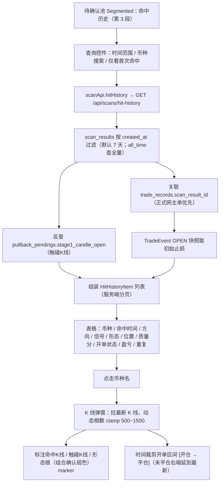
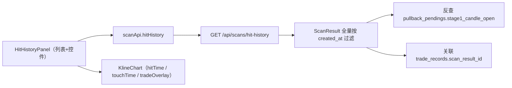
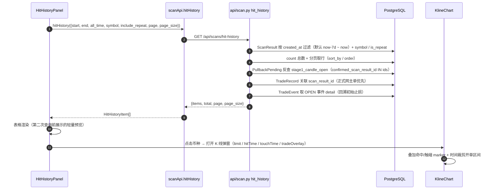

# 14-命中历史查询

> 现行版本：RULE_VERSION v2026-10-18（2026-10-18）。本文为原 `功能流程/14-命中历史查询.md` 与 `技术实现/14-命中历史查询.md` 于 2026-10-21 合并而成：功能口径与拍板以业务规则为准，实现细节以代码为准。

> **实施状态（已实施，2026-10-15）**：本文为需求整理与设计方案，经 2026-10-15 拍板确认后落档，并已按方案实现——后端 `GET /api/scans/hit-history`、前端 `HitHistoryPanel`（待确认池第 3 段「命中历史」）、`KlineChart` 扩展（命中/触碰K线标注 + 时间裁剪开单区间）。
>
> **关联**：docs/06（复盘归因）、docs/08（前端界面）、docs/19（均线策略融合，回踩两段式触点口径）、docs/01 §3.2（判定链）。
>
> **一句话**：在待确认池「后续结果」之后新增「命中历史」分段，跨轮次全量查询扫描命中，点击币种名在最新 K 线上标注命中K线并叠加开单区间。

---

## 功能流程图



## 1 目标与入口

### 1.1 问题
现有「后续结果」（[PendingPoolPanel.tsx](../../../frontend/src/components/PendingPoolPanel.tsx)）只覆盖**待确认池回踩路径的 confirmed 结论**，且**仅保留最近 3 天**（`OUTCOME_DAYS=3`）。需要跨轮次、跨路径地回看历史上全部扫描命中及其后续开单表现。

### 1.2 入口
[待确认池面板](../../../frontend/src/components/PendingPoolPanel.tsx) 的 `Segmented<StatusFilter>` 分段，插在 `后续结果` 之后，成为第 3 项：

```
待确认 (n) | 后续结果 (n) | 命中历史 | 无触发 | 筛选漏斗
```

`StatusFilter` 枚举新增 `'hit-history'`，与现有 `funnel`/`no-trigger` 一样走独立子面板渲染（新组件 `HitHistoryPanel`），不复用待确认表格。

## 2 数据源与关联链

### 2.1 命中行 = ScanResult 全量
**口径（2026-10-15 拍板）**：命中 = 扫描信号命中，覆盖**全部 `signal_type` 路径**（回踩确认 `trigger_pullback_confirm`、突破 `trigger_breakout`、当根触碰确认等），不限回踩路径。

- 来源表 [scan_results](../../../backend/app/models/scan.py)（`ScanResult`）：`symbol / signal_type / created_at / pattern / touch_ref / position_ref / quality_score / votes_json / trend_slope / is_repeat`
- **命中时刻** = `ScanResult.created_at`
- **历史留存**：`scan_results` 无任何定期清理任务（已确认），支持"默认最近 7 天、可往前查全量"

### 2.2 触碰K线锚点（仅回踩路径可得）
回踩两段式命中的 Stage-1 触碰 K 线时间，存于 [pullback_pendings](../../../backend/app/models/scan.py) 的 `stage1_candle_open`。反查方式：

```
pullback_pendings.confirmed_scan_result_id == ScanResult.id
```

非回踩路径（突破等）无此锚点，K 线上只标命中K线。

### 2.3 开单关联
**直连** [TradeRecord.scan_result_id](../../../backend/app/models/trade.py)（模型注释明确该列即溯源用，比经 `AIAnalysis` 中转更稳，且能容忍 `ai_analysis_id` 摘钩）：

```
ScanResult.id == TradeRecord.scan_result_id
```

一个 ScanResult 可能对应**多笔**交易（同一 AI 分析在两网各一单，docs/17）。列表展示时取主单（正式网优先），弹窗内可展示该命中下全部开单。

## 3 后端接口与 API 契约

现无跨轮次 + 时间范围 + 币种的历史查询接口（现有 `/scans/{id}/results` 与 `/scans/latest/results` 均按单轮 scan_record 取数），需新增：

**`GET /api/scans/hit-history`**

| 参数 | 类型 | 默认 | 说明 |
|---|---|---|---|
| `start` | ISO8601 | now-7d | 命中时刻下界（含） |
| `end` | ISO8601 | now | 命中时刻上界（含） |
| `all_time` | bool | false | 清空时间范围 = 不限下界（忽略 `start`，仍受 `end`/now 约束） |
| `symbol` | str | 空 | 币种精确匹配（`normalize_symbol`；空 = 全部） |
| `include_repeat` | bool | true | 是否含重复命中（`is_repeat`），默认全展示 |
| `page` / `page_size` | int | 1 / 20 | `page_size` ≤ 200 |
| `sort_by` / `order` | str | created_at / desc | 可选 `created_at` / `quality_score` |

**响应**：`{items: HitHistoryItem[], total, page, page_size}`（服务端分页）。`all_time=true`（前端清空日期选择器）时不设下界、查全量历史；上界仍按 `end`（缺省 now）。每项含组合确认展示字段 `golden_combo` / `pattern_candle_open` / `entry_lag_pct` / `entry_lag_warn`（口径见 §6.2）。

**统计**：返回总条数供分页；可选返回窗口内命中数 / 开单数 / 胜率，供列表头概览（YAGNI：首版可省）。

## 4 列表与查询

### 4.1 列定义

| 列 | 宽度 | 渲染 |
|---|---|---|
| 币种 | 130 | **Link，点击打开 K 线弹窗**（唯一弹窗入口） |
| 命中时间 | 120 | `created_at` 北京时间 |
| 方向 | 90 | 看多/看空 Tag（`schemeTag(colorScheme)`） |
| 信号类型 | 130 | `SIGNAL_TYPE_MAP` 中文名 |
| 形态 | 130 | `patternStyle`；组合确认且形态根早于信号根时加 `前根·` 前缀（`entry_lag_pct != null`，2026-10-26） |
| 位置 | 130 | `TOUCH_TAG_MAP` + 方向化文案（回踩）／`position_ref`（突破） |
| 质量分 | 80 | 右对齐 |
| 开单状态 | 110 | 运行中/部分止盈/已止盈/已平仓/未开单 |
| 盈亏 | 100 | `realized_pnl`（带色）；未平仓显示浮盈或 `-` |
| 重复 | 80 | `is_repeat` 时显示 `重复` Tag |

### 4.2 查询控件
- **时间范围**：`RangePicker`（`showTime`），默认 `[now-7d, now]`；可往前拉全量。**清空日期选择器**（`allowClear`）= 不限下界查全量历史（请求带 `all_time=true`）。
- **币种搜索**：`Input.Search`，精确匹配 symbol（币种名本身即代码，如 `BTCUSDT`）。
- **重复命中**：`Checkbox`「仅看首次命中」（默认关 = 全展示，2026-10-15 拍板）。
- **刷新**按钮（与现有段一致）。
- 分页：`pageSize 20`，与现有表格一致。

## 5 K 线弹窗与标注

### 5.1 数据窗口
**K 线数据取最新**（用户明确），窗口 = `[命中时刻 − 缓冲, 当前]`：

- 根数按命中时刻动态计算，clamp 到 `[500, 1500]`（精确公式见 §6.4.4）。
  - 命中在 30 天前时固定 500 根（1h ≈ 20.8 天）会覆盖不到命中点，故按命中时刻动态取根数。
- 复用现有 symbol 模式接口 [`scanApi.klines(symbol, limit, isLive, interval)`](../../../frontend/src/components/KlineChart.tsx)（`limit` 已可配），非复盘模式路径。

### 5.2 K 线标注
| 标注 | 条件 | 位置/样式 |
|---|---|---|
| **命中K线** | 必有（`hitTime` = `created_at`） | 多=belowBar↑、空=aboveBar↓，文案 `命中 · 信号类型·形态`；组合确认且形态根更早时追加 `(前根)`（2026-10-26） |
| **形态根** | 组合确认且 `pattern_candle_open` 映射到当前图表周期后严格早于命中K（`entry_lag_pct != null`） | 同方向 marker，弱色灰 `#8b93a7`（填充 `rgba(139,147,167,.10)`），文案 `形态根·形态名`；4h/1d 图常与命中K同槽，同槽时主标不带 `(前根)`、不画副标 |
| **触碰K线** | 仅回踩路径有 `stage1_candle_open` | 同方向 marker，文案「触碰」，颜色与命中区分 |
| 开仓 | 关联交易有开单（`tradeOverlay`） | 沿用[复盘模式](../../../frontend/src/components/KlineChart.tsx)现有开仓 marker |

### 5.3 开单区间绘制（时间裁剪，2026-10-15 拍板）
与现有复盘模式**全区间价格带**不同，命中历史需**时间裁剪**：

- **持仓区间矩形**：横向 = `[opened_at → closed_at]`；
  - **未平仓（status ∈ OPENED/TP1_HIT/TP2_HIT）或无 tp/sl 目标 → 右边界延续到最新 K 线**（开放右端）。
  - CLOSED 单右边界 = 平仓时刻，实现「单子范围宽度到止盈或止损结束」。
- 纵向价格带沿用复盘配色：
  - `entry ↔ stop_loss` 红带（`rgba(239,83,80,.15)`）
  - `entry ↔ tp1` 绿带（`rgba(38,166,154,.15)`）
  - `tp1 ↔ tp2` 浅绿带（`rgba(38,166,154,.08)`，仅当有 tp2）
- 价格水平线（entry / 止损 / 止盈1 / 止盈2 + 跟进后的 `current_stop_loss`）沿用复盘现有绘制与百分比标注。

## 6 技术实现

### 6.1 模块与分层

**方案 A（采用）**：新组件 + 后端新接口 + `KlineChart` 扩展 props。

| 模块 | 文件 | 职责 |
|---|---|---|
| 后端接口 | `backend/app/api/scan.py:1514-1616` | `GET /api/scans/hit-history` 查询与组装 |
| 查询辅助 | `scan.py:1457-1511` | `_HIT_SORT_COLS` / `_naive_utc` / `_hit_direction` / `_trade_brief` |
| 前端面板 | `frontend/src/components/HitHistoryPanel.tsx` | 第 3 分段「命中历史」列表 + 查询控件 + K 线弹窗 |
| 分段入口 | `frontend/src/components/PendingPoolPanel.tsx:30,218` | `StatusFilter` 新增 `'hit-history'` |
| API 封装 | `frontend/src/api/scan.ts:181-191` | `scanApi.hitHistory` |
| K 线扩展 | `frontend/src/components/KlineChart.tsx:623-707` | 扩展 props `hitTime` / `touchTime` / `tradeOverlay` |
| 类型 | `frontend/src/types/index.ts:357-358` | `HitHistoryItem` |

后端查询用 `scan_results` 按 `created_at` 过滤 + 关联 `trade_records`（`scan_result_id`）与 `pullback_pendings`（`confirmed_scan_result_id`）。现有 `tradeId` 复盘模式与 `symbol` 模式行为不变。



**备选对比**：
- 方案 B：改造 `ResultTable` 支持历史查询——与 `scanStore.currentScanId` 耦合深，改动风险大，**不采用**。
- 方案 C：另写一套 K 线组件——重复造轮子，**不采用**。

### 6.2 数据结构

**返回行 `HitHistoryItem`**：

| 字段 | 来源 | 说明 |
|---|---|---|
| `id` | `scan_results.id` | 行主键 |
| `symbol` | ScanResult | |
| `created_at` | ScanResult | 命中时刻（前端 `bj()` 北京时区展示） |
| `signal_type` | ScanResult | 复用 `SIGNAL_TYPE_MAP` |
| `pattern` | ScanResult | 复用 `patternStyle` |
| `golden_combo` | ScanResult | 组合确认留痕（规则2 双流星 / 规则3 前根+趋势K）；**只留痕、不参与渲染** |
| `pattern_candle_open` | ScanResult | `pattern` 实际所在K线开盘时间（naive UTC ISO，不带 `Z`），可空；旧行为 `null` |
| `entry_lag_pct` | ScanResult | 形态K收盘 → 信号K收盘的方向归一漂移 %（正=对本次交易不利，即追高/杀低），仅形态早于信号根时有值 |
| `entry_lag_warn` | 后端派生 | `entry_lag_pct >= COMBO_LAG_WARN_PCT`（0.8，不取绝对值），后端单点判定、前端只渲染 |
| `touch_ref` / `position_ref` | ScanResult | 触点 / 位置 |
| `quality_score` | ScanResult | |
| `is_repeat` | ScanResult | 重复命中标记 |
| `direction` | 派生 `_hit_direction` | `votes_json.net` 符号 → 回落 `trend_slope` 符号（与 `ResultTable.touchLabel` 同口径） |
| `stage1_candle_open` | 反查 pullback_pendings | 触碰K线时间，可空 |
| `trade` | `_trade_brief` | 开单摘要，可空（未开单） |

**组合确认展示口径（2026-10-26，docs/11 回踩组合确认展示口径）**：是否标「前根」只看形态根是否早于信号根——命中K与 `pattern_candle_open` 各自映射到当前图表周期后，形态根严格更早才标，等价于 `entry_lag_pct != null`；`golden_combo` 仅留痕（双流星为 `true` 但形态就在信号根，不标前根）。4h/1d 图两根常落同一根K，此时只保留主标（不带 `(前根)`）、不画「形态根」副标。旧行三列为 `NULL`/`false`，展示回退「单形态、锚信号根」，不回填。

**`trade` 摘要子集**：`trade_id / status / direction / entry_price / stop_loss（初始止损，取 OPEN 事件快照） / current_stop_loss（移动止损现值，SL_MOVE 后更新） / take_profit_1 / take_profit_2 / opened_at / closed_at / realized_pnl / pnl_pct / testnet`。

### 6.3 请求 → API → 标注叠加时序



### 6.4 关键算法与常量

#### 6.4.1 方向派生（`_hit_direction`）

```
direction = sign(votes_json.net)  →  为空时回落 sign(trend_slope)  →  均无则 0
```

口径与 `ResultTable.touchLabel` 同源。

#### 6.4.2 主单选择（`api/scan.py:1514-1614`）

按 `created_at` 逆序遍历该命中下全部 TradeRecord，遇到 `cur.testnet and not t.testnet` 时替换——即**正式网主单优先**，其次最近一笔。

#### 6.4.3 初始止损回溯

`TradeRecord.stop_loss` 会被 SL_MOVE 改成移动止损现值；初始止损改从 `TradeEvent(event_type="OPEN").detail` 的 `stop_loss` 快照取（`api/scan.py:1585-1595`）。

#### 6.4.4 K 线窗口（`HitHistoryPanel.klineLimit`）

```
根数 = ceil((now − min(created_at, stage1_candle_open, trade.opened_at)) / 1h) + 50
clamp 到 [500, 1500]
```

命中在 30 天前时固定 500 根覆盖不到命中点，故按命中时刻动态取根数；复用 `scanApi.klines(symbol, limit, isLive, interval)`。

### 6.5 配置项

| 配置 | 位置 | 说明 |
|---|---|---|
| 默认窗口 | 接口硬编码 `now - timedelta(days=7)` | 默认最近 7 天 |
| `page_size` | 前端 `pageSize = 20` / 接口默认 20 | 与现有表格一致，接口上限 200 |
| K 线根数 clamp | `HitHistoryPanel.klineLimit` `[500, 1500]` | 后端 `/klines` limit 上限 1500 |
| 时间粒度 | 前端 `disabledMinutes` | 仅整点（只可选 00） |
| `OUTCOME_DAYS` | `PendingPoolPanel`（不变） | 「后续结果」3 天窗口保持不变 |

### 6.6 并发、幂等与异常处理

- **只读接口**：无写操作，天然幂等；分页 + `count` 一致性由同一条件集保证。
- **关联缺失容错**：非回踩路径或无 pending 关联时 `stage1_candle_open` 为空、只标命中K线，不报错；`trade=null` 时只标命中/触碰、不画区间。
- **撞库防护**：触碰/开单反查按本页 `ids` 批量 `IN` 查询，避免逐行 N+1。
- **前端异常**：`fetchData` 捕获错误 `message.error` 展示，`finally` 关闭 loading。

## 7 边界约定与验收

### 7.1 边界与约定

1. **未开单命中**：允许存在（命中≠开单），`trade=null`，K 线只标命中/触碰，不画单子区间。
2. **多次开单**：一命中多单时列表取正式网主单，弹窗可叠加全部（叠加时用同配色、按 status 区分透明度）。
3. **重复命中**：全展示 + 标记列（不合并、不折叠）。
4. **触碰标记缺失**：非回踩路径或无 pending 关联时，只标命中K线，不报错。
5. **颜色方案**：沿用 `colorScheme`（`schemeTag`），与现有页面一致。
6. **时区**：DB 存 UTC，前端统一 `bj()` 北京时区展示。
7. **不动**：「后续结果」现有 3 天窗口与口径保持不变；本 Tab 是增量入口。

### 7.2 验收要点

- [ ] Segmented 出现第 3 项「命中历史」，「后续结果」行为不变。
- [ ] 默认展示最近 7 天，可改日期范围查到更早历史；币种搜索生效。
- [ ] 列表列齐全，`is_repeat` 有标记，「仅看首次命中」开关生效。
- [ ] 点击币种名打开 K 线弹窗，K 线拉到最新且覆盖命中时刻。
- [ ] 命中K线有 marker；回踩路径额外有「触碰」marker。
- [ ] 组合确认命中：列表形态列带 `前根·` 前缀；抽屉显示「形态K <时间>」与「确认滞后 ±x.xx%」（≥0.8% 追加 ⚠）；K 线图主标 `命中 · 信号类型·形态(前根)` 且在形态根画灰副标；4h/1d 同槽时只剩主标（不带 `(前根)`）。
- [ ] 有开单时画出 `[开仓 → 平仓]` 区间带；未平仓/无 tp/sl 时右端延续到最新 K 线。

## 8 测试

- `backend/tests/test_hit_history.py`：默认 7 天窗口排除旧命中、`all_time` 返回全量、显式起止范围、`include_repeat` / `symbol` 过滤、触碰K线反查 + 开单关联（正式网主单优先）+ 方向派生、服务端分页（`page_size=1` / `total`）、组合确认展示字段（`golden_combo` / `pattern_candle_open` / `entry_lag_pct` 落库与响应、`entry_lag_warn` 0.8 阈值边界）。
- 前端：`HitHistoryPanel` 面板经 `PendingPoolPanel` 第 3 分段渲染，`KlineChart` 扩展 props 行为在 `test_trade_klines_api.py` 相关后端 K 线接口用例中间接覆盖。

## 相关文档

- [06-复盘归因](../复盘归因/06-复盘归因.md)
- [08-前端界面](08-前端界面.md)
- [01-币种筛选与扫描](../扫描与筛选/01-币种筛选与扫描.md) §3.2 判定链
