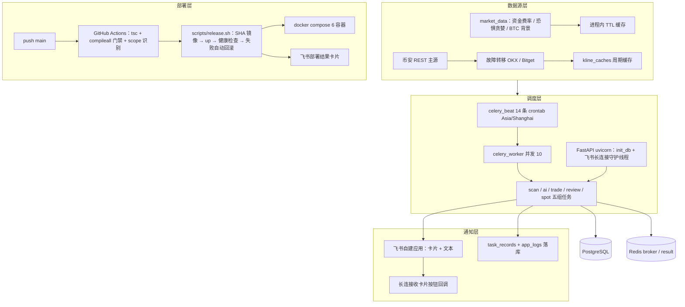
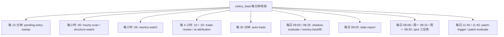
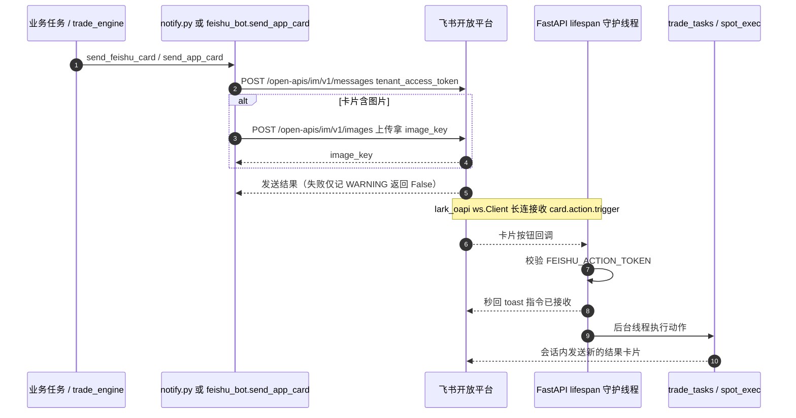
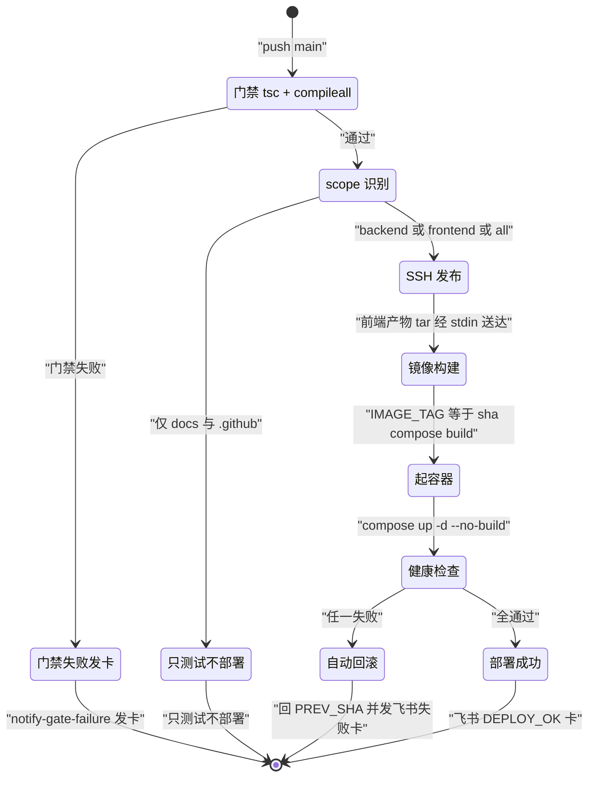

# 09-基建与通知

> 现行版本：RULE_VERSION v2026-10-18（2026-10-18）。本文对照代码整理，以代码为准；历史拍板记录见 docs/archive/。
>
> 本文为原 `功能流程/09-基建与通知.md` 与 `技术实现/09-基建与通知.md` 于 2026-10-21 合并而成：功能口径与拍板以业务规则为准，实现细节以代码为准。

## 功能流程图

> 本图概括本文所述功能的整体流程（Mermaid 渲染）。



## 1. 概览

系统基建分四层：**数据源 → 调度 → 通知 → 部署**。业务逻辑（扫描 / AI / 交易 / 复盘 / 现货）运行在 FastAPI 与 Celery worker 两类进程里，共享 PostgreSQL 与 Redis：

```
数据源层   币安 REST（主）──故障转移──▶ 欧易 OKX / Bitget      exchange_pool.py
           资金费率 / 恐惧贪婪指数 / BTC 背景K线                market_data.py
               │ K线（kline_caches 周期缓存）＋环境数据（进程内 TTL 缓存）
               ▼
调度层     celery_beat（14 个定时条目，Asia/Shanghai）──Redis broker──▶ celery_worker（并发 10）
           FastAPI（uvicorn：API + 建表迁移 + 飞书长连接守护线程）        celery_app.py / main.py
               │ scan / ai / trade / review / spot 五组任务
               ▼
通知层     飞书自建应用（卡片 + 文本；长连接收卡片按钮回调）            feishu_bot.py / notify.py
           任务记录 + 应用日志落库 → 前端「任务记录 / 系统日志」面板      task_log.py / log_sink.py
               ▼
部署层     push main → GitHub Actions（tsc + compileall 门禁 → scope 识别）
           → SSH → scripts/release.sh（SHA 镜像 → up → 健康检查 → 失败自动回滚）
           → docker compose（6 容器）→ 飞书部署结果卡片
```

代码模块表：

| 模块 | 职责 |
|---|---|
| `backend/app/services/binance_client.py` | 币安公开 API 同步客户端（429/418/5xx 限流退避）；`get_futures_klines` 薄封装供 BTC 背景数据 |
| `backend/app/services/exchange_pool.py` | 多交易所 K 线 / 合约清单故障转移（币安→OKX→Bitget）+ `kline_caches` 周期缓存 |
| `backend/app/services/market_data.py` | 市场环境数据源（资金费率 / 恐惧贪婪 / 大盘广度）；`build_market_context` AI 环境注入（含 BTC 急跌警示） |
| `backend/app/services/narrator.py` | suggest 决策 ≤300 字中文叙述生成（LLM 轻量调用，失败回退模板；skip 不调） |
| `backend/app/services/feishu_bot.py` | 飞书自建应用机器人：发卡片 / 文本 + 长连接卡片按钮回调（合约平仓 / 现货一键确认）；`start_card_listener` 定义于 feishu_bot.py:155 |
| `backend/app/services/notify.py` | 通知统一入口 `send_feishu_card` / `send_feishu_text`（转发 feishu_bot，未配置静默跳过） |
| `backend/app/services/task_log.py` | 任务记录读写助手（`open_task` / `close_task` → `task_records`） |
| `backend/app/services/log_sink.py` | 应用日志异步入库（`app.*` → `app_logs`），保留策略与 fork 后重启 |
| `backend/app/database.py` | 引擎 / 会话 + `init_db`（create_all + `_run_migrations` 幂等迁移） |
| `backend/app/config.py` | pydantic-settings 全量配置 + `RULE_VERSION` 机制（config.py:293） |
| `backend/app/celery_app.py` | Celery 应用：beat_schedule 总表 + worker fork 钩子（celery_app.py:11-25） |
| `backend/app/api/health.py` / `ops.py` | `/api/health` 探活；`/api/tasks`、`/api/logs` 运维观测端点 |
| `scripts/release.sh` | 服务器端发布 / 回滚 / 状态脚本（镜像按 git SHA 打标签；探活 `GET /api/scans/config`，release.sh:58） |
| `.github/workflows/deploy.yml` | push main CI/CD：门禁 → scope 识别 → SSH 发布 → 飞书通知 |
| `docker-compose.yml` / `deploy.sh` | 容器编排（6 服务）；本地一键启停辅助脚本 |

## 2. 定时任务（Celery beat）

### 2.1 Celery 应用配置（celery_app.py）

`Celery("trading_workbench", broker=CELERY_BROKER_URL, backend=CELERY_RESULT_BACKEND, include=[8 个任务模块])`；`conf.update`：`task_serializer=json`、`accept_content=["json"]`、`result_serializer=json`、`timezone="Asia/Shanghai"`、`enable_utc=True`、`task_acks_late=True`、`worker_prefetch_multiplier=1`。Redis 分工：`REDIS_URL`（db0，信号量等）、`CELERY_BROKER_URL`（db1）、`CELERY_RESULT_BACKEND`（db2）。

`worker_process_init`（celery_app.py:11-25）做两件事：`restart_db_log_sink_after_fork()` 重启日志写库线程 + `engine.dispose(close=False)` 丢弃 fork 继承的数据库连接池（防子进程串包）。

### 2.2 beat 调度总表

全系统唯一权威清单：`backend/app/celery_app.py` 的 `beat_schedule`（timezone=Asia/Shanghai，crontab 按北京时间解释）。broker / result 走 Redis db1 / db2（`REDIS_URL` 本体 db0）。



| beat 条目 | 任务 | 节奏 | 职责 |
|---|---|---|---|
| hourly-scan | `scan_tasks.run_scan_task`（scan_type=scheduled） | 每小时 `minute=SCAN_BEAT_MINUTE`（默认 0，即 :00） | 定时扫描（整点收盘后跑）：指标筛选 → 触发确认 → 落库 → AI 配额分发；新命中推飞书卡片 |
| structure-watch | `structure_watch.run_structure_watch_task` | 每小时 :00 | BTC/ETH 1h 结构形态 + 4h 完整性检测（只读轻量；任务自监控误差 ≤30s，超限告警） |
| trade-review | `review_tasks.run_trade_review_task` | 每 4 小时 `minute=10, hour="*/4"`（2026-10-31 降频） | 建议复盘：处理超 24h 的 AI 建议决策（逐 K 回放归档）；分片每轮 12 个，24h 轮完一圈 |
| ai-attribution | `review_tasks.run_ai_attribution_task` | 每 4 小时 `minute=20, hour="*/4"`（2026-10-31 降频） | 对已平仓交易做 AI 错误归因（排在 trade-review 之后，避免 LLM 并发） |
| patch-trigger | `review_tasks.run_patch_trigger_task` | 每日 11:40（`hour=11, minute=40`） | 标签热度检查 → 生成规则补丁草稿 |
| patch-evaluate | `review_tasks.run_patch_evaluate_task` | 每日 11:45（`hour=11, minute=45`） | active 补丁三态评估 |
| auto-trade | `trade_tasks.run_auto_trade_task` | 每 30 分钟（`minute="0,30"`） | 结算在跑仓位、自动导入手动持仓、孤儿挂单清扫、持仓时长预警判定、派发单笔持仓诊断、划转同步。开仓唯一通道 = 分析落库后即时开仓（不在本任务） |
| pending-entry-sweep | `trade_tasks.watch_pending_entries` | 每 15 分钟（`minute="0,15,30,45"`） | 挂单入场兜底：成交落地 + 1 小时未成交撤单清除 + 保护事故恢复（与 user-data-stream 实时路径双入口，幂等）；空闲轮次由 Redis 标志短路不查库 |
| reentry-watch | `trade_tasks.watch_reentry_watches` | 每小时 :06（`minute=6`） | 止损后再入场检测与提醒（docs/需求文档/24）：止损根长影线 + 结构两道闸建监控，只用已收盘 1h high/low 判触发，仅提醒不下单 |
| daily-report | `daily_report.notify_daily_report` | 每日 08:05（`hour=8, minute=5`） | 主流币日收盘 + 前一日交易统计卡片（币安日K 北京 08:00 收盘后 5 分钟） |
| shadow-evaluate | `shadow_tasks.run_shadow_evaluate_task` | 每日 08:00（`hour=8, minute=0`） | 影子特征分桶评估（复盘归因 join），经 `/api/shadow/report` 与日报附录输出；只统计不决策 |
| reentry-backfill | `shadow_tasks.run_reentry_backfill_task` | 每日 08:25（`hour=8, minute=25`） | 出场 48h 观察窗已过的止损单补打标（结构×续走，CARD-07） |
| spot-daily-check | `spot_tasks.run_spot_daily_task` | 每日 08:08（`hour=8, minute=8`） | 现货日检：三币评分卡片（纯评分不下单；P1 决策币种带一键确认按钮） |
| spot-dca | `spot_tasks.run_spot_dca_task` | 周一 08:15（`hour=8, minute=15`） | 现货周度定投（`spot_settings.dca_enabled` 才执行） |
| spot-weekly-review | `spot_tasks.run_spot_weekly_review_task` | 周一 08:30（`hour=8, minute=30`） | AI 周度研判卡片（纯展示，无执行权限） |

### 2.3 beat 之外的异步任务（事件触发）

| 任务 | 触发时机 | 职责 |
|---|---|---|
| `trade_tasks.open_trade_for_analysis` | AI 分析落库后即时派发 | suggest 且过全部闸门即开仓（全系统唯一开仓通道） |
| `trade_tasks.run_position_advice` | auto-trade 巡检后逐单派发 | 单笔持仓 AI 诊断（建议离场 / 滞留诊断 → 飞书卡片） |
| `ai_tasks.run_ai_analysis_task` / `run_ai_analysis_single` | 扫描命中后分发 | 批量分析编排 / 单币 LLM 分析（重试 3 / 2 次） |
| `spot_tasks.run_spot_backfill_task` | 页面手动 / 历史回填 | 现货历史 K 线回填 |

### 2.4 Worker 配置与任务登记口径

Worker：`task_acks_late=True` + `worker_prefetch_multiplier=1`（长任务不饿死短任务）；并发 10 = LLM 信号量 `LLM_CONCURRENCY=4` + 预留短任务空位（docker-compose.yml）。fork 钩子见 §2.1。

任务登记口径：五类 beat 任务 + 即时开仓 / 持仓诊断等均在开头 `task_log.open_task`、结束 `close_task`；`trigger` 区分 scheduled（beat）/ manual（页面手动，如手动扫描、手动刷新）/ system（事件派发）。扫描任务携带 `scan_record_id`，前端任务记录可点击直达该轮扫描结果。任务名与展示名（task_name）解耦：如 `run_auto_trade_task` 展示为「自动交易」。

## 3. 数据层

### 3.1 交易所连接池（exchange_pool.py）

`ExchangePool` 无状态可全局共享，K 线故障转移链 **币安 → OKX → Bitget**，单次失败即切下一所（不做退避重试——故障转移本身就是重试）：

- 418 / 429 按 `Retry-After` 记录该交易所冷却期（无头默认：限流 60s、网络错误 30s），冷却中的交易所排到尝试序列末尾（`_ordered_names`，仍作兜底尝试）。
- 所有交易所 K 线统一归一化为币安行格式 `[open_time_ms, o, h, l, c, base_vol, close_time, quote_vol]`；OKX 单次 limit ≤300。
- 缓存落 `kline_caches` 表，键 `(symbol, interval, kline_hour)`，`kline_hour` 对齐 UTC 周期起点——同一周期内命中不请求交易所；缓存条数少于请求条数视为未命中重拉；`force_refresh=True` 跳过读缓存但仍回写（关注列表手动刷新）。
- 全部失败：`allow_stale=True` 返回最近一份旧缓存（前端展示兜底），否则抛 `AllExchangesFailed`（summary 含各所失败原因与解禁时长）；`exchange_status()` 输出各所可用 / 冷却摘要。
- `get_klines_range`：截至 `end_time_ms` 的历史区间（交易复盘按开仓时刻取 K 线），直接请求交易所，不读不写缓存（历史区间无复用价值），保留故障转移。
- `get_usdt_swap_symbols_with_volume`：USDT 永续合约清单 + 24h 成交额降序（扫描宇宙数据源），三所同款故障转移；排除稳定币与 `EXCLUDE_KEYWORDS` 命中的基础资产。

### 3.2 币安直连客户端（binance_client.py）

`BinanceClient` 维护合约（fapi）+ 现货（api）两个 httpx.Client，`_request` 统一限流退避：429 按 `Retry-After` 等待重试（最多 3 次）、418 IP 封禁立即抛错（不可重试）、5xx / 超时指数退避 1/2/4s。`get_futures_klines` 为薄封装（数值化数组、走退避），供市场环境块拉 BTC 背景数据；`get_usdt_symbols` 现货列表保留备用。与 ExchangePool 的分工：ExchangePool 服务扫描 / 图表（周期缓存 + 多所转移），BinanceClient 服务环境块与不进缓存的直连调用。

### 3.3 市场环境数据源（market_data.py）

进程内 TTL 缓存：资金费率 10min、恐惧贪婪 30min、大盘广度 5min；**全部静默降级**——任何失败返回 None，prompt 显示「不可用」，绝不阻塞 AI 分析。

- `get_funding`：`/fapi/v1/premiumIndex`（+ openInterest）。
- `get_market_breadth`：BTC / ETH 的 EMA 形态 + 24h 涨跌幅（K 线走 ExchangePool，同周期命中缓存零交易所 IO）。
- `build_market_context`：AI 事实包「市场环境」文本块——本币资金费率（|rate| > 0.1%/8h 标注多头 / 空头拥挤）+ BTC 状态摘要（4h EMA21/55 排列 + 1h 近 3 根已收盘累计涨跌，跌破阈值追加「BTC 短线急跌，山寨开单需谨慎」警示）。
- BTC 急跌警示：BTC 1h 近 3 根已收盘累计跌幅 < `-BTC_CRASH_PAUSE_PCT` 时，经 `_btc_market_line` 在环境块追加「BTC 短线急跌，山寨开单需谨慎」AI 提示词警示，**不再拦截开单**；阈值 0 = 关闭该警示。（原 `btc_crash_active` 程序级普跌闸门已于 2026-10-13 移除）

### 3.4 K 线推送现状（KlineHub/SSE 已废弃，改用 REST 拉取）

- K 线实时推送（KlineHub + SSE，币安 WS 上游）2026-09-15 整体移除，`kline_hub.py` / `api/kline_stream.py` 已删除且未恢复。
- **但代码已有行情相关 WebSocket**：`event_stream.py` 提供每配置账号一条 user-data-stream（币安 listenKey WS）+ 每 WS 域一条 mark price 市场流，用于事件驱动执行（挂单成交/撤单实时落地，`EVENT_EXEC_ENABLED` 控制 user-data 路径），见 [04-交易执行与多账号](../交易执行/04-交易执行与多账号.md) §2.6。
- 图表取最新 K 线 = 前端手动「更新」按钮：`GET /api/scans/klines/{symbol}`（`force_refresh=1` 绕过缓存直连交易所）。
- 仓库内 WebSocket 现有三类：飞书卡片回调长连接（§4.2，lark_oapi ws.Client）+ `event_stream.py` 的 user-data-stream（币安 listenKey）+ mark price 市场流。

### 3.5 叙述生成（narrator.py）

- 定位：决策定稿后的**叙述分离**（docs/04 §5）——决策 JSON 由 AI 分析产出（不含叙述，省 token、结构稳），`generate_narrative` 只为 suggest 决策生成 ≤300 字中文叙述；skip 决策不调 LLM（`skip_reason` 已是结构化理由，前端直接展示）。
- 输入事实：币种 / 现价、信号类型 + 金K形态（含位置标签）、决策要素（方向 / 入场 / 止损 / 止盈1 / 盈亏比 / 仓位）、开单类型标签（`TRADE_TYPE_LABELS`，含 legacy 映射）、AI 核心依据、市场环境（资金费率 + 大盘 EMA 标签）。
- 生成约束：system 提示词要求「1. 2. 3.」序号逐条（满足条件 → 不满足 / 风险 → 结论），temperature=0.3，返回截断 600 字符（≈300 汉字上限）。
- 失败语义：任何异常（LLM 不可用 / 空返回）回退 `_template` 模板拼接——方向 / 锚点 / 入场 / 止损 / 盈亏比 / 仓位 / 推荐程度，叙述永不缺席。

### 3.6 建表与迁移入口（database.py）

`init_db()`（main.py lifespan 启动时执行）：先 `Base.metadata.create_all` 建全新表（需先 import 各 models 模块），再执行 `_run_migrations(engine)`。create_all 不会给已存在的表加列，所以历史演进全部靠 `_run_migrations` 里的 SQL 补齐。

### 3.7 幂等迁移机制

- `ALTER TABLE ... ADD COLUMN IF NOT EXISTS`（含 NOT NULL DEFAULT）补列；`CREATE INDEX IF NOT EXISTS` 补索引；`DROP COLUMN IF EXISTS` 仅用于确认退役的列（如 `memory_injection_enabled`）。
- 回填 `UPDATE`：如 `trade_records.account_key` / `account_transfers.account_key` 按 testnet 布尔回填 `testnet-1` / `live-1`、`watchlist.updated_at` 回填 created_at、`system_config.live_trading_keys` 回填当前账号。
- `system_config` 默认行 `INSERT ... ON CONFLICT (id) DO NOTHING`：必须列全所有 NOT NULL 列——全新库靠它建首行（模型列只有 Python 端 default，漏列的裸 INSERT 会 NotNullViolation）。
- 惯例：下线功能的历史列**保留不 DROP**（`key_levels_json`、旧 `breakout_threshold` 散列等），旧数据原样可查，代码侧停止读写。
- 迁移在 `engine.begin()` 单事务内逐条 `conn.execute(text(...))`；重复执行天然幂等（启动即跑，无版本表）。

迁移时间线摘要（对照 `_run_migrations` 注释，供检索；完整拍板理由见各 docs/archive）：

| 时间 | 迁移内容 | 表 |
|---|---|---|
| 2026-09-25 | 触发信号 / K线形态快照列 | trade_records.signal_type / pattern |
| Feature 1-8 期 | 量能分类、EMA 状态、强度 + AI 指纹、Agent 管线开关、stage_trace、双评委开关 | scan_results / ai_analyses / system_config |
| 2026-09-15 | 开单策略开关、余额风控 trading_min_free_pct、pullback_wait、open_block_reason | system_config / ai_analyses |
| 2026-09-20 | testnet 环境标识、环境口径运行时化（trading_testnet/enabled 进 DB）、quality_score/votes_json | trade_records / system_config / scan_results |
| 2026-09-18 | 复盘重设计（fee_total/funding_total/error_tags）、规则补丁闭环索引 | trade_records / prompt_patches |
| 2026-09-23 | 多账号注册表（account_key 三表 + 回填、live_trading_keys 扇出） | system_config / trade_records / account_transfers |
| 2026-09-26~27 | 初始资金、盈亏峰值、止损金额模式（pct/fixed）、持仓时长告警级别 | system_config / trade_records |
| 2026-09-29 | 止损锚类型 stop_anchor、rule_version 两表、双评委 veto 快照 | ai_analyses / trade_records / trade_reviews |
| 2026-09-28 | 回踩触点体系（touch_ref 三表 + 索引）、筛选参数组 scan_filters JSONB、position_ref | scan_results / pullback_pendings / trade_reviews / system_config |
| 2026-09-23~24 | 现货环境独立（spot_trading_testnet / spot_live_trading_keys）、spot_orders.account_key | system_config / spot_orders |

### 3.8 表清单（20 张，models/__init__.py）

| 表 | 模型 | 用途 |
|---|---|---|
| `scan_records` / `scan_results` | models/scan.py | 扫描批次 / 命中结果（含质量分、touch_ref、ema_state 等） |
| `ai_analyses` | models/scan.py | AI 分析记录（决策 JSON、rule_version、veto_original 等） |
| `kline_caches` | models/scan.py | K 线周期缓存（ExchangePool 读写） |
| `breakout_events` / `pullback_pendings` | models/scan.py | 破轨事件 / 回踩待确认池 |
| `watchlist` | models/scan.py | 关注列表 |
| `system_config` | models/system_config.py | 单行运行时配置（交易开关、风控参数、scan_filters JSON 等） |
| `trade_records` / `trade_events` / `account_transfers` | models/trade.py | 交易记录 / 交易事件 / 资金划转 |
| `task_records` / `app_logs` | models/ops.py | 任务记录 / 系统日志（§5） |
| `prompt_patches` | models/patch.py | 规则补丁闭环 |
| `symbol_blacklist` | models/blacklist.py | 币种黑名单（手动 + 自动） |
| `spot_orders` / `spot_weekly_reviews` / `spot_kline_cache` | models/spot.py | 现货屯币三表 |

## 4. 飞书通知

### 4.1 通道与配置（feishu_bot.py）

- 2026-09-22 起全部走**自建应用**，webhook 自定义机器人弃用（收不到卡片按钮回调）。配置三件套 `FEISHU_APP_ID` / `FEISHU_APP_SECRET` / `FEISHU_TARGET_ID`，未配置时 `configured()`=False，所有通知静默跳过（返回 False，不抛错不影响主流程）。
- `TARGET_ID` 按前缀自动识别：`oc_` → 群（chat_id），`ou_` → 个人单聊（open_id）；发送走 `/open-apis/im/v1/messages`，`tenant_access_token` 进程内缓存（提前 60s 过期刷新）。
- 交互令牌 `FEISHU_ACTION_TOKEN`：随按钮 value 下发、回调时校验；未配置时卡片降级为**纯展示**（不带按钮）。
- 卡片内嵌图片（2026-10-15）：卡片 `img` 元素必须两步走——先 `POST /open-apis/im/v1/images` 上传（`image_type=message`）拿 `image_key`，再随卡片挂 `{"tag":"img","img_key":…,"alt":…}`（`upload_image`，失败返回 ""）。**部署前置**：飞书后台需给自建应用开「上传图片」权限（`im:resource` 或「上传文件 V2」任一），否则上传报权限错、卡片自动退化为纯文字。
- 发送失败仅记 WARNING（落 app_logs）返回 False；发送语义是「尽力而为」，无重试队列。

### 4.2 卡片按钮回调（长连接，仓库唯一 WebSocket）

- backend lifespan 启动守护线程（main.py:37 `start_card_listener`），未配置 / 缺 lark_oapi SDK 静默跳过。
- `lark_oapi` ws.Client 长连接收 `card.action.trigger`：`client.start()` 断开时静默返回 → 外层 while 循环 30s 重连；整体异常退出 5 分钟后重试（`_run_ws`），关键日志 WARNING 落 app_logs 可观测。
- 回调分支（`_on_card_action`）：`close_market` 合约市价平仓；`spot_buy` / `spot_sell` 现货屯币一键确认（[07-现货屯币](../现货屯币/07-现货屯币.md) P1 挂载点式扩展，合约逻辑零改动）；`open_live` 正式网未开单提醒卡片的「开单」按钮（2026-10-15，多账号时不渲染按钮，避免群聊误开实盘单）。
- 交互流：校验令牌 → **秒回 toast**「指令已接收」（回调须快速返回）→ 后台线程执行 → 会话内发送**新的**结果卡片（不更新原卡片）。
- 执行核心同源：平仓走 `trade_tasks.manual_close_market`（与网页「市价平仓」按钮同一函数，含账号锁互斥）；现货走 `spot_exec.exec_spot_order`（trigger_type=signal，受单币每日一次冷却，重复点击被拒）；开单走 `trade_tasks.manual_open_from_analysis`（与网页扫描结果表「开单」按钮同一函数，`force_market=True` 市价即时入场；重复点击被「同分析同账号已开仓」去重闸门拦住）。开单的执行核心已把锁外异常（db.get / 账号注册表 / Redis 构建）收敛成 `code=error` 而不裸抛（2026-10-15）——回调跑在守护线程里，裸抛即静默死掉、结果卡片永不送达；平仓（`manual_close_market`）与现货（`_exec_spot_confirm`）目前仍是裸抛惯例，同一暴露面待后续对齐。
- 开单结果卡四态（2026-10-15）：**绿**＝成交（价格栅格）/ **蓝**＝该分析在此账号已有成交、未重复开单（去重闸门不落 `block_reason`，靠回填的 `trade_id` 识别，原「⚠️ 未开单」是误述，已改「ℹ️ 未重复开单」）/ **橙**＝真闸门拦截（带 `block_reason`）/ **红**＝校验、锁或下单执行失败（带 `error`）。
- 按钮 value 字段契约（JSON，随卡片下发、回调原样带回）：

| 字段 | close_market | spot_buy / spot_sell | open_live |
|---|---|---|---|
| `act` | `close_market` | `spot_buy` / `spot_sell` | `open_live` |
| `token` | FEISHU_ACTION_TOKEN 校验 | 同左 | 同左 |
| `trade_id` | 交易记录 UUID（必填） | — | — |
| `symbol` | — | 币种（必填） | — |
| `quote` / `lots` | — | BUY 带金额（push 时评估价，按金额买价格无关）/ SELL 带 lots（执行时按现价折算并裁剪到波段仓 30% 上限） | — |
| `analysis_id` / `account_key` | — | — | AI 分析 UUID + 目标账号 key（均必填；回调按账号注册表复验） |

### 4.3 通知与卡片回调时序



失败语义：发送「尽力而为」，无重试队列；除日报有文本降级外，其余发送失败只落系统日志。

### 4.4 扫描命中卡片 `_scan_hit_card`（scanner.py:69）

仅**定时扫描**且新命中 >0 时推送（scanner.py:819；手动扫描用户在场不推），命中已过重复抑制、只在真新命中时提醒。蓝头「🔎 定时扫描命中 N 个」+ lark_md 命中列表：`**币种**　信号族·金K形态中文名　质量分 X`——信号族与形态中文名沿用复盘侧 `TRIGGER_FAMILY`（actual_review.py）与 `PATTERN_LABEL_MAP`（strategy/candlestick.py）映射；超 8 条截断、余量并入 note 脚注。2026-09-30 由纯文本升级为卡片。

### 4.5 各通知触发点全表

| # | 触发点 | 代码位置 | 形式 | 内容 / 备注 |
|---|---|---|---|---|
| 1 | 定时扫描命中 | scanner.py:819 → `_scan_hit_card` | 卡片（蓝） | 仅 scheduled；超 8 条截断 |
| 2 | AI 持仓建议 · 建议离场 | position_advisor.py:499 `_notify_advice` | 卡片（红） | 浮亏高亮 + 四列价格栅格 + AI 建议 +「市价平仓」按钮（有 ACTION_TOKEN 时） |
| 3 | 滞留诊断（≥24h 未触发 TP1） | position_advisor.py:749 `_notify_stale` | 卡片 | 每 24h 一次；仅 action=exit 带平仓按钮 |
| 4 | 持仓时长分级预警 | trade_engine.py:2715 `check_hold_warnings`（trade_tasks.py:378 锁外发送） | 卡片（黄/红） | >12h 黄卡 / >24h 红卡；`hold_warn_level` 只升级不重发（幂等去重） |
| 5 | 自动导入手动持仓 | trade_tasks.py:356 | 文本 | 「📥 自动导入持仓：…」（仅正式网接管） |
| 6 | 每日交易日报 | daily_report.py:213（降级文本 :224） | 卡片 | 08:05；行情栅格 + 交易统计 + 净收益；卡片失败降级纯文本 |
| 7 | 现货日检评分卡 | spot_tasks.py:70（卡片 :521，发送 :605） | 卡片 | 08:08；纯评分不下单；P1 决策币种带 BUY/SELL 一键确认按钮 |
| 8 | 现货定投执行卡 | spot_tasks.py:318 | 卡片 | 周一 08:15 定投结果 |
| 9 | 现货周度研判卡 | spot_tasks.py:515 | 卡片 | 周一 08:30，纯展示 |
| 10 | 合约平仓结果卡 | feishu_bot.py:442 `_exec_close` | 卡片 | 平仓按钮回调后新消息回报（绿/红 + 净盈亏/收益率栅格） |
| 11 | 现货下单结果卡 | feishu_bot.py:363 `_exec_spot_confirm` | 卡片 | 一键确认回调后新消息回报（成交均价/回款/风控拒绝原因） |
| 12 | 自动开仓成功卡 | trade_engine.py `notify_open_cards`（trade_tasks.py:544 锁外发送） | 卡片（蓝） | suggest 自动开单成交即推：概览行（方向/杠杆/预估风险/AI 评分）+ 价格栅格（入场/SL/TP1/TP2）+ 数量·名义·信号·战法标注 + 环境脚注；锁内只取记录 ID、全部账号扇出结束锁外逐笔发送（飞书 HTTP 不进开仓锁） |
| 13 | 部署成功 / 失败卡 | .github/workflows/deploy.yml（内嵌 Python） | 卡片 | CI 直发 open API（不经 backend）；成功提取 `DEPLOY_OK` 行、失败附日志尾部 + 回滚提示 |
| 14 | 门禁失败卡 | deploy.yml `notify-gate-failure` | 卡片 | test / changes job 失败时单独发（此时 deploy 被 skip，不静默） |
| 15 | 正式网未自动开单提醒 | trade_engine.py `notify_live_auto_open_off`（trade_tasks.py:442 锁外发送） | 卡片（橙）+ 内嵌图 | 2026-10-09 立；仅 `trading_enabled_live=False` 且信号达标（`analysis_open_eligible`）且实盘该分析无成交时发。2026-10-15 卡内嵌服务端渲染 PNG（K 线 + EMA21/55/144 + 入场/SL/TP1/TP2 计划线，见 `kline_chart.render_plan_chart`，图内标签全 ASCII）；正式网启用账号恰好 1 个且配了 ACTION_TOKEN 时附「开单」按钮（`open_live` 回调 → `manual_open_from_analysis`）。画图/上传失败自动退化为纯文字卡片 |
| 16 | 开单结果卡 | feishu_bot.py:243 `_exec_open_live` | 卡片 | 「开单」按钮回调后新消息回报四态：绿＝成交（方向/账号/入场价 + SL/TP1/TP2 栅格 + 数量脚注）/ 蓝＝该分析在此账号已有成交、未重复开单 / 橙＝开仓闸门拦截（带 `block_reason`）/ 红＝校验、锁或执行失败（带 `error`，2026-10-15 加锁外异常兜底） |

调用入口说明：`notify.py` 是统一入口（`send_feishu_card` / `send_feishu_text`），tasks 层多用它；scanner / position_advisor / trade_tasks 直接 import feishu_bot 的 `send_app_card` / `send_app_text`（同一通道）。全表仅日报有文本降级，其余发送失败只落系统日志。

## 5. 日志与运维

### 5.1 任务记录（task_log.py → `task_records`）

- `open_task` 在任务开头登记 running 记录，`close_task` 在结束 / 异常收尾（completed / failed / skipped）；均为独立短会话，助手自身异常静默（任务记录不可用不能拖垮任务）。
- `status=failed` 时同步 `logger.warning` 一条——不依赖任务自身是否 `logger.exception`，保证失败在「任务记录」与「系统日志」两处可见。
- 字段：`task_type`（scan/ai/trade/review）、`task_name`（展示名，与任务函数名解耦）、`trigger`（scheduled/manual/system）、`summary`（≤250 字）、`detail` JSON、`error`（≤2000 字）、`scan_record_id`（扫描任务关联批次，前端点击加载结果）。
- 保留 14 天。

### 5.2 系统日志（log_sink.py → `app_logs`）

- `DBLogHandler` 挂在 `logging.getLogger("app")` 而**非 root**——celery worker 默认清空 root handler（hijack），app.* 记录沿层级传播必经「app」节点不受影响（uvicorn 同理）；main.py 与 celery_app.py 各自 `attach_db_log_sink()`，幂等。
- 级别口径：`app.*` 仅 WARNING 及以上落库；例外 `app.spot.*` INFO 即落库（现货日志 Tab 需要日检全程）；uvicorn / celery / httpx 等框架噪音不入库。
- 异步不阻塞：emit 永不抛错，内存队列（2000 条，满则丢最旧）→ 后台写线程批量入库；单条截断 4000 字符；写库失败 stderr 丢弃（不走 logging 防递归）。
- 保留策略：app_logs 7 天、task_records 14 天，写线程每 10 分钟清理一次。
- fork 处理：worker prefork 子进程里写库线程已死，`worker_process_init` 调 `restart_db_log_sink_after_fork` 重启（`start()` 幂等）；同时 `engine.dispose(close=False)`。
- 未处理接口异常由 main.py 全局 exception_handler 落系统日志并返回 500（4xx 不在此列）。

### 5.3 健康检查端点

- `GET /api/health`（api/health.py）：`{"status":"ok"}` 存活探针。
- 注意：发布脚本探活用的是 `GET /api/scans/config`（scripts/release.sh:58）——DB 依赖端点，比 /api/health 更严格。

### 5.4 API 契约

| 端点 | 用途 | 备注 |
|---|---|---|
| `GET /api/health` | 存活探针 | `{"status":"ok"}`（api/health.py）；发布探活实际用 `GET /api/scans/config`（release.sh:58） |
| `GET /api/tasks` | 任务记录列表 | `task_type` / `status` 过滤 + 分页；保留 14 天 |
| `GET /api/tasks/{id}` | 任务记录详情 | — |
| `GET /api/logs` | 系统日志 | `level` / 关键字 `q` / `logger` 前缀过滤 + 分页；现货日志用 `logger=app.spot` |

### 5.5 前端观测面板 ↔ 数据来源对照

| 前端面板 | 数据表 | 写入方 | API | 保留 |
|---|---|---|---|---|
| 任务记录 | `task_records` | 各 celery 任务（task_log） | `GET /api/tasks`、`/api/tasks/{id}` | 14 天 |
| 系统日志 | `app_logs` | log_sink（app.* WARNING+；app.spot.* INFO+） | `GET /api/logs`（level/q/logger 过滤） | 7 天 |
| 现货日志 Tab | `app_logs` | log_sink（app.spot.* 全程 INFO） | 同上（logger=app.spot 过滤） | 7 天 |
| 交易所连通状态 | 进程内状态（不落库） | exchange_pool `_ban_until` | `exchange_status()` 摘要（随报错返回） | — |

## 6. 配置体系

### 6.1 settings 分组（config.py）

| 分组 | 关键项（默认值） |
|---|---|
| 应用 / 数据库 | `APP_NAME`、`DEBUG=True`、`DATABASE_URL` |
| Redis / Celery | `REDIS_URL`（db0）、`CELERY_BROKER_URL`（db1）、`CELERY_RESULT_BACKEND`（db2） |
| 币安行情 | `BINANCE_BASE_URL` / `BINANCE_FUTURES_URL` / `BINANCE_TIMEOUT=15` / `BINANCE_CONCURRENCY=8` |
| 扫描策略 | `KLINE_INTERVAL=1h`、`KLINE_WINDOW=240`、`SCAN_BEAT_MINUTE=0`（config.py:40）、`BREAKOUT_*`（突破门槛 0.2% / 通道 20 根 / 量比 1.2 / 追高上限 1.5%）、`RETEST_WINDOW_BARS=24`、`STRUCTURE_TOUCH_BAND_PCT=0.3`、`EMA_TOUCH_MIN_BARS=200`、`DAILY_LOSS_STOP_ENABLED=True` + `DAILY_LOSS_STOP_PCT=9.0`（硬熔断） |
| 宇宙过滤 | `EXCLUDE_KEYWORDS`、`QUOTE_ASSET=USDT`、`MIN_VOLUME_24H=300万` |
| AI 分析 | `AI_API_KEY/BASE_URL/MODEL`、`LLM_CONCURRENCY=4`、`AI_CALL_TIMEOUT_S=300`、`LLM_JSON_MODE=False`（网关兼容）、`AI_RR_MIN=1.5`、`AI_MAX_PER_SCAN=10`、`FINGERPRINT_TTL_MIN=60` |
| 市场环境 | `MARKET_CONTEXT_ENABLED=True`、`BTC_CRASH_PAUSE_PCT=1.0`（0=关闭） |
| 飞书 | `FEISHU_APP_ID/APP_SECRET/TARGET_ID/ACTION_TOKEN` |
| 自动交易 | 多账号 `BINANCE_LIVE_{N}_*`（account_registry 扫 os.environ）、`TRADING_TESTNET/TRADING_ENABLED`（仅首次建行注入，运行时以 system_config 为准）、`TRADING_MIN_RECOMMENDATION=60`、`NEAR_ANCHOR_RISK_FACTOR=0.7`、`SPREAD_MAX_PCT=0.003`、`TAKER_FEE_RATE=0.0005`、`TRADING_LEVERAGE=20/_MIN=8`；默认关闭的开关：`CONSECUTIVE_LOSS_DERATE=False`、`PORTFOLIO_HEAT_CAP=0`、`SAME_DIRECTION_CAP=0` |

### 6.2 RULE_VERSION 机制

- `settings.RULE_VERSION = "v2026-10-18"`（config.py:293）。递增时机：改 trigger / risk_guard / 提示词纪律 / 分批比例均算改版；版本沿革以注释形式沉淀在 config.py（v2026-09-29 → v2026-10-18）。
- 开仓 / 分析时点快照到 `trade_records.rule_version` / `ai_analyses.rule_version`（2026-09-29 迁移引入）。
- 复盘 / 归因按版本分组对比，**跨版本混谈从机制上杜绝**；NULL = 标记上线前的旧行，统计口径归 legacy。

### 6.3 env 约定

- 配置文件 `backend/.env`（docker-compose env_file 注入各容器）；权威样例 `backend/.env.example`。
- `Settings.Config`：`env_file=".env"`、`extra="ignore"`——多账号变量 `BINANCE_LIVE_{N}_API_KEY/SECRET_KEY(/NAME)` 不逐个声明，由 `services/account_registry.py` 直接扫 `os.environ`（N≥1 数量不限）。
- 迁移趋势：运行时可变参数持续从 env 迁进 `system_config`（trading_testnet / trading_enabled、spot_trading_testnet、筛选参数组 `scan_filters` JSON、风险预算模式 pct/fixed 等）；env 只保留首次建行注入值与第三方凭据。

## 7. 部署链路

### 7.1 CI/CD（.github/workflows/deploy.yml，2026-09-19 上线）

```
push main
  ① test    前端 npx tsc --noEmit ＋ 后端 python -m compileall backend/app
  ② changes (仅 push) 与上一 commit diff 定 scope：
              backend/                    → backend
              frontend/                   → all
              docker-compose.yml、backend/.env.example、scripts/release.sh、
              */Dockerfile                → all
              仅 .github/、docs/、*.md     → none（只测试不部署）
  ③ deploy  runner 构建前端（scope≠backend）：npm ci + vite build → dist.tar.gz
              （2026-10-12 构建外移：1.6G 服务器无法完成含 mermaid 的 vite build，
                峰值 ~2.3GB，曾连续两次部署卡死 2h+ 后 SSH 断连失败）
              SSH deploy@<host> "deploy <scope> <sha> [bundle]" < dist.tar.gz
              （服务器 /usr/local/bin/deploy-run.sh 包装脚本只接受该命令，
                bundle 模式经 stdin 接收产物；Deploy Key 受限通道）
  ④ scripts/release.sh deploy <scope> <sha> [bundle_tar]：
              git fetch + reset --hard origin/main（硬对齐防分叉卡死）
              → 前端产物就位：解压 bundle 到 frontend/dist（scope≠backend 必需，缺失即中止）
              → IMAGE_TAG=<sha> compose build   （前端镜像仅 COPY dist，秒级；
                失败=旧容器未动，无需回滚）
              → compose up -d --no-build        （失败→自动回滚 PREV_SHA）
              → 健康检查：容器全 Up ＋ :8082/api/scans/config ＋ :8088/（scope≠backend）
                ＋ beat 近 3 分钟日志无 Traceback/DuplicateTable/crashed ＋ worker/beat 运行中
              → 失败自动回滚上一成功 SHA；.deploy_state 记录 LAST_SHA / PREV_SHA
  ⑤ 飞书通知 成功提取 DEPLOY_OK 行；失败附日志尾部（1200 字）＋「release.sh rollback」提示
              门禁失败由独立 job notify-gate-failure 发卡（不静默）
```

- 手动入口：workflow_dispatch 可指定 scope（auto → all）；回滚：服务器上 `scripts/release.sh rollback [<sha>]`（默认回 PREV_SHA）；`status` 查看当前版本与镜像列表。
- 前端构建已外移（2026-10-12）：服务器不执行 vite build，手动 `release.sh deploy`（scope≠backend）须传产物 tar（`deploy <scope> <sha> <bundle_tar>`），缺失即中止 `DEPLOY_FAILED stage=bundle`。
- `concurrency: deploy-<ref>` 排队执行，部署不互相打断。
- Secrets：`DEPLOY_HOST`、`DEPLOY_SSH_KEY`、`FEISHU_APP_ID/APP_SECRET/TARGET_ID`（未配置时通知步骤跳过、不阻塞流水线）。
- 回滚 = 切 SHA 标签 + `up -d`，秒级免重建（镜像按 git SHA 打标签，docker-compose 里 `IMAGE_TAG`）。

### 7.2 部署状态机



### 7.3 scope → 重启服务对应（scripts/release.sh `services_for_scope`）

| scope | 服务 | 探活项 |
|---|---|---|
| backend | backend、celery_worker、celery_beat | 容器 Up + `/api/scans/config` + beat 日志无崩溃 |
| frontend | frontend | 容器 Up + `/api/scans/config` + 前端首页 ：8088 |
| all | 全部 6 容器 | 上述全部 |

### 7.4 容器编排（docker-compose.yml）

| 服务 | 镜像 / 基座 | 端口 | 说明 |
|---|---|---|---|
| db | postgres:15-alpine | 5433→5432 | healthcheck `pg_isready`；pgdata 卷 |
| redis | redis:7-alpine | 6380→6379 | broker / result / 信号量 |
| backend | trading-workbench-backend:$IMAGE_TAG | 8082→8000 | FastAPI（init_db + 飞书长连接） |
| celery_worker | 同 backend 镜像 | — | `--concurrency=10` |
| celery_beat | 同 backend 镜像 | — | 定时调度 |
| frontend | trading-workbench-frontend:$IMAGE_TAG | 8088→80 | nginx 静态 |

全部 `restart: unless-stopped`；backend / worker / beat 共用 `./backend/.env`。本地开发辅助脚本 `deploy.sh`（up/down/build/logs/restart/status）；生产服务器用同一 compose 文件 + `scripts/release.sh`。

## 8. 并发、幂等与异常处理

- **长任务不饿死短任务**：`task_acks_late=True` + `worker_prefetch_multiplier=1`；并发 10 = `LLM_CONCURRENCY=4` + 预留短任务空位。
- **fork 安全**：`worker_process_init` 重启日志写库线程（`start()` 幂等）+ `engine.dispose(close=False)`，避免父子进程共用 TCP socket 串包。
- **日志不阻塞**：`DBLogHandler.emit` 永不抛错；内存队列 2000 条，满则丢最旧；写库失败 stderr 丢弃（不走 logging 防递归）。
- **任务记录不自伤**：`open_task` / `close_task` 均为独立短会话，助手自身异常静默；`status=failed` 时同步 `logger.warning` 一条，保证失败在「任务记录」与「系统日志」两处可见。
- **通知静默降级**：未配置飞书时 `configured()`=False，所有通知静默跳过（返回 False 不抛错）；卡片内嵌图片需部署前置（飞书后台开「上传图片」权限，否则上传报权限错并退化为纯文字）。
- **回调快速返回**：`_on_card_action` 校验令牌后秒回 toast，后台线程执行；开单执行核心已把锁外异常收敛成 `code=error`（2026-10-15），避免守护线程静默死掉。
- **迁移幂等**：重复执行天然幂等（启动即跑）；下线功能的历史列保留不 DROP。
- **部署并发**：`concurrency: deploy-<ref>` 排队执行，部署不互相打断；回滚 = 切 SHA 标签 + `up -d`，秒级免重建。
- **HTTP 异常**：未处理接口异常由 `main.py` 全局 `exception_handler` 落系统日志并返回 500（4xx 不在此列）。

## 9. 测试覆盖（backend/tests）

| 文件 | 覆盖 |
|---|---|
| `test_task_records.py` | 任务记录 `open_task` / `close_task` 与字段口径 |
| `test_access_log_middleware.py` | 请求级访问日志（慢请求 / ≥400 落库）中间件 |
| `test_market_context.py` | 市场环境块构建与 BTC 急跌警示 |
| `test_scan_hit_card.py` | 定时扫描命中卡片 `_scan_hit_card` |
| `test_open_feishu_card.py` / `test_ai_skip_card.py` / `test_advice_feishu_net_label.py` | 开仓结果卡 / skip 卡 / 持仓建议卡网络标注 |
| `test_feishu_testnet_notify_switch.py` | 测试网通知开关静默丢弃 |
| `test_kline_chart.py` | 卡片内嵌 K 线 PNG 渲染 |
| `test_hold_warnings.py` | 持仓时长分级预警（只升级不重发） |
| `test_structure_watch.py` | 结构监控任务 |
| `test_event_stream.py` / `test_event_executor.py` | user-data-stream 与事件驱动结算 |
| `test_screen_window.py` | 尾窗 / 整点竞态幽灵根视图 |

## 10. 历史演进

- **实时 K 线推送**（KlineHub + SSE，币安 WS 上游）：docs/archive/05-实时K线推送设计.md，2026-09-15 整体移除 → 手动「更新」按钮；现状见 §3.4。
- **全链路梳理**：docs/archive/07-全链路逻辑梳理.md（2026-09-14 梳理稿），其中调度节奏（每小时巡检）、信号管线（旧 Donchian+EMA 硬门控）均已演进；现行扫描漏斗见 docs/01、触发器见 docs/02。
- **合约系统流程图**：docs/archive/flow/合约系统.md（2026-09-24 基于代码整理），其中金K口径过时（现行金K规则见 docs/02）。
- **通知通道**：webhook 自定义机器人（弃用，收不到回调）→ 2026-09-22 起自建应用 + 长连接；扫描命中 2026-09-28 纯文本 → 2026-09-30 卡片（`_scan_hit_card`）。
- **部署**：手动 docker-compose → 2026-09-19 CI/CD（tsc/compileall 门禁 + scope 识别 + SHA 镜像 + 健康检查自动回滚 + 飞书部署卡）。

## 11. 相关文档

- 扫描漏斗：[01-币种筛选与扫描](../扫描与筛选/01-币种筛选与扫描.md)
- 触发器 / 金K：[02-信号触发器](../信号与形态/02-信号触发器.md)
- AI 分析（P0 管线、决策契约、历史 veto 统计）：[03-AI分析](../AI决策/03-AI分析.md)
- 交易执行 / 多账号（user-data-stream、事件驱动结算）：[04-交易执行与多账号](../交易执行/04-交易执行与多账号.md)
- 现货屯币：[07-现货屯币](../现货屯币/07-现货屯币.md)
- 前端观测面板：[08-前端界面](../前端与查询/08-前端界面.md)
