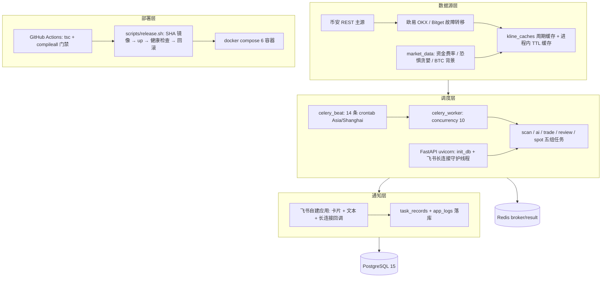
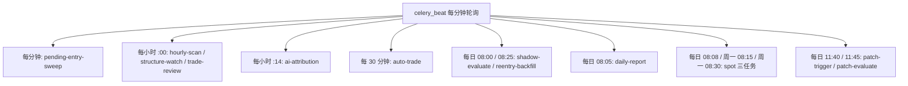
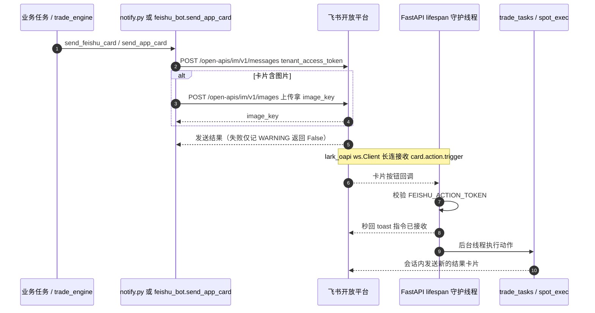
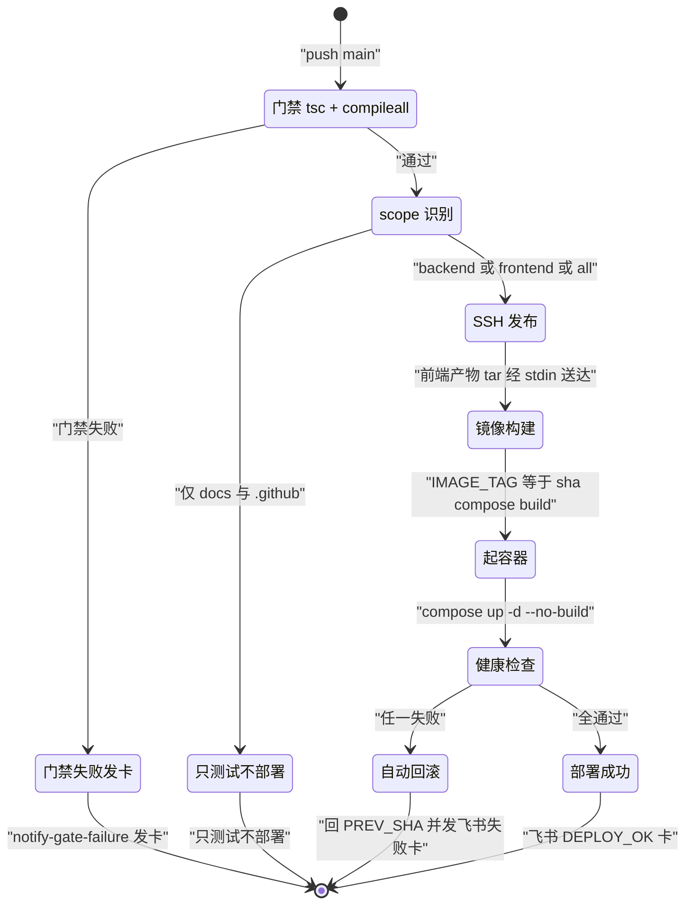

# 技术文档 09 — 基建与通知（对照 功能流程/09-基建与通知.md）

> 现行版本：RULE_VERSION v2026-10-18（2026-10-18）。本文从功能文档 09 提炼**技术实现细节**，以代码为准；功能口径与拍板记录见 [功能文档](../功能流程/09-基建与通知.md)。

## 1. 模块与分层

基建分四层：**数据源 → 调度 → 通知 → 部署**，两类进程（FastAPI / Celery worker）共享 PostgreSQL 与 Redis。模块职责：

| 模块 | 职责 |
|---|---|
| `services/binance_client.py` | 币安公开 API 同步客户端（429/418/5xx 限流退避）；`get_futures_klines` 薄封装供 BTC 背景数据 |
| `services/exchange_pool.py` | 多交易所 K 线 / 合约清单故障转移（币安→OKX→Bitget）+ `kline_caches` 周期缓存 |
| `services/market_data.py` | 市场环境数据源（资金费率 / 恐惧贪婪 / 大盘广度）；`build_market_context` AI 环境注入 |
| `services/narrator.py` | suggest 决策 ≤300 字中文叙述（LLM 轻量调用，失败回退模板；skip 不调） |
| `services/feishu_bot.py` | 飞书自建应用：发卡片 / 文本 + 长连接卡片按钮回调；`start_card_listener` 定义于 feishu_bot.py:155 |
| `services/notify.py` | 通知统一入口 `send_feishu_card` / `send_feishu_text`（转发 feishu_bot，未配置静默跳过） |
| `services/task_log.py` | 任务记录读写（`open_task` / `close_task` → `task_records`） |
| `services/log_sink.py` | 应用日志异步入库（`app.*` → `app_logs`），保留策略 + fork 后重启 |
| `database.py` | 引擎 / 会话 + `init_db`（`create_all` + `_run_migrations` 幂等迁移） |
| `config.py` | pydantic-settings 全量配置 + `RULE_VERSION`（config.py:293） |
| `celery_app.py` | Celery 应用：`beat_schedule` 总表 + `worker_process_init` 钩子（celery_app.py:11-25） |
| `api/health.py` / `api/ops.py` | `/api/health` 探活；`/api/tasks`、`/api/logs` 运维观测端点 |
| `scripts/release.sh` | 服务器端发布 / 回滚 / 状态脚本（镜像按 git SHA 打标签；探活 `GET /api/scans/config` release.sh:58） |
| `.github/workflows/deploy.yml` | push main CI/CD：门禁 → scope 识别 → SSH 发布 → 飞书通知 |
| `docker-compose.yml` / `deploy.sh` | 6 服务容器编排；本地一键启停辅助脚本 |

## 2. 数据结构

### 2.1 Celery 应用配置（`celery_app.py`）

`Celery("trading_workbench", broker=CELERY_BROKER_URL, backend=CELERY_RESULT_BACKEND, include=[8 个任务模块])`；`conf.update`：`task_serializer=json`、`accept_content=["json"]`、`result_serializer=json`、`timezone="Asia/Shanghai"`、`enable_utc=True`、`task_acks_late=True`、`worker_prefetch_multiplier=1`。Redis 分工：`REDIS_URL`（db0，信号量等）、`CELERY_BROKER_URL`（db1）、`CELERY_RESULT_BACKEND`（db2）。

`worker_process_init`（celery_app.py:11-25）做两件事：`restart_db_log_sink_after_fork()` 重启日志写库线程 + `engine.dispose(close=False)` 丢弃 fork 继承的连接池（防子进程串包）。

### 2.2 数据表清单（20 张，`models/__init__.py`）

| 表 | 模型 | 用途 |
|---|---|---|
| `scan_records` / `scan_results` | models/scan.py | 扫描批次 / 命中结果 |
| `ai_analyses` | models/scan.py | AI 分析记录（决策 JSON、`rule_version`、`veto_original`） |
| `kline_caches` | models/scan.py | K 线周期缓存（ExchangePool 读写） |
| `breakout_events` / `pullback_pendings` | models/scan.py | 破轨事件 / 回踩待确认池 |
| `watchlist` | models/scan.py | 关注列表 |
| `system_config` | models/system_config.py | 单行运行时配置 |
| `trade_records` / `trade_events` / `account_transfers` | models/trade.py | 交易记录 / 交易事件 / 资金划转 |
| `task_records` / `app_logs` | models/ops.py | 任务记录 / 系统日志 |
| `prompt_patches` | models/patch.py | 规则补丁闭环 |
| `symbol_blacklist` | models/blacklist.py | 币种黑名单 |
| `spot_orders` / `spot_weekly_reviews` / `spot_kline_cache` | models/spot.py | 现货屯币三表 |

### 2.3 任务记录字段（`task_records`，`task_log.py`）

`task_type`（scan/ai/trade/review）、`task_name`（展示名，与任务函数名解耦）、`trigger`（scheduled/manual/system）、`summary`（≤250 字）、`detail` JSON、`error`（≤2000 字）、`scan_record_id`（扫描任务关联批次）。

### 2.4 日志表（`app_logs`，`log_sink.py`）

`DBLogHandler` 挂 `logging.getLogger("app")`（非 root）；单条截断 4000 字符；内存队列 2000 条（满则丢最旧）→ 后台写线程批量入库。级别口径：`app.*` 仅 WARNING+ 落库，例外 `app.spot.*` INFO 即落库。

## 3. 核心流程

### 3.1 beat 定时调度表（`celery_app.py` `beat_schedule`，timezone=Asia/Shanghai）

| beat 条目 | 任务 | 节奏 | 职责 |
|---|---|---|---|
| hourly-scan | `scan_tasks.run_scan_task`（`scan_type=scheduled`） | 每小时 `minute=SCAN_BEAT_MINUTE`（默认 0） | 定时扫描 → 落库 → AI 配额分发；新命中推卡片 |
| structure-watch | `structure_watch.run_structure_watch_task` | 每小时 `minute=0` | BTC/ETH 1h 结构 + 4h 完整性检测（自监控误差 ≤30s） |
| trade-review | `review_tasks.run_trade_review_task` | 每小时 `minute=0` | 超 24h AI 建议逐 K 回放归档 |
| ai-attribution | `review_tasks.run_ai_attribution_task` | 每小时 `minute=14` | 已平仓交易 AI 错误归因 |
| patch-trigger | `review_tasks.run_patch_trigger_task` | 每日 `hour=11, minute=40` | 标签热度 → 补丁草稿 |
| patch-evaluate | `review_tasks.run_patch_evaluate_task` | 每日 `hour=11, minute=45` | active 补丁三态评估 |
| auto-trade | `trade_tasks.run_auto_trade_task` | `minute="0,30"` | 结算巡检 / 导入手动持仓 / 时长预警 / 持仓诊断派发 / 划转同步 |
| pending-entry-sweep | `trade_tasks.watch_pending_entries` | `minute="*"` | 挂单入场兜底：成交落地 + 1h 未成交撤单 |
| daily-report | `daily_report.notify_daily_report` | 每日 `hour=8, minute=5` | 主流币收盘 + 前一日交易统计卡片 |
| shadow-evaluate | `shadow_tasks.run_shadow_evaluate_task` | 每日 `hour=8, minute=0` | 影子特征分桶评估（只统计不决策） |
| reentry-backfill | `shadow_tasks.run_reentry_backfill_task` | 每日 `hour=8, minute=25` | 止损单 48h 观察窗补打标 |
| spot-daily-check | `spot_tasks.run_spot_daily_task` | 每日 `hour=8, minute=8` | 现货日检评分卡（P1 币种带一键确认） |
| spot-dca | `spot_tasks.run_spot_dca_task` | 周一 `hour=8, minute=15` | 周度定投（`dca_enabled` 才执行） |
| spot-weekly-review | `spot_tasks.run_spot_weekly_review_task` | 周一 `hour=8, minute=30` | AI 周度研判卡（纯展示） |

beat 之外的事件触发任务：`trade_tasks.open_trade_for_analysis`（分析落库即时派发，唯一开仓通道）、`trade_tasks.run_position_advice`（巡检后逐单派发）、`ai_tasks.run_ai_analysis_task` / `run_ai_analysis_single`（重试 3 / 2 次）、`spot_tasks.run_spot_backfill_task`。

### 3.2 通知与卡片回调链路

失败语义：发送「尽力而为」，无重试队列；除日报有文本降级外，其余发送失败只落系统日志。

### 3.3 部署链路（push main → 上线 / 回滚）

## 4. 关键算法与常量

- **交易所故障转移**（`exchange_pool.py`）：币安 → OKX → Bitget，单次失败即切下一所；418/429 按 `Retry-After` 记冷却（无头默认限流 60s、网络错误 30s），冷却中的交易所排到尝试序列末尾（`_ordered_names`）；K 线统一归一化为币安行格式 `[open_time_ms, o, h, l, c, base_vol, close_time, quote_vol]`，OKX 单次 `limit ≤ 300`。
- **缓存键**：`kline_caches` 键 `(symbol, interval, kline_hour)`，`kline_hour` 对齐 UTC 周期起点；缓存条数少于请求条数视为未命中重拉；`force_refresh=True` 跳过读缓存仍回写。全部失败：`allow_stale=True` 返旧缓存，否则抛 `AllExchangesFailed`。
- **币安直连退避**（`binance_client.py`）：429 按 `Retry-After` 等待重试（最多 3 次）、418 立即抛错、5xx / 超时指数退避 1/2/4s。
- **进程内 TTL 缓存**（`market_data.py`）：资金费率 10min、恐惧贪婪 30min、大盘广度 5min；全部静默降级（失败返 None）。
- **BTC 急跌警示**：BTC 1h 近 3 根已收盘累计跌幅 < `-BTC_CRASH_PAUSE_PCT`（默认 1.0，0=关闭）时经 `_btc_market_line` 追加 AI 提示词警示，不再拦截开单。
- **叙述生成**（`narrator.py`）：system 提示词要求「1. 2. 3.」序号逐条，`temperature=0.3`，返回截断 600 字符（≈300 汉字）；异常回退 `_template` 模板拼接。
- **保留策略**：`app_logs` 7 天、`task_records` 14 天，写线程每 10 分钟清理。
- **幂等迁移**：`ALTER TABLE ... ADD COLUMN IF NOT EXISTS`、`CREATE INDEX IF NOT EXISTS`、`DROP COLUMN IF EXISTS`（仅退役列）；回填 `UPDATE`；`system_config` 默认行 `INSERT ... ON CONFLICT (id) DO NOTHING`；全部在 `engine.begin()` 单事务内逐条 `conn.execute(text(...))`，无版本表、启动即跑。

## 5. API 契约

| 端点 | 用途 | 备注 |
|---|---|---|
| `GET /api/health` | 存活探针 | `{"status":"ok"}`（api/health.py）；发布探活实际用 `GET /api/scans/config`（release.sh:58） |
| `GET /api/tasks` | 任务记录列表 | `task_type` / `status` 过滤 + 分页；保留 14 天 |
| `GET /api/tasks/{id}` | 任务记录详情 | — |
| `GET /api/logs` | 系统日志 | `level` / 关键字 `q` / `logger` 前缀过滤 + 分页；现货日志用 `logger=app.spot` |

## 6. 配置项

### 6.1 settings 分组（`config.py`）

| 分组 | 关键项（默认值） |
|---|---|
| 应用 / 数据库 | `APP_NAME`、`DEBUG=True`、`DATABASE_URL` |
| Redis / Celery | `REDIS_URL`（db0）、`CELERY_BROKER_URL`（db1）、`CELERY_RESULT_BACKEND`（db2） |
| 币安行情 | `BINANCE_BASE_URL` / `BINANCE_FUTURES_URL` / `BINANCE_TIMEOUT=15` / `BINANCE_CONCURRENCY=8` |
| 扫描策略 | `KLINE_INTERVAL=1h`、`KLINE_WINDOW=240`、`SCAN_BEAT_MINUTE=0`（config.py:40）、`BREAKOUT_*`、`RETEST_WINDOW_BARS=24`、`DAILY_LOSS_STOP_PCT=9.0` |
| 宇宙过滤 | `EXCLUDE_KEYWORDS`、`QUOTE_ASSET=USDT`、`MIN_VOLUME_24H=300万` |
| AI 分析 | `AI_API_KEY/BASE_URL/MODEL`、`LLM_CONCURRENCY=4`、`AI_CALL_TIMEOUT_S=300`、`LLM_JSON_MODE=False`、`AI_RR_MIN=1.5`、`AI_MAX_PER_SCAN=10`、`FINGERPRINT_TTL_MIN=60` |
| 市场环境 | `MARKET_CONTEXT_ENABLED=True`、`BTC_CRASH_PAUSE_PCT=1.0`（0=关闭） |
| 飞书 | `FEISHU_APP_ID/APP_SECRET/TARGET_ID/ACTION_TOKEN` |
| 自动交易 | `BINANCE_LIVE_{N}_*`（account_registry 扫 os.environ）、`TRADING_MIN_RECOMMENDATION=60`、`SPREAD_MAX_PCT=0.003`、`TAKER_FEE_RATE=0.0005`、`TRADING_LEVERAGE=20/_MIN=8` |

### 6.2 RULE_VERSION 机制

`settings.RULE_VERSION = "v2026-10-18"`（config.py:293）。改 trigger / risk_guard / 提示词纪律 / 分批比例均算改版；开仓 / 分析时点快照到 `trade_records.rule_version` / `ai_analyses.rule_version`；复盘 / 归因按版本分组，NULL = 上线前旧行归 legacy。

### 6.3 env 约定

配置文件 `backend/.env`（docker-compose `env_file` 注入各容器）；样例 `backend/.env.example`。`Settings.Config`：`env_file=".env"`、`extra="ignore"`——多账号变量 `BINANCE_LIVE_{N}_API_KEY/SECRET_KEY(/NAME)` 不逐个声明，由 `services/account_registry.py` 扫 `os.environ`（N≥1 不限）。

### 6.4 容器编排（`docker-compose.yml`，6 服务）

| 服务 | 镜像 / 基座 | 端口 |
|---|---|---|
| db | postgres:15-alpine | 5433→5432 |
| redis | redis:7-alpine | 6380→6379 |
| backend | trading-workbench-backend:$IMAGE_TAG | 8082→8000 |
| celery_worker | 同 backend 镜像 | —（`--concurrency=10`） |
| celery_beat | 同 backend 镜像 | — |
| frontend | trading-workbench-frontend:$IMAGE_TAG | 8088→80 |

全部 `restart: unless-stopped`；backend / worker / beat 共用 `./backend/.env`。

## 7. 并发、幂等与异常处理

- **长任务不饿死短任务**：`task_acks_late=True` + `worker_prefetch_multiplier=1`；并发 10 = `LLM_CONCURRENCY=4` + 预留短任务空位。
- **fork 安全**：`worker_process_init` 重启日志写库线程（`start()` 幂等）+ `engine.dispose(close=False)`，避免父子进程共用 TCP socket 串包。
- **日志不阻塞**：`DBLogHandler.emit` 永不抛错；内存队列 2000 条，满则丢最旧；写库失败 stderr 丢弃（不走 logging 防递归）。
- **任务记录不自伤**：`open_task` / `close_task` 均为独立短会话，助手自身异常静默；`status=failed` 时同步 `logger.warning` 一条，保证失败在「任务记录」与「系统日志」两处可见。
- **通知静默降级**：未配置飞书时 `configured()`=False，所有通知静默跳过（返回 False 不抛错）；卡片内嵌图片需部署前置（飞书后台开「上传图片」权限，否则上传报权限错并退化为纯文字）。
- **回调快速返回**：`_on_card_action` 校验令牌后秒回 toast，后台线程执行；开单执行核心已把锁外异常收敛成 `code=error`（2026-10-15），避免守护线程静默死掉。
- **迁移幂等**：重复执行天然幂等（启动即跑）；下线功能的历史列保留不 DROP。
- **部署并发**：`concurrency: deploy-<ref>` 排队执行，部署不互相打断；回滚 = 切 SHA 标签 + `up -d`，秒级免重建。
- **HTTP 异常**：未处理接口异常由 `main.py` 全局 `exception_handler` 落系统日志并返回 500（4xx 不在此列）。

## 8. 测试覆盖（backend/tests）

| 文件 | 覆盖 |
|---|---|
| `test_task_records.py` | 任务记录 `open_task` / `close_task` 与字段口径 |
| `test_access_log_middleware.py` | 请求级访问日志（慢请求 / ≥400 落库）中间件 |
| `test_market_context.py` | 市场环境块构建与 BTC 急跌警示 |
| `test_scan_hit_card.py` | 定时扫描命中卡片 `_scan_hit_card` |
| `test_open_feishu_card.py` / `test_ai_skip_card.py` / `test_advice_feishu_net_label.py` | 开仓结果卡 / skip 卡 / 持仓建议卡网络标注 |
| `test_feishu_testnet_notify_switch.py` | 测试网通知开关静默丢弃 |
| `test_kline_chart.py` | 卡片内嵌 K 线 PNG 渲染 |
| `test_hold_warnings.py` | 持仓时长分级预警（只升级不重发） |
| `test_structure_watch.py` | 结构监控任务 |
| `test_event_stream.py` / `test_event_executor.py` | user-data-stream 与事件驱动结算 |
| `test_screen_window.py` | 尾窗 / 整点竞态幽灵根视图 |
