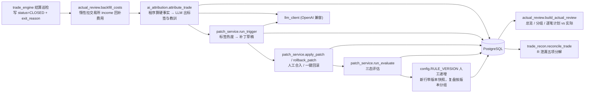
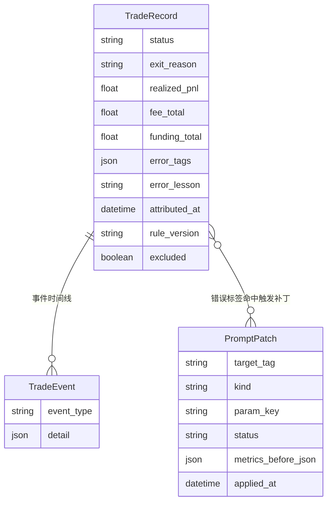
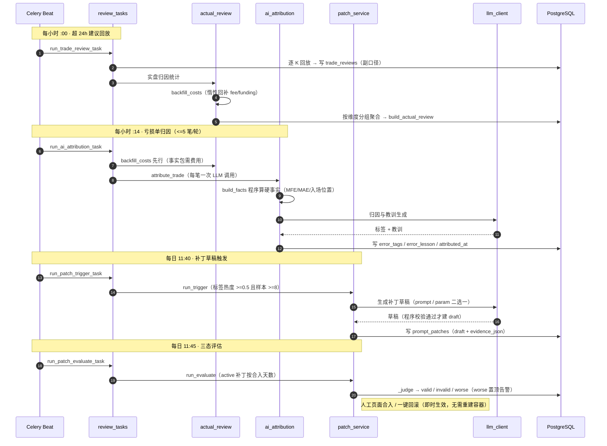
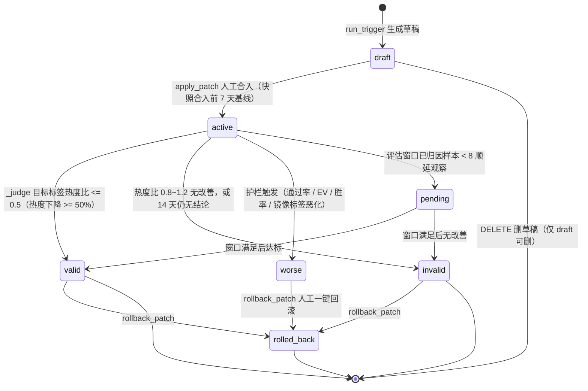
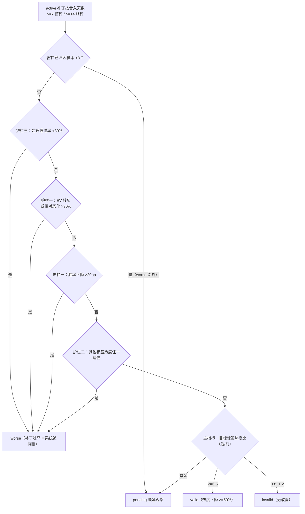

# 技术文档 06 — 复盘归因（对照 功能流程/06-复盘归因.md）

> 现行版本：RULE_VERSION v2026-10-18（2026-10-18）。本文从功能文档 06 提炼**技术实现细节**，以代码为准；功能口径与拍板记录见 [功能文档](../功能流程/06-复盘归因.md)。

## 1. 模块与分层

主轴是「实盘归因 → 补丁 → 规则演进」闭环。模块职责：

| 模块 | 路径 | 职责 / 关键符号 |
|---|---|---|
| 实盘归因统计 | `backend/app/services/actual_review.py` | `build_actual_review` / `_agg` / `backfill_costs`；分组常量 `TRIGGER_FAMILY` / `HOUR_BUCKETS` / `GOLDEN_PATTERN_ORDER` / `_REC_BUCKETS` / `_VOLUME_BUCKETS` / `_HTF_PHASE_BUCKETS` / `_BACKFILL_LIMIT` |
| AI 错误归因 | `backend/app/services/ai_attribution.py` | `build_facts` / `attribute_trade`；词表 `ERROR_TAGS` / `ERROR_TAG_OTHER` / `ATTRIBUTION_SYSTEM` |
| 规则补丁闭环 | `backend/app/services/patch_service.py` | `run_trigger` / `_generate_draft` / `apply_patch` / `rollback_patch` / `run_evaluate` / `_judge` / `build_prompt_view` / `window_stats`；常量 `RULE_TAGS` / `PARAM_KEYS` / `HEAT_THRESHOLD` / `MIN_SAMPLE` / `COOLDOWN_DAYS` / `EVAL_FIRST_DAYS` / `EVAL_FINAL_DAYS` / `MARKER_RE` |
| 逐笔 R 泄漏对账 | `backend/app/services/trade_recon.py` | `reconcile_trade`；常量 `_QTY_TOL=0.01` / `_UNEXPLAINED_R_HINT=0.05` |
| 建议模拟回放 | `backend/app/tasks/review_tasks.py` | `run_trade_review_task`（suggest/veto 建议 24h 后逐 K 回放，副口径） |
| 决策叙述 | `backend/app/services/narrator.py` | 非复盘模块：suggest 定稿时生成 ≤300 字中文叙述 |
| 定时任务 | `backend/app/celery_app.py` | beat 调度（timezone=Asia/Shanghai） |

## 2. 数据结构

| 模型 / 载体 | 路径 | 复盘相关字段 |
|---|---|---|
| `TradeRecord` | `backend/app/models/trade.py` | `fee_total` / `funding_total`（结算费用）、`error_tags`（JSON 数组）、`error_lesson`（≤120 字）、`attributed_at`（幂等键）、`excluded` / `excluded_at`（异常单剔除）、`rule_version`、`ai_snapshot`、`risk_amount`、`exit_reason`、`realized_pnl` / `pnl_pct`、`signal_type`、`pattern` |
| `TradeEvent` | 同上 | `OPEN` / `TP1_FILL` / `SL_FILL` 等事件明细，`trade_recon` 成交明细来源 |
| `PromptPatch` | `backend/app/models/patch.py` | `target_tag` / `origin` / `kind` / `param_key` / `old_text` / `new_text` / `param_value` / `evidence_json` / `metrics_before_json` / `metrics_after_json` / `verdict` / `status` / `applied_at` |
| `TradeReview` | `backend/app/models/scan.py` | `outcome`（win_tp1/win_tp2/loss/expired）、`tp1_hit`、`bars_to_exit`、维度快照、`is_veto`（否决单假想回放标记） |
| `SystemConfig` | `backend/app/models/system_config.py` | `strategy_prompt`（补丁覆盖段宿主）+ 5 个补丁参数列 |

**AI 归因事实包 `build_facts(rec, klines)` 输出**：AI 计划（entry/sl/tp1/tp2、止损距离%、风险回报比）、实际结果（成交价/出场原因/盈亏/费用/持仓时长）、K 线特征（`entry_pos_in_20bar_range` 入场在开仓前 20 根区间中的位置，1=区间顶、0=区间底，越界不截断；`mfe_pct`/`mae_pct` 持仓期最大有利/不利波动；`held_bars`）、分析原文截 1500 字。

**固定标签词表 `ERROR_TAGS`（9 类）**：追高追空 / 止损过宽 / 止损过窄 / 逆指标多数 / 逆4h背景 / 区间中段开单 / 执行偏差 / 行情异常 / 无明显错误。词表外标签丢弃，全部无效兜底「其他」。`RULE_TAGS = ERROR_TAGS 去掉「行情异常」「无明显错误」`，非规则性标签不参与补丁触发。

## 3. 核心流程

### 3.1 复盘闭环主链路（结算 → 回补 → 归因 → 统计 → 补丁 → 评估）

### 3.2 补丁三态生命周期（draft → active → valid/invalid/worse/rolled_back）

> worse 保持 active 并置顶告警（等人工回滚）；valid/invalid 定稿为对应 status；14 天仍无结论按 invalid 处理。

### 3.3 `_judge` 判定顺序（护栏优先，主指标在后）

## 4. 关键算法与常量

**总览指标（`_agg` + 扩展）**：

| 指标 | 公式 / 定义 |
|---|---|
| `win_rate` | `wins / count`（净胜率，主考核口径） |
| `payoff` | `|avg_win / avg_loss|`（需双侧样本，否则 None） |
| `ev_per_trade` | `pnl / count`（USDT/笔） |
| `plan_gap` | `max(0, |净亏| − 计划风险合计)`（≤0 钳为 0） |
| `avg_hold_hours` | `closed_at − opened_at`（小时） |

统计口径：`status=CLOSED` 且 `exit_reason` 非空、`closed_at` 在窗口内（days 1~180，默认 30），统一剔除 `excluded=True` 异常单。

**逐笔 R 泄漏五项（`reconcile_trade`，成本口径：不利=正）**：

| 项 | 计算 |
|---|---|
| a 入场滑点 | `sign × (实际成交 − 计划 entry) × 数量` |
| b 手续费 | `|fee_total|`（缺失时惰性查 income 回补） |
| c 资金费 | `−funding_total`（交易所负=支付→正成本） |
| d SL 穿价 | `sign × (触发价 − 成交价) × 数量`（取 `SL_FILL` 事件，常缺） |
| e TP1 滑点 | 由 TP1 分档盈亏反推实际成交均价后 `sign × (计划 TP1 − 反推成交) × 数量` |

总泄漏 = 理论 R − 实际 R；`covered = a~e 可得项之和`；`unexplained > 0.05R`（`_UNEXPLAINED_R_HINT`）时在 `gaps` 提示可能有未入账成本。任一数据缺失对应项为 null 不抛异常。

**补丁闭环常量（`patch_service.py` / `review_tasks.py` / `actual_review.py`）**：

| 常量 | 值 | 说明 |
|---|---|---|
| `HEAT_THRESHOLD` | 0.5 | 标签热度阈值（近 7 天该标签笔数 / 已归因笔数） |
| `MIN_SAMPLE` | 8 | 最小样本（近 7 天已归因笔数） |
| `COOLDOWN_DAYS` | 14 | 同标签合入后冷却天数 |
| `EVAL_FIRST_DAYS` | 7 | 首评天数（>=7 天） |
| `EVAL_FINAL_DAYS` | 14 | 终评天数（>=14 天） |
| `ATTRIBUTION_BATCH` | 5 | 归因任务单轮上限（`review_tasks.py`） |
| `_BACKFILL_LIMIT` | 20 | 费用回补单轮上限（`actual_review.py`） |
| `_QTY_TOL` | 0.01 | TP1 分批数量不符检测容差（1%） |
| `_UNEXPLAINED_R_HINT` | 0.05 | 未解释泄漏 R 提示阈值 |

**参数补丁白名单 `PARAM_KEYS`（5 个，`param_value` 须 0<v<1）**：`max_stop_pct`（止损宽度硬上限）、`liq_gate_buffer`（强平闸门缓冲）、`min_adapt_leverage`（动态杠杆下限）、`pullback_market_pct`（入场偏离容差）、`max_slippage_pct`（开仓滑点实测上限）。

**两处 R 口径区分**：① `trade_recon` 逐笔 R 泄漏（`R = 金额 / risk_amount`）；② AI 建议质量 `ev_r`（`/review/stats`，简化 R：`loss=-1R` / `win_tp1=RR1` / `win_tp2=RR2` 减 taker 往返 0.1% + 资金费 0.03%/8h 折算费用）。两者口径不同，勿混用。

**RULE_VERSION 分组机制**：`config.py` 的 `RULE_VERSION`（现行 `v2026-10-18`）；`trade_engine` 写 `trade_records.rule_version`、`ai_tasks` 写 `ai_analyses.rule_version`，NULL 旧行按 `legacy` 理解；`/review/stats` 输出独立 `rule_version_groups`。补丁合入改变运行时规则但不自动 bump，由人工判断递增。

## 5. API 契约

`backend/app/api/scan.py`（前缀 `/api/scans`）与 `backend/app/api/trades.py`：

| 方法 | 路径 | 说明 |
|---|---|---|
| GET | `/api/scans/review/actual?days=&scope=` | 实盘归因主统计：overview + groups + items；调用前惰性费用回补 |
| POST | `/api/scans/review/attribute` | 手动归因：`trade_id` 单笔或全部待归因（≤5 笔） |
| GET | `/api/scans/review/stats?days=` | AI 建议质量副口径：四态统计 + `ev_r` + `rule_version_groups` + `veto_stats` |
| GET | `/api/scans/review/funnel?days=&scope=` | 全漏斗：信号命中 → AI 分析 → suggest → 过评委 → 开仓 → 盈利，逐级转化率 + 闸门拦截 top3 |
| GET | `/api/scans/review/patches` | 补丁列表（worse 置顶）+ 实时热度 stats + RULE_TAGS |
| GET | `/api/scans/review/patches/{patch_id}` | 补丁对照明细（前后指标 + 证据案例） |
| POST | `/api/scans/review/patches/{patch_id}/apply` | 合入补丁 |
| POST | `/api/scans/review/patches/{patch_id}/rollback` | 回滚补丁 |
| DELETE | `/api/scans/review/patches/{patch_id}` | 删草稿（仅 draft 可删） |
| GET | `/api/scans/review/prompt-view` | 生效提示词分层视图 + 参数 |
| POST | `/api/scans/review/patches/trigger` | 手动触发草稿生成，未生成时返回 skips |
| GET | `/api/trades/{id}/reconciliation` | 逐笔 R 泄漏对账（`trade_recon.reconcile_trade`） |

## 6. 配置项

| 配置 | 位置 | 说明 |
|---|---|---|
| `RULE_VERSION` | `backend/app/config.py` | 规则版本标记；改 trigger/risk_guard/提示词纪律/分批比例均须递增 |
| `AI_API_KEY` / `AI_BASE_URL` / `AI_MODEL` | 同上 | 归因与补丁草稿的 LLM 依赖；`AI_API_KEY` 空则归因/补丁定时任务静默跳过 |
| celery beat 调度 | `backend/app/celery_app.py` | trade-review 每小时 :00；ai-attribution 每小时 :14；patch-trigger 每日 11:40；patch-evaluate 每日 11:45（`timezone=Asia/Shanghai`） |
| `strategy_prompt` | `system_config` 表 | 用户自定义策略提示词 + 补丁覆盖段宿主（标记 `<!-- patch:标签:id前8位 -->`） |
| 5 个补丁参数列 | `system_config` 表 | `max_stop_pct` / `liq_gate_buffer` / `min_adapt_leverage` / `pullback_market_pct` / `max_slippage_pct`；NULL=内置默认 |
| `trading_testnet` | `system_config` 表 | 归因任务的环境权威（按环境筛选待归因行与 trader） |

## 7. 并发、幂等与异常处理

- **归因幂等**：`attributed_at` 为幂等键，每笔仅归因一次，支持定时批量与手动单笔触发。
- **补丁去重与冷却**：`run_trigger` 同标签已有 draft/active 补丁不重复生成；同标签 14 天内合入过（任意终态）冷却跳过；三重门槛全部写在 `skips` 返回里（任务记录与响应直接可见）。
- **合入前快照**：`apply_patch` 时快照合入前 7 天基线指标（`metrics_before_json`：热度/EV/胜率/建议通过率）。
- **回滚走 DB**：提示词删标记段（到下一标记/文末）、参数恢复 NULL，即时生效无需重建容器；不删除删系统自带提示词（`SYSTEM_PROMPT` / `AGENT_SYSTEM` 代码常量永不改动）。
- **费用回补双网隔离**：`backfill_costs` 按记录自身 `testnet` 选择 trader（正式网记录走正式网 income、测试网走测试网，跨网不混拉）；单轮 ≤20 笔防拉爆限额；失败按 0 落库避免反复重试。
- **对账防御式约定**：任一数据缺失对应项为 null 不抛异常，缺口以中文一句落 `gaps`；`_income_costs` 查询异常静默降级。
- **评估窗口顺延**：评估窗口已归因样本 <8 顺延观察（worse 除外）；`window_stats` 胜负口径与 `actual_review` 一致（win = `realized_pnl > 0`）。

## 8. 测试覆盖

| 文件 | 覆盖 |
|---|---|
| `backend/tests/test_review_batch3.py` | veto 假想回放落库与建议行不串改、`/review/stats` veto 行不混入主统计、全漏斗逐级口径与 scope 过滤、HTF 硬约束 veto 快照、实盘归因新分组维度（评分/量比分桶、止损锚、战法、规则版本、金K形态 12 维度全量） |
| `backend/tests/test_trade_recon.py` | 多单全量对账（五项泄漏 + 理论/实际 R）、空单费用回补与账号回落、缺失数据全 null 不抛异常 + gaps、TP1 分批数量不符 gap、reconciliation 端点 404/转发 |
| 补丁闭环 | 无独立专项文件；`patch_service` 逻辑当前主要靠代码评审与线上任务记录（task_log）观察覆盖 |
