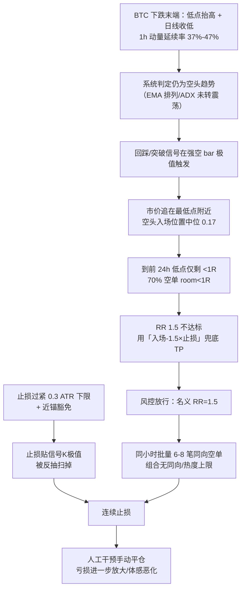

# 实盘亏损归因：2026-10-26 ~ 2026-10-27

> 分析时间：2026-10-27（北京时间）
> 数据来源：生产库只读查询（`trade_records` / `trade_events` / `scan_results` / `ai_analyses`）+ Binance USDⓈ-M 公共 1h K 线复原
> 分析口径：最近 4 天 150 笔已开仓记录（10-24 16:00 UTC 起），其中 10-26/27 共 76 笔
> 代码改动：本次仅诊断，未修改任何生产代码与配置
> 规则版本：10-26 全部为 `v2026-10-22-2`；10-27 为 `v2026-10-22-2` 7 笔 + `v2026-10-27` 8 笔（故 10-26 是单版本干净样本）

---

## 0. 结论摘要

1. **不是「系统坏了」，也不是单纯「行情差」。** 同一套系统 10-25 正式网仍为 +2.0R（25 笔，胜率 40%），10-26 才集中崩溃（正式网 -6.9R、测试网 -15.7R）。属于「环境切换 + 结构性短板」叠加，不是整套系统失效。
2. **共同点不是方向，而是「风险几何」：** 入场贴着前 24h 极值（空头 70% 剩余空间不足 1R）、止损偏宽（room<1R 组中位 1.88 ATR）、止盈一是 1.5R 兜底价（占 61%）。名义盈亏比达标，实际期望为负。
3. **环境已切到「趋势→震荡/转折尝试」：** BTC 10-24 以来低点抬高（79179→79536→79322→79600），但日线收盘逐日走低；1h 强动量延续率仅 37%–47%（全部 <50%），趋势跟踪的「延续」前提失效。
4. **最有效的单一闸门是「剩余空间 room ≥ 1R」。** 样本内 room<1R 共 72 笔、胜率约 12%、平均 -0.46R；room 1.5–2.5R 共 23 笔、胜率 74%、平均 +0.73R。且该规律在 10-25（非灾难日）同样成立，不是只拟合崩盘日。
5. **建议先影子标记、再硬门，最后 walk-forward。** 直接按两天样本改生产规则是最典型的过拟合路径；且 room 越大并非越好（≥2.5R 反而亏），阈值必须联合止损宽度一起验证。

---

## 1. 取数与方法

### 1.1 数据源与口径

| 项目 | 说明 |
|---|---|
| 交易记录 | `trade_records`：方向、信号类型、入场/止损/止盈、状态、`exit_reason`、`realized_pnl`、`pnl_pct`、`rule_version`、`testnet` |
| 开仓快照 | `trade_events` 的 `OPEN` 事件 `detail`：初始 `stop_loss`、`tp1`、`risk_amount`、`fill_price`、`slippage_pct` |
| 信号质量 | `scan_results` / `quality_parts`：质量分与 `range` 等惩罚项 |
| AI 决策 | `ai_analyses`：`htf_phase`、`recommendation`、分析文本（含 AI 自己写出的空间不足/反抽风险） |
| K 线 | Binance USDⓈ-M `fapi/v1/klines` 1h，用于计算 ATR14、MFE/MAE、前向收益、24h 区间位置 |
| 账户规模 | 正式网单笔风险中位 2.1–4.2 USDT；测试网 84–89 USDT（故金额不可跨账户比较，统一用 R） |

### 1.2 指标定义

- **R**：`pnl_pct / 100`，即盈亏占初始风险金额的比例（-100% ≈ -1R）。
- **room（剩余空间）**：`|入场价 − 前 24h 极值| ÷ |入场价 − 初始止损|`。空头取前 24h 最低，多头取前 24h 最高；前 24h 不含入场当根。
- **入场位置**：`(入场价 − 信号K线最低) ÷ (信号K线最高 − 信号K线最低)`。空头 0 = 收在最低点，多头 1 = 收在最高点。
- **stop_atr**：初始止损距离 ÷ 1h ATR14。
- **动量延续率**：1h `|收益| ≥ 0.5×ATR` 的强动量根，下一根同向的比例。
- **前向收益**：按持仓方向折算的入场后 1/4/8/24h 收益，负值 = 继续逆向。

### 1.3 样本与版本

| 日期 | 笔数 | 规则版本 |
|---|---|---|
| 10-25 | 74 | `v2026-10-22-2` |
| 10-26 | 61 | `v2026-10-22-2`（单一版本） |
| 10-27 | 15 | 7 笔旧版 + 8 笔 `v2026-10-27` |

10-26 崩塌样本完全处于同一规则版本，排除了「改版导致」的解释。

### 1.4 局限（必须先声明）

1. 150 笔、4 天，统计功效有限；76 笔集中亏损样本的置信区间很宽。
2. `room` 用 1h 收盘 K 线复原 24h 极值，盘中极值会略有偏差；`MFE/MAE` 同样受 1h 粒度限制。
3. 10-27 有 6 笔仍无 `exit_reason`（未结算/空值），出场结构统计需按已结算子集看。
4. `exit_reason=manual` 同时包含系统/飞书手动平仓与交易所侧平仓（`EXTERNAL_CLOSE`），不能全部当「系统止损」。
5. `entry_lag_pct` 全为 NULL、`quality_parts` 中未出现 `r2_low`，属落库口径缺口，本文不据此下结论。

---

## 2. 盈亏总览

### 2.1 按日（已结算）

| 日期 | 账户 | 笔数 | 胜率 | 合计 R | 单笔均值 |
|---|---|---|---|---|---|
| 10-25 | 正式网 | 25 | 40% | **+2.0** | +0.08R |
| 10-25 | 测试网 | 49 | 39% | -1.6 | -0.03R |
| 10-26 | 正式网 | 20 | 25% | **-6.9** | -0.35R |
| 10-26 | 测试网 | 41 | 17% | **-15.7** | -0.38R |
| 10-27 | 正式网 | 15 | 27% | **-2.4** | -0.16R |

- 亏损高度集中在 10-26，且正式网/测试网同向、同幅度（约 -0.35R/笔），说明不是单个账户或单笔风控事故。
- 测试网金额放大只是因为单笔风险 84–89 USDT（正式网 2–4 USDT），R 口径下两者一致。

### 2.2 按信号族（10-26 + 10-27，76 笔）

| 信号族 / 方向 | 笔数 | 胜率 | 合计 R |
|---|---|---|---|
| `trigger_pullback_confirm` 空 | 38 | 21% | -11.4 |
| `trigger_breakout` 空 | 12 | 8% | -5.6 |
| `trigger_pullback_confirm` 多 | 18 | 33% | -4.4 |
| `trigger_trend_breakout` 空 | 7 | 14% | -2.6 |
| `trigger_trend_breakout` 多 | 1 | 0% | -1.0 |
| 合计 | 76 | — | **-25.0** |

结论：所有信号族、两个方向同时亏损。**「空头方向错了」不是完整解释**，因为多头同样亏；真正的共性是入场时点与风险几何。

### 2.3 出场结构（10-26/27）

| exit_reason | 笔数 | 合计 PnL（USDT） |
|---|---|---|
| `sl` | 24 | -885.45 |
| `manual`（系统/飞书手动 + 交易所侧） | 34 | -674.90 |
| `tp1_trail` | 9 | +366.31 |
| `breakeven_sl` | 2 | +1.72 |
| 空值/未结算 | 7 | +2.43 |

「不断止损」的体感一半来自系统 SL，一半来自手动/交易所平仓。复盘必须把两者拆开，否则会误判系统自身表现。

---

## 3. 共同点（按贡献排序）

### 3.1 空头高度集中，但不是唯一问题

10-26/27 空头 57/76（75%）。空头集中在 `pullback_confirm`（38 笔）与 `breakout`（12 笔），与「日线/4h 空头排列 + 1h 反抽」的环境一致。但多头 19 笔也亏 5.4R，说明方向只是表象。

### 3.2 入场位置几乎都在信号 K 线极值

| 方向 | 笔数 | 中位入场位置 | 25 分位 | 75 分位 |
|---|---|---|---|---|
| 空头 | 57 | **0.17** | 0.07 | 0.30 |
| 多头 | 19 | **0.82** | 0.60 | 0.87 |

系统在强方向 bar 收完后，于最低/最高点附近市价追入。震荡市里这个位置就是短线反抽的起点，等价于「用最差的价格买波动率」。

### 3.3 剩余空间 room：最强、最可执行的规律（n=150）

| room | 笔数 | 胜率 | 平均 R |
|---|---|---|---|
| <0.5R | 48 | 19% | -0.37 |
| 0.5–1R | 24 | **0%** | -0.63 |
| 1–1.5R | 16 | 50% | -0.02 |
| **1.5–2.5R** | **23** | **74%** | **+0.73** |
| ≥2.5R | 39 | 28% | -0.21 |

- room<1R 合计 72 笔、胜率约 12%、平均 -0.46R，是最大亏损来源。
- 10-26/27 空头 **70% 落在 <1R**（46% <0.5R），这批胜率 10%、平均 -0.48R。
- 分日看规律稳定：10-25 的 <1R 组 29 笔平均 -47%，1.5–2.5R 组 16 笔平均 +89%；10-26 的 <1R 组 35 笔平均 -57%，1.5–2.5R 组 6 笔平均 +60%。**不是只拟合 10-26。**

> 注意非单调：≥2.5R 组反而亏。因为 room 与止损宽度强负相关（Spearman ρ = -0.81），room 大往往意味着止损过紧（中位 0.83 ATR），被噪音扫掉。因此 room 必须与止损宽度联合使用，不能「越大越好」。

### 3.4 止损宽度：只有 1–1.5 ATR 档是赚的

| stop_atr | 笔数 | 胜率 | 平均 R |
|---|---|---|---|
| <1 | 38 | 24% | -0.38 |
| **1–1.5** | **41** | **56%** | **+0.40** |
| 1.5–2 | 31 | 13% | -0.41 |
| 2–3 | 23 | 26% | -0.36 |
| ≥3 | 17 | 18% | -0.33 |

当前 `SL_MIN_ATR=0.3`（`backend/app/config.py`），且突破类「近锚」可豁免，导致 0.8 ATR 级别的止损贴在信号 K 线极值外，正好被反抽扫掉。

### 3.5 61% 的 TP1 是 1.5R 兜底价，不是结构位

- 全样本 92/150（61%）的 TP1 距离恰好 ≈1.5R；10-26/27 空头中 65%。
- `ai_analyzer.py` 明确允许「入场 ± rr_min×止损距离」兜底价永远合规；`risk_guard.py` 的止盈上限也以 `rr_min×止损距离` 为下限，保证兜底永远可用。
- 直接后果：RR 铁律 1.5 被「数学兜底」空转——前方没有结构空间也能凑出 1.5R，风控看到的是达标价，不是可成交的真实目标。

AI 文本已多次自证风险仍然建议开单：

- HEMI 10-27 12:06：「近端摆动低点距现价仅约 0.77R，第一档空间不足」「价格已跌至支撑上方，追空需防反抽」→ 仍建议开单 + 兜底 TP1。
- 2Z 10-27 11:36：「OBV 底背离」「布林带宽极窄，方向选择后存在反抽风险」→ 仍建议开单。
- UAI 10-27 11:02：「OBV 底背离 + ADX 多头端占优，短线存在反抽」→ 仍建议开单。

### 3.6 同小时批量开高相关单，组合层没有约束

10-26 开仓集中度：15:00 8 笔、21:00 7 笔、11:00 6 笔、22:00 6 笔，几乎全为同向空单。

- `PORTFOLIO_HEAT_CAP=0`、`SAME_DIRECTION_CAP=0`（`config.py`）均为关闭状态。
- `max_open_trades=10` 仅对正式网生效；测试网自 2026-10-15 起不限持仓数。
- 一次判断错误被复制成 6–8 笔同 β 空单，等价于单笔 6–8 倍仓位。

### 3.7 震荡闸门漏判

10-26 起 64 条扫描结果中仅 11 条带 `range` 惩罚（17%）。

- `scanner.py` 对突破类命中 `range_score` 硬拒，但对回踩路径只设 `range_penalty=True`（质量分 -8），不拒绝。
- `range_score` 的判据（1h EMA 排列、55/144 分离史、ADX<18、波动扩张分位）在「日线下跌 + 1h V 型反抽」时仍可能显示「空头趋势良好」，识别不出转折尝试。

### 3.8 入场后短期被双向打脸

10-26 亏损单按持仓方向折算的前向收益：

| 分组 | 1h | 4h | 8h | 24h |
|---|---|---|---|---|
| 亏损多头 | -3.10% | -1.56% | -3.01% | +3.70% |
| 亏损空头 | -0.71% | -0.43% | -0.88% | +0.10% |

多空同时在 1–8h 逆向、24h 才修复（多头），是典型的震荡/转折特征：**方向可能没错，但入场时点与止损距离错了。**

---

## 4. 环境判断：是转折/震荡，不是系统报废

### 4.1 BTC 日线结构（北京时间）

| 日期 | 收盘 | 涨跌 | 最低 |
|---|---|---|---|
| 10-24 | 79762 | -2.31% | **79179** |
| 10-25 | 80603 | +1.05% | 79536 |
| 10-26 | 80400 | -0.25% | 79322 |
| 10-27 | 79626 | -0.96% | 79600 |

- 低点逐日抬高（79179→79536→79322→79600），但收盘逐日走低。
- 形态是「下跌末端的双底尝试/横向吸筹」，方向尚未选择。
- 这种结构对趋势突破策略最不友好：向下追空遇到支撑反抽，向上追多遇到趋势压制。

### 4.2 动量延续率（1h 强动量根 → 下一根同向）

| 日期 | 延续率 |
|---|---|
| 10-23 | 41.9% |
| 10-24 | 47.8% |
| 10-25 | 40.7% |
| 10-26 | 46.6% |
| 10-27 | 37.3% |

全部 <50%。趋势跟踪系统的收益来源是「延续」，当前样本里延续是负的。

### 4.3 判定

- **是环境问题**：市场从趋势切到震荡/转折尝试，1h 动量不延续，趋势策略的前提失效。
- **但不是「系统永久不合适」**：10-25 仍盈利；问题在于系统缺少「没空间就不做」的纪律，在震荡里高频开单被反复扫损。
- **风险提示**：如果 BTC 后续真向下破位，贴着支撑的 room<1R 空单反而是赢家。因此 room 闸门必须配「破位 + retest 确认」豁免，不能简单一刀切。

---

## 5. 根因链



根因排序（按可修复性与贡献）：

1. **缺「剩余空间 room」闸门**（最大贡献，样本内可解释约 -32R）。
2. **兜底 TP 让 RR 铁律空转**（放行了本应拒绝的信号）。
3. **止损宽度下限过低 + 近锚豁免**（<1 ATR 档胜率仅 24%）。
4. **震荡/衰竭识别不足**（range 对回踩只降权，无 V 型反抽检测）。
5. **组合层无同向/并发/批量约束**（testnet 无上限）。
6. **入场在信号 bar 极值市价追单**。
7. **统计口径把 manual 与 sl 混算**（影响后续调参判断）。

---

## 6. 解决方案

### P0：只加拒绝条件，不改信号生成

| # | 措施 | 关键实现点 | 建议初值 |
|---|---|---|---|
| 1 | **room 硬门** | 信号阶段 `scanner.py` 早拒；下单前 `risk_guard.py` 用实际成交价复核 | `ROOM_MIN_R=1.2`、`ROOM_LOOKBACK_BARS=24`、开关默认关（影子） |
| 2 | **禁止兜底 TP 绕过** | `ai_analyzer.py` 提示词段 + `risk_guard.py` 校验；落库 `tp1_fallback` 标记 | room<1.5R 时禁止兜底 TP1，否则拒绝 |
| 3 | **止损宽度下限** | `config.py: SL_MIN_ATR`；取消近锚豁免或设 0.8 ATR 地板 | `SL_MIN_ATR=1.0`（先影子观测） |
| 4 | **组合约束** | `config.py` 的 `SAME_DIRECTION_CAP` / `PORTFOLIO_HEAT_CAP`；`trade_engine.py` 开仓闸门；testnet 并发上限；每小时新开上限 | 同向 3、热度 0.06、testnet 并发 10、每小时 ≤2 |
| 5 | **先影子** | 上述闸门只记录「本应拒绝」与原因，不真正拦单 | 跑 1–2 天核对拦截名单 |

实现注意：

- room 必须用**初始止损**（`OPEN` 事件快照）计算，不能用移动后的止损，否则会随持仓漂移。
- 止损加宽会改变仓位规模与 TP1 上限（`TP1_MAX_ATR`/`TP1_MAX_R` 均乘以止损距离），必须同步复核提示词与风控，不能只改一个常量。
- 组合闸门对 testnet 也要生效，否则测试网数据会继续污染复盘结论。

### P1：环境识别（约 1 周）

1. **range 对回踩硬拒**：回踩路径命中 `range_score` 不再只 -8 分，改为可配置硬拒；至少 `room<1.5R` 时硬拒。
2. **V 型反抽/衰竭冷却**：OBV 背离（已有计算）+ 布林带宽极窄分位（已有 `_bbw_width_pctl`）+ ADX 方向 + 价格距 24h 极值 <0.5 ATR + 更高低点结构 → 同向冷却 4–8h。
3. **入场机制**：禁止在信号 bar 极值市价追单，改结构位限价或等 retest 确认。

### P2：验证与体系（2–4 周）

1. **walk-forward 回放**：60–90 天、train/test 分段，报告被拦样本的净期望 Δ、置信区间、阈值敏感性（0.8/1.0/1.2/1.5）。
2. **落库补齐**：`room`、`entry_position`、`stop_atr`、`tp1_fallback` 写入 `trade_records` 或 `scan_results.quality_parts`。
3. **统计口径拆分**：`sl` / `manual` / `EXTERNAL_CLOSE` / `htf_state` 分开统计；`entry_lag_pct`、`r2_low` 落库缺口修复。
4. **组合风险预算**：按 BTC β 分簇限额，避免 6–8 笔同向单等价于单笔重仓。

---

## 7. 样本内模拟效果（仅供参考，非上线依据）

| 方案 | 保留笔数 | 合计 R | 胜率 |
|---|---|---|---|
| 现状（n=150） | 150 | **-24.6** | 30% |
| room ≥ 1.0R | 78 | +8.1 | 46% |
| room ≥ 1.2R | 71 | +7.6 | 46% |
| room ≥ 1.5R | 62 | +8.5 | 45% |
| room ≥ 1.2R 且 stop ≥ 1 ATR | 35 | **+19.8** | 69% |
| 上一行 + 每小时最多 2 笔 | 27 | +9.0 | — |

解读：

- 单独 room 闸门即可把 -24.6R 翻正，但会砍掉约一半交易。
- 叠加止损宽度后期望更高，但只保留 23% 的交易，**样本内过拟合风险显著**。
- 每小时上限主要降低集中度与回撤，不提供 alpha（+19.8R → +9.0R），应作为风险控制而非盈利手段。

---

## 8. 验证计划与验收标准

### 8.1 三阶段

1. **影子期（1–2 天）**：只记录「本应拒绝」的候选、拒绝原因、事后 24h 的假想 R；不改变实盘。
2. **灰度期（1–2 周）**：room 硬门先只作用于 testnet，正式网保持观察；对比两账户同环境差异。
3. **全量 + walk-forward（60–90 天）**：阈值在 train 段定、test 段验；按环境分桶（趋势/震荡）报告。

### 8.2 验收指标

- 净 R、胜率、单笔均值 R、最大回撤、最差 5% 尾部 R、Profit Factor、交易频次。
- 用按日 block bootstrap 给净 R 差值的置信区间；test 段 Δ 的 95% CI 不含 0 才算通过。
- 分层检查：强趋势子样本不能被闸门显著做坏（否则说明闸门只会砍趋势）。
- 拦截率上限：若拒绝超过 70% 的候选，说明阈值过紧或环境识别有误，需回退。

### 8.3 预注册的反对证据

出现以下任一情况即判方案失败并回滚：

- test 段净 R 改善的 CI 含 0。
- 强趋势子样本净 R 下降超过 0.15R/笔。
- 拦截名单中「事后 24h 本可盈利 ≥1R」的占比 >40%（说明误杀过多）。

---

## 9. 未决问题

1. 正式网峰值并发口径不一致：SQL 按 `opened_at` 重叠算得 11，早期事件法算得 18，需统一口径后再评估组合风险。
2. `entry_lag_pct` 全为 NULL、`quality_parts` 未见 `r2_low`，需确认是落库缺失还是样本未触发。
3. 10-26 仅 17% 信号带 range 惩罚的原因需进一步定位：是闸门判据本身，还是回踩路径只降权不拒绝。
4. 手动平仓（34 笔）的时间分布与触发人需拆分：是飞书按钮、网页，还是交易所 App，以便区分「系统保护失败」与「人工情绪干预」。
5. 若后续 BTC 选择向下破位，需单独回放「room<1R + 破位确认」样本，验证豁免规则是否成立。

---

## 10. 判定框架：趋势 / 震荡 / 转折

### 10.1 先把三个概念分层

- **趋势 / 震荡**：是持续状态（regime），可以用状态机表达，切换需要确认。
- **转折**：是一个**事件/过渡**，不是稳定状态；只能分「尝试」与「确认」两级，且天然低置信。
- 因此正确结构是：`state = trend_up | trend_down | range`，外加一个独立的 `transition` 标志。不要做成四选一，否则转折期会被硬塞进趋势或震荡，导致规则自相矛盾。

### 10.2 六个证据族（每族只看 1–2 个指标，避免堆指标）

| 证据族 | 趋势特征 | 震荡特征 | 转折特征 | 本仓库已有 |
|---|---|---|---|---|
| 结构 | EMA21/55/144 排列 + 摆动点 HH/HL（空头 LH/LL） | 排列缠绕、摆动点混合 | 最后一个摆动高点/低点被有效突破 | `technical.py` 的 EMA 状态机、`swing.py` |
| 强度 | ADX14 ≥ 25 且 +DI/−DI 分离 | ADX < 18 | ADX 从 >30 回落，价格却创新极值（背离） | `analyze_adx` |
| 效率 | ER20 ≥ 0.35，或 log 价格 R² ≥ 0.6 | ER20 ≤ 0.20，R² ≤ 0.3 | 效率骤降 + 波动扩张 | `R_SQUARED_THRESHOLD=0.5` |
| 位置 | 沿 Donchian 外沿推进，回撤浅 | 区间内往返，触边回落 | 扫破 24h 极值后收回（sweep & reclaim） | `room` 计算、Donchian |
| 波动 | 扩张后维持 | BBW / Donchian 宽度低分位 | 极窄后扩张但方向不延续 | `_bbw_width_pctl` |
| 行为 | 突破后 2–3 根不收回 | 近 10 根 ≥2 次突破失败 | 假突破 + 反向吞没/收回 | `BREAKOUT_*` 常量 |

### 10.3 打分与决策规则（先给可执行版本，阈值需校准）

6 个证据族各投一票，不做加权（权重留给 walk-forward 定标）：

- `trend_votes`：结构、ADX、ER/R²、位置、突破跟随，任一满足 +1。
- `range_votes`：排列缠绕、ADX<18、ER≤0.2、宽度低分位、近 10 根 ≥2 次假突破，任一满足 +1。
- `transition_votes`：ADX 背离、扫破收回、效率骤降、极窄后扩张失败、4h 状态机刚切换，任一满足 +1。

判定：

| 条件 | 状态 | 动作 |
|---|---|---|
| `trend_votes ≥ 4` 且 `range_votes ≤ 1`，`transition_votes ≤ 1` | 趋势 | 允许顺势回踩/突破 |
| `range_votes ≥ 3` | 震荡 | 只做区间边界，突破需 retest |
| `transition_votes ≥ 2`，或 `trend_votes ≥ 3` 且 `range_votes ≥ 2` | 转折过渡 | **禁止新开趋势单**；只管理存量或 0.5× 仓位 |
| 4h 与 1h 结论冲突 | 转折过渡 | 同上 |

**滞回（必须）**：状态切换要求连续 2 根已收盘 K 线确认；切换后冷却 6 根，避免在边界反复翻状态。所有计算只用已收盘 K 线，禁用未收盘尾根。

### 10.4 多周期矩阵：4h 定状态，1h 定入场

| 4h \ 1h | 1h 趋势 | 1h 震荡 | 1h 转折 |
|---|---|---|---|
| **4h 趋势** | 顺势加仓（最佳） | 等回踩结束再进（次佳） | 暂停新开，等 1h 重新对齐 |
| **4h 震荡** | 突破大概率假，等 retest | 区间边界高抛低吸 | 不追，等区间破位确认 |
| **4h 转折** | 不追，等 4h 确认 | 只做边界、半仓 | **空仓观察** |

这张矩阵能直接解释 10-26/27：4h 仍是 `aligned_bear`，但 1h 已进入震荡/转折，按矩阵应「暂停新开空，等 1h 重新对齐或 4h 确认」，而不是每小时批量追空。

### 10.5 转折的两级确认

**转折尝试（低置信，只减仓不加仓）**：

- 扫破前低/前高后收回（sweep & reclaim）；
- OBV / RSI 与价格背离；
- 下跌后出现更高低点，或上涨后出现更低高点；
- EMA21 走平、ADX 从高位回落；
- 极窄布林带后扩张，但价格未能延续。

**转折确认（可恢复正常仓位）**：

- 4h 状态机从 `aligned_bear` 经「拐头/缠绕」转为 `aligned_bull`（反向同理）；
- 收盘有效突破最后一个反向摆动点（空转多 = 突破最后一个 LH）；
- 突破后回踩不破，连续 2 根 4h 收盘站稳；
- 突破腿放量，回踩腿缩量。

规则：**尝试阶段只做区间边界且半仓；确认后才按趋势单处理。** 这样既不会错过转折，也不会在第一次反抽就被扫。

### 10.6 阈值怎么定（避免拍脑袋）

1. 给历史每根 K 线打「前向标签」：未来 24h 的 MFE/MAE、同向延续率、突破后 3 根是否收回。
2. 定义趋势友好样本（MFE/MAE ≥ 1.5 且延续）与震荡友好样本（两侧 MFE 都小、触边回落）。
3. 在 60–90 天 train 段粗网格搜阈值，test 段只验一次；报告**分 regime 的每笔期望 R**，不看分类准确率。
4. 一次最多调 2 个参数，其余冻结；用按日 block bootstrap 给 CI。
5. 阈值全部进配置（`REGIME_*`），每次扫描把 `regime_state`、三类票数、证据快照落库，供事后归因。

### 10.7 落到代码的位置

建议新增 `backend/app/services/strategy/regime.py`：

```python
@dataclass
class Regime:
    state: str          # trend_up / trend_down / range / transition
    trend_votes: int
    range_votes: int
    transition_votes: int
    evidence: dict      # adx / er20 / r2 / width_pctl / failed_breakouts ...

def detect_regime(k4: list[list], k1: list[list],
                  prev_state: str | None = None) -> Regime:
    ...
```

- 在 `scanner.py` 每次扫描调用一次，结果写入 `scan_results` 并注入 AI 上下文；
- `ai_analyzer.py` 的提示词增加一行「当前 regime + 票数」，让 AI 的 suggest/skip 与环境一致；
- `trade_engine.py` 开仓闸门按状态执行：`transition` 禁止新开趋势单，`range` 只允许区间边界单；
- 状态持久化到 `system_config` 或独立表，保证跨扫描滞回生效（不能只存内存，否则重启即丢）。

### 10.8 用这套框架回看 10-26/27

| 证据 | 读数 | 票 |
|---|---|---|
| 4h EMA 状态 | `aligned_bear`（趋势仍在） | trend +1 |
| 1h ADX14 | 27–31，仍 ≥25（强度未降） | trend +1 |
| 1h ER20 | 0.02–0.35，多数 ≤0.2（有强度、无净进展） | transition +1 |
| 24h 极值行为 | 79322、79600 两次扫破后收回（10-26 收回强、10-27 偏弱） | transition +1 |
| 结构 | 低点抬高（79179→79536→79322→79600） | transition +1 |
| OBV / 布林带 | 底背离 + 带宽极窄 | transition +1 |

关键读法：**高 ADX + 低 ER = 大量单向波动但净值不前进**，属于吸收/换手，是趋势末端的典型组合；只看 ADX 会误判为「趋势良好」，这正是 10-26 只 17% 信号被 range 标记的原因之一。

按 10.3 的规则：`transition_votes ≥ 2` → 状态 = **转折过渡**，动作 = 禁止新开趋势空单。这正好拦掉 10-26 15:00 的 8 笔、21:00 的 7 笔批量空单。

---

## 附：一句话给决策层

> 这两天不是策略「突然失效」，而是趋势策略在转折/震荡环境里暴露了三个可修的漏洞：**没有空间就不做、没有结构就不设止盈、同一个错误不重复下 8 次**。先修这三件事，再谈参数和信号。
