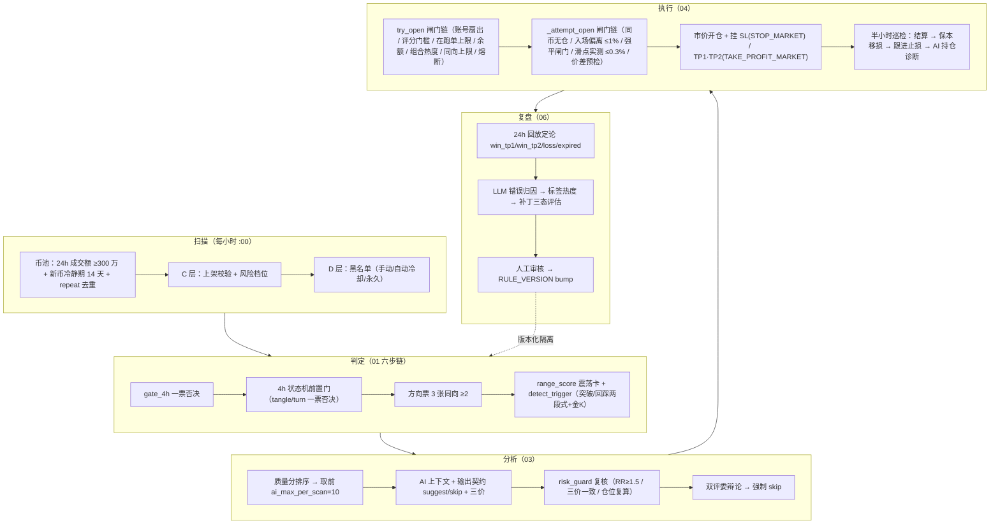
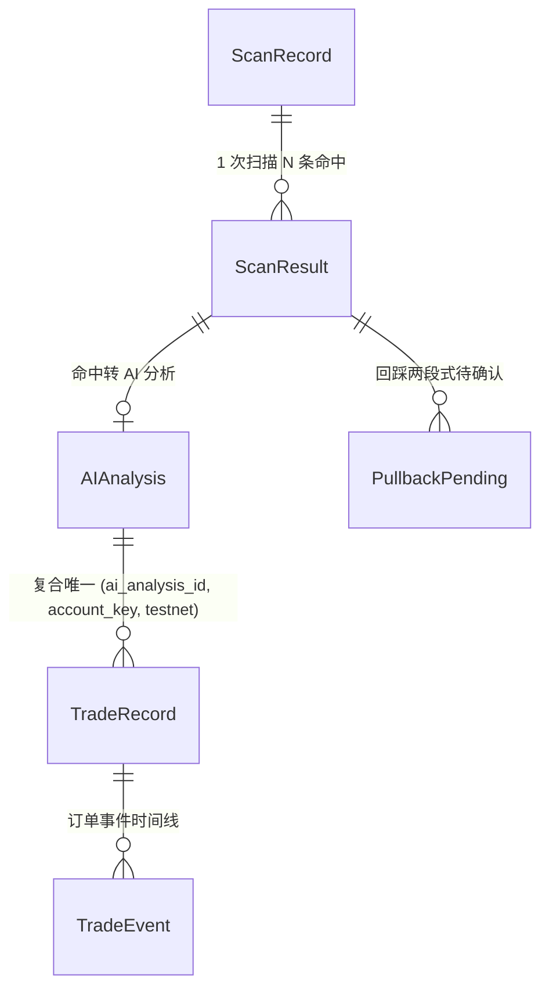
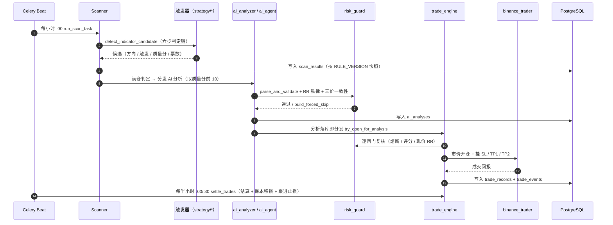
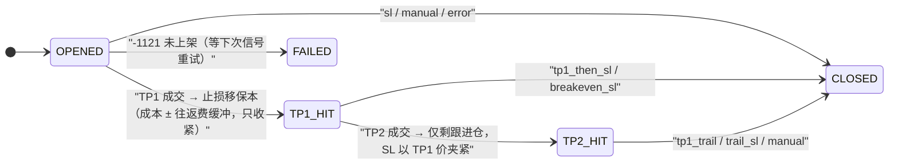

# 技术文档 12 — 交易系统总览（对照 功能流程/12-交易系统总览.md）

> 现行版本：RULE_VERSION v2026-10-18（2026-10-18）。本文从功能文档 12 提炼**技术实现细节**，以代码为准；功能口径与拍板记录见 [功能文档](../功能流程/12-交易系统总览.md)。

## 1. 模块与分层

系统为**前后端分离 + 异步任务队列**的分层架构，交易主链路按职能分为五段：

| 分层 | 核心模块 | 职责 |
| --- | --- | --- |
| 扫描筛选 | `services/scanner.py`、`scan_filters.py`、`exchange_pool.py` | 币池构建、B/C/D 三层过滤、`detect_indicator_candidate` 六步判定链 |
| 策略引擎 | `services/strategy/*`（technical / trigger / candlestick / ema_gate / swing / indicators） | 4h 闸门与状态机、方向票、突破/回踩触发、金K证据 |
| AI 分析 | `services/ai_analyzer.py`、`ai_agent.py`、`dual_judge.py`、`risk_guard.py`、`market_data.py` | 上下文构建、输出契约、程序复核、双评委、强制 skip |
| 交易执行 | `services/trade_engine.py`、`binance_trader.py`、`account_registry.py` | 14 道下单闸门、市价开仓挂 SL/TP、半小时结算巡检 |
| 复盘进化 | `services/actual_review.py`、`ai_attribution.py`、`patch_service.py` | 24h 回放定论、错误归因、补丁三态评估 |



## 2. 数据结构

**核心实体**（`backend/app/models/`）：



**关键常量**（`config.py` / 运行时配置）：

| 常量 | 现行值 | 出处 |
| --- | --- | --- |
| `MIN_VOLUME_24H` | 300 万 USDT | scan_filters |
| `NEW_COIN_COOLDOWN_DAYS` | 14 天 | scan_filters |
| `AI_MAX_PER_SCAN` | 10 | scan_filters |
| `AI_RR_MIN` | 1.5 | `risk_guard` |
| `TRADING_MIN_RECOMMENDATION` | 60 | 闸门 |
| `RISK_BUDGET_PCT` | 3.0% | `risk_budget.resolve_risk_budget` |
| `NEAR_ANCHOR_RISK_FACTOR` | 0.7 | 近锚折价 |
| `TRADING_LEVERAGE` / `MIN_ADAPT_LEVERAGE` | 20 / 8 | `_adaptive_leverage` |
| `MAX_SLIPPAGE_PCT` | 0.3% | 滑点实测 |
| `max_open_trades` | 5 | 在跑单上限 |
| `PORTFOLIO_HEAT_CAP` | 0（关） | 组合热度 |
| `daily_loss_stop_pct` | 基数 × 9% | 当日熔断 |

## 3. 核心流程（时序/状态图）



**持仓状态机（ladder）**：



## 4. 关键算法与常量

### 4.1 单笔风险与仓位推导（固定亏损法）

```
风险基数 = 钱包首位取整，夹在 [100, 5000]         —— trade_engine._capital_base
单笔风险预算 = 基数 × risk_pct%（默认 3%）或 fixed 固定 USDT —— risk_budget.resolve_risk_budget
近锚折价 = 预算 × 0.7（止损锚点贴近现价时）        —— NEAR_ANCHOR_RISK_FACTOR
名义仓位 notional = 风险预算 ÷ 止损宽度 stop_pct
数量 qty = notional ÷ 现价（按交易所 filters 取整；超单笔上限则缩减）
```

含义：止损越宽 → 仓位越小；无论止损宽窄，打止损时亏损恒等于风险预算（仓位是风险的结果）。

### 4.2 杠杆：只管保证金效率

```
动态杠杆 = 从上限（默认 20×）向下搜索，首个「强平距离 > 止损距离」的杠杆，下限 8× —— _adaptive_leverage
杠杆取三者最小：配置上限 / 该名义档位最大杠杆 / 精确档 MMR 强平安全杠杆
止损距离超 8× 下限的强平闸门 → 直接放弃
```

### 4.3 闸门链（事前风控）

| 层 | 闸门 | 参数（默认） |
| --- | --- | --- |
| 组合 | 在跑单上限 / 组合热度 / 同向上限 / 最低可用余额 | 5 / 20%（默认关）/ 0（关）/ 钱包×50% |
| 账户 | 当日亏损熔断 / 连损降速 | 基数×9%，UTC 日自动恢复 / 默认关 |
| 单笔 | 评分门槛 / RR 现价复算 / 入场偏离 / 强平闸门 | ≥60 / ≥1.5 / ≤1% / 8~20× |
| 执行 | 滑点实测 / 盘口价差预检 / 最小规则 / TP 分批预检 | ≤0.3% / `SPREAD_MAX_PCT` / — |

手动开单（`force_market`）仅豁免「入场偏离 / 待回踩时机」两道时机闸门，其余闸门全部保留。

## 5. API 契约

| 端点 | 方法 | 职责 |
| --- | --- | --- |
| `/api/scans` | POST / GET | 手动触发扫描 / 扫描记录列表 |
| `/api/scans/{id}/results` | GET | 扫描命中结果列表 |
| `/api/scans/{id}/ai-analyses` | GET | AI 分析列表 |
| `/api/scans/review/stats` | GET | 复盘统计 |
| `/api/trades` | GET | 交易记录列表 |
| `/api/trades/{id}/close` | POST | 市价平仓 |
| `/api/trades/{id}/events` | GET | 事件时间线 |
| `/api/ops/config` | GET / PUT | 运行时配置读写 |
| `/api/ops/accounts` | GET | 账号列表（双网扇出） |
| `/api/ops/breaker-status` | GET | 熔断状态 |

## 6. 配置项

- **环境变量**：扫描周期 `KLINE_INTERVAL=1h`、窗口 `KLINE_WINDOW=240`、`RULE_VERSION`、`AI_API_KEY` 等（`config.py` Settings）。
- **运行时（system_config 单行表）**：AI 开关、P0/P1 管线、双评委、TP2 开关与分批比例、双网自动交易开关、扫描参数组、风控参数（熔断/盈亏比/杠杆/费率/近锚折价/组合热度/同向上限）、周/月回撤阈值、ATR 跟进倍数。
- DB 值为 NULL 时回落 env 默认；`resolve_scan_filters(cfg)` 解析生效值。

## 7. 并发、幂等与异常处理

- **账号扇出 + 互斥锁**：账号级 Redis 锁 `lock:trade_open:{account_key}`（`trade_locks.py`）——结算巡检、即时开仓、手动平仓、事件驱动共用。
- **复合唯一**：`trade_records` 复合唯一索引 `uq_trade_analysis_account`（`ai_analysis_id + account_key + testnet`）防双网镜像单重复。
- **幂等迁移**：`database._run_migrations` 用 `ALTER TABLE ... ADD COLUMN IF NOT EXISTS` 补列。
- **事件流 + 巡检兜底**：user-data-stream 事件驱动结算为叠加层，30 分钟巡检永久保留兜底。
- **影子铁律**：影子打标独立事务，失败绝不拖累扫描结果/交易记录。
- **熔断只停开仓**：AI 分析 / 巡检 / 复盘照常运行。

## 8. 测试覆盖

- 扫描与漏斗：`backend/tests/test_scan_funnel.py`、`test_scan_filters.py`。
- 触发与状态机：`test_trigger_two_stage.py`、`test_htf_trend_age.py`、`test_touch_refs.py`。
- 开仓闸门：`test_open_gates_rr.py`、`test_open_gates_v2.py`、`test_open_from_analysis.py`、`test_daily_loss_stop.py`。
- 结算与出场：`test_ladder_exits.py`、`test_auto_tighten.py`、`test_tiered_breaker_atr_trail.py`。
- 复盘归因：`test_actual_review.py`、`test_ai_attribution.py`、`test_trade_recon.py`。
