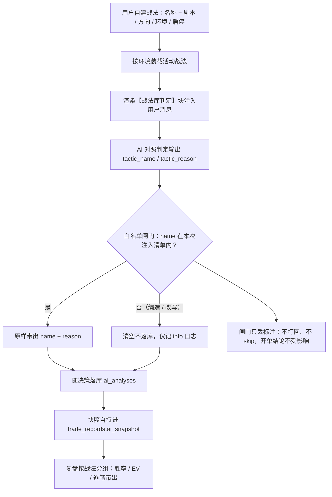
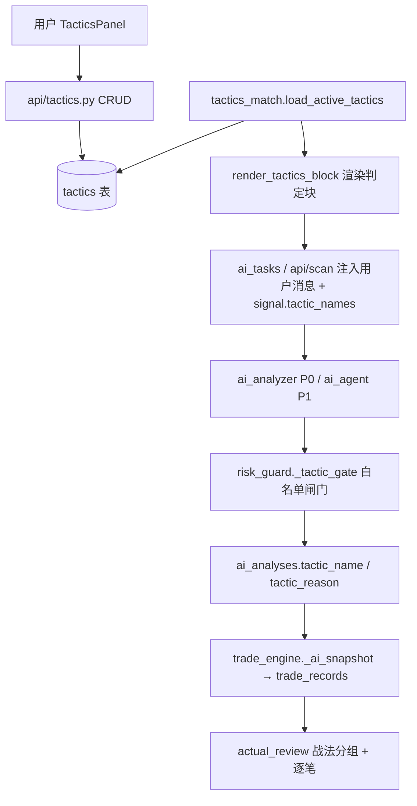
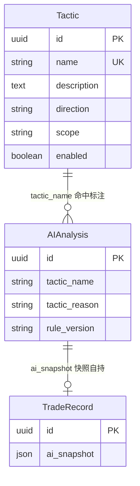
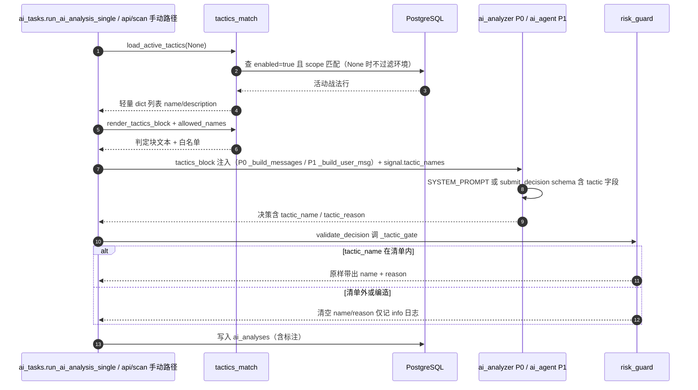
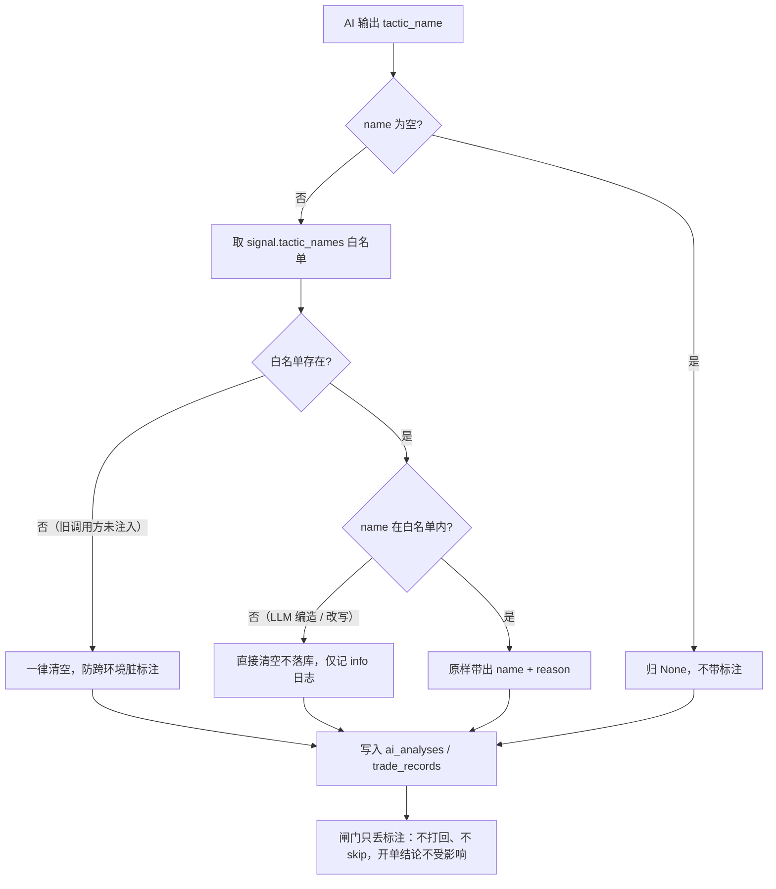

# 10-战法模块

> 现行版本：RULE_VERSION `v2026-10-18`（2026-10-18）。本文对照代码整理，以代码为准；历史拍板记录见 docs/archive/。
>
> 本文为原 `功能流程/10-战法模块.md` 与 `技术实现/10-战法模块.md` 于 2026-10-21 合并而成：功能口径与拍板以业务规则为准，实现细节以代码为准。

## 功能流程图

> 本图概括本文所述功能的整体流程（Mermaid 渲染）。

## 1. 概览

战法模块（2026-10-02 拍板）让用户自建「战术剧本」（名称 + 剧本描述），AI 分析时对照判定当前信号是否符合某个战法并落库标注（`tactic_name/tactic_reason`），复盘按战法分组对比实盘胜率/EV——哪个战法真能打，数据说话。

**核心拍板：战法仅作借鉴参考，不是门槛。** 信号不符合任何战法时 AI 照常给 suggest/skip 结论，不因「不符合战法」而 skip；战法命中只是随决策携带的一行归因标注。

全链路一句话：**装载（按环境）→ 渲染判定块注入用户消息 → AI 对照判定输出 name/reason → 白名单闸门防幻觉 → 随决策落库 → 快照自持进实盘记录 → 复盘分组**。

### 1.1 模块与分层

| 层 | 文件 | 职责 |
|---|---|---|
| 模型 | `models/tactic.py` | `Tactic` 表 + 枚举 `TACTIC_DIRECTIONS` / `TACTIC_SCOPES` |
| 服务 | `services/tactics_match.py` | `load_active_tactics`（装载）/ `render_tactics_block`（渲染块）/ `allowed_names`（白名单） |
| 注入 | `tasks/ai_tasks.py`（ai_tasks.py:274-276）、`api/scan.py`（scan.py:1809-1811） | 装载 → 渲染 → 传 `tactics_block` + 写 `signal["tactic_names"]` |
| 闸门 | `services/risk_guard.py` `_tactic_gate`（risk_guard.py:213） | 白名单校验，清单外清空、不打回 |
| 落库 | `models/scan.py` `ai_analyses.tactic_name/tactic_reason` | 随决策落库（latest-wins） |
| 快照 | `services/trade_engine.py` `_ai_snapshot` | 带出 `tactic_name/tactic_reason` 进 `trade_records` |
| 复盘 | `services/actual_review.py`（actual_review.py:306、395-396） | 分组维度「战法」+ 逐笔带出 |
| API | `api/tactics.py` `/api/tactics` | CRUD + 启停 |
| 前端 | `components/TacticsPanel.tsx`、`api/tactics.ts`、`types/index.ts` | 管理面板 / API 客户端 / `Tactic` + `AIAnalysis` 类型 |

## 2. 定位与边界

与其他三个「影响 AI 行为的配置」的定位边界：

| 配置 | 性质 | 自定义 | 作用面 |
|---|---|---|---|
| `trade_type`（trend_follow 等） | 程序结构分类 | 固定枚举不可自定义 | 每笔决策必填的结构标签 |
| 策略提示词（skill_library） | 全局纪律 | 用户可编辑单份文本 | 注入所有分析，无个体判定 |
| **战法（本模块）** | **用户自建剧本** | **可建多条、可启停、分环境** | **仅标注不拦截，复盘分组归因** |

## 3. 数据模型

### 3.1 `tactics` 表（backend/app/models/tactic.py，新表）

| 列 | 类型 | 说明 |
|---|---|---|
| `id` | UUID PK | `default=uuid.uuid4` |
| `name` | String(64) unique index | 战法名（AI 输出必须逐字一致，重名 400） |
| `description` | Text ≤2000，`default=""` | 战法剧本——AI 判定的唯一依据，写得越可判定（条件明确）命中越准 |
| `direction` | String(8)，`default="all"` | 适用方向：`all` / `long` / `short`（`TACTIC_DIRECTIONS`） |
| `scope` | String(8)，`default="both"` | 适用环境：`testnet` / `live` / `both`（`TACTIC_SCOPES`） |
| `enabled` | Boolean，`default=False` | 启停开关，**新建默认停用**（用户确认剧本后启用才参与判定） |
| `created_at / updated_at` | DateTime | `updated_at` `onupdate=utcnow` |

`TACTIC_DIRECTIONS = ("all", "long", "short")`；`TACTIC_SCOPES = ("testnet", "live", "both")`（models/tactic.py:26-28）。

### 3.2 `ai_analyses` 新列（backend/app/models/scan.py）

| 列 | 类型 | 说明 |
|---|---|---|
| `tactic_name` | String(64) nullable | 命中战法名（latest-wins：新一轮分析 None 覆盖不残留） |
| `tactic_reason` | String(255) nullable | ≤60 字判定依据（AI 输出，normalize 截 255） |

### 3.3 ER 关系

### 3.4 迁移与快照自持

- `backend/app/database.py` `_run_migrations`：`tactics` 全新表由 `create_all` 建表（`init_db` 已导入 `app.models.tactic`）；`ai_analyses` 两条幂等 `ADD COLUMN IF NOT EXISTS`。旧行 NULL = 上线前/未命中。
- **快照自持**：命中结果随 `ai_snapshot` 进 `trade_records`（trade_engine `_ai_snapshot` 带出 `tactic_name/tactic_reason`），删战法不断链；API 层对已有分析引用的战法仍拒绝硬删（409 提示改停用），双重保历史归因不失锚。

## 4. CRUD API（backend/app/api/tactics.py，/api/tactics）

| 端点 | 行为 |
|---|---|
| `GET /api/tactics` | 列表（按创建时间升序），`trade_count`=该战法累计被 AI 命中的分析数（聚合 `AIAnalysis.tactic_name`，含 skip 单） |
| `POST /api/tactics` | 创建；重名 400；direction/scope 枚举校验 422；description ≤2000 |
| `PUT /api/tactics/{id}` | 更新（改名查重排除自身）；不存在 404 |
| `PATCH /api/tactics/{id}/enabled` | 启停切换；停用后不再注入 AI 判定，历史命中标注保留 |
| `DELETE /api/tactics/{id}` | 删除；已被分析引用 → 409「已有 N 条分析引用该战法，不可删除（请改为停用）」；不存在 404 |

- 响应字段（`_serialize`，api/tactics.py:52）：`id/name/description/direction/scope/enabled/trade_count/created_at/updated_at`。
- Pydantic 校验（`TacticIn`）：name 1~64 字、description 1~2000 字、direction/scope 枚举内（`field_validator`，非法 422）。校验器规格常量：`NAME_MAX=64` / `DESC_MAX=2000`（api/tactics.py:22-23）。

## 5. AI 集成链

### 5.1 时序总览

### 5.2 装载（tactics_match.load_active_tactics，backend/app/services/tactics_match.py）

- 过滤条件：`enabled=true`；`testnet is not None` 时追加 `scope in ("both", "testnet"|"live")`，`testnet=None` 时**不过滤环境**（取两网 scope 并集）；按创建时间升序（`created_at.asc()`）排序（tactics_match.py:20）。
- 环境来源：`resolve_current_account(db).testnet`（调用方解析）。
- **降级与默认**：`testnet=None` 即装载全部活动战法（2026-10-03 删环境切换——同一次 AI 分析双网各开一单，战法注入取两网 scope 并集，输出侧由白名单闸门兜底）；装载异常 warning 后返回空表——不阻断分析（tactics_match.py:27-39）。

### 5.3 注入（调用方预渲染，DB 访问只在装载时短暂持有会话）

| 调用方 | 位置 | 逻辑 |
|---|---|---|
| 定时/自动分析 | `tasks/ai_tasks.py` `run_ai_analysis_single`（signal 构建后） | 装载 → `render_tactics_block` → 传 `tactics_block` 给 P0 `analyze_with_guard` / P1 `analyze_coin_agent`；`signal["tactic_names"] = allowed_names(_tactics)` 白名单随 signal 进闸门 |
| 手动分析 | `api/scan.py` 单币分析路径 | 同上，仅走 P0 `analyze_coin` |

注入块渲染（`render_tactics_block`，tactics_match.py:42）：编号清单 + 「仅作借鉴参考，不影响是否开单的结论；最多命中 1 个最符合者」声明 + 输出要求（name 逐字取清单 / reason ≤60 字 / 均不符合输出空串）。**空清单返回空串整块不注入**。P0 注入位置：摆动结构之后、K 线 CSV 之前（`_build_messages`）；P1 同位置（`_build_user_msg`）。

### 5.4 输出契约（两管线一致）

- P0：SYSTEM_PROMPT 增 `tactic_name/tactic_reason` 字段说明（逐字输出禁改写/自创；未命中空串）。
- P1：`TOOLS_SCHEMA.submit_decision` 增同名字段（ai_agent.py:306）；`_handle_submit` 预归一（空串→None、截断 64/255，ai_agent.py:491），skip/suggest 两条路径均携带。

### 5.5 白名单闸门（risk_guard.py `_tactic_gate`，非打回型）

- 数据源与实现：`signal.get("tactic_names")`（调用方从活动战法装载的本次注入清单）；`allowed = signal.get("tactic_names") or []`，`d.tactic_name in allowed` 则返回 `(name, reason)`（reason 同进同出），否则 `(None, None)` 并记 info 日志（risk_guard.py:213-222）。清单外（LLM 编造/改写）与无白名单（旧调用方未注入）均**清空不落库**，后者一律清空以防跨环境脏标注。
- **闸门只丢标注，不打回不 skip**——防幻觉脏键污染复盘分组，同时不影响开单结论（拍板核心）。
- `normalize_raw`：空串归 None；截断 name 64 / reason 255（risk_guard.py:117-122）。
- latest-wins：新一轮分析 `tactic_name=None` 覆盖旧值，不残留。

## 6. 复盘集成（backend/app/services/actual_review.py）

- 分组维度新增「战法」（位于止损锚之后、规则版本之前，actual_review.py:306）：`ai_snapshot.tactic_name`，未命中/旧行归「未指定」——按命中战法分组对比实盘胜率/EV，验证哪个战法真能打。
- 逐笔 `items` 带出 `tactic_name/tactic_reason`（快照自持，actual_review.py:395-396），前端逐笔展示归因依据。
- `GET /api/tactics` 的 `trade_count` 与复盘分组同源（`AIAnalysis.tactic_name`）。

## 7. 前端

| 组件 | 位置 | 要点 |
|---|---|---|
| `TacticsPanel.tsx` | 扫描结果页「战法」Tab（`ScanResult.tsx`，位于「策略提示词」之后） | 表格：战法名/剧本/方向（多空通用/仅做多/仅做空）/环境（测试网/正式网/双环境）/命中数/启用 Switch/更新时间/操作；新建/编辑 Modal（direction/scope Radio 组）；删除带 Popconfirm，409 时提示改停用 |
| `AIAnalysisCard.tsx` | AI 分析卡 | 「⚔ 战法匹配」蓝色横幅行（suggest/skip 均显示），展示命中战法名 + 判定依据；未命中不显示 |
| `api/tactics.ts` | API 客户端 | `tacticsApi.list/create/update/toggle/remove` |
| `types/index.ts` | 类型 | `Tactic` interface + `AIAnalysis` 增 `tactic_name/tactic_reason` |

## 8. 配置、并发幂等与测试

### 8.1 配置项

| 配置 | 位置 | 说明 |
|---|---|---|
| `RULE_VERSION` | `backend/app/config.py`（config.py:293） | 现行为 `v2026-10-18`；战法模块上线时 bump 至 `v2026-10-02`（提示词契约变更标记，历史值） |
| 迁移 | `backend/app/database.py` | `tactics` 建表（create_all）+ `ai_analyses` 两列幂等 ALTER |
| 路由注册 | `backend/app/main.py` / `api/__init__.py` | `tactics_router`（`prefix=/api/tactics`） |
| 运行时开关 | `tactics.enabled` / `tactics.scope` | 数据库内，页面可改（无对应 system_config / env 项） |

### 8.2 并发、幂等与异常处理

- **DB 会话短持**：`load_active_tactics` 只在装载时短暂持有 `SessionLocal`，LLM 长调用不持连接（tactics_match.py:27-39），与 ai_tasks 惯例一致。
- **失败不阻断**：装载异常降级空表（见 5.2）、闸门只清标注且不触发重试/不 skip（见 5.5）；战法模块任何环节失败不影响开单结论。
- **删除保护与幂等**：已有分析引用的战法拒硬删（409），配合 `ai_snapshot` 快照自持保证历史归因不失锚（见 3.4）；两列 `ADD COLUMN IF NOT EXISTS` 重复执行安全，旧行 NULL 视为未命中。

### 8.3 测试覆盖（backend/tests/）

| 文件 | 覆盖 |
|---|---|
| `test_tactics_api.py` | CRUD 全流程 + trade_count 聚合、重名 400/枚举与超长 422、启停 toggle、被引用 409 拒删/无引用可删/不存在 404（sqlite StaticPool + dependency_overrides） |
| `test_ai_tactic_gate.py` | 装载 scope/enabled SQL 级过滤（含 testnet/live 双环境、解析失败降级空表）、渲染块与白名单、normalize 空串归 None/截断、闸门四态（清单内带出/清单外清空/skip 路径携带/无白名单清空）、`_build_messages` 注入位置（摆动后 K 线前）、Agent schema 契约 |
| `test_review_batch3.py` | 增补 `test_actual_review_tactic_dimension`：战法分组计数（未指定兜底）+ items 逐笔带出 |
| `test_risk_budget.py` | 决策替身补 `tactic_name/tactic_reason` 字段（契约演进同步） |

## 9. 历史演进

| 时间 | 内容 |
|---|---|
| 2026-10-02 拍板并实施 | 战法模块上线：自建战法库（启停/分环境）+ AI 命中标注 + 复盘战法分组；**初版方案曾含「不符合战法 → skip」拦截语义，用户明确修正：「不符合战法不需要 skip，战法仅作为借鉴」**——最终落地为判定制而非门槛制：白名单闸门只清脏标注不打回，AI 输出要求写明「不影响是否开单的结论」，RULE_VERSION → v2026-10-02 |

## 相关文档

- [03-AI分析](../AI决策/03-AI分析.md)：用户消息块表 #10（【战法库判定】块）、TradeDecision 契约、校验链第 6 条（战法白名单闸门）
- [06-复盘归因](../复盘归因/06-复盘归因.md)：分组维度表「战法」行、快照自持口径
- [05-风控体系](../风控/05-风控体系.md)：`_tactic_gate` 所在的 risk_guard 校验链全景
- [08-前端界面](../前端与查询/08-前端界面.md)：扫描结果页 Tab 布局、AI 分析卡结构
