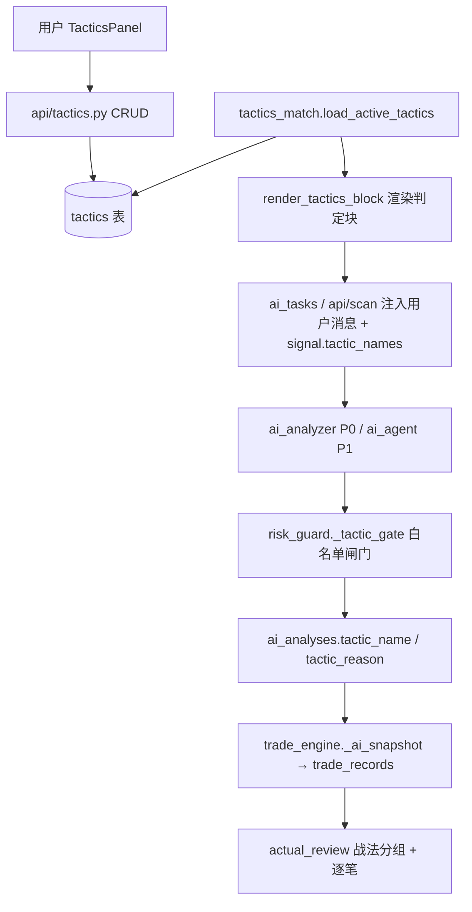
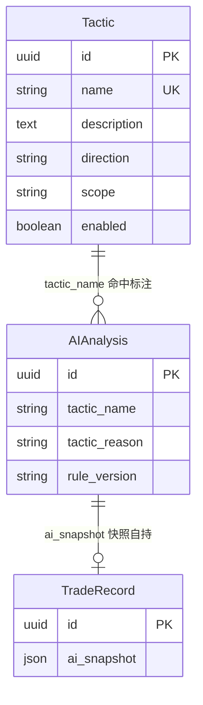
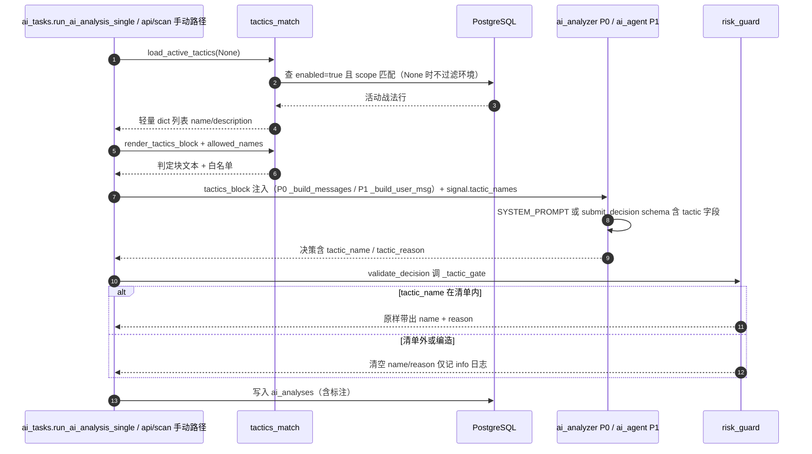
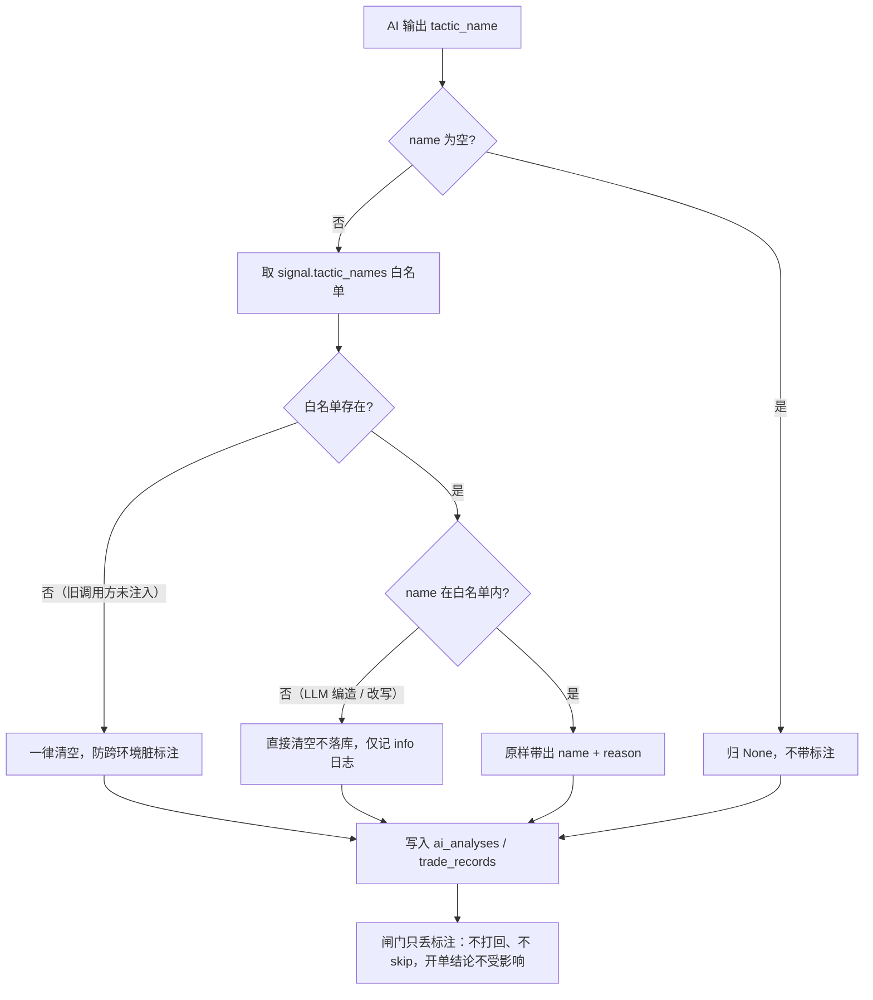

# 技术文档 10 — 战法模块（对照 功能流程/10-战法模块.md）

> 现行版本：RULE_VERSION v2026-10-18（2026-10-18）。本文从功能文档 10 提炼**技术实现细节**，以代码为准；功能口径与拍板记录见 [功能文档](../功能流程/10-战法模块.md)。

## 1. 模块与分层

战法模块（2026-10-02 拍板）让用户自建「战术剧本」（名称 + 描述），AI 分析时对照判定并落库标注（`tactic_name/tactic_reason`），复盘按战法分组对比。**核心口径：战法仅作借鉴，不拦截开单**。

| 层 | 文件 | 职责 |
|---|---|---|
| 模型 | `models/tactic.py` | `Tactic` 表 + 枚举 `TACTIC_DIRECTIONS` / `TACTIC_SCOPES` |
| 服务 | `services/tactics_match.py` | `load_active_tactics`（装载）/ `render_tactics_block`（渲染块）/ `allowed_names`（白名单） |
| 注入 | `tasks/ai_tasks.py`（ai_tasks.py:274-276）、`api/scan.py`（scan.py:1809-1811） | 装载 → 渲染 → 传 `tactics_block` + 写 `signal["tactic_names"]` |
| 闸门 | `services/risk_guard.py` `_tactic_gate`（risk_guard.py:213） | 白名单校验，清单外清空、不打回 |
| 落库 | `models/scan.py` `ai_analyses.tactic_name/tactic_reason` | 随决策落库（latest-wins） |
| 快照 | `services/trade_engine.py` `_ai_snapshot` | 带出 `tactic_name/tactic_reason` 进 `trade_records` |
| 复盘 | `services/actual_review.py`（actual_review.py:306、395-396） | 分组维度「战法」+ 逐笔带出 |
| API | `api/tactics.py` `/api/tactics` | CRUD + 启停 |
| 前端 | `components/TacticsPanel.tsx`、`api/tactics.ts`、`types/index.ts` | 管理面板 / API 客户端 / `Tactic` + `AIAnalysis` 类型 |

## 2. 数据结构

### 2.1 `tactics` 表（`models/tactic.py`，新表）

| 列 | 类型 | 说明 |
|---|---|---|
| `id` | UUID PK | `default=uuid.uuid4` |
| `name` | String(64) unique index | 战法名（AI 输出须逐字一致，重名 400） |
| `description` | Text，`default=""` | 战法剧本——AI 判定唯一依据 |
| `direction` | String(8)，`default="all"` | `all` / `long` / `short`（`TACTIC_DIRECTIONS`） |
| `scope` | String(8)，`default="both"` | `testnet` / `live` / `both`（`TACTIC_SCOPES`） |
| `enabled` | Boolean，`default=False` | 启停开关（新建默认停用） |
| `created_at` / `updated_at` | DateTime | `updated_at` `onupdate=utcnow` |

`TACTIC_DIRECTIONS = ("all", "long", "short")`；`TACTIC_SCOPES = ("testnet", "live", "both")`（models/tactic.py:26-28）。

### 2.2 `ai_analyses` 新列（`models/scan.py`）

| 列 | 类型 | 说明 |
|---|---|---|
| `tactic_name` | String(64) nullable | 命中战法名（latest-wins：新一轮 None 覆盖不残留） |
| `tactic_reason` | String(255) nullable | ≤60 字判定依据（normalize 截 255） |

### 2.3 迁移与快照自持

- `database.py` `_run_migrations`：`tactics` 全新表由 `create_all` 建表（`init_db` 已导入 `app.models.tactic`）；`ai_analyses` 两条幂等 `ADD COLUMN IF NOT EXISTS`。旧行 NULL = 上线前 / 未命中。
- **快照自持**：命中结果随 `ai_snapshot` 进 `trade_records`（`trade_engine._ai_snapshot` 带出两字段），删战法不断链；API 层对已有分析引用的战法仍拒绝硬删（409 提示改停用）。

## 3. 核心流程

### 3.1 AI 集成链路（装载 → 注入 → 判定 → 落库）

### 3.2 白名单闸门防幻觉（`_tactic_gate`）

## 4. 关键算法与常量

- **装载过滤**（`load_active_tactics`，tactics_match.py:20）：`enabled=true`；`testnet is not None` 时追加 `scope in ("both", "testnet"|"live")`，`testnet=None` 时不过滤环境（取两网并集）；按 `created_at.asc()` 排序；异常 warning 后返回空表。
- **判定块渲染**（`render_tactics_block`，tactics_match.py:42）：编号清单 + 「仅作借鉴参考，不影响是否开单的结论；最多命中 1 个最符合者」声明 + 输出要求（name 逐字取清单 / reason ≤60 字 / 均不符合输出空串）；**空清单返回空串整块不注入**。P0 注入位置在摆动结构之后、K 线 CSV 之前（`_build_messages`），P1 同位置（`_build_user_msg`）。
- **输出契约**：P0 SYSTEM_PROMPT 增 `tactic_name/tactic_reason` 字段说明；P1 `TOOLS_SCHEMA.submit_decision` 增同名字段（ai_agent.py:306），`_handle_submit` 预归一（`args.get("tactic_name")` 空串→None、截断 64，ai_agent.py:491），skip/suggest 两路径均携带。
- **normalize**（risk_guard.py:117-122）：空串归 None；截断 name 64 / reason 255。
- **闸门**（`_tactic_gate`，risk_guard.py:213-222）：`allowed = signal.get("tactic_names") or []`；`d.tactic_name in allowed` 则返回 `(name, reason)`；否则 `(None, None)` 并记 info 日志。
- **校验器规格常量**：`TacticIn` 的 `NAME_MAX=64` / `DESC_MAX=2000`（api/tactics.py:22-23），`direction` / `scope` 用 `field_validator` 校验枚举（非法 422）。
- **latest-wins**：新一轮分析 `tactic_name=None` 覆盖旧值，不残留。

## 5. API 契约

| 端点 | 行为 |
|---|---|
| `GET /api/tactics` | 列表（创建时间升序）；`trade_count` = 该战法累计被 AI 命中的分析数（聚合 `AIAnalysis.tactic_name`，含 skip 单） |
| `POST /api/tactics` | 创建；重名 400；direction/scope 枚举校验 422；description ≤2000 |
| `PUT /api/tactics/{id}` | 更新（改名查重排除自身）；不存在 404 |
| `PATCH /api/tactics/{id}/enabled` | 启停切换；停用后不再注入 AI 判定，历史命中标注保留 |
| `DELETE /api/tactics/{id}` | 删除；已被分析引用 → 409「已有 N 条分析引用该战法，不可删除（请改为停用）」；不存在 404 |

响应字段（`_serialize`，api/tactics.py:52）：`id/name/description/direction/scope/enabled/trade_count/created_at/updated_at`。前端 `tacticsApi`（api/tactics.ts）封装 `list/create/update/toggle/remove`。

## 6. 配置项

| 配置 | 位置 | 说明 |
|---|---|---|
| `RULE_VERSION` | `config.py`（config.py:293） | 现行为 `v2026-10-18`；战法模块上线时 bump 至 `v2026-10-02`（提示词契约变更标记，历史值） |
| 迁移 | `database.py` | `tactics` 建表（create_all）+ `ai_analyses` 两列幂等 ALTER |
| 路由注册 | `main.py` / `api/__init__.py` | `tactics_router`（`prefix=/api/tactics`） |
| 运行时开关 | `tactics.enabled` / `tactics.scope` | 数据库内，页面可改（无对应 system_config / env 项） |

## 7. 并发、幂等与异常处理

- **DB 会话短持**：`load_active_tactics` 只在装载时短暂持有 `SessionLocal`，LLM 长调用不持连接（tactics_match.py:27-39），与 ai_tasks 惯例一致。
- **降级不阻断**：装载异常 warning 后返回空表 → 判定块不注入，分析照常；战法模块任何环节失败不影响开单结论。
- **闸门非打回型**：只清空脏标注（info 日志），不触发重试、不 skip，避免幻觉脏键污染复盘分组。
- **删除保护**：已被分析引用的战法拒硬删（409）；快照自持（`ai_snapshot`）保证删战法后历史归因不失锚。
- **幂等迁移**：两列 `ADD COLUMN IF NOT EXISTS`，重复执行安全；旧行 NULL 视为未命中。

## 8. 测试覆盖（backend/tests）

| 文件 | 覆盖 |
|---|---|
| `test_tactics_api.py` | CRUD 全流程 + `trade_count` 聚合、重名 400 / 枚举与超长 422、启停 toggle、被引用 409 拒删 / 无引用可删 / 不存在 404（sqlite StaticPool + `dependency_overrides`） |
| `test_ai_tactic_gate.py` | 装载 scope/enabled SQL 级过滤（含 testnet/live 双环境、解析失败降级空表）、渲染块与白名单、normalize 空串归 None/截断、闸门四态（清单内带出 / 清单外清空 / skip 路径携带 / 无白名单清空）、`_build_messages` 注入位置（摆动后 K 线前）、Agent schema 契约 |
| `test_review_batch3.py` | 增补 `test_actual_review_tactic_dimension`：战法分组计数（未指定兜底）+ items 逐笔带出 |
| `test_risk_budget.py` | 决策替身补 `tactic_name/tactic_reason` 字段（契约演进同步） |
