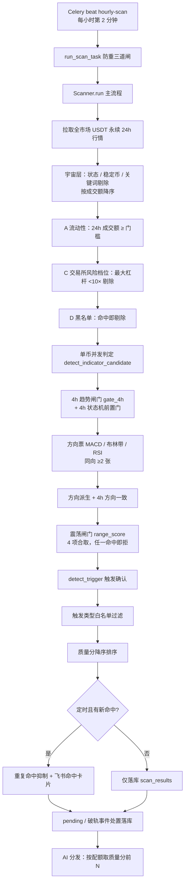
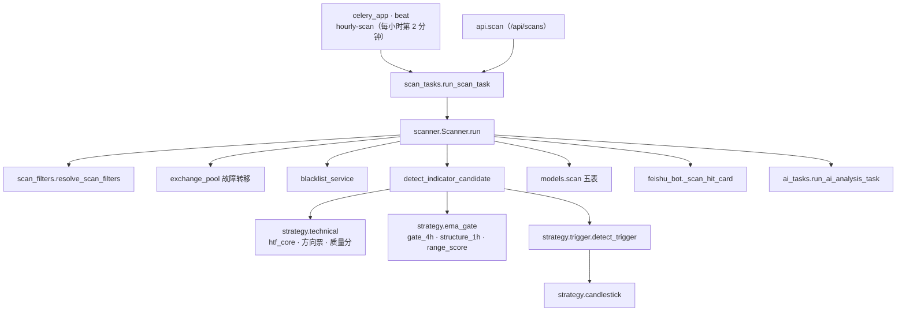
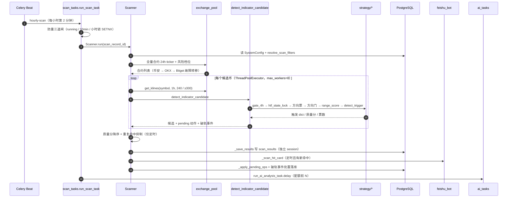
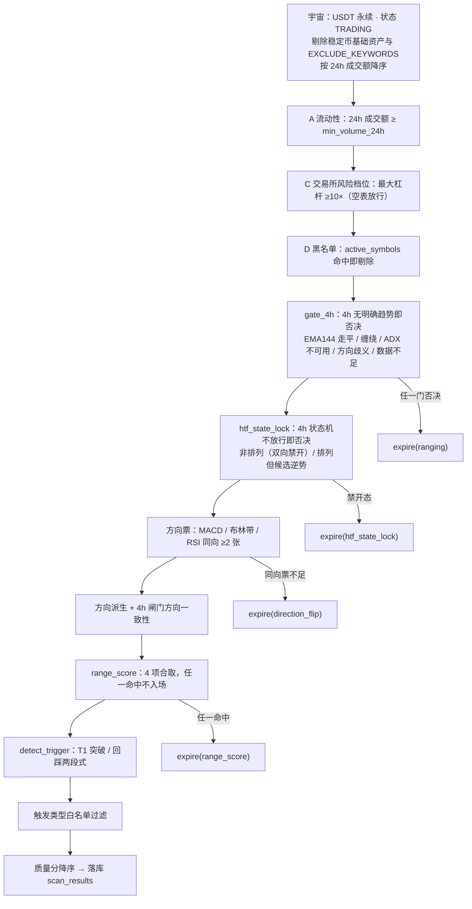
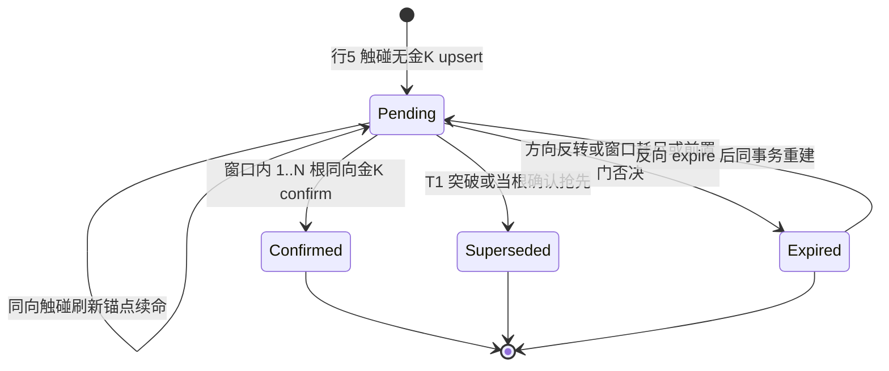
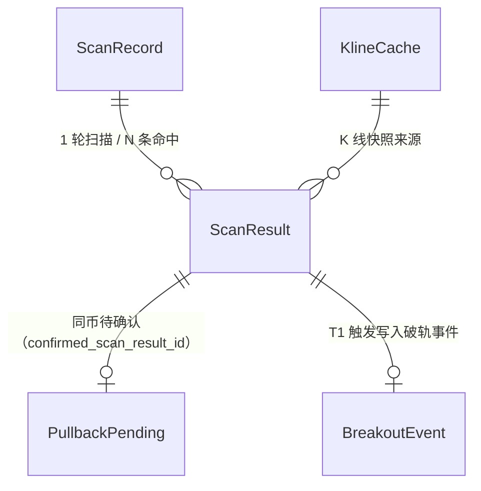

# 01-币种筛选与扫描

> 现行版本：RULE_VERSION v2026-10-18（2026-10-18）。本文对照代码整理，以代码为准；历史拍板记录见 docs/archive/。
> 本文为原 `功能流程/01-币种筛选与扫描.md` 与 `技术实现/01-币种筛选与扫描.md` 于 2026-10-21 合并而成：功能口径与拍板以业务规则为准，实现细节以代码为准。

---

## 功能流程图

> 本图概括本文所述功能的整体流程（Mermaid 渲染）。



## 1. 概览

扫描是整个合约系统的入口：从全市场 USDT 永续合约中，按「流动性门槛 → 币种过滤 →
4h 趋势闸门 → 方向票决定向 → 震荡闸门 → 触发确认」的漏斗筛出
候选信号，落库 `scan_results` 后按质量分配额分发 AI 分析。设计原则
（backend/app/services/scanner.py:1-20 模块 docstring）：

- **指标为主、信号为触发器**：方向判定权归**方向票**——仅 1h 三张 MACD/布林带/RSI
  （`technical.DIR_VOTE_SHORTS`，2026-10-15 指标拆角色 docs/21 O9），同向 ≥2 张才成候选；
  ADX/OBV/SuperTrend/4h 背景退出方向票，改由 range_score 与质量分承担。触发器只回答
  「此刻是否出现与候选方向一致的入场点」。
- **EMA 趋势硬门前置（2026-10-10 二次拍板）**：4h 趋势闸门一票否决 + 震荡闸门
  硬门化——只有 4H 趋势明确时才允许 1H 入场，4h 走平或缠绕时 1h 信号再漂亮也不做；
  1H 结构门（`structure_1h`）已于 2026-10-12 从筛选链退役，下沉 trigger 层作 ema21
  触点**软校验**（2026-10-15 硬门再降级：不过门不否决、仅质量分重罚 −15，docs/02 §5.6）。
- **信号判定全部基于已收盘 K 线**（klines[-2]），同根 K 线同结果，与扫描时刻无关。

### 1.1 模块与分层

扫描链按「调度 → 任务防重 → 编排（宇宙/多层过滤）→ 单币判定 → 收尾落库/通知/AI」
分层，策略层为纯函数、无 DB 依赖，落库统一由编排层在独立 session 完成。

| 层 | 路径 | 职责 |
|---|---|---|
| 调度 | `backend/app/celery_app.py` | beat `hourly-scan`（`crontab(minute=2)`，celery_app.py:50-58）；worker fork 后重启日志线程 + `engine.dispose`（celery_app.py:11-25） |
| 任务 | `backend/app/tasks/scan_tasks.py` | `run_scan_task`（15-120）：入口、防重三道闸（46-93）、任务记录 `open_task`/`close_task` |
| 编排 | `backend/app/services/scanner.py` | `Scanner.run`（550 起，宇宙/多层过滤 597-688）、`detect_indicator_candidate`（210-508）、`_votes_snapshot`（511-540）、`_save_results`（913-985）、`_slots_full`（1017-1058）、`_suppress_repeat_hits`（1061-1091）、`_prefetch_pendings`（1096-1130）、`_prefetch_retest_events`（1144）、`_apply_breakout_events`（1176-1232）、`_sweep_orphan_pendings`（1233）、`_apply_pending_ops`（1265-1332）、`_scan_hit_card`（69-116）、`classify_volume`（144） |
| 参数 | `backend/app/services/scan_filters.py` | `ScanFilters` 冻结 dataclass（85-114）、`resolve_scan_filters`（117）、`SCAN_FILTER_KEYS`（60-79）、白名单解析（140-161） |
| 数据源 | `backend/app/services/exchange_pool.py` | 多交易所合约列表/K 线（币安→OKX→Bitget 故障转移）+ 小时级缓存；`allow_stale` 降级（357-409、418-465） |
| 过滤 | `backend/app/services/blacklist_service.py` | `active_symbols`、`register_settle` 自动拉黑（23-32） |
| 策略 | `backend/app/services/strategy/technical.py` | `htf_core`（736）、`analyze_htf_background`（778）、`compute_indicator_votes`（1112）、`compute_quality_score`（1252）、`golden_zone_swing_count`（1219） |
| 策略 | `backend/app/services/strategy/ema_gate.py` | `gate_4h`（75-131）、`structure_1h`（132-221）、`range_score`（203-275） |
| 策略 | `backend/app/services/strategy/trigger.py` | `detect_trigger`（571-888） |
| 形态 | `backend/app/services/strategy/candlestick.py` | `detect_all_patterns` / `resolve_golden_evidence`、`GOLDEN_PATTERNS`（662-674） |
| 模型 | `backend/app/models/scan.py` | `scan_records` / `scan_results` / `pullback_pendings` / `breakout_events` / `kline_caches` |
| API | `backend/app/api/scan.py` | 手动触发、结果查询、配置读写、黑名单、pending 池（prefix `/api/scans`） |
| 通知 | `backend/app/services/feishu_bot.py` | `send_app_card` 发送扫描命中卡片（卡片体构造在 scanner `_scan_hit_card`）；失败只记日志，不影响扫描与 AI 链路 |
| 下游 | `backend/app/tasks/ai_tasks.py` | `run_ai_analysis_task`（156：按 `ai_max_per_scan` 配额取质量分前 N；指纹缓存 `FINGERPRINT_TTL_MIN` 兜底同币同信号不重复调 LLM） |



## 2. 币种池与三层过滤

扫描宇宙的构建与逐层过滤在 `Scanner.run`（scanner.py:597-688），历史设计见
archive/13-BCD三层币种过滤.md：

| 层 | 过滤内容 | 代码位置 | 失败兜底 |
|---|---|---|---|
| 宇宙 | USDT 永续、状态 TRADING、剔除稳定币基础资产与 `EXCLUDE_KEYWORDS`（UP/DOWN/BEAR/BULL 等）关键词，按 24h 成交额降序；另有新币冷静期 `new_coin_cooldown_days`（默认 14 天，上市未满 N 天不进扫描，0=关闭） | exchange_pool.py:208-246、config.py:296-297、config.py:359 | 三交易所故障转移，全失败抛 `AllExchangesFailed` |
| A 流动性 | 24h 成交额 ≥ `min_volume_24h`（默认 300 万 USDT） | scanner.py:618-627 | — |
| C0 下单环境可交易（**已撤，2026-10-11**） | 原用下单环境（`trading_testnet` 决定）的 exchangeInfo 剔除未上架币（防开单 -1121 白烧 AI 配额，ARX 案例 2026-09-19）；2026-10-11 用户拍板撤销——未上架币照常进扫描/AI 分析（数据源走正式网、K 线齐全），可交易校验收敛到开单层（`trade_engine._attempt_open` listed 兜底 + 未上架飞书提示） | scanner.py:629-634（撤销注释） | — |
| C 交易所风险档位 | 最大允许杠杆 <10× 的币剔除（`risk_tier_all()` 一次全市场拉取、进程缓存 24h）。注意按首档 MMR 过滤会误拦 58%（币安 2026 已把山寨首档 MMR 统一到 1.5%~2%），已废弃 | scanner.py:659-674 | 空表放行 |
| D 黑名单 | `active_symbols(db)` 命中不进扫描：手动添加（永久）+ 自动（结算后实亏 ≥ 计划风险 ×1.5 → 冷却 14 天；≥×1.8 → 永久；强平按倍数定档） | scanner.py:676-684、blacklist_service.py:23-32 | 集合为空跳过查询 |

黑名单补充口径（blacklist_service.py）：

- `register_settle`：结算后钩子，盈利单/无预算不涉及；已存在则刷新理由与到期时间。
- 手动 `add_manual`（永久）/ `remove`（删行）；auto 行到期自然失效，行保留供查看。
- 黑名单在开仓前还有第二道兜底查询（trade_engine `_attempt_open`），覆盖扫描与
  开仓时间差内刚被拉黑的场景。
- B 层（盘口滑点实测 `market_slippage_estimate`，默认上限 0.3%）不在扫描阶段，
  属开仓链路，见 archive/13 §2。

---

## 3. 扫描链路

### 3.1 入口：定时 vs 手动

| 维度 | 定时扫描 | 手动扫描 |
|---|---|---|
| 触发 | Celery beat `hourly-scan`（celery_app.py:50-58，每小时第 2 分钟，等 K 线收盘） | `POST /api/scans`（api/scan.py:90-108），有 running 记录时 409 |
| 记录 | `run_scan_task` 无 scan_record_id 时新建（scan_tasks.py:32-36） | API 先建 `scan_type="manual"` 记录再投递 |
| 重复命中抑制 | 生效：同 (symbol, signal_type) 在 `repeat_window_hours`（默认 3h）内已命中不落库（scanner.py:802-807、`_suppress_repeat_hits` scanner.py:1061-1091） | 不抑制（2026-09-20 拍板：手动 = 对最近已收盘 K 线的完整评估，与 :02 定时同根 K 线应得同样结果） |
| 飞书命中通知 | 发送（scanner.py:816-821） | 不发送（用户在场） |
| 满仓跳过 AI | 在跑单达 `max_open_trades` 时跳过本轮 AI 分发（`_slots_full` scanner.py:1017-1058，只统计 OPENED；查询失败按未满仓处理） | 不受限 |

防重三道闸（scan_tasks.py:46-93，仅定时）：

1. 已有 running 记录 → 本轮标 failed 跳过；
2. 10 分钟内已有 scheduled completed → 跳过（休眠唤醒后 beat 积压背靠背执行）；
3. UTC 小时锁：Redis `SETNX scan:hourly:{YYYYMMDDHH}`（TTL 2h），防 beat 双发 /
   消息重投导致「扫描命中」飞书通知双发（2026-09-28）。

### 3.2 主链路时序（定时扫描一轮）



### 3.3 单币判定链 `detect_indicator_candidate`

单币检测入口为 `detect_indicator_candidate`（scanner.py:210-508，2026-09-17 管线
重设计后已无 `_evaluate_symbol` 这个名字，部分旧文档沿用旧称），Scanner 与
watchlist.refresh 共用同一套逻辑与阈值。判定链逐步：

1. **4h 趋势闸门 `gate_4h`（第一步，2026-10-10 二次拍板硬门化，借鉴外部设计
   check_4h_gate 一票否决语义；2026-10-20 与 4h 状态机合并为 `htf_context`
   单入口）**（scanner.py:270-324，technical.py:htf_context）：
   先拉 4h K 线 300 根，`reject_reason` 非空即否决——`flat`（EMA144 走平，
   斜率 <0.5%/20根）/ `tangle`（缠绕：ADX<20 ∪ 21-55 间距 <0.1% ∪ 21×55 锯齿
   ∪ 价格穿越 144 >2 次）/ `adx`（ADX 不可用，fail-closed）/ `undetermined`
   （位置与斜率不同号）/ `data`（历史 <200 根）。命中直接否决：不跑票数、不
   触发、不进候选（连 AI 分析都不给），
   活跃 pending 同轮 `expire(ranging)`（词义="4h 无明确趋势"）。方向来自状态机
   （`direction` 字段）。各判据常量见 §4.1。
   4h 每轮对全币池拉取（kline 缓存按 4h 桶对齐，实际新请求 ≈ 池子 ÷4 每小时）；
   拉取异常降级放行（None=主动否决，异常=数据问题，二者区分）。同一份 4h
   快照与证据被方向一致门/ema21_4h 触点复用。
   **4h 状态机前置门 `htf_state_lock`（2026-10-20 收紧：仅排列放行）**：
   `block_both = state ∉ {aligned_bull, aligned_bear}` —— 非多头/空头排列
   （`turn_*` 拐头 / `macro_cross_*` 交叉初期 / `*_recover` 恢复初期 /
   `bull_dip`·`bear_rally` 过渡态）对**全部 1h 候选（回踩·突破）一票否决**，
   活跃 pending 同轮 `expire(htf_state_lock)`。排列状态下另有逆势锁：
   状态方向与候选方向相反者同样否决（`STATE_LOCK_CONTRA`）。两关均置于
   闸门之后、票数之前；命中即不看（不跑票数/触发/候选）。计算上 `gate_4h`
   与状态机共用 `technical.htf_core` 一次算好的 EMA21/55/144+ADX+ATR。
2. **单趟方向票投票（2026-10-10 精简；2026-10-15 指标拆角色，docs/21 O9）
   ——方向票关可开关跳过（2026-10-18）**（scanner.py:326-345）：**方向票仅 1h 三张
   ——MACD / 布林带 / RSI**（`technical.DIR_VOTE_SHORTS`），3 项一趟算完
   （`compute_indicator_votes(klines, htf_bg=htf_res)`，4h 背景复用第一步结果，不双算）。
   **门槛 = 方向票同向 ≥2 张**（`DIR_VOTE_MIN`）→ 否则中性跳过，pending 走前置过期
   `expire(direction_flip)`。**开关 `direction_vote_gate_enabled`（默认 True，配置页可调）：
   关闭即跳过本关**——不再因同向票不足否决候选（即使只 1 张同向票也照下方派生定向），
   放开信号池。原「7 票净差 `|net|<3` ∧ `voted≥5`」门槛退役（ADX/OBV/SuperTrend/
   4h背景退出方向票的归口见 §11 2026-10-15），`net` 恒为方向票净差
   （∈{±1,±2,±3}，符号=方向），仍写入 `votes_json` 供 AI/质量分。
3. **方向派生 + 闸门方向一致性（方向冲突关可开关跳过，2026-10-18）**（scanner.py:348-389）：
   定向取 `net` 符号（`net≠0`）；**`net=0` 时由 `gate_4h` 方向兜底、无闸门方向则不出信号**
   （2026-10-17 docs/23 A2，3 张票下 net=0 不可达，属防御修复；2026-10-18 方向票关关闭后
   `votes=None`/`net=0` 均可达此处，一律按无票处理）。gate_4h 给出的 4h 方向必须与定向
   一致——4h 闸门看多只产生多头信号，与 4h 冲突的活跃 pending 不可能被确认，按方向失守
   `expire(direction_flip)`（htf 拉取失败降级时跳过检查）。**开关
   `direction_conflict_gate_enabled`（默认 True，配置页可调）：关闭即跳过本关**——允许
   逆 4h 闸门方向的候选照常产生（放开深回撤等逆势形态）。
4. **1H 结构门 `structure_1h`——已从筛选链退役（2026-10-12 O7；2026-10-15 再降级
   重罚，O9）**：现下沉 trigger 层，仅作 **1h EMA21 触点软校验**——回踩触点为 ema21
   且结构不过**不否决**（照常出信号，带 `structure_gate=False` 证据由质量分重罚
   −15；其余触点豁免，见 docs/02 §5.6）。结构判定算法要点见 §4.2。scanner 漏斗
   `structure_1h` 关卡退役（仅旧轮次数据可见）。
5. **震荡闸门 `range_score`（2026-10-20 重构：8 项评分卡 → 4 项合取）**
   （scanner.py:417-426，ema_gate.py:203-275）：任一命中即不入场——
   ① 1h EMA21/55/144 非同向排列；② 近 12 根最大 |EMA55−EMA144|/ATR <1.0
   （分离史口径，深回踩压窄现值不误伤）；③ 1h ADX <18；④ 波动过度扩张
   （Donchian 或布林带宽在当前 100 根的分位 ≥0.80）。命中即 pending
   `expire(range_score)`。常量、PNL 依据与退役项见 §4.3（代价是候选吞吐下降约 41%）。
6. **触发器 `detect_trigger`**（trigger.py:571-888，决策矩阵见 3.5）：命中则计算
   质量分（`compute_quality_score`，组成见 §4.4），组装候选 dict（每币至多 1 个）。
   T1 突破触发在白名单过滤**之前**先写破轨事件动作（scanner.py:419-427）——
   破轨是市场事实，白名单只决定是否产生突破信号。
7. **触发类型白名单**（scanner.py:428-433）：白名单外类型不产生候选（连 AI 都不
   进），但 pending 处置照常执行（突破抢先 supersede、窗口过期 expire），保持
   回踩池状态机自洽。
8. **无触发** → 观察池（不落库，下轮重算）；触碰转 pending 的补 Stage-1 快照
   （质量分按回踩口径计并含企稳加分项，scanner.py:448-459）。

并发与落库隔离见 §8。

### 3.4 筛选漏斗逐层关卡（含死因）



### 3.5 触发器决策矩阵（trigger.py，docs/19 §4.1 + docs/22 触点）

方向 = 多数决符号（1 多 / -1 空）。信号判定全部基于已收盘 K 线（klines[-2]）；
pending 有效期 = 其 `stage1_candle_open` 落在信号 K 线之前 **1..N 根已收盘 K 线**内
（N=`pending_confirm_window_bars`，默认 4，逐根比对开盘时间；超 N 根或找不到锚点
即失效，免疫扫描时刻漂移与轮次缺失；N=1 等价旧「恰好 klines[-3]」口径）。

| 行 | 条件 | 结果 |
|---|---|---|
| T1a | 顺向长实体收盘越过最近**未破**摆动前高/前低（结构突破） | `trigger_breakout`，pending 被抢先 → supersede |
| T1b | 结构突破未命中，收盘破 N 根 Donchian 滚动轨（窗口不含信号 K 线与未收盘根） | `trigger_trend_breakout`，与 T1a 同轮互斥（结构优先） |
| 行2 | 当根触碰触点 + 同向金K | `trigger_pullback_confirm`（当根确认），pending 一律被抢先 |
| 行3 | 未触碰但有金K + 有效同向 pending | `trigger_pullback_confirm`（窗口内确认，锚∈前 1..N 根），pending → confirm |
| 行4 | 未触碰有金K + pending 方向不一致或窗口过期 | None，pending → expire |
| 行5 | 触碰但无金K | None，→ upsert pending（转待确认池） |
| 行6/7 | 未触碰无金K | None，窗口未满（elapsed<N）保持等待；窗口耗尽/失效 → expire |

**进待确认池准入闸（2026-10-13 拍板，RULE_VERSION v2026-10-13-3/-4/-5）**：行5 转
pending 前（「通过全部门」之后）再加一道准入——待确认池产物恒为回踩确认
（`trigger_pullback_confirm`），该类型须在触发类型白名单 `allowed_triggers` 内，否则
窗口内确认也产生不了候选、进池只是挂空账。命中即不入池：漏斗记 `trigger_whitelist`
关卡（判定说明列给原因），upsert 动作丢弃。仅挡新进池，已有 pending 生命周期不变。

**4h 状态机禁开（前置门，2026-10-13-5 拍板）**：早期 -3/-4 版本曾把它作为进池/确认的
**临时子闸**（散落在准入闸与确认路径），-5 拍板**提升为筛选链前置门**（§3.3 第 1 步），
对全部 1h 候选一票否决——进池、窗口内确认、当根确认、突破四条路径统一由该门兜住，
不再单独设闸（拍板过程见 §11）。

**1H 结构门软校验（ema21 触点，2026-10-12 硬门 → 2026-10-15 降级不否决，docs/21 O9，
docs/02 §5.6）**：行2/行3 确认前对**回踩触点为 1h EMA21**的路径复校 `structure_1h`
——结构不过**不否决**：照常产出 `trigger_pullback_confirm`（当根/窗口内确认、行5 转
pending 均不拦），带 `structure_gate=False` 证据 + reason 注记「·1H结构未过(重罚-15)」，
由质量分重罚 −15 体现排序差异；窗口内确认对命中 ema21 触点的 pending 同样复校，照常
确认（不再有 `{"op":"expire","reason":"structure_1h"}` 死因）。
**豁免范围**：其余触点（retest/swing/4h EMA21/EMA55/EMA144）不受此门约束。原
`trigger_trend_pullback` 升级标注（trend_gate 证据、reason 前缀）随 2026-10-12 改动删除；
4H 方向一致性由 `gate_4h` 统一保证，触发器内不重复判定。

突破类共享闸门：① 最小突破幅度 `breakout_threshold`（毛边不算）；② 长实体短影线
（实体/K线全长 ≥ 0.70，2026-09-30-2 放宽）；③ 放量为加分项（≥量比门槛 +5 分，
不卡死）；④ 追高上限 `breakout_max_pct`（越位超限不产生突破触发，0=关闭）。

金K 证据：`detect_all_patterns` + `resolve_golden_evidence`（candlestick.py）。现行
白名单 **8 种**（看涨 4：锤/吞没/启明星/刺透 + 看跌 4：流星/吞没/黄昏星/乌云，
`GOLDEN_PATTERNS` candlestick.py:662-674；孕线突破/蜻蜓/墓碑移出，检测器与前端标签
保留仅历史行展示，docs/11）；纯金K独立触发（trigger_candlestick）2026-09-29 下线——
正式网复盘 28 笔 6 胜负期望，金K必须与触点配合。12→8 的收窄过程见 §11。

回踩触点（docs/22，启用白名单 `pullback_touch_refs`，标注优先级 retest > swing >
ema21 > ema21_4h > ema55 > ema144，横向结构语义强于均线；默认开启六项——
retest + swing + 均线族四触点，2026-10-17 起 retest 默认启用〔docs/23 A1〕）：

- **retest** 突破回测位：破位价来自破轨事件（T1 触发时 scanner upsert）或结构推导
  （新 HH 越过前一个 HH），影线可入带、收盘须守住——回踩不破 = 突破有效性确认；
- **swing** 摆动结构位：多头只认最近 3 个 HL / 空头最近 3 个 LH（任一满足即命中），
  时效门 bars_ago ≤ 40；
- **ema21**：原口径不加门；
- **ema55**：数据门（`ema_touch_min_bars`）+ 排列门（EMA21 在 EMA55 同侧）+ 斜率门（近 5 根同向）；
- **ema144**（2026-10-16 复出并默认启用）：数据门 + 走平/顺势门（1h EMA144 走平或顺 4h 方向），不叠加排列门。

破轨事件生命周期（scanner.py:1176-1232，`breakout_events` 表）：T1 触发 upsert（同
方向刷新位价与锚点；反向破轨旧行 expired 后新建）→ touch_ref=retest 的回踩金K
落库时 consume → 超 `retest_window_bars` 窗口的 active 行批量 expired。

### 3.6 待确认池 pending 状态机（scanner.py:1265-1332）

每币至多一条活跃 pending（status=pending），批量预取快照（`_prefetch_pendings`
scanner.py:1096-1130，每轮一次查询），处置动作收集后统一落库（`_apply_pending_ops`，
独立 session，失败整体回滚——下轮按快照重评估，不产生不可恢复状态）：



- **upsert**：同方向触碰刷新锚点续命（换触碰根、等待窗口重新计时）；无活跃行则
  新建；方向反转旧行 expired（direction_flip）后同事务新建（保留审计链，不原地
  改写方向）；
- **confirm**：终态 confirmed，回填确认形态与 `confirmed_scan_result_id`（放在
  `_save_results` 之后以便关联新记录 id；Stage-1 触点是 retest 时同步 consume
  破轨事件）；
- **supersede**：终态 superseded（T1 突破 / 当根确认抢先）；
- **expire**：终态 expired（ranging=4h 趋势闸门否决（走平/缠绕/ADX弱/方向歧义/数据不足）/
  structure_1h=1H 结构不符 / range_score=震荡闸门 4 项合取任一命中 / direction_flip /
  window_expired / htf_state_lock=4h 状态机前置门不放行（非排列双向禁开 / 排列逆势，
  全部候选一票否决））。

### 3.7 收尾：排序 → 抑制 → 落库 → 通知 → AI

1. 候选按质量分降序、同分按 24h 成交额（scanner.py:790-793）；
2. 重复命中抑制（仅定时，见 §3.1）；
3. `_save_results` 独立 session 写 `scan_results`，返回 {symbol: 新 id} 供
   confirm 回写（scanner.py:913-985）；
4. 定时且有新命中 → 飞书卡片（见 §9.2）；
5. pending 处置落库 → 破轨事件处置落库；
6. AI 分发：`run_ai_analysis_task.delay`（ai_tasks.py:156 按 `ai_max_per_scan`
   配额、quality_score 降序取前 N；指纹缓存 `FINGERPRINT_TTL_MIN` 兜底同币同信号
   不重复调 LLM）。

---

## 4. 关键算法与常量

### 4.1 4h 趋势闸门 `gate_4h`（ema_gate.py:75-131）

三重条件**同时成立**才给方向，任一命中返回 `None`（一票否决）：

| 条件 | 常量 | 判据 |
|---|---|---|
| 斜率 | `SLOPE_BARS`=20、`SLOPE_FLAT_PCT`=0.005 | 20 根 EMA144 变化 / 价格 ≥0.5%，否则走平 |
| 缠绕 | `WRAP_WINDOW`=10、`WRAP_MAX`=2 | 近 10 根收盘穿越 EMA144 次数 ≤2，否则震荡 |
| 趋势强度 | `EmaGateConfig.adx_min`=20.0 | 4h ADX ≥20 |

方向 = 价格×EMA144 位置 + 斜率方向（`long`/`short`）；数据门：已收盘 4h 根 `<200` 一并否决。`gate_4h` 与 `analyze_htf_background` 共用 `technical.htf_core`（technical.py:736）一次算好的 EMA21/55/144+ADX+ATR。

### 4.2 1H 结构门 `structure_1h`（ema_gate.py:132-221）

三线排列（多头 EMA21>55>144，空头镜像）+ 快中线 ATR 归一发散史（`div_fast_mid`=0.5，近 12 根取 max，docs/19 §3.2 三次拍板）+ **EMA144 方向**（做多要求走平或向上——近 20 根变化 ≥0；做空镜像；2026-10-11 拍板中慢线发散度退役）；历史 `<200` 根（新币）不过门。2026-10-15 起仅作 ema21 触点软校验（不过门不否决、质量分 −15，见 §3.5）。

### 4.3 震荡闸门 `range_score`（ema_gate.py:203-275，`RANGE_SCORE_REJECT`=1）

2026-10-20 重构：原 8 项评分卡「≥3」退役（方向感知 PNL 回放证明阈值 3 对净期望无区分力，放行池 −0.02R；且项 1 恒 0、项 6 方向相反）。现为 4 项合取判据，任一命中即不入场：

| 项 | 常量 | 判据 | PNL 依据 |
|---|---|---|---|
| 1h 三线交错 | — | EMA21/55/144 非同向排列 | Δ −0.14 |
| 55/144 分离过近 | `MS_DIV_MIN`=1.0、`RANGE_DIV_LOOKBACK`=12 | 近 12 根最大 \|EMA55−EMA144\|/ATR <1.0（分离史口径，深回踩压窄现值不误伤） | Δ −0.21 |
| ADX 过低 | `ADX_WARN_MIN`=18.0 | 1h ADX <18 | Δ −0.21（最强单项） |
| 波动过度扩张 | `EXP_PCTL`=0.80、`EXP_HISTORY`=100、`EXP_DONCH_N`/`EXP_BB_N`=20 | Donchian 或布林带宽在当前 100 根的分位 ≥0.80 | 最高分位档 netR −0.19/−0.16 |

回放读数（60 币 × 60 天，近锚止损 1.5R、含 0.14% 往返费）：放行池净期望 +0.10R、胜率 48.6%、Wilson LB 45.5%，且 train（+0.02R）/ test（+0.26R）双段为正；旧评分卡放行池为 −0.02R。代价是候选吞吐下降约 41%（1759→1040 笔）。

已退役：项 1（4H EMA144 走平，链路中恒 0）、项 3（21/55 距离，与其余项共线）、项 6（布林带收口，squeeze 是突破前奏、方向相反）、项 7/8（穿越次数/量能，滞后于 PNL 标签）。

### 4.4 方向票与质量分（technical.py）

- 方向票 `DIR_VOTE_SHORTS`=(`MACD`,`布林带`,`RSI`)（technical.py:942），门槛 `DIR_VOTE_MIN`=2（同向张数 ≥2）；`net` = 方向票净差（∈{±1,±2,±3}，符号=方向）。`STATE_BLOCK_BOTH`=(`tangle`,`turn_bull`,`turn_bear`)（technical.py:611）为 4h 状态机双向禁开，**现仅供 AI 层 `enforce_htf_constraint` 使用**；筛选链前置门已改用 `STATE_ALIGNED`=(`aligned_bull`,`aligned_bear`)（2026-10-20 收紧，仅排列放行）。
- 质量分基础分 **`50 + direction × net × 10`**（net∈{1,2,3} → 60/70/80，technical.py:1310），封顶 [0,100]：
  - 4h 状态分矩阵 `STATE_QUALITY`（technical.py:606-613）：同向 `aligned_*`+10 / `macro_cross_*`+12 / `*_recover`+8 / `bull_dip`·`bear_rally`+5；逆向 −12/−14/−10/−6；`turn_*` 同向 −8 / 逆向 −4；逆宏观额外 −4。
  - 突破且 ADX≥25 +5；放量（量比 ≥1.2）+5；决断K线影线梯度加分 +5/+3/+1；金K价格带结构点密度 +3×n 封顶 +12。
  - RSI 追高（>75 多 / <25 空）−8；OBV 背离 −6；`RISK_VOTE_PENALTY`（SuperTrend 逆向）−6；突破且布林带宽分位 ≤10 −5；`STRUCTURE_GATE_PENALTY`=−15（1H 结构门未过）。
  - 回踩类另收企稳加分项 `stabilize`——缩量回踩 +3 / 放量回踩 −5 / MACD 零轴同侧 +4 / 回踩零轴不破 +5 / 动量不确认 −4（docs/19 §3.3 条件2/3，加分不拦截，证据落 `votes_json["stabilize"]`）。

---

## 5. 筛选参数与配置

### 5.1 可配置键（`SCAN_FILTER_KEYS`，scan_filters.py:60-79）

筛选漏斗可调参数的单一来源：`system_config.scan_filters`（JSONB，可空）有值优先生效，缺键回落 env（settings.*），env 未配置回落代码默认。**优先级：DB JSONB > env > 代码默认**。

| 键 | 类型 | 代码默认（env） | API 允许范围 | 含义 |
|---|---|---|---|---|
| `min_volume_24h` | float | 3,000,000（config.py:358） | 0 ~ 1e9 | ① 宇宙层：24h 成交额门槛（USDT），0=不过滤 |
| `new_coin_cooldown_days` | int | 14（config.py:359） | — | ① 宇宙层：新币冷静期（上市未满 N 天不进扫描，0=关闭） |
| `breakout_channel_bars` | int | 20（config.py:47） | 5 ~ 200 | ③ 触发层：Donchian 通道回看根数 |
| `breakout_threshold` | float | 0.002（config.py:43） | 0 ~ 0.05 | ③ 触发层：最小突破幅度（0.002=0.2%，毛边不算） |
| `breakout_vol_ratio` | float | 1.2（config.py:48） | 0 ~ 10 | ③ 触发层：放量加分门槛（量比口径，达标 +5 分不卡死） |
| `breakout_max_pct` | float | 1.5（config.py:49） | 0 ~ 20 | ③ 触发层：突破幅度上限（%，防追高，0=关闭） |
| `candle_max_ema21_dist_pct` | float | 1.5（config.py:50） | 0 ~ 20 | ③ 触发层：悬空金K距 EMA21 上限（纯金K 2026-09-29 下线后无消费方，键保留兼容） |
| `ai_max_per_scan` | int | 10（config.py:357） | 1 ~ 50 | ④ 配额层：单轮扫描 AI 分析上限 |
| `allowed_triggers` | tuple | 全部 3 类（`ALL_TRIGGERS`） | 非空合法列表 | ③ 触发层：触发类型白名单（trigger_breakout / trigger_trend_breakout / trigger_pullback_confirm） |
| `pullback_touch_refs` | tuple | 默认 6 类（retest/swing/ema21/ema21_4h/ema55/ema144，`DEFAULT_TOUCH_REFS`） | 非空合法列表 | ③ 触发层：回踩触点白名单（docs/22；2026-10-17 起 retest 默认启用） |
| `retest_window_bars` | int | 24（config.py:51） | 0 ~ 500 | ③ 触发层：突破回测有效窗口（已收盘根数，0=关闭 retest 触点） |
| `pending_confirm_window_bars` | int | 4（config.py:56、scan_filters.py:99） | 1 ~ 10 | ③ 触发层：回踩待确认窗口（已收盘根数，触碰根后 1..N 根内出现同向金K即确认；孤儿清扫阈值取 N+1）。不上前端配置页 |
| `structure_touch_band_pct` | float | 0.3（config.py:57） | 0 ~ 5 | ③ 触发层：retest/swing 横向位触碰带宽（%，影线可入带收盘须守住） |
| `ema_touch_min_bars` | int | 200（config.py:58） | 50 ~ 1000 | ③ 触发层：EMA 触碰最小已收盘根数（数据门） |
| `structure_1h_gate` | bool | True | 布尔 | 已退役字段（2026-10-12 开关退役，无消费方；键/字段保留向后兼容） |
| `direction_vote_gate_enabled` | bool | True（config.py:66） | 布尔 | ② 方向层：**方向票关**（方向票同向张数 < DIR_VOTE_MIN 是否否决候选；关闭=跳过该检测，2026-10-18） |
| `direction_conflict_gate_enabled` | bool | True（config.py:68） | 布尔 | ② 方向层：**方向冲突关**（定向与 4h 闸门 `gate_4h` 方向相反是否否决；关闭=跳过，2026-10-18） |

`swing_order`（int，默认 3，config.py:46）不在本键集，是 SystemConfig 顶层列单独注入 `ScanFilters`。

### 5.2 解析、校验与合并

- `ScanFilters`（冻结 dataclass，scan_filters.py:85-114）承接全部键，字段默认值即上表代码默认；`resolve_scan_filters`（scan_filters.py:117）按 DB>env>默认解析。
- 逐键容错：类型错误/负数/inf/nan 按缺失回落，不让一条坏配置烧掉整轮扫描；白名单键全不勾/全非法视为配置事故回落全量（触发类型）或默认（触点，静默全空会让回踩管线停摆）。白名单解析见 scan_filters.py:140-161。
- 范围校验在 `_SCAN_FILTER_RANGES`（api/scan.py:524-538）+ `_validate_scan_filters`（api/scan.py:550-595）：未知键拒绝（防拼错静默失效）、越界 400、数值化清洗；布尔开关键 `_BOOL_FILTER_KEYS`（`structure_1h_gate` + 方向过滤两开关）走 `isinstance(bool)` 校验。
- 合法但缺省的键不补齐——`PUT /config` 走 `_merge_scan_filters`（api/scan.py:598）与库内旧值**键级合并**（提交键覆盖、未提交键保留；2026-10-13 修复：此前整组覆盖会静默抹掉先前定制键、回落 env）。显式传 null = 清除全部定制恢复 env/代码默认（api/scan.py:912-916）。

### 5.3 不可配置的固定参数（config.py）

| 参数 | 默认 | 含义 |
|---|---|---|
| `RULE_VERSION` | `v2026-10-18`（config.py:293） | 规则版本，落库快照 |
| `SCAN_INTERVAL_HOURS` | 1 | 扫描节拍（beat 实际按 crontab minute=2 每小时） |
| `KLINE_INTERVAL` / `KLINE_WINDOW` | "1h" / 240 | 主周期与窗口（DB SystemConfig 可改；实际拉取 ≥300 根暖机 EMA144） |
| `REPEAT_WINDOW_HOURS` | 3 | 重复命中抑制窗口（DB SystemConfig 可改） |
| `BINANCE_CONCURRENCY` | 8 | 扫描线程池并发 |
| `EXCLUDE_KEYWORDS` / `QUOTE_ASSET` | UP/DOWN/BEAR/BULL… / USDT | 宇宙剔除关键词与计价资产 |

旧 SystemConfig 散列（breakout_threshold/r_squared_threshold/pullback_tolerance
等列）已废弃不再读取，列保留不删（历史行兼容，scan_filters.py:9-10）。

---

## 6. 数据模型（backend/app/models/scan.py）

### 6.1 表关系与快照结构



`votes_json` 快照（`_votes_snapshot` scanner.py:511-540）结构：`bull`/`bear`/`net`/`voted` + `results`（各指标 dir）+ `htf` 背景 `state`/`dir`；回踩类另含 `stabilize` 企稳证据。

### 6.2 scan_records（models/scan.py:11-28）

| 字段 | 类型 | 说明 |
|---|---|---|
| id | UUID PK | |
| scan_type | String(20) | scheduled / manual（watchlist 刷新不进历史列表） |
| status | String(20) | running / completed / failed（防重跳过也标 failed） |
| coin_count / hit_count / error_count | Integer | 扫描币数 / 命中数（抑制后）/ 单币异常数 |
| started_at / finished_at / created_at | DateTime | |

### 6.3 scan_results（models/scan.py:31-66）

| 字段 | 类型 | 说明 |
|---|---|---|
| id / scan_record_id | UUID | PK / FK → scan_records |
| symbol | String(32) | 索引；组合索引 (symbol, created_at) 供抑制查询 |
| signal_type | String(32) | 触发类型 = trigger_breakout / trigger_trend_breakout / trigger_pullback_confirm（旧行有 trigger_pullback / trigger_candlestick / uptrend_pullback 等） |
| current_price | Numeric(20,8) | 未收盘 K 线最新价（仅入场价差参考） |
| breakout_pct | Numeric(10,4) | 收盘越过突破位的百分比（回踩类恒 0） |
| trend_slope / r_squared | Numeric | 旧管线遗留，现恒 0 |
| pattern | String(32) | 金K形态（突破类为 NULL） |
| signal_reason | String(128) | 触发理由（含量能注记） |
| strength | Numeric(6,4) | quality_score/100 |
| ema_state | String(16) | 1h 均线形态状态（背景展示） |
| position | String(32) | 方向派生：看涨形态/回踩企稳=support、向上突破=resistance |
| touch_ref | String(16) | 回踩触点（retest/swing/ema21/ema55/ema144） |
| position_ref | String(48) | 命中位置文案（前端「位置」列，旧行 NULL） |
| volume_24h / volume / volume_type | Numeric/String | 24h 成交额 / 信号 K 线量 / 分类（地量~倍量，scanner.py:144-166） |
| quality_score | Integer | 0-100 质量分（AI 配额排序键） |
| votes_json | JSON | 票数快照（见 §6.1） |
| is_repeat | Boolean | 遗留列（抑制在落库前完成，不再写 True） |
| created_at | DateTime | 索引 |

### 6.4 pullback_pendings（models/scan.py:219-257，docs/19 两段式待确认池）

| 字段 | 类型 | 说明 |
|---|---|---|
| id / symbol | UUID / String(32) | 组合索引 (symbol, status) |
| direction | SmallInteger | 1 多 / -1 空 |
| stage1_candle_open | DateTime | Stage-1 信号 K 线开盘（有效期锚点：落在信号 K 线前 1..N 根已收盘 K 线内，N=pending_confirm_window_bars） |
| ema21 | Numeric(20,8) | 命中触点位价（历史命名的 Stage-1 位价；docs/22 起语义扩展，列名沿用） |
| touch_ref | String(16) | Stage-1 命中触点（旧行 NULL） |
| quality_score / votes_json | Integer / JSON | 转待确认时的质量分与票数快照 |
| status | String(20) | pending / confirmed / expired / superseded |
| resolve_reason | String(32) | expired=ranging / structure_1h / range_score / window_expired / direction_flip / htf_state_lock；superseded=breakout / same_candle_confirm |
| confirm_pattern | String(32) | 确认形态 |
| confirmed_scan_result_id | UUID | 确认后落库的 scan_results.id（刻意不用 FK，避免删除耦合） |
| created_at / updated_at / resolved_at | DateTime | |

### 6.5 breakout_events（models/scan.py:198-216，docs/22 §4 破轨事件）

| 字段 | 说明 |
|---|---|
| symbol / direction | 币种 / 1 多 -1 空 |
| level_price | 被穿轨价（= 回测位） |
| candle_open | 破轨信号 K 线开盘（窗口过期判定锚点） |
| status | active → consumed（回测确认）/ expired（窗口过期 / 反向破轨） |

### 6.6 kline_caches（models/scan.py:144-162）

symbol + interval + kline_hour（对齐周期起点）唯一约束的 JSON K 线缓存；同周期内
复用不请求交易所，全交易所失败时 `allow_stale` 降级返回最近一份旧缓存
（exchange_pool.py:357-409、418-465）。

---

## 7. API 契约（backend/app/api/scan.py，prefix=/api/scans）

| 方法 | 路径 | 用途 / 入参要点 | 出参要点 | 代码位置 |
|---|---|---|---|---|
| POST | `` | 手动触发扫描 | 触发结果；已有 running 记录 → 409 | api/scan.py:90-108 |
| GET | `` | 扫描记录列表，仅最近 24h | 记录列表（排除 watchlist） | api/scan.py:109-140 |
| GET | `/latest/results` | 分页 + signal_type/position/pattern/ema_state 过滤 + 排序白名单 | 最近一次 completed 扫描的结果 | api/scan.py:141-170 |
| GET | `/{scan_id}/results` | scan_id | 指定扫描的结果 | api/scan.py:171-193 |
| GET | `/{scan_id}/funnel` | scan_id | 该轮筛选漏斗明细（各关卡被拒计数 + symbol→关卡映射，`funnel_json`；旧行/异常轮次为 null） | api/scan.py:194-207 |
| GET | `/status` | 无 | 扫描状态 + 配置摘要 + 在跑单数 | api/scan.py:208-312 |
| GET | `/config` | 无 | 系统配置（含 `scan_filters` 原值与 `scan_filters_effective` 生效值） | api/scan.py:609-614（构造 408-522） |
| PUT | `/config` | `scan_filters` 键级合并（未提交键保留）、null 恢复默认 | 经 `_validate_scan_filters` 校验 + `_merge_scan_filters` 合并 | api/scan.py:616-934 |
| GET | `/pullback-pendings` | status 过滤 | 回踩待确认池列表（updated_at 倒序） | api/scan.py:1419-1459 |
| GET | `/hit-history` | 服务端分页 | 待确认池「命中历史」跨轮次全量查询（覆盖全部 signal_type；前端 K 线标注命中K线/开单区间） | api/scan.py:1514-1620 |
| GET | `/blacklist` | 无 | 黑名单列表（含 active/expired 判定） | api/scan.py:1621-1641 |
| POST | `/blacklist` | symbol | 手动添加（自动补 USDT 后缀/去空格/转大写，永久） | api/scan.py:1642-1654 |
| DELETE | `/blacklist/{symbol}` | symbol | 手动移除（删行） | api/scan.py:1655-1667 |
| GET | `/klines/{symbol}` | 1h/4h 切换、force_refresh、摆动点标注 | 前端 K 线图（allow_stale 降级） | api/scan.py:1685-1744 |
| POST | `/analyze` | symbol 等 | 手动搜索任意币种 AI 分析（不受自动分析开关限制，symbol=manual_search） | api/scan.py:1745-1851 |

---

## 8. 并发、幂等与异常处理

- **并发**：单轮币池用 `ThreadPoolExecutor(max_workers=BINANCE_CONCURRENCY=8)`（scanner.py:779）；扫描线程只读快照并收集动作，所有落库由主流程在独立 session 执行（与只读线程隔离）。
- **幂等/防重**：定时任务三道闸（scan_tasks.py:46-93）——① 已有 running 记录 → 本轮标 failed 跳过；② 10 分钟内已有 scheduled completed → 跳过；③ UTC 小时锁 Redis `SETNX scan:hourly:{YYYYMMDDHH}`（TTL 2h）防 beat 双发 / 消息重投。重复命中抑制同 `(symbol, signal_type)` 在 `repeat_window_hours` 内不落库（`_suppress_repeat_hits` scanner.py:1061-1091，仅定时）。
- **信号判定幂等**：全部基于已收盘 K 线（`klines[-2]`），同根 K 线同结果，与扫描时刻无关，免疫扫描时刻漂移与轮次缺失；pending 有效期按 `stage1_candle_open` 落在信号 K 线前 1..N 根已收盘 K 线内逐根比对。
- **异常兜底**：4h 拉取失败 / 闸门计算异常降级放行（`None`=主动否决、异常=数据问题，二者区分）；风险档位空表放行；`resolve_scan_filters` 逐键容错（类型错误/负数/inf/nan 按缺失回落）；白名单全不勾/全非法回落全量（触发类型）或默认（触点）；`_apply_pending_ops` 失败整体回滚，下轮按快照重评估；飞书卡片失败只记日志不影响扫描与 AI 链路。

---

## 9. 定时任务与通知

### 9.1 beat 调度（celery_app.py:50-58）

```python
"hourly-scan": {
    "task": "app.tasks.scan_tasks.run_scan_task",
    "schedule": crontab(minute=2),   # 每小时第 2 分钟，等待 K 线收盘
    "kwargs": {"scan_type": "scheduled"},
}
```

配套：`task_acks_late=True` + `worker_prefetch_multiplier=1`；worker 进程 fork 后
重启日志线程并 dispose 连接池（celery_app.py:11-25，04:02 扫描整批失败的根因修复）。
任务入口 `run_scan_task`（scan_tasks.py:15-120）负责建记录/防重/任务记录
（open_task/close_task，前端「任务记录」列表）。

### 9.2 飞书扫描命中卡片（scanner.py:69-116 `_scan_hit_card`）

- 触发条件：`scan_type == "scheduled"` 且抑制后 new_hits 非空（scanner.py:816-821）；
  手动扫描不推送。经 `feishu_bot.send_app_card` 发送，失败只记日志不影响扫描与
  AI 链路。
- 卡片体：蓝色 header「🔎 定时扫描命中 N 个」+ lark_md 命中行
  （加粗币种 + TRIGGER_FAMILY 信号族中文名 + 金K形态中文名 + 质量分）；
  超 8 条正文截断，note 脚注「仅列前 8 个，共命中 N 个」；未知信号/形态有兜底
  文案不吞值。
- 2026-09-28 新增通知（纯文本），2026-09-30 改消息卡片。

---

## 10. 测试覆盖（backend/tests/）

| 文件 | 覆盖点 |
|---|---|
| `test_scan_filters.py` | `resolve_scan_filters` 优先级（DB>env>默认）、逐键容错（垃圾串/负数/inf/nan/OverflowError）、`detect_trigger` 参数透传（自定义幅度/量比不卡死/追高上限 0=关闭）、悬空金K不触发（纯金K下线）、`_validate_scan_filters`（未知键/越界 400）、触发类型/触点白名单解析与校验、scanner 白名单外触发丢弃且 pending 处置透传 |
| `test_scan_hit_card.py` | 卡片标题计数、命中行渲染（信号族·形态·质量分）、未知信号/形态兜底、超 8 条截断 + note 脚注 |
| `test_trigger_two_stage.py` | `detect_trigger` 7 行决策矩阵 + 前置过期 + pending 有效期开盘时间比对边界（CI 一票否决） |
| `test_touch_refs.py` | 触点探测器（retest 方向/窗口/带宽、swing 只认 HL/LH + 时效门、ema55 数据/排列/斜率门）、优先级标注、白名单与配置接线、BREAKOUT 携带 breakout_level/candle_open |
| `test_htf_ranging_filter.py` | 判定链 EMA 三件套硬门：`gate_4h` 一票否决（ranging 死因）、闸门先于票数、方向失守、structure_1h/range_score 硬门（桩强制命中）、range_score 4 项合取（震荡高分/趋势零命中）、4h 拉取失败降级放行 |
| `test_pending_ops_db.py` | `_save_results` 返回值 + pending confirm 落库（`confirmed_scan_result_id` 关联回写回归） |
| `test_quality_score.py` | 质量分修饰项（4h 同向/反向、ADX、放量、RSI 极端、OBV 背离） |
| `test_golden_candle.py` | 金K形态识别与复合确认证据（`resolve_golden_evidence`） |
| `test_scan_funnel.py` | 漏斗关卡计数与 `funnel_json` |
| `test_blacklist_settle.py` | `register_settle` 自动拉黑分档与冷却 |
| `test_slots_full_by_net.py` | 满仓跳过 AI 判定（`_slots_full`） |
| `test_hit_history.py` / `test_kline_chart.py` | 命中历史 / K 线图接口 |

---

## 11. 历史演进（拍板索引）

- **2026-09-17 指标驱动筛选管线重设计**：方向判定权移交指标多数决 + 质量分配额，
  整体替换旧「Donchian+形态为主动作、EMA 硬门控」信号管线 → archive/02、archive/09。
- **2026-09-18 BCD 三层币种过滤上线**：盘口滑点实测（开仓前）/ 最大杠杆 <10× 剔除 /
  黑名单（手动 + 止损超预算 1.2× 自动冷却 30 天，2026-10-14-2 收紧为 1.5×/14 天与
  1.8× 永久，见下方 2026-10-14-2 条）→ archive/13。
- **2026-09-25 回踩金K两段式确认**：触碰无金K 转 pending 待确认池，窗口内金K确认
  （docs/19，archive/19-回踩金K两段式确认设计.md；窗口默认 1 根，2026-10-13-10 放宽为
  N 根，见文末变更记录）。
- **2026-09-28 筛选配置上页面 + 触点体系**：scan_filters JSONB（DB>env>默认）、
  回踩触点白名单（retest/swing/ema21/55/144）、4h 震荡过滤与方向一致门、扫描小时锁
  → archive/22-回踩触点体系设计.md。
- **2026-09-29~30 触发器收敛**：双突破分类（结构突破/趋势突破互斥）、纯金K下线
  （archive/20-正式网复盘与触发器优化设计.md）、命中通知改卡片、突破实体门
  0.75→0.70；**2026-10-01** 金K复合确认收窄（仅流星线复合，锤形单根确认），
  **同日-2** 倒锤形线退出看涨白名单（KSMUSDT 回踩 EMA21 个案拍板），
  **同日-3** 恢复完整 12 金K（看涨 6 + 看跌 6 对称）。
  全景速查见 archive/11-现行规则总览.md（快照截至 2026-09-29）。
- **2026-10-10 EMA 融合 + ranging 前置**：① 影子层退役（docs/19/20），4H EMA144
  闸门+1H 结构并入触发层，行2/行3 确认升级 `trigger_trend_pullback`（升级不拦截）；
  ② 金K 白名单收窄 12→8（2026-10-09，docs/11）；③ **4h ranging 过滤前置到判定链
  第一步**（原在多数决之后）——震荡币直接跳过一切判定，活跃 pending 同轮
  `expire(ranging)`（新终态死因，待确认池过滤不看票数只看 4h 背景），4h 快照单币
  单轮复用（第 7 票/方向门/触点/趋势门同一份）；④ **6 票预筛层撤销改单趟 7 票
  投票**——预筛在 4h 前置后失去省请求意义，`|net6|<2` 被终判完全蕴含，有损的
  `voted6<5` 分支删除，6 项指标与 4h 背景不再双算（`compute_indicator_votes`
  新增 `htf_bg` 复用参数）。
- **2026-10-10-2 EMA 三件套硬门化（二次拍板，借鉴外部设计 check_4h_gate /
  check_1h_structure / calc_range_score）**：判定链改为
  **gate_4h（4h 趋势闸门一票否决）→ 7 票 → 闸门方向一致 → structure_1h（1H
  结构门）→ range_score（震荡评分 ≥3 不入场）→ 触发**——③ 的 ranging 过滤与
  htf_res 方向门（EMA21/55 趋势年龄口径）被 gate_4h 取代（更严格：斜率 0.5%/20根
  + 缠绕 ≤2/10根 + ADX≥20 三重否决，自带方向）；新增 pending 死因
  `structure_1h`（三线排列+快中线发散度+EMA144 方向不符，1h<200 根一并否决；
  2026-10-11 拍板中慢线发散度退役）与 `range_score`
  （8 项评分卡，前置门全过时实际杀伤力来自 ADX<18 预警/布林带收口/反复穿越
  EMA21/量 CV<0.3 四项）。触发层的趋势门（trend_pullback 升级标注）保留：
  筛选硬门全过的回踩确认恒升级，普通 pullback_confirm 仅剩 4h 拉取失败的
  降级路径产生。
- **2026-10-12 均线融合收口（RULE_VERSION v2026-10-12-11）**：① 删除触发类型
  `trigger_trend_pullback`——它并非独立信号，而是同一回踩路径按「4H 闸门 + 1H 结构
  是否全过」打的质量分层标注，现并入 `trigger_pullback_confirm`（后端常量
  `TREND_PULLBACK_CONFIRM`/`TRIGGER_TREND_PULLBACK` 删除，`ALL_TRIGGERS` 收敛为
  (breakout/trend_breakout/pullback_confirm) 三元组；历史 scan_results 行前端映射
  保留）；② 1H 结构门（`structure_1h`）改为 **1h EMA21 触点硬门**（trigger.py）——
  触点为 ema21 且结构不过则硬门否决，不产生信号、不落 pending，窗口内确认对 pending
  同样复校（`expire(structure_1h)`），其余触点豁免；scanner 漏斗新增 `structure_1h`
  死因；③ 删除 `trend_gate` 字段与 reason 前缀；④ 筛选链的 `structure_1h` 硬门
  （O7）退役——结构门只存在于 trigger 层且仅约束 ema21 触点；⑤ 配置项「1h 结构门」
  开关退役（前端移除该开关与「趋势回踩金K确认」触发类型选项；后端 `scan_filters`
  的 `structure_1h_gate` 键/字段保留向后兼容、无消费方）。全局 4H 闸门 `gate_4h`
  三重否决不变。
- **2026-10-13 进待确认池准入收紧（RULE_VERSION v2026-10-13-3/-4）**：行5 转 pending
  前新增准入闸（「通过全部门」之后）——① 回踩确认类型须在 `allowed_triggers`
  白名单内；② 4h 状态机双向禁开（tangle/turn_*）时确认必被 AI 层强制 skip，进池
  是噪音。命中即不入池（漏斗新增 `htf_state_lock` 关卡、附判定说明）；仅挡新进池，
  已有 pending 生命周期不变。**-4 续**：把状态机禁开约束延伸到窗口内确认——已有
  pending 被确认成候选时若状态机禁开，则不产生候选、pending 直接
  `expire(htf_state_lock)`（进池/确认两条路径口径一致）。
- **2026-10-13 合并 4h 计算 + 状态机前置门入链（RULE_VERSION v2026-10-13-5，用户拍板）**：
  ① **合并 4h 计算**：`gate_4h` 与 `analyze_htf_background` 各自复算的
  EMA21/55/144+ADX+ATR 收敛为 `technical.htf_core` **一次算**、`core` 透传
  （`gate_4h(k4, core=...)` / `analyze_htf_background(htf, core=...)`），纯去重、
  数值等价（EMA 由 `ema_gate.ema_series` 换成同公式的 `ema.calc_ema`；ADX 两处本
  同源 `analyze_adx`）；② **4h 状态机前置门**：把状态机双向禁开（tangle/turn_*）
  从散落的临时子闸提升为筛选链**前置门**（`gate_4h` 之后、票数之前），对全部 1h
  候选（回踩·突破）一票否决、活跃 pending 同轮 `expire(htf_state_lock)`；③ 移除
  -3/-4 版的 upsert/confirm 状态机子闸（仅保留正交的触发类型白名单子闸）。
- **2026-10-13 回踩待确认窗口放宽为 N 根（RULE_VERSION v2026-10-13-10，用户拍板）**：
  pending 确认窗口由「恰好下一根」放宽为 **N 根**（`pending_confirm_window_bars`，
  默认 3，env/DB 可配、不上配置页；N=1 等价旧行为）——触碰根后 1..N 根已收盘 K 线内
  出现同向金K即确认（支持启明星/黄昏星等三根形态等待）；窗口未满（elapsed<N）且无金K
  时保持等待不再当轮 expire，窗口耗尽才 `window_expired`；scanner 孤儿清扫阈值随 N 取
  N+1（scanner.py:1233-1262）。
- **2026-10-14-2 黑名单自动分档收紧（RULE_VERSION v2026-10-14-2，用户拍板）**：D 黑名单
  的自动登记门槛收紧——冷却档由「实亏 ≥1.2R」提到「≥1.5R」、冷却期 30 天缩短为 14 天；
  永久档由 1.5R 提到 1.8R（`AUTO_RISK_OVERSHOOT` / `AUTO_COOLDOWN_DAYS` /
  `PERMANENT_R_OVERSHOOT`）。DUSKUSDT 个案：测试网孪生单 −1.29R 触发自动拉黑，
  连坐正式网币种（`register_settle` 不区分网络），旧 1.2R 门槛过松。
- **2026-10-15 指标拆角色 + 1H 结构门降级重罚（docs/21 O9，用户拍板）**：
  ① **方向票收敛为三张**（`technical.DIR_VOTE_SHORTS` = MACD/布林带/RSI）——
  ADX（趋势强度，交由 range_score 项5）/OBV（量价，改由质量分「顶/底背离 −6」）/
  SuperTrend（趋势跟踪滞后，逆向仅质量分 −6）/4h背景（已被 gate_4h 前置覆盖）
  **均退出方向票**；② **门槛改「方向票同向 ≥2 张」**（`DIR_VOTE_MIN`）取代原
  「`voted≥5` ∧ `|net|≥3`（7 票净差）」；③ 质量分基础分 rescale 为
  **`50+|net|×10`**（net 缩到方向票净差，比值 7→10 保持量级）；④ **1H 结构门由
  trigger 层 ema21 触点硬门降级为「不否决、仅质量分重罚 −15」**——不过门照常产出
  `trigger_pullback_confirm`（含 pending 进入/窗口内确认），带 `structure_gate=False`
  证据；漏斗 `structure_1h` 关卡退役（仅旧轮次数据可见）；`touch_blocked` 删除。

---

## 12. 相关文档

- [12-交易系统总览](../总览与索引/12-交易系统总览.md)：扫描在端到端链路中的位置
- [02-信号触发器](../信号与形态/02-信号触发器.md)：触发器与回踩两段式的规则细节
- [11-金K形态库](../信号与形态/11-金K形态库.md)：金K形态定义与确认口径
- [13-4H背景排列强度判定](../信号与形态/13-4H背景排列强度判定.md)：4h 状态机与排列强度
- [03-AI分析](../AI决策/03-AI分析.md)：扫描命中后的 AI 分发与提示词
- [04-交易执行与多账号](../交易执行/04-交易执行与多账号.md)：开仓层可交易与黑名单兜底
- [05-风控体系](../风控/05-风控体系.md)：黑名单自动分档与风险档位
- [08-前端界面](../前端与查询/08-前端界面.md) / [14-命中历史查询](../前端与查询/14-命中历史查询.md)：扫描结果与命中历史展示
- [09-基建与通知](../基建与通知/09-基建与通知.md)：Celery 与飞书卡片通道
