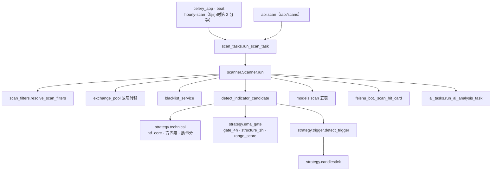
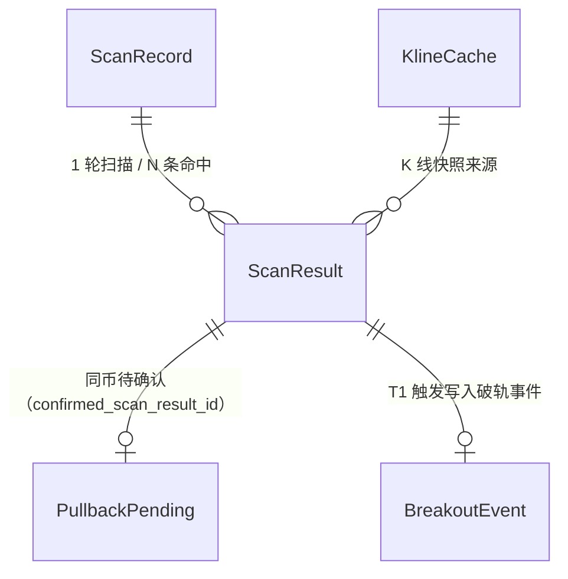
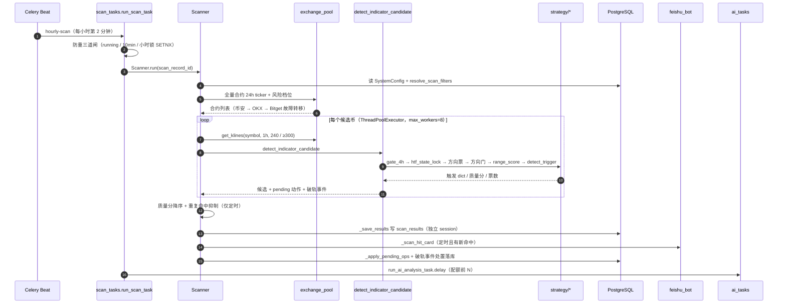
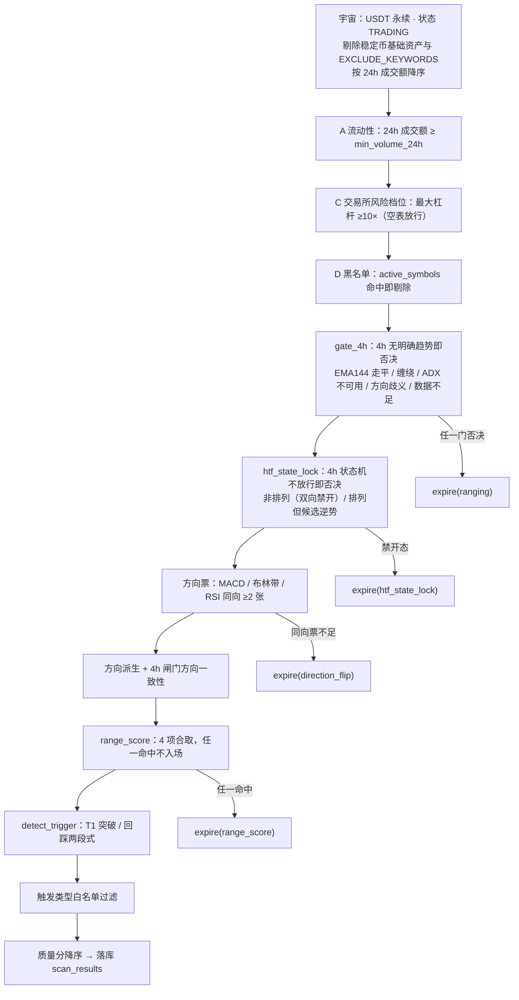
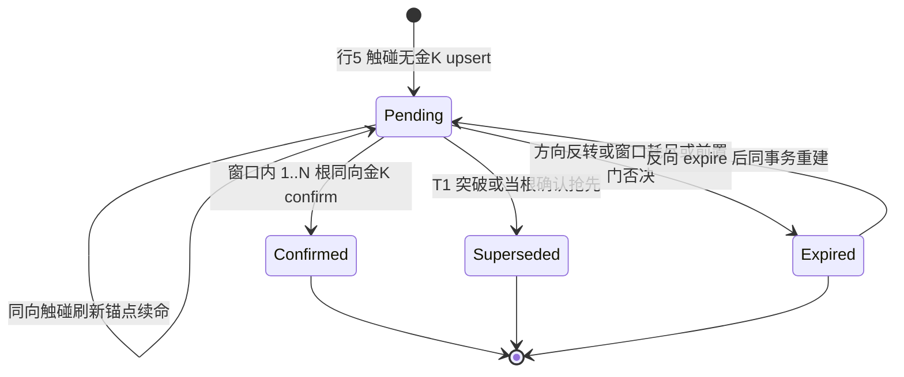

# 技术文档 01 — 币种筛选与扫描（对照 功能流程/01-币种筛选与扫描.md）

> 现行版本：RULE_VERSION v2026-10-18（2026-10-18）。本文从功能文档 01 提炼**技术实现细节**，以代码为准；功能口径与拍板记录见 [功能文档](../功能流程/01-币种筛选与扫描.md)。

## 1. 模块与分层

扫描链按「调度 → 任务防重 → 编排（宇宙/多层过滤）→ 单币判定 → 收尾落库/通知/AI」分层，策略层为纯函数、无 DB 依赖，落库统一由编排层在独立 session 完成。

| 层 | 文件 | 职责 |
|---|---|---|
| 调度 | `backend/app/celery_app.py` | beat `hourly-scan`（`crontab(minute=2)`，celery_app.py:50-58）；worker fork 后重启日志线程 + `engine.dispose`（celery_app.py:11-25） |
| 任务 | `backend/app/tasks/scan_tasks.py` | `run_scan_task`（scan_tasks.py:15-120）：入口、防重三道闸（46-93）、任务记录 open/close_task |
| 编排 | `backend/app/services/scanner.py` | `Scanner.run`（scanner.py:550 起，宇宙/多层过滤 597-688）、`detect_indicator_candidate`（210-508）、`_votes_snapshot`（511-540）、`_save_results`（913-985）、`_slots_full`（1017-1058）、`_suppress_repeat_hits`（1061-1091）、`_prefetch_pendings`（1096-1130）、`_prefetch_retest_events`（1144）、`_apply_breakout_events`（1176-1232）、`_sweep_orphan_pendings`（1233）、`_apply_pending_ops`（1265-1332）、`_scan_hit_card`（69-116）、`classify_volume`（144） |
| 参数 | `backend/app/services/scan_filters.py` | `ScanFilters` 冻结 dataclass（85-114）、`resolve_scan_filters`（117）、`SCAN_FILTER_KEYS`（60-79）、白名单解析（140-161） |
| 数据源 | `backend/app/services/exchange_pool.py` | 多交易所合约列表/K 线（币安→OKX→Bitget 故障转移）+ 小时级缓存；`allow_stale` 降级（357-409、418-465） |
| 过滤 | `backend/app/services/blacklist_service.py` | `active_symbols`、`register_settle` 自动拉黑（23-32） |
| 策略 | `backend/app/services/strategy/technical.py` | `htf_core`（736）、`analyze_htf_background`（778）、`compute_indicator_votes`（1112）、`compute_quality_score`（1252）、`golden_zone_swing_count`（1219） |
| 策略 | `backend/app/services/strategy/ema_gate.py` | `gate_4h`（75-131）、`structure_1h`（132-221）、`range_score`（222-326） |
| 策略 | `backend/app/services/strategy/trigger.py` | `detect_trigger`（571-888） |
| 数据模型 | `backend/app/models/scan.py` | `scan_records` / `scan_results` / `pullback_pendings` / `breakout_events` / `kline_caches` |
| API | `backend/app/api/scan.py` | 手动触发、结果查询、配置读写、黑名单、pending 池（prefix `/api/scans`） |
| 下游 | `backend/app/tasks/ai_tasks.py` | `run_ai_analysis_task`（ai_tasks.py:156 配额取质量分前 N） |

## 2. 数据结构

### 2.1 筛选参数 `ScanFilters`（冻结 dataclass，scan_filters.py:85-114）

| 字段 | 类型 | 默认 | 语义 |
|---|---|---|---|
| `min_volume_24h` | float | `MIN_VOLUME_24H`=3,000,000（config.py:358） | ① 宇宙层 24h 成交额门槛 |
| `new_coin_cooldown_days` | int | 14（config.py:359） | ① 新币冷静期（天，上市未满 N 天不进扫描，0=关闭） |
| `breakout_channel_bars` | int | 20（config.py:47） | ③ Donchian 回看根数 |
| `breakout_threshold` | float | 0.002（config.py:43） | ③ 最小突破幅度 |
| `breakout_vol_ratio` | float | 1.2（config.py:48） | ③ 放量加分门槛 |
| `breakout_max_pct` | float | 1.5（config.py:49） | ③ 追高上限（0=关闭） |
| `candle_max_ema21_dist_pct` | float | 1.5（config.py:50） | ③ 悬空金K上限（纯金K下线后无消费方，键保留兼容） |
| `ai_max_per_scan` | int | 10（config.py:357） | ④ 单轮 AI 分析上限 |
| `allowed_triggers` | tuple | `ALL_TRIGGERS`（scan_filters.py:28） | ③ 触发类型白名单 |
| `pullback_touch_refs` | tuple | `DEFAULT_TOUCH_REFS`（scan_filters.py:55-57） | ③ 回踩触点白名单（retest/swing/ema21/ema21_4h/ema55/ema144） |
| `retest_window_bars` | int | 24（config.py:51） | ③ 突破回测有效窗口 |
| `pending_confirm_window_bars` | int | 4（config.py:56、scan_filters.py:99） | ③ 回踩待确认窗口（已收盘根数） |
| `structure_touch_band_pct` | float | 0.3（config.py:57） | ③ retest/swing 触碰带宽（%） |
| `ema_touch_min_bars` | int | 200（config.py:58） | ③ EMA 触碰数据门 |
| `swing_order` | int | 3（config.py:46，读 SystemConfig 顶层列） | 摆动点阶数 |
| `structure_1h_gate` | bool | True | 已退役字段（仅向后兼容解析） |
| `direction_vote_gate_enabled` | bool | True（config.py:66） | ② 方向票关开关 |
| `direction_conflict_gate_enabled` | bool | True（config.py:68） | ② 方向冲突关开关 |

### 2.2 表模型（backend/app/models/scan.py）

- **ScanRecord**（`scan_records`，scan.py:11）：`scan_type`（scheduled/manual）、`status`（running/completed/failed）、`coin_count`/`hit_count`/`error_count`、时间戳。
- **ScanResult**（`scan_results`，scan.py:31）：`signal_type`、`current_price`、`breakout_pct`、`pattern`、`signal_reason`(128)、`strength`=quality/100、`ema_state`、`position`（support/resistance）、`touch_ref`、`position_ref`、`volume_24h`/`volume`/`volume_type`、`quality_score`、`votes_json`（JSON）、`is_repeat` 遗留列。
- **PullbackPending**（`pullback_pendings`，scan.py:219）：`direction`（1/-1）、`stage1_candle_open`、`ema21`（历史命名的 Stage-1 位价）、`touch_ref`、`quality_score`/`votes_json`、`status`（pending/confirmed/expired/superseded）、`resolve_reason`、`confirm_pattern`、`confirmed_scan_result_id`、`resolved_at`。
- **BreakoutEvent**（`breakout_events`，scan.py:198）：`direction`、`level_price`、`candle_open`、`status`（active/consumed/expired）。
- **KlineCache**（`kline_caches`，scan.py:144）：`symbol`+`interval`+`kline_hour` 唯一，JSON K 线缓存。

`votes_json` 快照（`_votes_snapshot` scanner.py:511-540）结构：`bull`/`bear`/`net`/`voted` + `results`（各指标 dir）+ `htf` 背景 `state`/`dir`。

### 2.3 关键枚举

- 触发类型 `ALL_TRIGGERS`（scan_filters.py:28）：`trigger_breakout` / `trigger_trend_breakout` / `trigger_pullback_confirm`（历史行另有 `trigger_pullback`、`trigger_candlestick`、`uptrend_pullback` 等）。
- pending `resolve_reason`：`ranging` / `structure_1h` / `range_score` / `direction_flip` / `window_expired` / `htf_state_lock`（expired）；`breakout` / `same_candle_confirm`（superseded）。
- 黑名单来源：手动 `add_manual`（永久）/ `remove`；自动 `register_settle`（冷却 14 天 / 永久分档）。

## 3. 核心流程（时序/状态图）

### 3.1 主链路时序（定时扫描一轮）

### 3.2 筛选漏斗（逐层关卡）

### 3.3 待确认池 pending 状态机（scanner.py:1265-1332）

处置动作由扫描线程收集、`_apply_pending_ops` 统一落库（独立 session，失败整体回滚，下轮按快照重评估）。

## 4. 关键算法与常量

### 4.1 4h 趋势闸门 `gate_4h`（ema_gate.py:75-131）

三重条件**同时成立**才给方向，任一命中返回 `None`（一票否决）：

| 条件 | 常量 | 判据 |
|---|---|---|
| 斜率 | `SLOPE_BARS`=20、`SLOPE_FLAT_PCT`=0.005 | 20 根 EMA144 变化 / 价格 ≥0.5%，否则走平 |
| 缠绕 | `WRAP_WINDOW`=10、`WRAP_MAX`=2 | 近 10 根收盘穿越 EMA144 次数 ≤2，否则震荡 |
| 趋势强度 | `EmaGateConfig.adx_min`=20.0 | 4h ADX ≥20 |

方向 = 价格×EMA144 位置 + 斜率方向（`long`/`short`）；数据门：已收盘 4h 根 `<200` 一并否决。`gate_4h` 与 `analyze_htf_background` 共用 `technical.htf_core`（technical.py:736）一次算好的 EMA21/55/144+ADX+ATR。

### 4.2 1H 结构门 `structure_1h`（ema_gate.py:132-221）

三线排列（多头 EMA21>55>144，空头镜像）+ 快中线 ATR 归一发散史（`div_fast_mid`=0.5，近 12 根 max）+ EMA144 方向（做多走平或向上）；历史 `<200` 根不过门。2026-10-15 起仅作 ema21 触点软校验（不过门不否决、质量分 −15）。

### 4.3 震荡闸门 `range_score`（ema_gate.py:203-275，`RANGE_SCORE_REJECT`=1）

2026-10-20 重构：原 8 项评分卡「≥3」退役（方向感知 PNL 回放证明阈值 3 对净期望无区分力，放行池 −0.02R；且项 1 恒 0、项 6 方向相反）。现为 4 项合取判据，任一命中即不入场：

| 项 | 常量 | 判据 | PNL 依据 |
|---|---|---|---|
| 1h 三线交错 | — | EMA21/55/144 非同向排列 | Δ −0.14 |
| 55/144 分离过近 | `MS_DIV_MIN`=1.0、`RANGE_DIV_LOOKBACK`=12 | 近 12 根最大 \|EMA55−EMA144\|/ATR <1.0 | Δ −0.21 |
| ADX 过低 | `ADX_WARN_MIN`=18.0 | 1h ADX <18 | Δ −0.21（最强单项） |
| 波动过度扩张 | `EXP_PCTL`=0.80、`EXP_HISTORY`=100、`EXP_DONCH_N`/`EXP_BB_N`=20 | Donchian 或布林带宽分位 ≥0.80 | 最高分位档 netR −0.19/−0.16 |

回放读数（60 币 × 60 天，近锚止损 1.5R、含 0.14% 往返费）：放行池净期望 +0.10R、胜率 48.6%、Wilson LB 45.5%，且 train（+0.02R）/ test（+0.26R）双段为正；旧评分卡放行池为 −0.02R。代价是候选吞吐下降约 41%（1759→1040 笔）。

已退役：项 1（4H EMA144 走平，链路中恒 0）、项 3（21/55 距离，与其余项共线）、项 6（布林带收口，squeeze 是突破前奏、方向相反）、项 7/8（穿越次数/量能，滞后于 PNL 标签）。

### 4.4 方向票与质量分（technical.py）

- 方向票 `DIR_VOTE_SHORTS`=(`MACD`,`布林带`,`RSI`)（technical.py:942），门槛 `DIR_VOTE_MIN`=2（同向张数 ≥2）；`net` = 方向票净差（∈{±1,±2,±3}，符号=方向）。`STATE_BLOCK_BOTH`=(`tangle`,`turn_bull`,`turn_bear`)（technical.py:611）为 4h 状态机双向禁开，**现仅供 AI 层 `enforce_htf_constraint` 使用**；筛选链前置门已改用 `STATE_ALIGNED`=(`aligned_bull`,`aligned_bear`)（2026-10-20 收紧，仅排列放行）。
- 质量分基础分 **`50 + direction × net × 10`**（net∈{1,2,3} → 60/70/80，technical.py:1310），封顶 [0,100]：
  - 4h 状态分矩阵 `STATE_QUALITY`（technical.py:606-613）：同向 `aligned_*`+10 / `macro_cross_*`+12 / `*_recover`+8 / `bull_dip`·`bear_rally`+5；逆向 −12/−14/−10/−6；`turn_*` 同向 −8 / 逆向 −4；逆宏观额外 −4。
  - 突破且 ADX≥25 +5；放量（量比 ≥1.2）+5；决断K线影线梯度加分 +5/+3/+1；金K价格带结构点密度 +3×n 封顶 +12。
  - RSI 追高（>75 多 / <25 空）−8；OBV 背离 −6；`RISK_VOTE_PENALTY`（SuperTrend 逆向）−6；突破且布林带宽分位 ≤10 −5；`STRUCTURE_GATE_PENALTY`=−15（1H 结构门未过）。

### 4.5 触发/扫描阈值常量

| 常量 | 值 | 位置 | 语义 |
|---|---|---|---|
| `BREAKOUT_THRESHOLD` | 0.002 | config.py:43 | 最小突破幅度 |
| `BREAKOUT_MAX_PCT` | 1.5 | config.py:49 | 追高上限（0=关闭） |
| `BREAKOUT_CHANNEL_BARS` | 20 | config.py:47 | Donchian 回看根数 |
| `BREAKOUT_VOL_RATIO` | 1.2 | config.py:48 | 放量加分门槛 |
| `RETEST_WINDOW_BARS` | 24 | config.py:51 | 突破回测窗口 |
| `PENDING_CONFIRM_WINDOW_BARS` | 4 | config.py:56 | 待确认窗口（以代码为准） |
| `SCAN_INTERVAL_HOURS` | 1 | config.py:28 | 扫描节拍 |
| `REPEAT_WINDOW_HOURS` | 3 | config.py:45 | 重复命中抑制窗口 |
| `BINANCE_CONCURRENCY` | 8 | config.py:25 | 单轮并发币数 |
| `EXCLUDE_KEYWORDS` / `QUOTE_ASSET` | UP/DOWN/BEAR/BULL… / USDT | config.py:296-297 | 宇宙剔除关键词与计价资产 |

## 5. API 契约

prefix `/api/scans`（backend/app/api/scan.py）：

| 方法 | 路径 | 入参要点 | 出参要点 | 代码位置 |
|---|---|---|---|---|
| POST | `` | 无 | 触发结果；已有 running 记录 → 409 | api/scan.py:90-108 |
| GET | `` | 仅最近 24h | 扫描记录列表（排除 watchlist） | api/scan.py:109-140 |
| GET | `/latest/results` | 分页 + signal_type/position/pattern/ema_state 过滤 + 排序白名单 | 最近 completed 轮的结果 | api/scan.py:141-170 |
| GET | `/{scan_id}/results` | scan_id | 指定扫描结果 | api/scan.py:171-193 |
| GET | `/{scan_id}/funnel` | scan_id | 各关卡被拒计数 + symbol→关卡映射（`funnel_json`） | api/scan.py:194-207 |
| GET | `/status` | 无 | 扫描状态 + 配置摘要 + 在跑单数 | api/scan.py:208-312 |
| GET | `/config` | 无 | `scan_filters` 原值与 `scan_filters_effective` | api/scan.py:609-614 |
| PUT | `/config` | `scan_filters` 键级合并；null 恢复默认 | 校验 `_validate_scan_filters` + `_merge_scan_filters` | api/scan.py:616-934 |
| GET | `/pullback-pendings` | status 过滤 | 待确认池列表（updated_at 倒序） | api/scan.py:1419-1459 |
| GET | `/hit-history` | 分页 | 跨轮次命中历史（全 signal_type） | api/scan.py:1514-1620 |
| GET | `/blacklist` | 无 | 黑名单（含 active/expired 判定） | api/scan.py:1621-1641 |
| POST | `/blacklist` | symbol | 手动添加（补 USDT 后缀/大写/永久） | api/scan.py:1642-1654 |
| DELETE | `/blacklist/{symbol}` | symbol | 手动移除 | api/scan.py:1655-1667 |
| GET | `/klines/{symbol}` | 1h/4h、force_refresh、摆动点标注 | K 线图（allow_stale 降级） | api/scan.py:1685-1744 |
| POST | `/analyze` | symbol 等 | 手动 AI 分析（不受自动开关限制，symbol=manual_search） | api/scan.py:1745-1851 |

## 6. 配置项

### 6.1 `config.py` settings（代码默认）

| 设置 | 默认 | 说明 |
|---|---|---|
| `KLINE_INTERVAL` / `KLINE_WINDOW` | "1h" / 240 | 主周期与窗口（实际拉取 ≥300 暖机 EMA144） |
| `RULE_VERSION` | `v2026-10-18`（config.py:293） | 规则版本，落库快照 |
| `BINANCE_CONCURRENCY` | 8 | 扫描线程池并发 |
| `AI_MAX_PER_SCAN` | 10 | 单轮 AI 上限 |
| `MIN_VOLUME_24H` | 3,000,000 | 流动性门槛 |
| `NEW_COIN_COOLDOWN_DAYS` | 14 | 新币冷静期（0=关闭） |
| `DIRECTION_VOTE_GATE_ENABLED` | True | 方向票关 |
| `DIRECTION_CONFLICT_GATE_ENABLED` | True | 方向冲突关 |

### 6.2 `system_config.scan_filters` 运行时配置（优先级 DB JSONB > env > 代码默认）

`SCAN_FILTER_KEYS`（scan_filters.py:60-79）共 17 键：`min_volume_24h`、`new_coin_cooldown_days`、`breakout_channel_bars`、`breakout_threshold`、`breakout_vol_ratio`、`breakout_max_pct`、`candle_max_ema21_dist_pct`、`ai_max_per_scan`、`allowed_triggers`、`pullback_touch_refs`、`retest_window_bars`、`pending_confirm_window_bars`、`structure_touch_band_pct`、`ema_touch_min_bars`、`structure_1h_gate`（退役兼容）、`direction_vote_gate_enabled`、`direction_conflict_gate_enabled`。

范围校验 `_SCAN_FILTER_RANGES`（api/scan.py:524-538）+ `_validate_scan_filters`（api/scan.py:550-595）：未知键拒绝、越界 400、数值化清洗；布尔开关键 `_BOOL_FILTER_KEYS` 走 `isinstance(bool)`；合法缺省键不补齐，`PUT /config` 走 `_merge_scan_filters`（api/scan.py:598）键级合并；显式 null 清除定制。`swing_order` 不在本键集，是 SystemConfig 顶层列单独注入。

## 7. 并发、幂等与异常处理

- **并发**：单轮币池用 `ThreadPoolExecutor(max_workers=BINANCE_CONCURRENCY=8)`（scanner.py:779）；扫描线程只读快照并收集动作，所有落库由主流程在独立 session 执行（与只读线程隔离）。
- **幂等/防重**：定时任务三道闸（scan_tasks.py:46-93）——① 已有 running 记录 → 本轮标 failed 跳过；② 10 分钟内已有 scheduled completed → 跳过；③ UTC 小时锁 Redis `SETNX scan:hourly:{YYYYMMDDHH}`（TTL 2h）防 beat 双发 / 消息重投。重复命中抑制同 `(symbol, signal_type)` 在 `repeat_window_hours` 内不落库（`_suppress_repeat_hits` scanner.py:1061-1091，仅定时）。
- **信号判定幂等**：全部基于已收盘 K 线（`klines[-2]`），同根 K 线同结果，免疫扫描时刻漂移与轮次缺失；pending 有效期按 `stage1_candle_open` 落在信号 K 线前 1..N 根已收盘 K 线内逐根比对。
- **异常兜底**：4h 拉取失败 / 闸门计算异常降级放行（`None`=主动否决、异常=数据问题，二者区分）；风险档位空表放行；`resolve_scan_filters` 逐键容错（类型错误/负数/inf/nan 按缺失回落）；白名单全不勾/全非法回落全量（触发类型）或默认（触点）；`_apply_pending_ops` 失败整体回滚，下轮按快照重评估；飞书卡片失败只记日志不影响扫描与 AI 链路。
- **Celery 可靠性**：`task_acks_late=True` + `worker_prefetch_multiplier=1`；worker fork 后重启日志线程并 `engine.dispose()`（celery_app.py:11-25）。

## 8. 测试覆盖

backend/tests/ 下相关测试：

| 文件 | 覆盖点 |
|---|---|
| `test_scan_filters.py` | `resolve_scan_filters` 优先级（DB>env>默认）、逐键容错、`detect_trigger` 参数透传、悬空金K不触发、`_validate_scan_filters`、触发/触点白名单解析与校验、白名单外触发丢弃且 pending 处置透传 |
| `test_scan_hit_card.py` | 卡片标题计数、命中行渲染、未知信号/形态兜底、超 8 条截断 + note 脚注 |
| `test_trigger_two_stage.py` | `detect_trigger` 7 行决策矩阵 + 前置过期 + pending 有效期锚点边界（CI 一票否决） |
| `test_touch_refs.py` | retest/swing/ema55 触点探测、优先级标注、白名单与配置接线、BREAKOUT 携带 breakout_level/candle_open |
| `test_htf_ranging_filter.py` | gate_4h 一票否决、闸门先于票数、方向失守、structure_1h/range_score 硬门、评分卡震荡/趋势分、4h 拉取失败降级放行 |
| `test_pending_ops_db.py` | `_save_results` 返回值 + pending confirm 落库（`confirmed_scan_result_id` 关联回写） |
| `test_quality_score.py` | 质量分修饰项（4h 同向/反向、ADX、放量、RSI 极端、OBV 背离） |
| `test_golden_candle.py` | 金K形态识别与复合确认证据（`resolve_golden_evidence`） |
| `test_scan_funnel.py` | 漏斗关卡计数与 `funnel_json` |
| `test_blacklist_settle.py` | `register_settle` 自动拉黑分档与冷却 |
| `test_slots_full_by_net.py` | 满仓跳过 AI 判定（`_slots_full`） |
| `test_scan_hit_card.py` / `test_hit_history.py` / `test_kline_chart.py` | 通知卡片 / 命中历史 / K 线图接口 |
