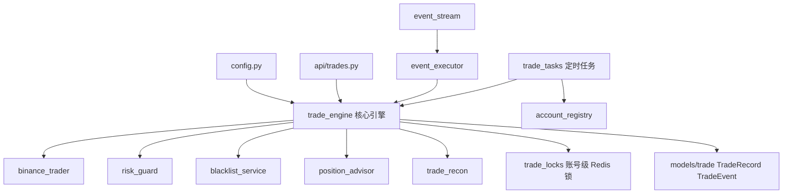
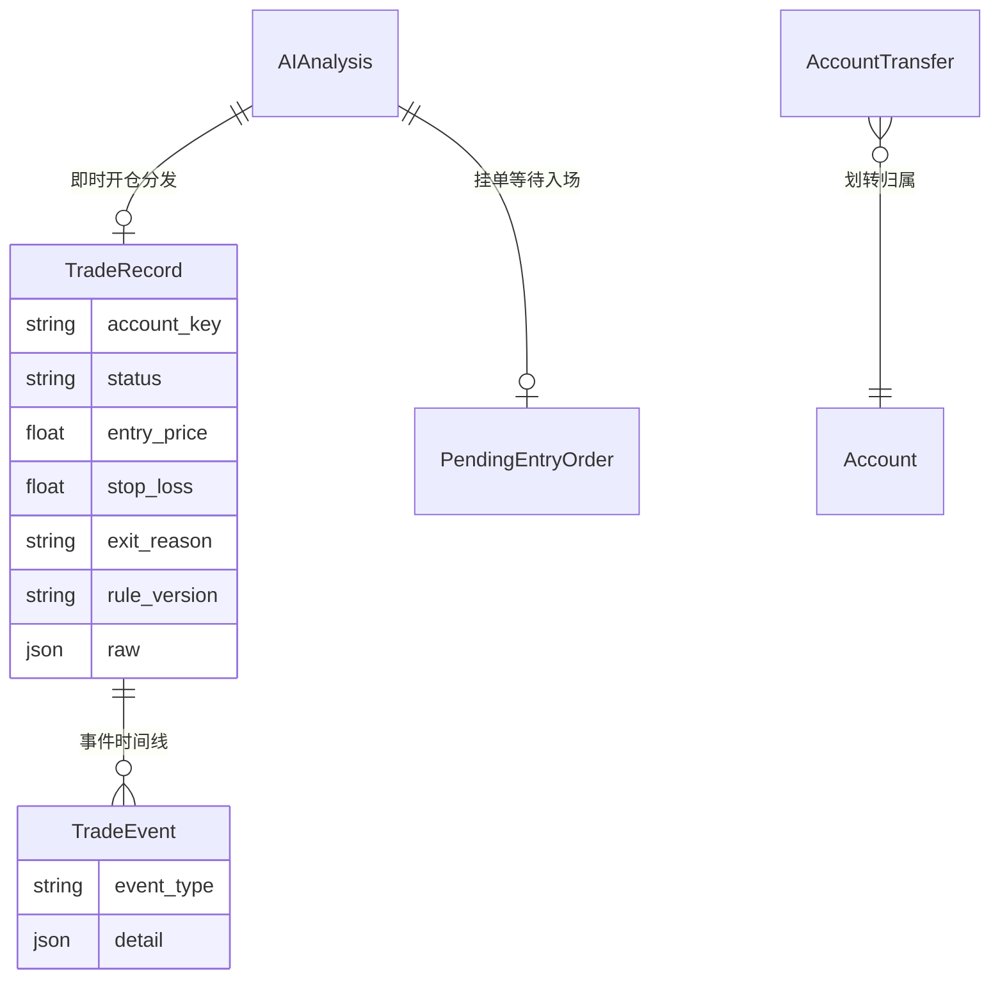
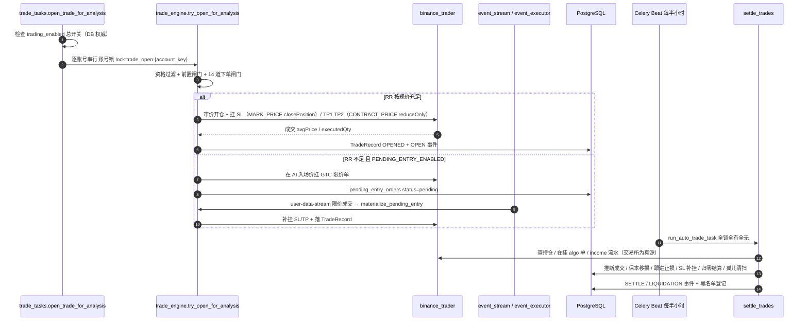
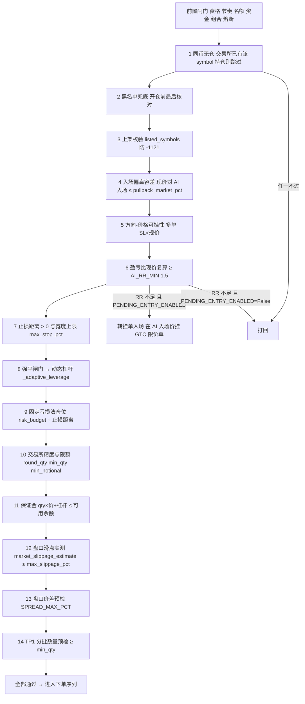
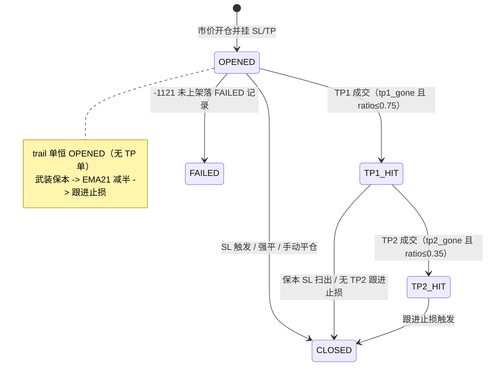

# 技术文档 04 — 交易执行与多账号（对照 项目功能流程文档/04-交易执行与多账号.md）

> 现行版本：RULE_VERSION v2026-10-18（2026-10-18）。本文从功能文档 04 提炼**技术实现细节**，以代码为准；功能口径与拍板记录见 [功能文档](../项目功能流程文档/04-交易执行与多账号.md)。

## 1. 模块与分层

执行链路为「即时开仓（分析落库即分发，唯一通道）→ 下单闸门序列 → 挂 SL/TP → 半小时结算巡检」，全链路以交易所为真源、多账号按 `account_key` 隔离。

| 模块 | 文件 | 职责 |
|---|---|---|
| 核心引擎 | `backend/app/services/trade_engine.py` | `try_open_for_analysis` / `_attempt_open` 闸门与下单序列、`settle_trades` 巡检、`_trailing_stop` / `_move_sl_breakeven` / `_ema21_half_cut` / `_rehang_lost_sl`、`adopt_position` / `auto_adopt_positions`、`_daily_closed_pnl` / `_daily_loss_cap`、`sync_account_transfers`、`materialize_pending_entry` |
| 币安封装 | `backend/app/services/binance_trader.py` | 多账号构造、交易规则/精度、杠杆分档（MMR）、市价 / algo 条件单、income 流水、`market_slippage_estimate`、`fill_tranche_pnls` |
| 账号注册表 | `backend/app/services/account_registry.py` | .env 配置驱动、账号解析回落链、`enabled_accounts` 扇出依据、`spot_enabled_accounts` |
| 逐笔对账 | `backend/app/services/trade_recon.py` | `reconcile_trade` 计划 vs 实际，泄漏五项分解 |
| 持仓建议 | `backend/app/services/position_advisor.py` | `advice_due` 触发判定、`build_facts`、`diagnose_trade`、飞书推送 |
| 风控 | `backend/app/services/risk_guard.py` | 强平闸门公式、滑点/价差等风控常量 |
| 黑名单 | `backend/app/services/blacklist_service.py` | 开仓前兜底核对 + 结算后自动登记 |
| 定时任务 | `backend/app/tasks/trade_tasks.py` | `open_trade_for_analysis` 扇出、`watch_pending_entries` 挂单兜底巡检、结算巡检、账号锁 |
| 事件驱动 | `backend/app/services/event_stream.py` / `event_executor.py` | 每账号 user-data-stream + mark price 市场流；限价成交 `materialize_pending_entry` 秒级落地 |
| API / 模型 | `backend/app/api/trades.py` / `backend/app/models/trade.py` / `backend/app/config.py` | 交易记录 API、`TradeRecord` / `TradeEvent` / `AccountTransfer`、交易 settings |

模块依赖与调用关系：

## 2. 数据结构

### 2.1 数据模型（`backend/app/models/trade.py`）

- **TradeRecord**（trade_records）：溯源（`scan_result_id` / `ai_analysis_id`）、归属（`account_key` / `testnet`）、`ai_snapshot`（开单时 AI 结论快照，自持不断链）、开仓组（entry_price / qty / notional / leverage / margin_used / risk_amount / `risk_budget_mode` 快照）、三价现值（stop_loss 随跟进更新）、状态组（OPENED / TP1_HIT / TP2_HIT / CLOSED / FAILED + realized_pnl / unrealized_pnl / pnl_pct / exit_reason / fee_total / funding_total）、AI 归因组（error_tags / error_lesson）、AI 建议组（ai_advice / ai_advice_at / ai_advice_pnl / peak_total_pnl）、`hold_warn_level`、`rule_version`（开单时快照，NULL=legacy）、`raw`（订单号 / 分批数量 / 书签 / 基数快照；FAILED 另存 fail_reason）。
- **TradeEvent**（trade_events）：操作历史，`event_type` + detail JSON。
- **AccountTransfer**（account_transfers）：划转流水（amount 正=转入 / 负=转出），`tran_id` 唯一幂等，`account_key` 归属。
- **pending_entry_orders**（挂单入场，独立表）：`status` / `limit_order_id` / `symbol` / `ai_analysis_id` / `margin_used` / `account_key` / `testnet`。

### 2.2 `TradeEvent.event_type` 枚举

`OPEN` / `TP1_FILL` / `TP2_FILL` / `SL_MOVE` / `SL_FILL` / `CANCEL` / `ERROR` / `SETTLE` / `SKIP` / `LIQUIDATION` / `MANUAL_CLOSE` / `AI_ADVICE`（另有 `CUT_EMA21`，EMA21 减半仓事件）。

### 2.3 `ai_snapshot` 关键字段

`id` / `symbol` / `trade_decision` / `direction` / `trade_type` / `analysis` / 三价 / `risk_reward_ratio` / `recommendation` / `stop_anchor` / `tactic_name` / `tactic_reason` / `htf_phase`（4h 状态）/ `volume_ratio`。

## 3. 核心流程

### 3.1 即时开仓 + 结算巡检主链路

### 3.2 14 道下单闸门序列（`_attempt_open`）

进入序列前先过前置闸门（资格 / 连损降速 / 名额 / 资金 / 组合热度 / 当日亏损熔断），任一不过即落 `ai_analyses.open_block_reason`。进入序列时会先清掉沿用/上一轮残留的拒开原因。

> 闸门 6（RR 现价复算）是唯一可转「挂单入场」的分支：`PENDING_ENTRY_ENABLED=True`（默认）且现价 RR < 铁律下限 − 容差时挂 GTC 限价单等待回踩；其余闸门不通过即直接放弃并落原因。

### 3.3 结算巡检状态机

### 3.4 `settle_trades` 逐单分流

| 现状态 | 巡检判定 | 动作 |
|---|---|---|
| 任意在跑 | 仓位归零（qty≤0 或 amt < qty×5%） | 撤残留挂单 → income 结算 → CLOSED + SETTLE/LIQUIDATION → 黑名单登记 |
| OPENED | tp1_gone 且 ratio≤0.75 | TP1_FILL → TP1_HIT → 保本移损；无 TP2 再启用跟进止损 |
| OPENED | tp2_gone 且 ratio≤0.35 | 同轮双档成交：`fill_tranche_pnls` 拆分双档盈亏 → 连写 TP1_FILL + TP2_FILL → TP2_HIT → 跟进止损 |
| TP1_HIT | tp2_gone 且 ratio≤0.35 | TP2_FILL → TP2_HIT → 跟进止损 |
| TP1_HIT | 其余 | 旧单 realized 回填 + 保本兜底（幂等）；无 TP2 跟进止损 |
| TP2_HIT | 每轮 | 跟进止损（只收紧不放松，TP1 价夹紧） |
| 任意在跑 | SL algoId 不在在挂集合 | SL 丢失补挂（`_rehang_lost_sl`）；单笔异常 rollback 跳过不阻断其余 |

## 4. 关键算法与常量

### 4.1 固定亏损法仓位

- `risk_budget = 风险基数 × TRADING_RISK_PCT(3%)`；pct 模式风险基数 `_capital_base(wallet)` 按钱包余额首位数取整（下限 100、上限 5000，4800→4000、980→900、5200→5000）；fixed 模式取 `risk_fixed_amount` 固定 USDT。
- `notional = risk_budget ÷ 止损距离`。
- 近锚单（`stop_anchor=near`）预算 ×`NEAR_ANCHOR_RISK_FACTOR`(0.7) 折价（`_near_discounted_budget`）。

### 4.2 强平闸门与动态杠杆

- 闸门口径：`liquidation_gate_pct = 1/杠杆 − MMR − 缓冲`（缓冲 `liq_gate_buffer` 补丁可覆盖）。
- `_adaptive_leverage`：从 `TRADING_LEVERAGE`(20) 向下搜索首个「强平距离 > 止损距离」的杠杆，低于下限 `TRADING_LEVERAGE_MIN`(8，`min_adapt_leverage` 可页面覆盖) 才放弃；名义确定后按精确档复验（杠杆超档位 `initialLeverage` 封顶、名义超最大档 `notionalCap` 放弃）。

### 4.3 止损演进

- **保本止损**（`_move_sl_breakeven`）：SL 移到「成本价 ± 往返费用缓冲」，buffer = `entry × 2 × TAKER_FEE_RATE(0.0005)`（`_breakeven_stop_price`）；幂等，新 SL 挂上即触发时跳过本轮保留原 SL。
- **跟进止损**（`_trailing_stop`，只收紧不放松）：多单 = `max(当前SL, 最近 3 根已收盘 K 线最低价)`，空单反之；TP2_HIT 状态额外以 TP1 价夹紧；新 SL 会立即触发时跳过本轮。
- **SL 移动**（`_replace_sl`）：撤旧挂新写 `SL_MOVE`；-4130 兜底清残留再挂；`rec.raw` 必须赋新 dict（SQLAlchemy 变更判定）。
- **纯跟踪巡检**（`_trail_mode_patrol`）：武装线 = `peak_total_pnl ≥ 1×entry_atr(22,1d)×qty`（缺失退化 1R=`risk_amount`）；EMA21 减半仓（`_ema21_half_cut`，最近 1h 已收盘 K 线剔尾，多单收盘 < EMA21 1h / 空单收盘 > → 市价 reduceOnly 减半，旗标一次性）。

### 4.4 分批止盈与出场原因

| AI 是否给 TP2 | TP1 档 | TP2 档 | 剩余仓退出 |
|---|---|---|---|
| 有 TP2（>0） | 50% | 25% | TP2 成交后跟进止损 |
| 无 TP2（AI 未报 / 无结构位回退清零） | 一次止盈 75% | — | TP1 成交起即启用跟进止损 |

`tp_mode=trail` 不适用本表：不挂任何 TP 档，出场全靠巡检。

出场原因（`_derive_exit_reason` / `_zero_pos_exit_reason`）：ladder 单 `sl` / `tp1_then_sl` / `breakeven_sl` / `tp1_trail` / `trail_sl` / `liquidation`（INSURANCE_CLEAR≠0）/ `manual`；trail 单三态 `sl` / `breakeven_sl` / `trail_sl`。

### 4.5 当日亏损熔断

- **双条件**：`DAILY_LOSS_STOP_ENABLED`(默认 True) 且 `DAILY_LOSS_STOP_PCT > 0`(默认 9.0)。
- **阈值**：`当日亏损熔断线 = _capital_base × 9%`（1000 账户 90、5000 账户 450）。
- **口径**：本账号（`account_key`，NULL 旧行按 testnet 回落）UTC 当日已平仓（status=CLOSED 且 closed_at 在今日）`realized_pnl` 合计 ≤ −阈值 → 停开仓（`_daily_closed_pnl` / `_daily_loss_cap`）。

### 4.6 R 泄漏五项（`reconcile_trade`）

| 项 | 口径 |
|---|---|
| a) 入场滑点 | (实际成交 − 计划 entry) × 数量 × 方向符号 |
| b) 手续费 | `|fee_total|`（缺失时查 income 回补） |
| c) 资金费 | 交易所 funding 负=支付 → 正成本 |
| d) SL 穿价 | (触发价 − 成交价) × 数量（常缺 → gaps 提示） |
| e) TP1 滑点 | 分档盈亏反推实际成交均价 vs 计划 TP1 |

汇总：理论 R vs 实际 R → 总泄漏 = 理论 − 实际；unexplained 超 0.05R 在 `gaps` 提示。

### 4.7 阈值 / 常量表

| 常量 | 值 | 说明 |
|---|---|---|
| `TRADING_MIN_RECOMMENDATION` | 60 | 开单评分门槛 |
| `TRADING_RISK_PCT` | 3.0 | 止损金额占风险基数 % |
| `TRADING_LEVERAGE` / `TRADING_LEVERAGE_MIN` | 20 / 8 | 动态杠杆上/下限 |
| `AI_RR_MIN` | 1.5 | 盈亏比现价复算下限 |
| `TRADING_MIN_FREE_PCT` | 0.5 | 余额风控下限（可用余额 ≥ 钱包 × 50%） |
| `DAILY_LOSS_STOP_ENABLED` / `DAILY_LOSS_STOP_PCT` | True / 9.0 | 当日亏损熔断开关与阈值 |
| `CONSECUTIVE_LOSS_DERATE` | False | 连损降速软熔断（连损 ≥3 提至 85、2 提至 75） |
| `PORTFOLIO_HEAT_CAP` / `SAME_DIRECTION_CAP` | 0 / 0 | 组合热度 / 同向上限（默认关闭） |
| `SPREAD_MAX_PCT` | 0.003 | 盘口价差预检（0=关闭） |
| `TAKER_FEE_RATE` | 0.0005 | 保本止损往返费缓冲 |
| `NEAR_ANCHOR_RISK_FACTOR` | 0.7 | 近锚单风险折价 |
| `PENDING_ENTRY_ENABLED` / `PENDING_ENTRY_TTL_MINUTES` | True / 60 | 挂单入场开关与超时（分钟） |
| `BTC_CRASH_PAUSE_PCT` | 1.0 | BTC 急跌 AI 提示词警示阈值（不再拦截开单） |
| 距离比例判定 | ratio ≤0.75 / ≤0.35 | TP1 / TP2 成交推断比例 |

## 5. API 契约

`backend/app/api/trades.py`：

| 端点 | 说明 |
|---|---|
| `GET /api/trades` | 交易记录列表（status/scope 过滤，附 4h 方向与 TP 分批数量） |
| `GET /api/trades/account-summary` | 当前账号资金概览（北京自然日切） |
| `GET /api/trades/transfers`、`/transfer-stats` | 划转明细 / 统计 |
| `GET /api/trades/analytics` | 资金分析聚合 |
| `POST /api/trades/open-from-analysis` | 手动开单：当前账号、force_market、不受 trading_enabled 约束 |
| `POST /api/trades/{id}/close-market` | 手动市价平仓（与飞书按钮同源） |
| `POST /api/trades/adopt-now`、`/inspect-now` | 手动触发导入持仓 / 结算巡检 |
| `GET /api/trades/pending-entries` | 挂单入场清单 |
| `POST /api/trades/pending-entries/{pending_id}/cancel` | 手动撤销挂单（与兜底巡检同源） |
| `GET /api/trades/{id}/events`、`/{id}/klines` | 操作历史 / 复盘 K 线（初始三价取 OPEN 事件） |
| `GET /api/trades/{id}/reconciliation` | 逐笔 R 泄漏对账 |
| `POST /api/trades/{id}/advice` | 手动 AI 持仓诊断（异步） |
| `POST /api/trades/purge-testnet` | 一键清空测试网交易数据 |

## 6. 配置项

`backend/app/config.py`（运行时部分以 `system_config` 表为准）：

| 配置 | 默认 | 说明 |
|---|---|---|
| `RULE_VERSION` | v2026-10-18 | 开仓 / 分析落库快照，复盘按版本分组 |
| `TRADING_MIN_RECOMMENDATION` | 60 | 开单评分门槛 |
| `TRADING_RISK_PCT` | 3.0 | 止损金额占风险基数 % |
| `NEAR_ANCHOR_RISK_FACTOR` | 0.7 | 近锚单风险折价 |
| `AI_RR_MIN` | 1.5 | 盈亏比现价复算下限 |
| `TRADING_LEVERAGE` / `TRADING_LEVERAGE_MIN` | 20 / 8 | 动态杠杆上/下限 |
| `TRADING_MIN_FREE_PCT` | 0.5 | 余额风控下限 |
| `DAILY_LOSS_STOP_ENABLED` / `DAILY_LOSS_STOP_PCT` | True / 9.0 | 当日亏损熔断 |
| `CONSECUTIVE_LOSS_DERATE` | False | 连损降速软熔断 |
| `PORTFOLIO_HEAT_CAP` / `SAME_DIRECTION_CAP` | 0 / 0 | 组合热度 / 同向上限 |
| `SPREAD_MAX_PCT` | 0.003 | 盘口价差预检 |
| `TAKER_FEE_RATE` | 0.0005 | 保本止损往返费缓冲 |
| `PENDING_ENTRY_ENABLED` / `PENDING_ENTRY_TTL_MINUTES` | True / 60 | 挂单入场 |
| `EVENT_EXEC_ENABLED` | False | 事件驱动结算叠加层开关 |
| `BTC_CRASH_PAUSE_PCT` | 1.0 | BTC 急跌 AI 警示阈值 |
| `BINANCE_API_KEY/SECRET`、`BINANCE_TESTNET_*`、`BINANCE_LIVE_{N}_*` | — | 账号凭据（注册表扫 os.environ） |

页面补丁参数（`system_config` 列，NULL 回落 env）：`min_adapt_leverage`、`liq_gate_buffer`、`max_stop_pct`、`max_slippage_pct`、`pullback_market_pct`、`ai_rr_tol`、`leverage_max`、`risk_pct`、`near_anchor_factor`、`trading_min_free_pct`、`max_open_trades`、`current_account_key`、`live_trading_keys`、`tp2_enabled`、`tp_mode`。

## 7. 并发、幂等与异常处理

- **并发互斥**：开仓与结算共用 Redis 账号级锁 `lock:trade_open:{account_key}`（`trade_locks`），同一账号串行、不同账号互不阻塞；扇出逐账号串行、等锁 45s 超时放弃并落因；结算巡检取启用账号 ∪ 存量在跑单账号，**全锁全有全无**（任一账号拿锁失败整轮跳过）。
- **锁外执行**：飞书 HTTP 与 LLM 调用（持仓诊断）绝不在开仓锁内——持仓时长警告判定在锁内、卡片发送在锁外，AI 诊断派发在锁外。
- **幂等**：`trade_records` 复合唯一索引 `uq_trade_analysis_account`（ai_analysis_id + account_key + testnet，同一 AI 结论每账号最多开一次仓，DB 级防重）；`materialize_pending_entry` 与「每分钟 `watch_pending_entries` 巡检」双入口幂等；挂单哨兵同分析重复点击幂等返回 pending、一币一挂单；保本兜底幂等；`hold_warn_level` 只升级不重发；划转 `tran_id` 唯一约束 + on_conflict_do_nothing（测试网 tranId 恒 0 用时间+资产+金额组合键，附加账号加 key 前缀）。
- **失败兜底**：下单在保护块内，任何一步失败紧急撤单 + reduceOnly 平仓，不留裸仓；实际止损风险超预算 115% 告警不放弃；单账号失败不中断其余账号扇出；单笔结算异常 rollback 跳过不阻断其余；`-1121` 落 FAILED 记录（同 symbol 只落一次）；孤儿条件单 `_sweep_orphan_algo_orders` 只动本系统交易过的符号；测试网账号不自动导入手动持仓、不做孤儿清扫。
- **诊断竞态**：LLM 执行期间（最长 1~18 分钟）仓位已结算则竞态丢弃不落库。

## 8. 测试覆盖（`backend/tests/`）

| 测试文件 | 覆盖点 |
|---|---|
| `test_open_gates_v2.py` | 开仓闸门序列（上限 / 余额 / 黑名单 / 滑点 / 动态杠杆等） |
| `test_open_gates_rr.py` | RR 现价复算拦截 / 挂单入场分支（legacy 路径 `PENDING_ENTRY_ENABLED=False`） |
| `test_daily_loss_stop.py` | 当日亏损熔断双条件与阈值 |
| `test_near_stop_anchor.py` | 近锚折价与 risk_guard 校验 |
| `test_risk_budget.py` | 风险基数 / 固定亏损法仓位 |
| `test_open_from_analysis.py` | 手动开单 API（force_market 语义） |
| `test_trade_recon.py` | 对账泄漏分解与 gaps |
| `test_advice_triggers.py` | AI 持仓诊断触发（浮亏 / 回撤 / 滞留） |
| `test_hold_warnings.py` | 持仓时长 12h/24h 预警 |
| `test_pending_ops_db.py` | DB pending 操作（现货侧，非合约 PENDING 单） |
