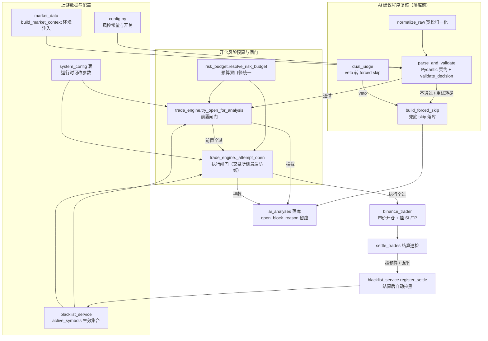
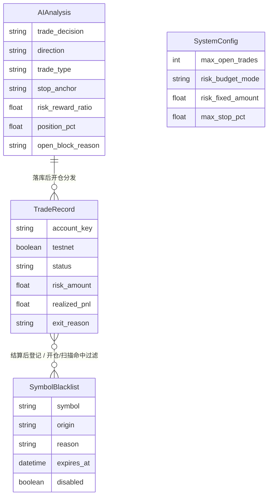
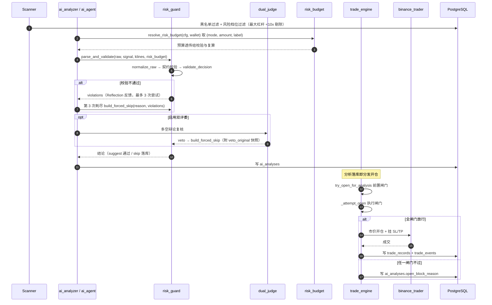
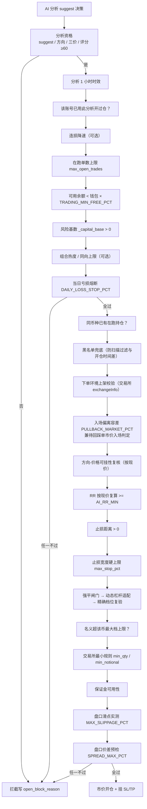
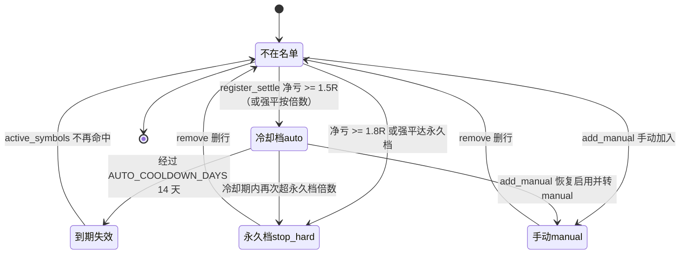

# 技术文档 05 — 风控体系（对照 项目功能流程文档/05-风控体系.md）

> 现行版本：RULE_VERSION v2026-10-18（2026-10-18）。本文从功能文档 05 提炼**技术实现细节**，以代码为准；功能口径与拍板记录见 [功能文档](../项目功能流程文档/05-风控体系.md)。

## 1. 模块与分层

风控分三层（AI 建议程序复核 → 组合/开仓风险预算 → 账户级熔断）加两条横切防线（系统性风险提示、币种黑名单）。模块职责：

| 模块 | 职责 | 关键符号 |
|---|---|---|
| `backend/app/services/risk_guard.py` | AI 决策确定性校验器；提供强平闸门口径与偏离/滑点常量供开仓闸门共用 | `TradeDecision` / `normalize_raw` / `validate_decision` / `parse_and_validate` / `build_forced_skip` / `liquidation_gate_pct` / `is_pullback_wait` / `_tactic_gate` |
| `backend/app/services/risk_budget.py` | 单笔固定亏损预算统一解析（pct / fixed 双口径），提示词/校验/开仓三处同源 | `resolve_risk_budget(cfg, wallet)` → `(mode, amount, label)` |
| `backend/app/services/trade_engine.py` | 开仓闸门序列；当日亏损熔断；连损计数；结算后黑名单登记 | `try_open_for_analysis` / `_attempt_open` / `_capital_base` / `_near_discounted_budget` / `_adaptive_leverage` / `_daily_closed_pnl` / `_daily_loss_cap` / `_consecutive_losses_today` / `_adopt_acc_cond` / `breaker_status_by_net` |
| `backend/app/services/market_data.py` | 环境注入（资金费率 + BTC 状态 + 急跌警示） | `build_market_context` / `_btc_market_line` |
| `backend/app/services/blacklist_service.py` | 黑名单集合维护与结算后自动登记 | `active_symbols` / `register_settle` / `add_manual` / `remove` |
| `backend/app/services/dual_judge.py` | 双评委辩论复核，veto 转 forced skip | — |
| `backend/app/config.py` | 风控常量与开关 | `AI_RR_MIN` / `DAILY_LOSS_STOP_*` / `PORTFOLIO_HEAT_CAP` 等 |
| `backend/app/models/system_config.py` | 运行时可改参数 | `max_open_trades` / `risk_budget_mode` / `max_stop_pct` 等补丁参数 |

## 2. 数据结构

**决策契约 `TradeDecision`**（Pydantic，`risk_guard.py`）关键字段：

| 字段 | 类型 / 取值 | 说明 |
|---|---|---|
| `trade_decision` | `suggest` / `skip` | 非法值直接抛错 |
| `direction` | `long` / `short` / `None` | 空串归一化为 `None` |
| `trade_type` | `trend_follow` / `structure_break` / `range_edge` | `TRADE_TYPES` 三选一 |
| `stop_anchor` | `structure` / `near` | 非法值回退 `None`，落库再回退 `structure` |
| `entry` / `stop_loss` / `tp1` / `tp2` | float 价格 | `normalize_raw` 把字符串数字转 float，转不动置 0 |
| `risk_reward_ratio` | float | AI 声称值不信，落库用程序复算值 |
| `position_pct` | float / `None` | fixed 口径下置 `None` |
| `recommendation` | 0~100 | 落库 clamp 到 [50, 100] |
| `analysis` | 文本 | 保留 AI 原文 |

**黑名单模型 `SymbolBlacklist`**（`backend/app/models/blacklist.py`，表 `symbol_blacklist`）：`symbol`（唯一）、`origin`（`manual` 永久 / `auto` 冷却档 / `stop_hard` 永久档）、`reason`、`expires_at`、`disabled`、`created_at`。

## 3. 核心流程

### 3.1 一笔交易的风控主链路（扫描 → 分析 → 开仓）

### 3.2 开仓闸门序列（前置 → 执行，顺序即代码顺序）

注：`force_market=True`（2026-09-28 手动开单）跳过 E4 入场偏离/待回踩时机闸门，其余闸门保留。

### 3.3 黑名单状态（结算后自动登记 → 到期 / 升级）

## 4. 关键算法与常量

**核心公式**：

| 项 | 公式 | 出处 |
|---|---|---|
| RR 复算 | `rr = |TP1 − entry| / |entry − SL|`（abs 对方向盲，故方向-价格一致性须独立硬校验） | `validate_decision` |
| 仓位复算（pct 口径） | `position_pct = RISK_BUDGET_PCT / stop_pct`（不设 clamp） | `validate_decision` |
| 固定亏损名义 | `notional = risk_budget / stop_pct`（stop_pct 按开仓时现价） | `_attempt_open` |
| 近锚折价 | `_near_discounted_budget × NEAR_ANCHOR_RISK_FACTOR(0.7)`（仅 near 声明且通过一致性校验生效） | `_near_discounted_budget` |
| 风险基数 | 钱包余额首位数取整，区间 [100, 5000]；钱包 ≤ 0 → 0 | `_capital_base` |
| 强平安全止损距离 | `liquidation_gate_pct = 1/杠杆 − MMR − 缓冲` | `liquidation_gate_pct` |
| 当日熔断阈值 | `风险基数 × DAILY_LOSS_STOP_PCT` | `_daily_loss_cap` |
| 黑名单自动倍数 | `净亏 >= 计划风险 × 1.5`（冷却档）/ `× 1.8`（永久档） | `register_settle` |

**大体量常量表（`backend/app/config.py`，功能文档 §7.1）**：

| 常量 | 默认值 | 说明 |
|---|---|---|
| `AI_RR_MIN` | 1.5 | 盈亏比复算下限（铁律） |
| `RISK_BUDGET_PCT` | 3.0 | 单笔固定亏损预算（% 账户资金，pct 口径） |
| `TRADING_RISK_PCT` | 3.0 | 止损金额占风险基数比例（开仓引擎 pct 口径） |
| `NEAR_ANCHOR_RISK_FACTOR` | 0.7 | 近锚单风险折价系数 |
| `DAILY_LOSS_STOP_PCT` / `DAILY_LOSS_STOP_ENABLED` | 9.0 / True | 当日亏损熔断阈值 / 总开关 |
| `CONSECUTIVE_LOSS_DERATE` | False | 连损降速软熔断（默认关闭） |
| `PORTFOLIO_HEAT_CAP` / `SAME_DIRECTION_CAP` | 0.0 / 0 | 组合热度 / 同向上限（0=关闭） |
| `BTC_CRASH_PAUSE_PCT` | 1.0 | BTC 1h 近 3 根累计急跌阈值（仅 AI 提示词警示，不再拦截） |
| `MARKET_CONTEXT_ENABLED` | True | 环境注入总开关 |
| `SPREAD_MAX_PCT` | 0.003 | 盘口价差预检上限（0=关闭） |
| `TRADING_MIN_RECOMMENDATION` | 60.0 | 开单推荐度门槛 |
| `TRADING_MIN_FREE_PCT` | 0.5 | 可用余额/总资金下限 |
| `TRADING_LEVERAGE` / `TRADING_LEVERAGE_MIN` | 20 / 8 | 杠杆上限 / 动态杠杆下限 |
| `TAKER_FEE_RATE` | 0.0005 | 往返费用缓冲 |
| `RULE_VERSION` | v2026-10-18 | 规则版本标记（开仓/分析落库快照） |

**risk_guard / blacklist 模块常量（功能文档 §7.2）**：

| 常量 | 默认值 | 说明 |
|---|---|---|
| `LIQ_GATE_MMR` / `LIQ_GATE_MMR_FALLBACK` | 0.005 / 0.025 | 强平闸门 MMR（默认口径 / 保守兜底） |
| `LIQ_GATE_BUFFER` | 0.005 | 强平闸门缓冲 |
| `PULLBACK_MARKET_PCT` | 0.01 | 入场偏离容差（一兼两职） |
| `MAX_SLIPPAGE_PCT` | 0.003 | 盘口滑点实测上限 |
| `NEAR_ANCHOR_BUFFER` / `NEAR_ANCHOR_TOLERANCE` | 0.003 / 0.005 | 近锚缓冲 / 止损对锚价最大相对偏离 |
| `AUTO_RISK_OVERSHOOT` / `AUTO_COOLDOWN_DAYS` / `PERMANENT_R_OVERSHOOT` | 1.5 / 14 / 1.8 | 自动拉黑倍数（冷却档）/ 冷却天数 / 永久档倍数 |
| `AI_RR_TOL` | 0.02 | RR 复算容差 |
| `BREAKOUT_SIGNAL_TYPES` | 突破类信号集合 | 与止损宽度下限豁免相关 |

## 5. API 契约

| 方法 | 路径 | 说明 |
|---|---|---|
| GET | `/api/scans/blacklist` | 黑名单列表（含 `origin` 分档、`expires_at`、`expired`/`active`/`disabled` 状态） |
| POST | `/api/scans/blacklist` | 手动加入（永久，`body: {symbol, reason?}`，校验 USDT 合约币种） |
| DELETE | `/api/scans/blacklist/{symbol}` | 手动移除（删行，404=不在名单） |
| GET | `/api/scans/config` | 系统配置读取，响应内含 `loss_breaker = breaker_status_by_net(db, cfg)` 熔断状态 |
| POST | `/api/scans/config/monthly-breaker-ack` | 月熔断人工复盘确认 |
| POST | `/api/scans/config/weekly-breaker-ack` | 周熔断人工复盘确认 |

> 开仓拦截原因 `ai_analyses.open_block_reason` 不单独出端点，随 `/api/scans/{id}/ai-analyses` 分析卡返回。（`blacklist_service` 的 `active_symbols` 三个消费点：扫描宇宙过滤、`_attempt_open` 兜底、API 展示。）

## 6. 配置项

**`config.py`（进程启动常量）**：见 §4 常量表。

**`system_config` 表（页面运行时可改，风控相关；NULL=回落代码默认）**：

| 列 | 默认 | 说明 |
|---|---|---|
| `max_open_trades` | 5 | 在跑单数上限（0=不限） |
| `trading_min_free_pct` | 0.5 | 可用余额/总资金下限 |
| `risk_budget_mode` / `risk_fixed_amount` | pct / 3 | 预算双口径 |
| `max_stop_pct` | NULL | 止损宽度硬上限（NULL=不限制） |
| `liq_gate_buffer` | NULL | 强平闸门缓冲覆盖 |
| `min_adapt_leverage` | NULL | 动态杠杆下限覆盖 |
| `pullback_market_pct` | NULL | 入场偏离容差覆盖 |
| `max_slippage_pct` | NULL | 滑点实测上限覆盖 |

## 7. 并发、幂等与异常处理

- **账号级互斥锁**：`trade_engine` 的开仓与结算共用账号维度 Redis 锁 `lock:trade_open:{account_key|default}`（`trade_locks.py`，`OPEN_LOCK_TTL_S=900` / `OPEN_LOCK_WAIT_S=45`），结算巡检/即时开仓/手动平仓/事件驱动共用，避免同账号并发下单冲突。
- **幂等开仓**：`try_open_for_analysis` 按 `(ai_analysis_id, account_key, testnet)` 复合唯一判断「该账号是否已用此分析开过仓」，重复调用直接 blocked（对应 `uq_trade_analysis_account` 索引）。
- **环境/账号回落**：`_adopt_acc_cond` 以 `account_key` 匹配，NULL 旧行按 `testnet` 环境回落——多账号扇出下各账号独立熔断/连损。
- **异常兜底**：`register_settle` 在结算后调用，失败不阻断结算；`build_forced_skip` 保证任何失败路径都有确定结论落库（不会出现半途而废的悬案）。
- **熔断可恢复**：熔断无持久状态表，每次开仓实时重算 `_daily_closed_pnl`，当日净亏回到阈值内自动解除，UTC 日切换后计数清零。
- **校验链降级**：`validate_decision` 对 skip 分支仅要求 `skip_reason` 非空，其余按修正落库而非打回（不浪费重试）；方法论类校验已降级为提示词纪律，程序只保留可行性铁律。

## 8. 测试覆盖

| 测试文件 | 覆盖点 |
|---|---|
| `backend/tests/test_risk_budget.py` | pct/fixed 口径解析与回退、fixed 模式 position_pct=None、fixed 模式 RR 铁律仍生效、提示词预算标签 |
| `backend/tests/test_ai_guard_retry_feedback.py` | 解析失败 Reflection 反馈、空内容回放、重试耗尽 forced skip、JSON mode |
| `backend/tests/test_near_stop_anchor.py` | 近锚校验通过/远止损拒绝/空侧/数据不足放行、回踩类 near 贴极值落 near/远离打回、近锚预算折价、折价系数可配 |
| `backend/tests/test_open_gates_v2.py` | 连损计数与降速门槛、热度上限、同向上限、当日亏损熔断与开关、价差预检、保本止损 |
| `backend/tests/test_daily_loss_stop.py` | 熔断阈值触发、按钱包缩放、账号/环境隔离、UTC 日界 |
| `backend/tests/test_blacklist_settle.py` | 自动登记分档边界：>=1.8R 永久 / 1.5R~1.8R 冷却 14 天 / <1.5R 不拉黑、强平按倍数定档、冷却升级永久、manual 行不被降级、到期/disabled 过滤 |
| `backend/tests/test_market_context.py` | 资金费率警示、BTC 状态行、急跌警示阈值、各级降级、注入开关 |

未覆盖：`_attempt_open` 的强平闸门/动态杠杆分支主要靠人工案例验证（4USDT、BATUSDT 等）。
