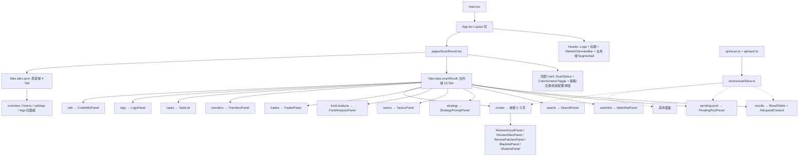
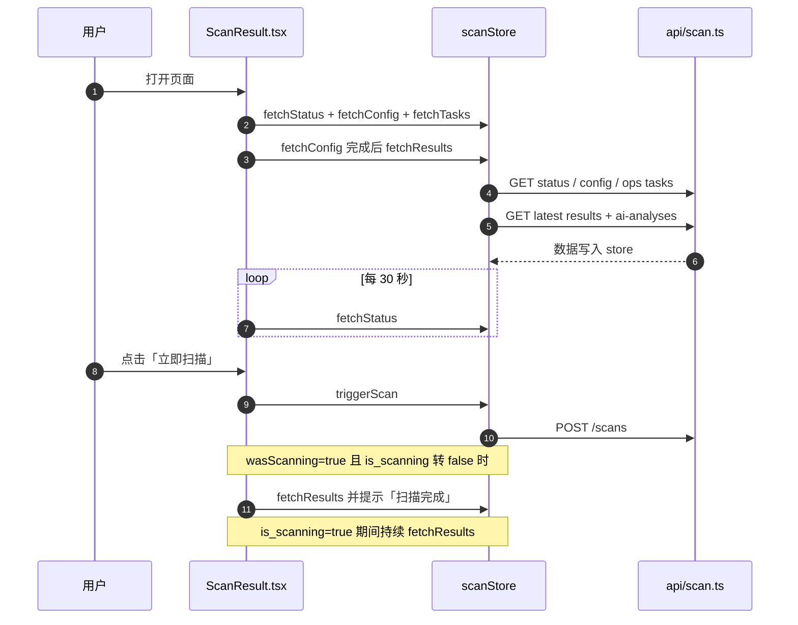
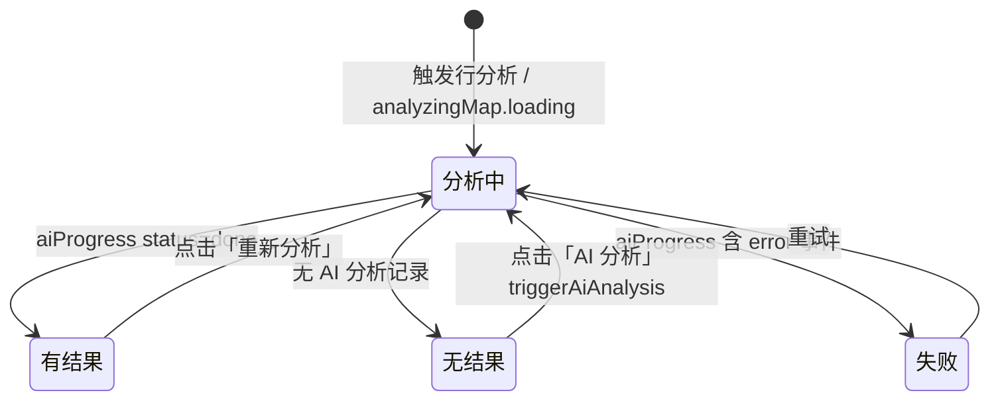

# 技术文档 08 — 前端界面（对照 项目功能流程文档/08-前端界面.md）

> 现行版本：RULE_VERSION v2026-10-18（2026-10-18）。本文从功能文档 08 提炼**技术实现细节**，以代码为准；功能口径与拍板记录见 [功能文档](../项目功能流程文档/08-前端界面.md)。

## 1. 模块与分层

前端为单页应用（React 18 + TypeScript + Vite 5 + Ant Design 5），状态集中在一个 Zustand store，HTTP 封装分业务域两个 axios 模块。层次如下：

| 层 | 文件 / 组件 | 职责 |
|---|---|---|
| 入口渲染 | `main.tsx` → `App.tsx` | Layout（Header + Content）；Header 含 Logo、标题、`MarketOverviewBar`、业务域 Segmented（`tabs.mode`） |
| 页面 | `pages/ScanResult.tsx` | 唯一页面；顶部 Card（`ScanStatus` + `ColorSchemeToggle` + 三个配置弹窗）+ 合约 / 现货两套 Tabs |
| 状态 | `stores/scanStore.ts` | 全量页面状态与动作（`useScanStore()`） |
| HTTP | `api/scan.ts`（合约域）、`api/spot.ts`（现货域）、`api/tactics.ts`、`api/market.ts`、`api/shadow.ts` | axios 实例 `baseURL=/api` |
| 类型 | `types/index.ts`、`types/spot.ts` | 65 个导出 interface/type（含 `ScanResult`、`AIAnalysis`、`SystemConfig`、`TradeRecord`、`Patch`、`Tactic` 等） |
| 标签常量 | `constants/labels.ts`、`constants/indicators.ts` | 信号/位置/形态/EMA/开单类型标签映射；指标目录（`INDICATOR_CATALOG`） |
| 工具 | `utils/dayjs.ts`（`bj()`）、`utils/scheme.ts`、`utils/tabMemory.ts`、`utils/clipboard.ts` | 北京时间换算、涨跌配色、Tab 记忆 |
| 图表 | `components/ChartCore.tsx`、`klineShared.ts`、`KlineChart.tsx`、`EChart.tsx` | lightweight-charts K 线内核 / ECharts 薄封装 |

## 2. 数据结构

### 2.1 Zustand store 状态切片（`stores/scanStore.ts`）

| 字段 | 类型 | 说明 |
|---|---|---|
| `status` | `ScanStatus \| null` | 顶部状态（`last_scan` / `is_scanning` / `open_trades` / `open_tp_hit` / `max_open_trades` / `trading_enabled`） |
| `aiConfig` | `SystemConfig \| null` | 系统配置（AI 开关、`scan_filters_effective`、`accounts`、`trading_testnet`） |
| `results` / `total` | `ScanResult[]` / `number` | 结果表数据与总数 |
| `resultsPage` / `resultsPageSize` | `number` | 分页（默认 1 / 20） |
| `filters` | `ResultFilters` | 服务端过滤条件 |
| `currentScanId` | `string \| null` | 当前批次 ID |
| `aiAnalyses` | `AIAnalysis[]` | 当前批次 AI 分析 |
| `analyzingMap` | `Record<string, {loading, error}>` | 按 `scanResultId` 跟踪行级分析状态 |
| `tasks` / `tasksTotal` / `tasksPage` / `tasksPageSize` / `tasksType` | — | 任务记录（默认 pageSize 10） |
| `logs` / `logsTotal` / `logsPage` / `logsPageSize` / `logLevel` / `logQuery` | — | 系统日志 |
| `watchlist` | `WatchlistItem[]` | 关注列表 |
| `colorScheme` | `'red-up' \| 'green-up'` | 全局涨跌配色 |
| `indicatorSettings` | `Record<string, {enabled, inputs}>` | 图表指标开关与参数（按插件 id 键控） |

### 2.2 localStorage 持久化键

| 键 | 写入方 | 内容 |
|---|---|---|
| `chart-color-scheme` | `setColorScheme` | 涨跌配色（默认 `red-up`） |
| `chart-indicator-settings` | `persistIndicatorSettings` | 指标开关与参数；含一次性迁移标记 `chart-indicator-settings-migrated-v1`（清理遗留宿主 EMA/MA key） |
| `tabs.mode` | `useTabMemory` | 业务域（`futures` / `spot`） |
| `tabs.scanResult` / `tabs.spot` | `useTabMemory` | 合约 / 现货内部 Tab |

`useTabMemory(storageKey, keys)`：初始读 `localStorage`，存储值不在 `keys` 内或读取失败则回落 `keys[0]`；切换时写回（写失败静默）。

### 2.3 页面级数据契约

- `src/types/index.ts` 定义全量前端类型（`ScanRecord` / `ScanResult` / `ScanStatus` / `AIAnalysis` / `SystemConfig` / `TradeRecord` / `TradeEvent` / `Patch` / `ReviewStats` / `FundAnalytics` / `Tactic` …）。
- 涨跌色经 `utils/scheme.ts`（`schemeTag` / `schemeValueColor`）读取 `colorScheme` 统一翻转，全部表格与图表共用。

## 3. 核心流程

### 3.1 页面加载与扫描联动（`ScanResult.tsx`）

### 3.2 AI 展开区三态（`AiExpandContent`）

轮询：`startRowPolling` 每 3s 拉 `GET /scans/ai-progress/{id}`（Redis 事件流），事件含 `error` 或 `status=done` 即停；兜底每 5 轮查一次 AI 分析列表；上限 `200 次 ×3s = 600s` 超时置错误。

## 4. 关键算法与常量

- **列宽与表格布局**：`ResultTable` `scroll.x = 1444`、`tableLayout fixed`——改列宽须同步总宽；`PendingPoolPanel` `scroll.x = 1140`、pageSize 20。
- **信号/形态标签**：`constants/labels.ts` 的 `SIGNAL_TYPE_MAP`、`EMA_STATE_MAP`、`TRADE_TYPE_MAP`、`TOUCH_TAG_MAP`；触点五色与后端 `trigger.TOUCH_LABELS` 同源。
- **指纹 / 时效判断**：开单按钮置灰含「信号过期（分析 >1h）」，UTC 时间须补 `Z` 解析。
- **指标目录驱动**：`constants/indicators.ts` 的 `INDICATOR_CATALOG`，副图自动分配 pane，主:副=5:1；默认显示最近 130 根 K 线。
- **摆动结构标注**：`ChartCore` 高低点各 20 个（与 AI 事实包 `recent_swings(n=20)` 同参）。
- **时间展示**：`utils/dayjs.ts` `bj()` 将 UTC-naive 转北京时间。

## 5. API 契约

前端统一走 `src/api/scan.ts`（合约域）与 `src/api/spot.ts`（现货域）；后端路由见 `backend/app/api/`。

| 模块 | 端点 | 前端消费方 |
|---|---|---|
| 扫描 | `POST /scans`；`GET /scans`；`GET /scans/status` | 触发扫描 / 任务记录 / 顶部状态（30s 轮询） |
| | `GET /scans/latest/results`；`GET /scans/{id}/results` | 结果表（page/sort_by/filters 服务端过滤） |
| | `GET/POST /scans/{id}/ai-analyses` | AI 分析列表 / 触发分析 |
| | `GET /scans/klines/{symbol}` | K 线（limit / force_refresh / interval） |
| | `GET/PUT /scans/config` | 配置读写（`scan_filters` 仅提交改动键） |
| | `POST /scans/analyze`；`GET /scans/ai-progress/{id}`；`GET /scans/ai-trace/{id}` | 手动分析 / 进度流 / Agent 轨迹 |
| | `GET /scans/pullback-pendings` | 待确认池（status / limit） |
| | `GET /scans/{id}/funnel`；`GET /scans/hit-history` | 筛选漏斗 / 命中历史 |
| 复盘 | `GET /scans/review/stats` `/funnel` `/actual` | 三面板主数据 |
| | `POST /scans/review/attribute` | AI 归因（≤5 笔/轮） |
| | `GET /scans/review/patches`（+`{id}/apply`、`{id}/rollback`、`trigger`、`DELETE {id}`）；`GET /scans/review/prompt-view` | 补丁全生命周期 / 分层视图 |
| 黑名单/技能 | `GET/POST /scans/blacklist`；`DELETE /scans/blacklist/{symbol}`；`GET /scans/skills`（+`{name}`） | 黑名单管理 / 技能库 |
| 交易 | `GET /trades`；`GET /trades/account-summary` | 交易记录 / 概览（scope 过滤） |
| | `GET /trades/analytics`；`GET /trades/transfers`；`GET /trades/transfer-stats` | 资金分析 / 划转 |
| | `POST /trades/open-from-analysis`；`POST /trades/{id}/close-market`；`POST /trades/{id}/advice` | 手动开单 / 市价平仓 / 持仓重诊 |
| | `GET /trades/{id}/events` `/klines` `/reconciliation` | 操作历史 / 复盘 K 线 / R 泄漏对账 |
| | `POST /trades/purge-testnet` `/adopt-now` `/inspect-now` | 清空测试网 / 导入持仓 / 立即巡检 |
| 关注 | `GET/POST /watchlist`；`DELETE /watchlist/{symbol}`；`GET /watchlist/quotes`；`POST /watchlist/{symbol}/refresh` | 关注列表与行情 |
| 运维 | `GET /ops/tasks`（+`{id}`）；`GET /ops/logs` | 任务记录 / 系统日志（现货用 `?logger=app.spot`） |
| 现货 | `GET/PUT /spot/config`；`GET /spot/overview`；`GET /spot/score/{symbol}`；`POST /spot/execute`；`GET /spot/timeline`；`GET/PUT /spot/settings`；`GET /spot/kline-cache-status`；`POST /spot/kline-backfill` | 屯币系统四页 |

`api/scan.ts` 导出 `scanApi`（含 `klines` / `analyzeCoin` / `reviewStats` / `reviewFunnel` / `skills` / `pullbackPendings` / `blacklist` / `trades` 子对象）与 `ResultFilters` 类型。

## 6. 配置项

- **后端 `config.py`**：前端可读写并回显的关键项有 `SCAN_BEAT_MINUTE`、`KLINE_INTERVAL` / `KLINE_WINDOW`、`MIN_VOLUME_24H`、`AI_MAX_PER_SCAN`、`AI_RR_MIN`、`TRADING_MIN_RECOMMENDATION`、`TRADING_LEVERAGE`、`RULE_VERSION`（config.py:293，现行 `v2026-10-18`）。
- **`system_config` 表（页面可改）**：AI 开关、Agent 管线开关、双评委开关、`scan_filters` JSONB（筛选参数组 + 触发类型白名单）、`trading_testnet` / `trading_enabled_live`（双网自动成交开关）、`feishu_testnet_notify_enabled`、多账号 `live_trading_keys`、风控参数（止损金额模式 pct/fixed、`max_stop_pct`、`liq_gate_buffer` 等）。
- **前端 localStorage**：见 §2.2。

配置读取口径：`aiConfig` 由 `GET /scans/config` 回填；「恢复默认」提交 `scan_filters=null` 回落 env。

## 7. 并发、幂等与异常处理

- **行级轮询隔离**：`aiPollTimers` 以 `scanResultId` 为键，`startRowPolling` 先 `stopRowPolling` 再启动；关闭 AI 开关时清理全部计时器。
- **竞态守卫**：`FundAnalysisPanel` 用 `seq` 序号只渲染最新一批响应（筛选条件快速切换防旧响应覆盖）。
- **超时与错误面**：行分析 600s 超时置 error 文案；K 线后端 503/4xx detail（如封禁时长）以 Alert 展示。
- **幂等**：`addToWatchlist` 写入前按 `symbol` 去重，避免重复行。
- **持久化容错**：localStorage 读写均包 try/catch（隐私模式静默降级）。
- **解析容错**：`loadIndicatorSettings` 丢弃已下线/结构不合法的指标存档，按 `defaultInputs` 合并缺失参数。
- **默认行为**：`fetchResults` 在 `scanId` 变化时重置到第 1 页；分页/筛选在 Table `onChange` 按 `extra.action` 分发（filter → `setFilters`，paginate → `fetchResults`，排序纯客户端）。

## 8. 前端对应（组件 ↔ 面板）

| 组件 / 模块 | 对应面板 / 位置 |
|---|---|
| `App.tsx` / `Logo.tsx` / `MarketOverviewBar.tsx` | 顶层壳 + 大盘条 + 业务域切换 |
| `ResultTable` + `AiExpandContent` + `AiAnalysisCard` | 扫描结果 Tab（右侧 K 线、行展开 AI 结论） |
| `PendingPoolPanel` / `HitHistoryPanel` / `FunnelPanel` | 待确认池 Tab（含两分段） |
| `WatchlistPanel` / `SearchPanel` | 关注列表 / 搜索币种 |
| `StrategyPromptPanel` / `TacticsPanel` | 策略提示词 / 战法 |
| `FundAnalysisPanel` / `TradesPanel` / `TransfersPanel` / `ScopeSelector` | 资金分析 / 交易记录 / 资金划转 |
| `ReviewActualPanel` / `ReviewStatsPanel` / `ReviewPatchesPanel` / `BlacklistPanel` / `ShadowPanel` | 复盘嵌套 5 子页 |
| `ScanConfigPanel` / `TradingConfigPanel` / `SystemConfigPanel` | 三个配置弹窗 |
| `ScanStatus` / `EnvironmentTag` / `ColorSchemeToggle` | 顶部状态、环境徽标、配色切换 |
| `TaskList` / `LogsPanel` / `CodeWikiPanel` | 任务记录 / 系统日志 / CODE WIKI |
| `SpotOverviewPanel` / `SpotHistoryPanel` / `SpotSettingsPanel` / `SpotLogsPanel` | 现货域四页 |
| `KlineChart` / `ChartCore` / `TradeReplayChart` / `EChart` / `StatCard` | 图表族与指标卡 |

Tab key ↔ 组件映射（合约域 13）：`results`→ResultTable、`pending-pool`→PendingPoolPanel、`watchlist`→WatchlistPanel、`search`→SearchPanel、`strategy`→StrategyPromptPanel、`tactics`→TacticsPanel、`fund-analysis`→FundAnalysisPanel、`trades`→TradesPanel、`review`→嵌套 Tabs、`transfers`→TransfersPanel、`tasks`→TaskList、`logs`→LogsPanel、`wiki`→CodeWikiPanel。现货域 4：`overview` / `history` / `settings` / `logs`。

> 码内观察：`ScanResult.tsx` 的 `tabs.scanResult` 记忆 key 数组为 12 项（未含 `tactics`），按 `useTabMemory` 规则存储值不在 `keys` 内时回落首个 key。
