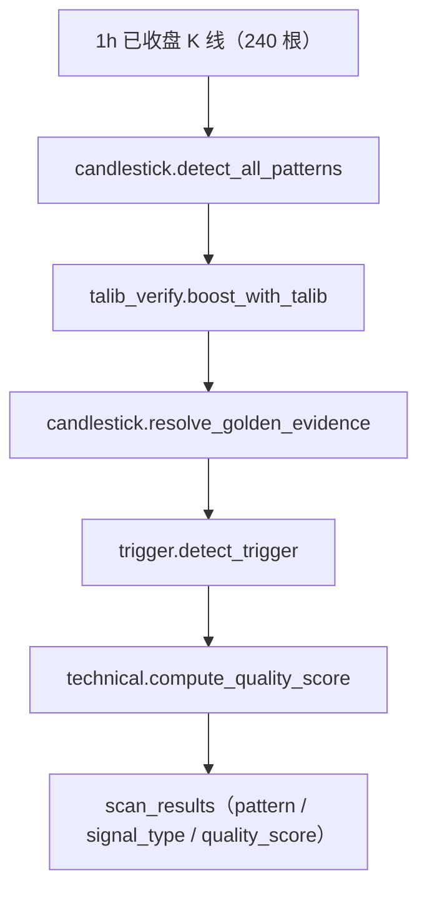
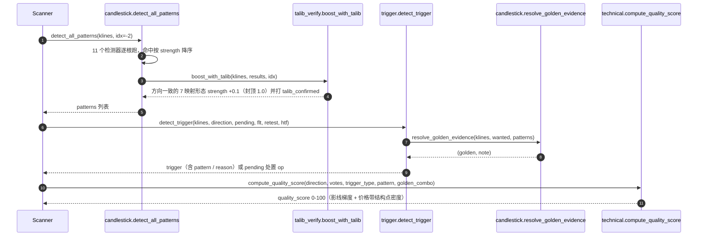
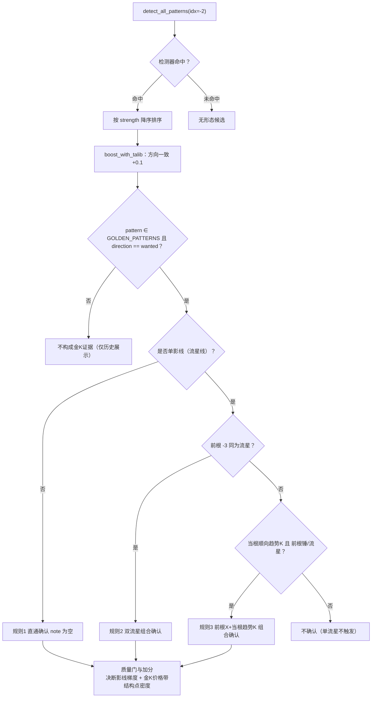

# 技术文档 11 — 金K形态库（对照 项目功能流程文档/11-金K形态库.md）

> 现行版本：RULE_VERSION v2026-10-18（2026-10-18）。本文从功能文档 11 提炼**技术实现细节**，以代码为准；功能口径与拍板记录见 [功能文档](../项目功能流程文档/11-金K形态库.md)。

## 1. 模块与分层

| 模块 | 文件 | 职责 |
| --- | --- | --- |
| 形态检测器 | `backend/app/services/strategy/candlestick.py` | 11 个 `detect_*` 检测器 + `detect_solid_trend_candle` 辅助检测 |
| 白名单常量 | `backend/app/services/strategy/candlestick.py:662-674` | `GOLDEN_BULLISH` / `GOLDEN_BEARISH` 有序元组，`GOLDEN_PATTERNS` 并集 |
| 证据裁决 | `backend/app/services/strategy/candlestick.py:752-823` | `resolve_golden_evidence` 三规则（直通 / 双流星 / 前根形态+趋势K） |
| TA-Lib 双源校验 | `backend/app/services/strategy/talib_verify.py` | `boost_with_talib`：方向一致时加权 + 打标 |
| 触发消费 | `backend/app/services/strategy/trigger.py:571` | `detect_trigger` 触点框架调用金K并产生 `trigger_pullback_confirm` |
| 质量分消费 | `backend/app/services/strategy/technical.py:1252` | `compute_quality_score` / `decision_shadow_bonus` / `golden_zone_swing_count` |
| 展示标签 | `candlestick.py:684-701` `PATTERN_LABEL_MAP`；`frontend/src/constants/labels.ts` `patternStyle` | 中文名与配色 |

## 2. 数据结构

**形态 dict**（检测器统一返回，`resolve_golden_evidence` 只读 `pattern` / `direction` / `strength`）：

| 字段 | 类型 | 说明 |
| --- | --- | --- |
| `pattern` | `str` | 形态 key（如 `hammer`、`bullish_engulfing`） |
| `direction` | `str` | `bullish` / `bearish` / `neutral`（`doji`） |
| `strength` | `float` | 0.5~1.0，排序与复合确认回落的依据 |

**白名单与关键常量**（`candlestick.py`）：

| 常量 | 定义位置 | 内容 |
| --- | --- | --- |
| `GOLDEN_BULLISH` | 662-667 | 看涨 4：`hammer` / `bullish_engulfing` / `morning_star` / `piercing_line` |
| `GOLDEN_BEARISH` | 668-673 | 看跌 4：`shooting_star` / `bearish_engulfing` / `evening_star` / `dark_cloud_cover` |
| `GOLDEN_PATTERNS` | 674 | 上述两序列的并集（现行 8 种） |
| `SINGLE_SHADOW_PATTERNS` | 717 | `{"shooting_star"}`——唯一需复合确认的单影线形态 |
| `TREND_CANDLE_BODY_RANGE_MIN` | 723 | 0.60——顺向趋势K实体/全长下限 |
| `MICRO_GAP_TOLERANCE` | 54 | 0.001——两根/三根形态跨K线边界微跳空容差 |
| `DECISION_SHADOW_BONUS_GRADES` | 145 | `((0.10, 5), (0.20, 3), (0.30, 1))`——决断K线影线比梯度加分 |
| `_DECISION_SHADOW_SIDE` | 148-153 | 吞没第二根看上影/下影、星第三根看总影线 |
| `ENGULF_BODY_LOOKBACK` / `ENGULF_BODY_MIN_RATIO` / `ENGULF_BODY_MIN_BARS` | 129-131 | 20 / 0.6 / 10——吞没实体质量门基线 |

**落库字段**：金K证据最终写入 `scan_results.pattern`（白名单形态名）与信号 `reason` 文本（如「指标同向·回踩摆动结构位(1.234)企稳且当根锤形线确认」）。

## 3. 核心流程（时序/状态图）

**金K检测 → 白名单 → 质量门**（判定链全景）：

## 4. 关键算法与常量

### 4.1 看涨 4 形态几何判定（现行白名单）

| 形态 key | 结构 | 几何条件（`klines[idx]`，idx=-2） | strength |
| --- | --- | --- | --- |
| `hammer` | 单根 | `body ≥ 1e-12` 且 `下影 ≥ 2×实体` 且 `上影 ≤ 全长×15%` | 0.5 起，`下影 ≥3×实体`→0.8，阳线 +0.1（封顶 1.0） |
| `bullish_engulfing` | 两根 | `o2 ≤ c1×(1+0.1%)` 且 `c2 ≥ o1`（微跳空容差），且当根实体 ≥ 前 20 根中位实体 ×0.6（样本 <10 根不判） | 0.7 起，`当根实体 > 前根实体×2`→0.9 |
| `morning_star` | 三根 | 阴 → `body2 < (body1+body3)/2×0.3` 星 → 阳且 `c3 > midpoint1` | 0.7 起，`c3 ≥ o1`→0.9 |
| `piercing_line` | 两根 | 阴 → 阳且 `o2 ≤ c1×(1+0.1%)` 且 `c2 > 前根实体中点` 且 `c2 < o1` | 0.6 起，`c2 ≥ o1×0.7 + c1×0.3`→0.8 |

### 4.2 看跌 4 形态几何判定（现行白名单）

| 形态 key | 结构 | 几何条件 | strength |
| --- | --- | --- | --- |
| `shooting_star` | 单根 | `body ≥ 1e-12` 且 `上影 ≥ 2×实体` 且 `下影 ≤ 全长×15%` | 0.5 起，`上影 ≥3×实体`→0.7 |
| `bearish_engulfing` | 两根 | 与看涨侧镜像 + 同吞没实体质量门（下影为决断影线） | 同看涨吞没 |
| `evening_star` | 三根 | 启明星镜像（`body2 < 外侧均值×0.3`），`c3` 深入第一根实体下半部 | 0.7 起，跌破第一根全部实体→0.9 |
| `dark_cloud_cover` | 两根 | 刺透线镜像，`c2 ≤ o1×0.7 + c1×0.3`→0.8 | 0.6 起 |

### 4.3 白名单外形态（检测器保留、不构成金K证据）

| pattern | direction | 说明 |
| --- | --- | --- |
| `inverted_hammer` | bullish | 与流星线同形双报；2026-10-01-2 退出看涨白名单 |
| `hanging_man` | bearish | 锤形 + 近 10 根区间上部 30% 位置门；2026-09-28 被流星线替代 |
| `bullish_harami` / `bearish_harami` | bull / bear | 三根孕线突破；2026-10-09 移出白名单 |
| `dragonfly_doji` / `gravestone_doji` | bull / bear | body≈0 十字互补；2026-10-09 移出白名单 |
| `doji` | neutral | 双长影 + 实体 ≤10%（几乎没有）或 ≤25%（很短）且双侧影线 >15%；2026-10-02 补全，仅展示 |

### 4.4 辅助检测器

- `detect_solid_trend_candle`（726-749）：长实体（`body/全长 ≥ 0.60`）+ 顺向（做多阳/做空阴），仅作「前根锤/流星 + 当根趋势K」复合组件。
- `close_above_prev_high`：趋势反转分类的历史展示标签，非金K。

### 4.5 金K证据裁决（`resolve_golden_evidence`，752-823）

- **规则 0（方向过滤 + 直通优先）**：候选先按 `pattern ∈ GOLDEN_PATTERNS 且 direction == wanted` 过滤；同向多形态并存时先取非单影线候选，取不到才回落 `strength` 序首个走复合路径（786-788）。
- **规则 1（直通确认）**：方向匹配且非单影线 → 直接确认，`note=""`（791-792）。
- **规则 2（双流星）**：当根流星 → 前根 `-3` 同为流星 → `双流星组合` 确认，否则不确认（797-804）。
- **规则 3（前根形态 + 当根趋势K）**：当根无金K → 当根顺向趋势K + 前根锤（看多）/流星（看空）→ `前根X+当根趋势K` 确认，`pattern` 落前根形态（806-823）。

### 4.6 质量分联动

- **决断K线影线梯度加分**（`technical.decision_shadow_bonus`，0/1/3/5）：吞没第二根（看涨看上影/看跌看下影）、星第三根（总影线），影线比 ≤10% +5、≤20% +3、≤30% +1、>30% 0；只失加分、不再拒判形态。
- **金K组合价格带结构点密度加分**（`technical.golden_zone_swing_count`，1219-1249）：金K确认后取价格带 `[min低, max高]`（单根=`klines[-2]`，`golden_combo=True` 并入 `klines[-3]`），统计近 200 根 1h 中**实体与带重叠**的摆动高低点数，每点 +3、封顶 +12，仅 `trigger_pullback_confirm` 且 `pattern` 存在时适用（1376-1383）。

## 5. API 契约

金K无独立端点，随扫描链路经 `scan_results` 落库并由结果接口透出：

| 端点 | 方法 | 金K相关字段 |
| --- | --- | --- |
| `/api/scans/{id}/results` | GET | `pattern`（白名单形态名）、`signal_type`、`reason`、`quality_score` |
| `/api/scans/hit-history` | GET | `pattern`（命中历史行，前端 `patternStyle` 渲染） |
| `/api/trades/{id}/klines` | GET | 复盘 K 线叠加入场/止损/止盈区间（不含形态） |

信号的 `reason` 文本由 `trigger.py` 拼接：`指标同向·回踩{触点}({位价})企稳且{证据}确认`，随信号进入 AI 分析的信号门槛块（`render_signal_gate_block`）。

## 6. 配置项

| 配置 | 位置 | 说明 |
| --- | --- | --- |
| `RULE_VERSION` | `backend/app/config.py`（现行 v2026-10-18） | 白名单/几何门/裁决规则变更须 bump |
| `swing_order` | `ScanFilters.swing_order`（默认 3） | `golden_zone_swing_count` 的摆动阶数 |
| 白名单 `GOLDEN_BULLISH` / `GOLDEN_BEARISH` | candlestick.py 代码常量 | 非运行时配置；变更需同步 `golden_whitelist_labels` 提示词渲染 |
| 几何门阈值 | candlestick.py 代码常量 | 同上，均为代码常量而非常开配置 |

## 7. 并发、幂等与异常处理

- **异常隔离**：`detect_all_patterns` 逐个检测器 `try/except`，单检测器抛错静默跳过，不阻断其余形态判定（846-851）。
- **TA-Lib 缺失降级**：`talib_verify` 未安装时整体跳过加权，主流程无感。
- **裁决内异常**：双流星/前根形态/趋势K检测均包 `try/except`，异常时按「无证据」处理（798-817）。
- **幂等**：金K判定为纯函数，同一 `klines` 与 `idx` 结果确定，可重复调用。

## 8. 测试覆盖

- `backend/tests/test_golden_candle.py`：白名单按方向分组、流星线检测与同形双报、十字星口径（双长影识别/不误判/不构成金K证据）、吞没实体质量门与微跳空容差（`test_engulfing_*` / `test_piercing_*` / `test_dark_cloud_*`）、星形中K实体门。
- `backend/tests/test_trigger_two_stage.py`：两段式确认链路、白名单逐形态确认、复合确认（双流星 / 前根锤+趋势K）、直通优先。
- `backend/tests/test_quality_score.py`：决断影线梯度加分与价格带结构点密度加分口径。
