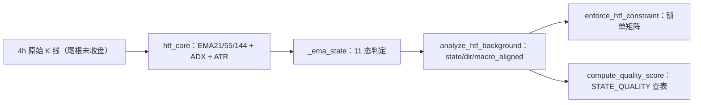
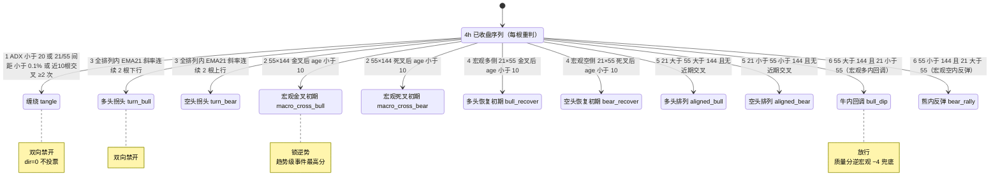
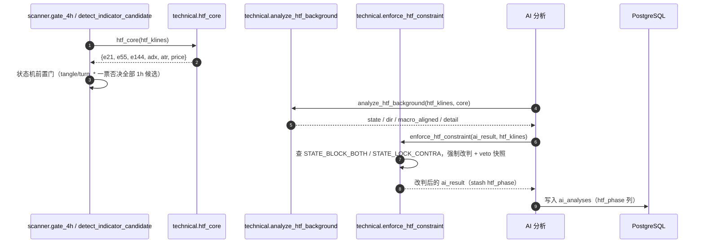

# 技术文档 13 — 4H背景排列强度判定（对照 项目功能流程文档/13-4H背景排列强度判定.md）

> 现行版本：RULE_VERSION v2026-10-18（2026-10-18）。本文从功能文档 13 提炼**技术实现细节**，以代码为准；功能口径与拍板记录见 [功能文档](../项目功能流程文档/13-4H背景排列强度判定.md)。

## 1. 模块与分层

实现集中于 `backend/app/services/strategy/technical.py`：

| 函数 | 行号 | 职责 |
| --- | --- | --- |
| `_sign_changes` | 634-640 | 近 n 根内 f−m 符号变号次数（缠绕锯齿道计数） |
| `_htf_cross_age` | 717-733 | 两 EMA 最后一次交叉的 (距最新根数, 交叉后方向)，NaN 种子区自动剔除 |
| `htf_core` | 736-775 | 4h 共享计算核心：一次算好 EMA21/55/144 + ADX(14) + ATR(14,4h) |
| `_ema_state` | 643-714 | 4h EMA 状态机 11 态（判定优先级即代码顺序） |
| `analyze_htf_background` | 778-846 | 对外入口：返回 state / dir / macro_aligned / 年龄 / div / detail |
| `enforce_htf_constraint` | 849-919 | 锁单矩阵程序化兜底（强制 skip + veto 快照 + stash `htf_phase`） |
| `compute_quality_score` | 1252-1395 | STATE_QUALITY 矩阵查表（含过渡态逆宏观 −4） |

## 2. 数据结构

**`analyze_htf_background` 返回 dict**：

| 字段 | 说明 |
| --- | --- |
| `state` | 11 态 key（见下） |
| `state_label` | `STATE_LABELS[state]` 中文名 |
| `dir` | 状态方向（1 多 / -1 空 / 0 不投票），`_STATE_DIR` 查表 |
| `macro_aligned` | True 同侧 / False 逆侧 / None 未评估，`_STATE_MACRO` 查表 |
| `age_bars` | 21×55 交叉年龄（`_htf_cross_age`） |
| `macro_cross_age` | 55×144 交叉年龄 |
| `div` | 排列角度（min of 21/55 与 55/144 的 ATR 距离），仅注记 |
| `detail` | 证据文本（EMA 值 + 交叉年龄注记 + ADX） |

**状态 key 值域（11 态）**：`tangle` / `turn_bull` / `turn_bear` / `macro_cross_bull` / `macro_cross_bear` / `bull_recover` / `bear_recover` / `aligned_bull` / `aligned_bear` / `bull_dip` / `bear_rally`。

**关键常量**（`technical.py`）：

| 常量 | 行号 | 值 / 内容 |
| --- | --- | --- |
| `CROSS_FRESH_BARS` | 585 | 10（交叉「初期」窗口，55×144 与 21×55 共用，严格小于） |
| `TURN_CONFIRM_BARS` | 586 | 2（拐头确认：EMA21 斜率连续反向根数） |
| `TANGLE_CROSS_LOOKBACK` | 588 | 10（缠绕锯齿道：近 10 根 21×55 交叉 ≥2 次） |
| `STATE_LABELS` | 590-597 | 11 态中文名映射 |
| `STATE_BLOCK_BOTH` | 598 | `("tangle", "turn_bull", "turn_bear")` |
| `STATE_LOCK_CONTRA` | 599-603 | `macro_cross_*` / `*_recover` / `aligned_*`（宏观同侧，锁逆势） |
| `STATE_QUALITY` | 606-613 | 11 态（同向, 逆向）质量分矩阵 |
| `_STATE_LEGACY_NEUTRAL` | 614 | `(5, -8)`——退役旧档存量行兜底 |
| `_STATE_DIR` | 616-623 | 11 态方向查表 |
| `_STATE_MACRO` | 624-631 | 11 态宏观对齐查表 |

**落库链路**：`enforce_htf_constraint` stash `htf_phase`（=状态 key，suggest 且有 4h 数据时）→ `AIAnalysis.htf_phase`（VARCHAR(20)）→ 开单 `_ai_snapshot` 随快照进 `trade_records` → `build_actual_review` 复盘维度「4h趋势期」。

## 3. 核心流程（时序/状态图）

**4h EMA 状态机 11 态**（每根 4h 收盘后重判，判定优先级即代码顺序）：

**消费端时序**：

## 4. 关键算法与常量

### 4.1 判定优先级（`_ema_state` 代码顺序，完备分割无第五落点）

| # | 状态 | 判据 | 行为 |
| --- | --- | --- | --- |
| 1 | `tangle` | `ADX<20` ∨ 21/55 间距 `<0.1%` ∨ 近 10 根 21×55 交叉 `≥2` 次 | dir=0，双向禁开 |
| 2 | `macro_cross_bull/bear` | 55×144 交叉后 `age < CROSS_FRESH_BARS(10)`（严格小于） | 趋势级事件优先定名，锁逆势 |
| 3 | `turn_bull/bear` | 仅全排列内 EMA21 斜率连续 `TURN_CONFIRM_BARS(2)` 根反向 | 趋势衰竭警戒，双向禁开 |
| 4 | `bull_recover/bear_recover` | 宏观同侧的 21×55 新交叉 `age<10` | 锁逆势 |
| 5 | `aligned_bull/bear` | 全排列且无近期交叉 | 锁逆势 |
| 6 | `bull_dip/bear_rally` | 宏观逆侧（21×55 关系定名，任意龄） | 放行，质量分兜底 |

### 4.2 锁单矩阵（`enforce_htf_constraint`）

| 状态组 | 常量 | 任何方向新单 |
| --- | --- | --- |
| `tangle` / `turn_*` | `STATE_BLOCK_BOTH` | **强制 skip（双向禁开，矩阵最先判）** + veto 快照 `htf_constraint` |
| `macro_cross_*` / `*_recover` / `aligned_*` | `STATE_LOCK_CONTRA` | 宏观同侧：顺势放行，**逆势强制 skip** |
| `bull_dip` / `bear_rally` | 过渡态 | 放行（质量分逆宏观 −4 兜底） |

锁逆势直接比较 `direction`（long/short）与状态方向 `htf["dir"]`（901-915）。无 4h 数据或非 suggest 时原样返回。

### 4.3 质量分矩阵（`STATE_QUALITY`，同向 / 逆向）

| 状态 | 同向 | 逆向 | 备注 |
| --- | --- | --- | --- |
| `tangle` | 0 | 0 | dir=0 不进方向分支 |
| `turn_bull/bear` | −8 | −4 | 双向禁开后仅扫描侧排序兜底 |
| `macro_cross_bull/bear` | **+12** | −14 | 趋势级事件独享最高档 |
| `bull_recover/bear_recover` | +8 | −10 | |
| `aligned_bull/bear` | +10 | −12 | |
| `bull_dip/bear_rally` | +5 | −6 | `macro_aligned=False` 额外 −4（天然只作用过渡态） |
| 退役旧档兜底 | +5 | −8 | `_STATE_LEGACY_NEUTRAL`，旧 `phase` 键兼容读取 |

### 4.4 复盘维度聚合

11 态按行为聚合 6 桶：`turn` 两态→拐头、`macro_cross` 两态→宏观交叉、`recover` 两态→恢复初期、`aligned` 两态→排列、`dip/rally`→过渡；加缠绕共 6 行为桶 + 未知兜底。维度名保留「4h趋势期」。

## 5. API 契约

无独立端点，随分析/复盘链路透出：

| 端点 | 方法 | htf 字段 |
| --- | --- | --- |
| `/api/scans/{id}/results` | GET | `votes_json.htf`（state / dir / detail 等）供前端 Tooltip 与 AI 上下文 |
| `/api/scans/{id}/ai-analyses` | GET | `htf_phase`（4h 状态 key） |
| `/api/scans/review/stats` | GET | 「4h趋势期」6 桶有序维度 |

## 6. 配置项

| 配置 | 位置 | 说明 |
| --- | --- | --- |
| `RULE_VERSION` | `config.py`（现行 v2026-10-18） | 状态机/锁单/质量分矩阵变更须 bump |
| `REC70_START` | `shadow.py` | 影子前向窗口起点（随重构重置） |
| 4h 拉取窗口 | scanner 侧按 300 根拉取 | EMA144 收敛（残留 ~12%） |
| 判据常量 | `technical.py` 代码常量 | `CROSS_FRESH_BARS` / `TURN_CONFIRM_BARS` / `TANGLE_CROSS_LOOKBACK` 非运行时常开配置 |

## 7. 并发、幂等与异常处理

- **共享计算去重**：`htf_core` 一次算好 EMA/ADX/ATR，`gate_4h` 与 `analyze_htf_background` 共用（第 1/2 步去重不改行为）。
- **异常降级**：ADX 计算失败降级 None（状态机跳过该道判据）；`enforce_htf_constraint` 整体 `try/except`，异常时放行（917-918）。
- **样本不足**：已收盘 <155 根（EMA144 种子 + 收敛余量）返回 None，4h 整票消失（新上市币）。
- **幂等**：状态判定为纯函数，同一 4h 序列结果确定。
- **veto 闭环**：程序否决的 suggest 快照 `veto_original`，复盘回放假想表现（键名与 dual_judge 对齐）。

## 8. 测试覆盖

- `backend/tests/test_htf_trend_age.py`（29 项）：11 态分类全覆盖（缠绕三道：间距/ADX + 锯齿道纯函数直测；拐头连续 2 根边界；宏观交叉 age=10 严格小于边界 + 双叉优先级；恢复/过渡位置语义）+ `_htf_cross_age` 纯函数 + 锁单矩阵常量驱动全枚举 + 质量分矩阵全枚举 + 渲染行三分类。
- `backend/tests/test_prompt_invariants.py`：不变量 8（结构化行 `state=` 键）、不变量 9（`_RULE_HTF_HARD` 状态约束/方向约束双行 + 双向禁开 + 程序强制改判）。
- `backend/tests/test_htf_ranging_filter.py`：4h 背景与震荡过滤联动。
- `backend/tests/test_review_batch3.py`：复盘「4h趋势期」7 桶有序维度 + 退役旧档归未知 + veto 快照夹具。
- `backend/tests/test_rec70_shadow.py`：窗口起点断言。
