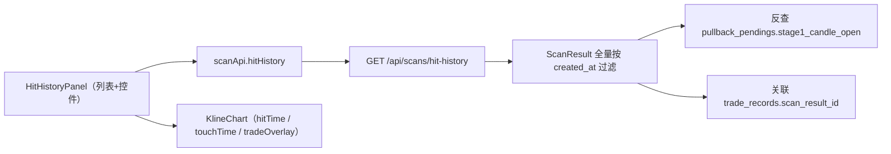
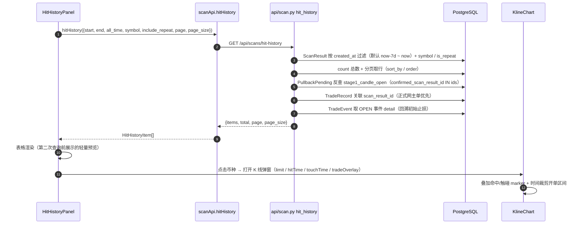

# 技术文档 14 — 命中历史查询（对照 项目功能流程文档/14-命中历史查询.md）

> 现行版本：RULE_VERSION v2026-10-18（2026-10-18）。本文从功能文档 14 提炼**技术实现细节**，以代码为准；功能口径与拍板记录见 [功能文档](../项目功能流程文档/14-命中历史查询.md)。

## 1. 模块与分层

| 模块 | 文件 | 职责 |
| --- | --- | --- |
| 后端接口 | `backend/app/api/scan.py:1514-1616` | `GET /api/scans/hit-history` 查询与组装 |
| 查询辅助 | `scan.py:1457-1511` | `_HIT_SORT_COLS` / `_naive_utc` / `_hit_direction` / `_trade_brief` |
| 前端面板 | `frontend/src/components/HitHistoryPanel.tsx` | 第 3 分段「命中历史」列表 + 查询控件 + K 线弹窗 |
| 分段入口 | `frontend/src/components/PendingPoolPanel.tsx:30,218` | `StatusFilter` 新增 `'hit-history'` |
| API 封装 | `frontend/src/api/scan.ts:181-191` | `scanApi.hitHistory` |
| K 线扩展 | `frontend/src/components/KlineChart.tsx:623-707` | 扩展 props `hitTime` / `touchTime` / `tradeOverlay` |
| 类型 | `frontend/src/types/index.ts:357-358` | `HitHistoryItem` |



## 2. 数据结构

**返回行 `HitHistoryItem`**：

| 字段 | 来源 | 说明 |
| --- | --- | --- |
| `id` | `scan_results.id` | 行主键 |
| `symbol` | ScanResult | |
| `created_at` | ScanResult | 命中时刻（前端 `bj()` 北京时区展示） |
| `signal_type` | ScanResult | 复用 `SIGNAL_TYPE_MAP` |
| `pattern` | ScanResult | 复用 `patternStyle` |
| `touch_ref` / `position_ref` | ScanResult | 触点 / 位置 |
| `quality_score` | ScanResult | |
| `is_repeat` | ScanResult | 重复命中标记 |
| `direction` | 派生 `_hit_direction` | `votes_json.net` 符号 → 回落 `trend_slope` 符号 |
| `stage1_candle_open` | 反查 pullback_pendings | 触碰K线时间，可空 |
| `trade` | `_trade_brief` | 开单摘要，可空（未开单） |

**`trade` 摘要子集**：`trade_id / status / direction / entry_price / stop_loss（初始止损，取 OPEN 事件快照） / current_stop_loss（现值） / take_profit_1 / take_profit_2 / opened_at / closed_at / realized_pnl / pnl_pct / testnet`。

**关联链**：

| 关联 | 条件 | 说明 |
| --- | --- | --- |
| 触碰K线 | `pullback_pendings.confirmed_scan_result_id == ScanResult.id` | 仅回踩路径可得 |
| 开单 | `TradeRecord.scan_result_id == ScanResult.id` | 一命中可多单，正式网主单优先 |

## 3. 核心流程（时序/状态图）



## 4. 关键算法与常量

### 4.1 方向派生（`_hit_direction`）

```
direction = sign(votes_json.net)  →  为空时回落 sign(trend_slope)  →  均无则 0
```

口径与 `ResultTable.touchLabel` 同源。

### 4.2 主单选择（1514-1614）

按 `created_at` 逆序遍历该命中下全部 TradeRecord，遇到 `cur.testnet and not t.testnet` 时替换——即**正式网主单优先**，其次最近一笔。

### 4.3 初始止损回溯

`TradeRecord.stop_loss` 会被 SL_MOVE 改成移动止损现值；初始止损改从 `TradeEvent(event_type="OPEN").detail` 的 `stop_loss` 快照取（1585-1595）。

### 4.4 K 线窗口（`HitHistoryPanel.klineLimit`）

```
根数 = ceil((now − min(created_at, stage1_candle_open, trade.opened_at)) / 1h) + 50
clamp 到 [500, 1500]
```

命中在 30 天前时固定 500 根覆盖不到命中点，故按命中时刻动态取根数；复用 `scanApi.klines(symbol, limit, isLive, interval)`。

### 4.5 K 线标注与时间裁剪开单区间

| 标注 | 条件 | 样式 |
| --- | --- | --- |
| 命中K线 | 必有（`hitTime`） | 多=belowBar↑、空=aboveBar↓，文案「命中」 |
| 触碰K线 | 仅回踩路径有 `stage1_candle_open` | 同方向 marker，文案「触碰」，颜色区分 |
| 开仓 | `tradeOverlay` 存在 | 沿用复盘开仓 marker |
| 持仓区间矩形 | `[opened_at → closed_at]`，未平仓/无 tp·sl 时右端延续最新 K 线 | 开放右端 |
| 价格带 | `entry↔stop_loss` 红带、`entry↔tp1` 绿带、`tp1↔tp2` 浅绿带 | 沿用复盘配色 |

CLOSED 单右边界=平仓时刻，实现「单子范围宽度到止盈或止损结束」。

## 5. API 契约

**`GET /api/scans/hit-history`**

| 参数 | 类型 | 默认 | 说明 |
| --- | --- | --- | --- |
| `start` | ISO8601 | now-7d | 命中时刻下界（含） |
| `end` | ISO8601 | now | 命中时刻上界（含） |
| `symbol` | str | 空 | 币种精确匹配（`normalize_symbol`） |
| `include_repeat` | bool | true | 是否含重复命中 `is_repeat` |
| `all_time` | bool | false | 清空时间范围 = 不限下界（忽略 start，仍受 end 约束） |
| `page` / `page_size` | int | 1 / 20 | `page_size` ≤200 |
| `sort_by` / `order` | str | created_at / desc | `created_at` / `quality_score` |

**响应**：`{items: HitHistoryItem[], total, page, page_size}`（服务端分页）。

## 6. 配置项

| 配置 | 位置 | 说明 |
| --- | --- | --- |
| 默认窗口 | 接口硬编码 `now - timedelta(days=7)` | 默认最近 7 天 |
| `page_size` | 前端 `pageSize = 20` / 接口默认 20 | 与现有表格一致 |
| K 线根数 clamp | `HitHistoryPanel.klineLimit` `[500, 1500]` | 后端 `/klines` limit 上限 1500 |
| 时间粒度 | 前端 `disabledMinutes` | 仅整点（只可选 00） |
| `OUTCOME_DAYS` | `PendingPoolPanel`（不变） | 「后续结果」3 天窗口保持不变 |

## 7. 并发、幂等与异常处理

- **只读接口**：无写操作，天然幂等；分页 + `count` 一致性由同一条件集保证。
- **关联缺失容错**：非回踩路径或无 pending 关联时 `stage1_candle_open` 为空、只标命中K线，不报错；`trade=null` 时只标命中/触碰、不画区间。
- **撞库防护**：触碰/开单反查按本页 `ids` 批量 `IN` 查询，避免逐行 N+1。
- **前端异常**：`fetchData` 捕获错误 `message.error` 展示，`finally` 关闭 loading。

## 8. 测试覆盖

- `backend/tests/test_hit_history.py`：默认 7 天窗口排除旧命中、`all_time` 返回全量、显式起止范围、`include_repeat` / `symbol` 过滤、触碰K线反查 + 开单关联（正式网主单优先）+ 方向派生、服务端分页（`page_size=1` / `total`）。
- 前端：`HitHistoryPanel` 面板经 `PendingPoolPanel` 第 3 分段渲染，`KlineChart` 扩展 props 行为在 `test_trade_klines_api.py` 相关后端 K 线接口用例中间接覆盖。
