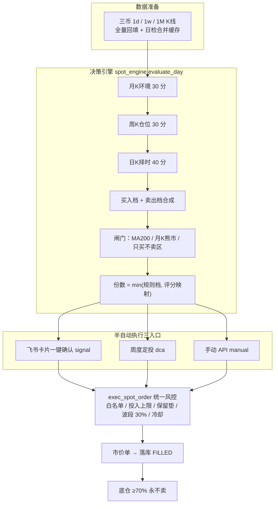
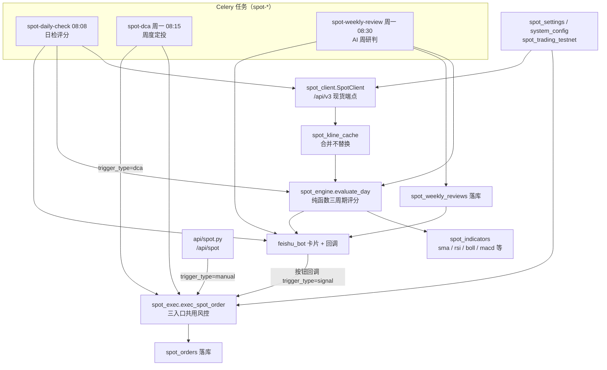
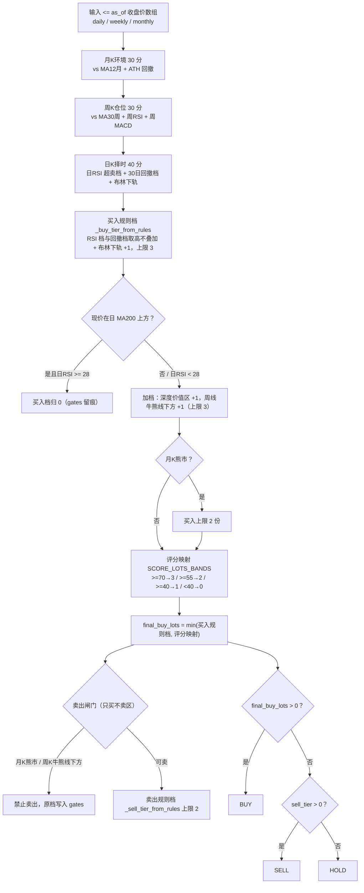
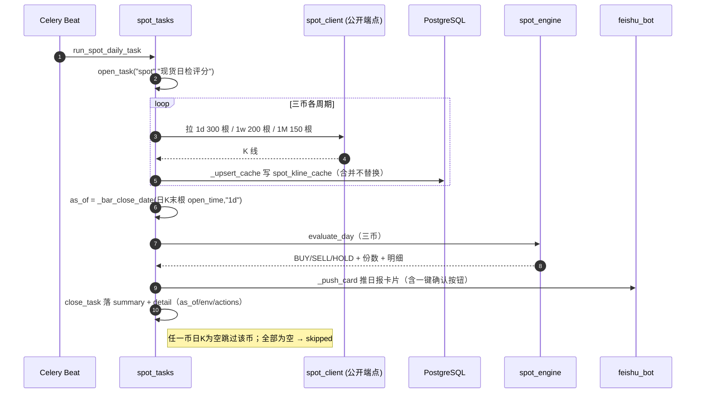
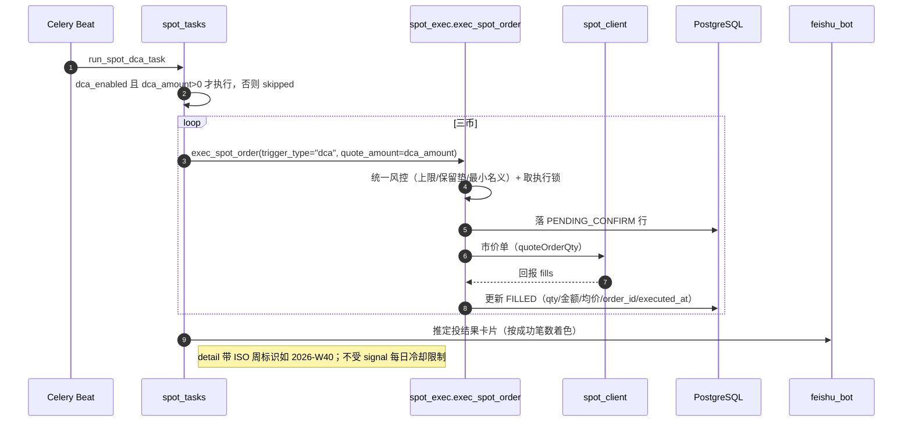
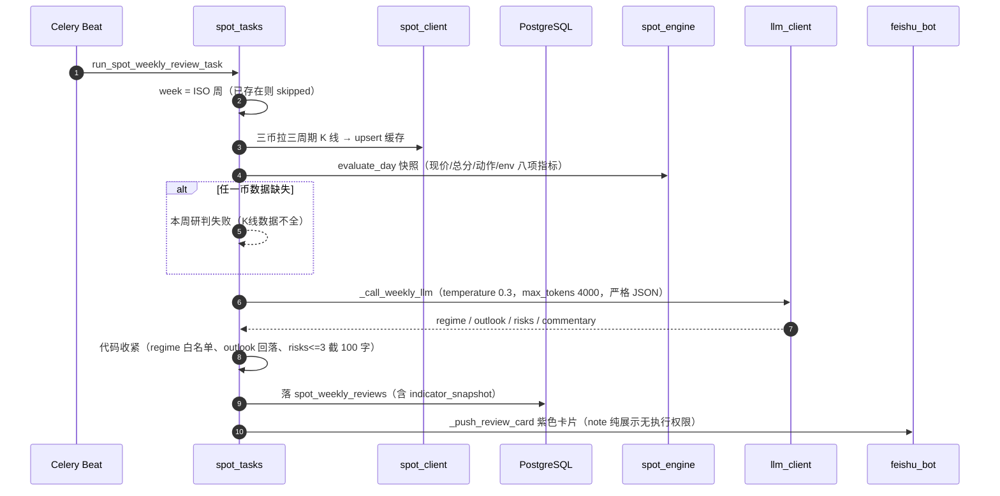
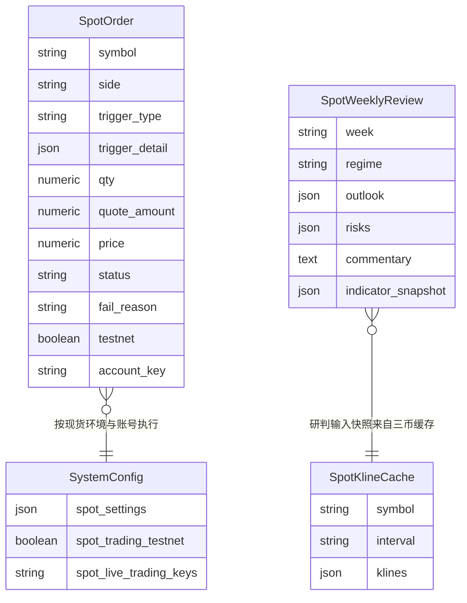

# 07-现货屯币
> 现行版本：RULE_VERSION v2026-10-18（2026-10-18）。本文对照代码整理，以代码为准；历史拍板记录见 docs/archive/。
> 本文为原 `功能流程/07-现货屯币.md` 与 `技术实现/07-现货屯币.md` 于 2026-10-21 合并而成：功能口径与拍板以业务规则为准，实现细节以代码为准。

## 功能流程图

> 本图概括本文所述功能的整体流程（Mermaid 渲染）。



## 1. 概览

### 1.1 目标与定位

- **目标：长期净增币最大化**。KPI 口径是「币数」不是 USDT——净增币 = FILLED BUY 币数 − FILLED SELL 币数，并与「同预算每周定投基准」对比算超额（`backend/app/api/spot.py` `_spot_kpi`）。
- **币种白名单硬编码三币**：`SPOT_SYMBOLS = ("BTCUSDT", "ETHUSDT", "BNBUSDT")`（`backend/app/models/spot.py`），执行层非白名单直接拒绝。
- **双层仓位**：底仓 ≥70% 永不卖，波段仓可卖上限 = 该币 free × 30%（`backend/app/services/spot_exec.py` `SWING_SELL_CAP`，承接 archive/18 §3.3）。
- **多周期分级决策**：月 K 定环境（30 分）→ 周 K 定仓位（30 分）→ 日 K 定执行（40 分），三层相加为总分（`backend/app/services/spot_engine.py` `evaluate_day`）。
- **不设硬止损**：靠「熊市只买不卖 + 单币投入上限」控风险，越跌越买（设计立场，archive/18 §2.3）。
- **半自动执行**：系统只产生评分与建议份数，实盘下单必须经三入口之一触发（飞书卡片确认 / 周度定投 / 手动 API），无全自动开单面。

### 1.2 与合约系统的零侵入隔离边界

现货是挂载式独立模块（`backend/app/main.py` 注释「独立模块」），隔离约定逐条落进代码：

| 隔离维度 | 现货侧做法 | 代码依据 |
|---|---|---|
| 交易所客户端 | 独立 `SpotClient` 走 `/api/v3` 现货端点，不复用合约 fapi 客户端实例，不共享连接与缓存 | `backend/app/services/spot_client.py` 模块注释 |
| 执行锁 | 自写 `lock:spot_open:{account_key}`（SET NX PX + 自旋），不碰合约 `trade_tasks._acquire_open_lock` | `backend/app/services/spot_exec.py` |
| 数据表 | 3 张全新表（spot_orders 等），不读写合约任何表 | `backend/app/models/spot.py` |
| 环境开关 | `spot_trading_testnet` 独立列，与合约 `trading_testnet` 互不影响 | `backend/app/models/system_config.py` |
| 定时任务 | 独立任务命名 `spot-*` | `backend/app/celery_app.py` beat |
| API 路由 | 独立 router `/api/spot`，不引用合约 task/trade_engine 服务 | `backend/app/api/spot.py` |
| 日志命名空间 | 统一走 `app.spot.*`（与合约 `app.services/app.tasks` 区分，系统日志面板按 logger 过滤） | `backend/app/services/spot_exec.py` |

**允许的复用仅限基础设施**：`task_log`（任务留档）、`notify`/`feishu_bot`（飞书推送与卡片回调）、`account_registry`（.env 账号注册表解析）、`llm_client`（LLM 调用）。

### 1.3 代码模块与分层

| 模块 | 路径 | 职责 / 关键符号 |
|---|---|---|
| 决策引擎 | `backend/app/services/spot_engine.py` | `evaluate_day` 纯函数：三周期评分 + 档位 + 闸门 → BUY/SELL/HOLD 与份数，输出可解释明细；常量 `RSI_BUY_TIERS` / `DRAWDOWN_TIERS` / `RSI_SELL_TIERS` / `REBOUND_SELL_TIERS` / `SCORE_LOTS_BANDS` / `ABOVE_MA200_RSI_GATE` / `BULL_LINE_DEVIATION_SELL` / `MIN_NOTIONAL_USDT` / `SpotDefaults` |
| 指标库 | `backend/app/services/spot_indicators.py` | `sma` / `rsi`（Wilder）/ `boll` / `macd` / `macd_golden_cross` / `drawdown_from_high` / `rebound_from_low` / `price_vs_ma`，全纯函数 |
| 执行 | `backend/app/services/spot_exec.py` | `exec_spot_order` 三入口共用风控 + 市价单 + 落库；常量 `SWING_SELL_CAP` / `_SPOT_LOCK_TTL_S` / `MIN_NOTIONAL_USDT` |
| 客户端 | `backend/app/services/spot_client.py` | 币安现货 REST（K线/现价/只读账户/exchangeInfo 精度/市价单），testnet 与 live 环境解析；`SPOT_TESTNET_BASE` / `SPOT_KLINE_INTERVALS` / `SpotClient` |
| 设置 | `backend/app/services/spot_settings.py` | `system_config.spot_settings` JSON 列读写 + PUT 字段白名单与范围校验；`load_spot_settings` / `merge_spot_settings` / `_FIELD_SPECS` |
| 任务 | `backend/app/tasks/spot_tasks.py` | `run_spot_daily_task` / `run_spot_dca_task` / `run_spot_weekly_review_task` / `run_spot_backfill_task` / `_push_card` / `_push_review_card`：日检、周度定投、AI 周度研判、K线全量回填、飞书卡片 |
| API | `backend/app/api/spot.py` | 总览 / 评分 / 执行 / 配置 / 时间轴 / K线缓存端点 |
| 模型 | `backend/app/models/spot.py` | `SpotOrder` / `SpotWeeklyReview` / `SpotKlineCache`；`SPOT_SYMBOLS = ("BTCUSDT","ETHUSDT","BNBUSDT")` |
| 调度 | `backend/app/celery_app.py` | spot-daily-check（每日 08:08）、spot-dca（周一 08:15）、spot-weekly-review（周一 08:30），均北京时间 |
| 飞书回调 | `backend/app/services/feishu_bot.py` | 卡片按钮 `spot_buy`/`spot_sell` 一键确认 → `exec_spot_order`（trigger_type=signal） |
| 前端 | `frontend/src/pages/ScanResult.tsx`（业务域 Segmented「现货」）、`frontend/src/components/Spot*Panel.tsx`、`frontend/src/api/spot.ts` | 持仓总览 / 历史记录 / 策略配置 / 日志四个子 Tab |

分层关系如下（Celery 任务 → 决策引擎/指标库 → 数据缓存与执行 → 落库与飞书）：



### 1.4 环境语义（现货与合约完全独立）

- `spot_trading_testnet=true`（默认）→ 现货测试网 `testnet-1`，域名 `testnet.binance.vision`（`spot_client.py` `SPOT_TESTNET_BASE`）。
- `false` → 现货正式网，启用账号取 `spot_live_trading_keys` ∩ 注册表，空回落 `live-1`（`backend/app/services/account_registry.py` `spot_enabled_accounts`）。
- 现货测试网与合约测试网是**两套独立系统，key 不互通**（2026-09-24 实证），专用凭据走 `.env BINANCE_SPOT_TESTNET_API_KEY/SECRET_KEY`，未配置回落 `BINANCE_TESTNET_*`（`backend/app/config.py`；账号副本覆盖见 `account_registry._with_spot_testnet_keys`）。
- K线属公开市场事实数据：全量回填强制走正式网公开端点（`SpotClient(public=True)`），与交易环境无关——现货测试网历史稀薄。

### 1.5 明确不做（以代码为准）

- **无日内周期**：K线 interval 白名单仅 `1d/1w/1M`（`spot_client.py` `SPOT_KLINE_INTERVALS`），最小决策周期日K，无小时级日内逻辑。
- **无全自动下单**：signal 单必须经飞书卡片人工确认；无任何定时任务直接按评分自动开单。
- **不做杠杆/合约**：周度研判 prompt 明令禁止给出合约/杠杆建议；屯币执行只在现货市场。
- **不设硬止损、不做对冲**：风险控制 = 熊市只买不卖闸门 + 单币投入上限 + 波段仓 30% 上限。
- **币种不可扩展（配置层面）**：白名单是代码常量而非配置，加币需改代码（决策阈值/评分常量同为显式常量，改档位即改代码）。

## 2. 日检

### 2.1 任务链路（`spot_tasks.run_spot_daily_task`，每日 08:08 北京）

- `open_task("spot", "现货日检评分")` 落 task_records（任务面板「现货任务」可见）；结束时 `close_task` 落 summary + detail（as_of/env/actions）。
- 三币各拉 `1d` 300 根 / `1w` 200 根 / `1M` 150 根（现货 `/api/v3/klines`，interval 白名单 `SPOT_KLINE_INTERVALS = ("1d","1w","1M")`，合约 fapi 因资金费率/溢价基差禁止用于屯币定价）。
- `_upsert_cache` 写 `spot_kline_cache`：精简列 `{t,o,h,l,c,v}`，**合并而非替换**（按 t 去重、远端覆盖同 t）——保住全量回填的深历史不被日检的最近 300 根覆盖。
- `as_of = _bar_close_date(日K末根 open_time, "1d")`（开盘 +1 天的北京日期）；调 `evaluate_day` 得三币决策；`_push_card` 推飞书日报卡片。
- 任一币日K为空则跳过该币；全部为空 → skipped。

### 2.2 飞书日报卡片（半自动）

- 三列展示：币种 / 现价 / 评分 / 动作（低买 N 份 N×单份金额、高卖 N 份（波段仓）、观望）/ `plan_text` 一句话环境。
- **一键确认按钮**仅在自建应用三件套 + `FEISHU_ACTION_TOKEN` 配置齐全时出现：BUY 主按钮、SELL 危险按钮，`value` 全用字符串（序列化事故教训）。点击回调 `feishu_bot._exec_spot_confirm` → `exec_spot_order(trigger_type="signal")`（受单币每日一次冷却，重复点击被拒）。
- 未配置按钮时卡片注明「评分仅供参考，不自动下单」。

## 3. 定投与执行

### 3.1 周度定投（`spot_tasks.run_spot_dca_task`，周一 08:15 北京）

- `dca_enabled=true` 且 `dca_amount > 0` 才执行，否则 skipped；三币各市价买入 `dca_amount`（`trigger_type="dca"`，detail 带 ISO 周标识如 `2026-W40`）。
- 走 `exec_spot_order` 统一风控与锁（不受 signal 冷却限制，见 §6.7）。
- 定投账号口径：现货启用清单第一个账号（`resolve_spot_account`），不做多账号扇出。
- 结果推飞书卡片（三币成交明细，表头绿/橙/红按成功笔数）。

### 3.2 统一执行入口 `exec_spot_order`（`spot_exec.py`）

三入口共用：飞书卡片确认按钮 / 周度定投任务 / 手动 `POST /api/spot/execute`；异常与落库语义见 §6.7。

**入参口径**（按 side 三选一）：
- BUY：`quote_amount` 优先，其次 `lots × per_order_usdt`（按金额买，价格无关）。
- SELL：`qty` 优先（先过波段仓上限裁剪），其次按 `lots × per_order_usdt ÷ 现价` 折算。

**风控铁律（实盘口径）**：
1. 白名单：非 `SPOT_SYMBOLS` 直接拒绝；`trigger_type` 仅 signal/dca/manual。
2. BUY 单币投入上限：已投入（该账号 FILLED BUY 金额之和）+ 本笔 ≤ `max_total_usdt`，超出按剩余额度向下裁剪（`math.floor` 到分）；到顶只允许卖出。
3. BUY USDT 保留垫：本笔 ≤ 买入前 free USDT × (1 − `usdt_reserve_pct`)，超出裁剪——买入后现金池始终留有垫（archive/18 §5 的 spot_budget 全局预算列未落地，按现金池比例兜底，代码注释在案）。
4. BUY 最小名义：裁剪后 < `MIN_NOTIONAL_USDT` 拒绝。
5. SELL 波段仓上限：数量 ≤ 该币 free × `SWING_SELL_CAP`（底仓 ≥70% 永不卖）；`round_qty` 按 LOT_SIZE.stepSize **向下取整**（绝不超卖）；名义 < `MIN_NOTIONAL_USDT` 拒绝。

**执行流程**：风控 → 落 `PENDING_CONFIRM` 行 → 币安市价单（BUY 用 `quoteOrderQty` 天然规避数量精度；SELL 用 `quantity` 且调用方先取整；`newOrderRespType=FULL` 回带 fills）→ 按回报更新 FILLED / FAILED（成交量、金额、均价、binance_order_id、executed_at，executed_at 为 naive UTC）。状态机与审计口径见 §3.3。

### 3.3 订单落库状态机（`spot_orders.status`）

```
（风控拒绝）──✕ 不落库，仅返回 reason
PENDING_CONFIRM ──币安回报 FILLED──→ FILLED     （qty/quote_amount/price/binance_order_id/executed_at 回填）
       │
       └──下单抛错──→ FAILED（fail_reason 截 500 字；db.rollback 后重挂状态再提交）
```

- `PENDING_CONFIRM` 在市价单发出**前**提交：执行中崩溃也可追溯（审计口径）；返回的 `status` 非 FILLED（理论上市价单极少）按回报原值落库，缺省兜底 FILLED。

### 3.4 大额 AI 复核（设计预留，当前未实现）

archive/18 §4.2 的「大额信号 AI 复核降档制」在当前代码中**未实现**：`SpotOrder.trigger_detail` 预留 `ai_review` 字段。现唯一 AI 触点是周度研判（纯展示）。

## 4. 周度研判

### 4.1 任务链路（`spot_tasks.run_spot_weekly_review_task`，周一 08:30 北京，定投之后）

1. `week` = ISO 周标识（如 `2026-W40`），`spot_weekly_reviews.week` 唯一——已存在则 skipped（不重复研判）。
2. 三币拉三周期K线 → upsert 缓存 → `evaluate_day` 快照（现价 / 总分 / 动作 / env 八项指标）。任一币数据缺失则本周研判直接失败（K线数据不全）。
3. 快照拼成文本喂 LLM（`_call_weekly_llm`）：`AI_MODEL`，temperature 0.3，max_tokens 4000；system prompt 要求严格 JSON 输出。
4. 结果落 `spot_weekly_reviews`（含 `indicator_snapshot` 输入快照，可回看 AI 判断依据）→ 推飞书紫色卡片。

**飞书卡片结构**（`_push_review_card`）：市场阶段标题行 → 三列「币种 / 偏多·中性·偏空（着色）/ 程序评分」对照 → 风险提示列表 → Markdown 正文 → note「纯展示无执行权限」。

**LLM 输入快照文本样例**（`_call_weekly_llm` 拼装）：

```
BTCUSDT: 现价 63000.00 · 三周期评分 80 · 建议动作 BUY |
月K: 非熊市、距ATH回撤 -0.38、深度价值区 False |
周K: 牛熊线上方（vs MA30周 0.05）、周RSI 36.0、周MACD金叉后 | 日K: vs MA200 -0.06
```

### 4.2 LLM 输出契约与代码收紧

- `regime` 四选一：积累期（月线熊/深度回撤，屯币黄金区）/ 上升期 / 分配期（波段卖出窗口）/ 下降期——非白名单值直接抛错。
- `outlook`：BTC/ETH/BNB 各「偏多/中性/偏空」，非法值回落「中性」。
- `risks` ≤ 3 条，每条截断 100 字；`commentary` ≤ 400 字 Markdown（代码再截 2000 字），禁止价格目标、禁止合约/杠杆建议、禁止臆测快照外事件。

### 4.3 权限边界

**纯展示、无执行权限**（卡片 note 明示）：研判不影响任何评分、份数或订单。程序规则与 AI 观点分离——快照里的动作来自 `evaluate_day`，prompt 明确「仅供参考」。

## 5. 决策引擎（评分、闸门与份数）

### 5.1 输入约束（纯函数铁律）

`evaluate_day` 只收 ≤ as_of 的收盘价数组（旧→新）；引擎内部不读时钟、不做日期过滤；未来函数防线在调用方截断 + `backend/tests/test_no_future.py` CI 一票否决。`monthly_closes` 传全历史（ATH 口径）。

### 5.2 三周期评分（满分 100 = 环境 30 + 仓位 30 + 择时 40）

| 层（满分） | 计分项与阈值 | 分值 |
|---|---|---|
| 月K环境（30） | 现价 vs MA12月：> 0（牛市）/ ≤ 0（月线熊市 `monthly_bear`）；距历史最高（全历史月K max）回撤 ≤ −50% → 深度价值区 `deep_value` | 20 / 5；深度价值 +10 |
| 周K仓位（30） | 现价 vs MA30周（牛熊线）：> 0（`weekly_above`）/ ≤ 0；周RSI(14) < 40；周MACD「金叉后」宽松口径（dif > dea，金叉后未死叉均算多头发散） | 15 / 5；+10；+5 |
| 日K择时（40） | 日RSI 超卖档（`RSI_BUY_TIERS`）；30 日回撤档（`DRAWDOWN_TIERS`）；收盘 < 布林下轨(20, 2.0) | 档位分值见 §5.6；布林下轨 +5 |

### 5.3 买入档、闸门与加档

**买入规则档**（`_buy_tier_from_rules`）：日RSI 档与回撤档**取高不叠加**；收盘破布林下轨 +1 份；单日上限 3。

**买入闸门**：
- MA200 过滤（`ABOVE_MA200_RSI_GATE`）：现价在日 MA200 上方时，要求日RSI < 该门槛才允许买，否则买入档归 0（牛上半场少接货）。
- 力度加档：深度价值区 +1 档；周线牛熊线下方折价 +1 档（合计上限 3）。
- 月K熊市环境：买入上限 2 份。

### 5.4 卖出档与闸门

**卖出规则档**（`_sell_tier_from_rules`，上限 2）：
- 日RSI 超买档（`RSI_SELL_TIERS`）与 30 日反弹档（`REBOUND_SELL_TIERS`）**取高**。
- 收盘 > 布林上轨 +1；现价 > MA30周 × 1.3（乖离 `BULL_LINE_DEVIATION_SELL`）+1。

**卖出闸门（只买不卖区）**：
- 月K熊市环境：禁止卖出。
- 周K牛熊线下方：只买不卖。
- 被拦的原卖出档写入 `gates` 留痕。

### 5.5 份数合成、动作与输出

- 评分映射（`SCORE_LOTS_BANDS`，取值见 §5.6）。
- 最终买入份数 = min(买入规则档, 评分映射)；规则档被评分拦下时写 gates（如「评分 35 < 40：规则档 2 份被评分映射拦下」）。
- 动作：final_buy_lots > 0 → BUY；否则 sell_tier > 0 → SELL；否则 HOLD。

**输出可解释性**：
- `score.{env,position,timing}` 每项带 当前值 / 阈值 / 得分，前端评分明细直接渲染。
- `rules.{buy_hits, sell_hits, gates, plan_text}`：命中描述、闸门记录、三周期环境一句话（如「月线非熊 · 牛熊线上方·可卖 · 正常力度」）。

**决策闸门总览**：



### 5.6 评分档位常量

| 常量 | 取值 | 说明 |
|---|---|---|
| `RSI_BUY_TIERS` | `((20.0,3),(25.0,2),(30.0,1))` | 日RSI 超卖买入档（20分/15分/10分） |
| `DRAWDOWN_TIERS` | `((-0.35,3),(-0.25,2),(-0.15,1))` | 30日回撤买入档（15分/10分/5分） |
| `RSI_SELL_TIERS` | `((80.0,2),(70.0,1))` | 日RSI 超买卖出档（>80 卖 2 档 / >70 卖 1 档） |
| `REBOUND_SELL_TIERS` | `((0.50,2),(0.30,1))` | 30日反弹卖出档（>50% 卖 2 档 / >30% 卖 1 档） |
| `SCORE_LOTS_BANDS` | `((70.0,3),(55.0,2),(40.0,1))` | 评分 → 买入份数映射（≥70→3 / ≥55→2 / ≥40→1 / <40→0） |
| `ABOVE_MA200_RSI_GATE` | 28.0 | MA200 上方时的更严日RSI 门槛 |
| `BULL_LINE_DEVIATION_SELL` | 0.30 | 现价 > MA30周 ×1.3 乖离卖出 +1 |
| `MIN_NOTIONAL_USDT` | 10.0 | 买卖裁剪后最小名义门槛 |
| `SWING_SELL_CAP` | 0.30 | 波段仓可卖上限（该币 free × 30%） |

### 5.7 决策示例（一次典型深回调低吸）

假设 BTCUSDT：月线 vs MA12月 +12%（20 分）、距 ATH −38%（0 分）→ 环境 20；周线牛熊线上方 +5%（15 分）、周RSI 36（+10）、周MACD 金叉后（+5）→ 仓位 30；日RSI 24（15 分）、30日回撤 −22%（10 分）、收盘破布林下轨（+5）→ 择时 30。总分 80。

- 买入规则档：RSI 档 2 与回撤档 1 取高 = 2，破下轨 +1 = 3 份。
- 评分映射：80 ≥ 70 → 3 份；最终 `min(3, 3) = 3` 份 → **BUY 3 份 = 300 U**（`quote_amount = lots × per_order_usdt`）。
- MA200 过滤不触发（现价在 MA200 下方）；`buy_hits` 记录三条命中，`plan_text` =「月线非熊 · 牛熊线上方·可卖 · 正常力度」。

对照约束示例：若上例月线 vs MA12月为 −8%（月线熊市），则买入档封顶 2 份、且卖出档无论多高一律拦截（gates 记「月K熊市环境：禁止卖出」）。

## 6. 技术实现

### 6.1 日检时序



### 6.2 周度定投时序



### 6.3 周度研判时序



### 6.4 数据结构

| 表 / 载体 | 关键列 | 说明 |
|---|---|---|
| `spot_orders` | `side`(BUY/SELL)、`trigger_type`(signal/dca/manual)、`trigger_detail`(JSONB 快照：score/rule_hits/env/risk_notes)、`qty`/`quote_amount`/`price`(Numeric)、`status`(PENDING_CONFIRM/FILLED/CANCELLED/FAILED)、`fail_reason`、`testnet`、`account_key`、`binance_order_id`、`executed_at` | 全部实盘成交流水；`account_key` 为 NULL 的旧行按 `testnet` 回落 |
| `spot_weekly_reviews` | `week`（ISO 周唯一）、`regime`、`outlook`、`risks`、`commentary`、`indicator_snapshot` | AI 周度研判留档 |
| `spot_kline_cache` | `symbol` + `interval`（唯一索引）、`klines`(JSONB `{t,o,h,l,c,v}` 精简列) | 三币 × 1d/1w/1M 共 9 行；日检/周研判/评分共用同一缓存 |

`SystemConfig` 新增现货列（零侵入，不动既有列）：`spot_settings`（JSONB）、`spot_trading_testnet`（默认 true）、`spot_live_trading_keys`（逗号分隔 live key）。

**`evaluate_day` 返回结构（可解释决策 dict）**：`score.{env,position,timing}`（每项带当前值/阈值/得分）、`rules.{buy_hits,sell_hits,gates,plan_text}`、`monthly_bear` / `deep_value` / `weekly_above` / `final_buy_lots` / `action` / `lots`。



### 6.5 API 契约（`backend/app/api/spot.py`，prefix `/api/spot`）

| 方法 | 路径 | 说明 |
|---|---|---|
| GET | `/overview` | 持仓总览：三币持仓 + 现金池（跨启用账号**聚合**，单账号失败降级计 0 并记 error）+ 实时评分 + 屯币 KPI；`account_key` 参数可切单账号查看 |
| GET | `/score/{symbol}` | 单币评分明细（可解释渲染；评分实时算，缓存缺失/过旧现场拉一次币安并回写） |
| POST | `/execute` | 手动执行市价单（第三入口，统一 `exec_spot_order` 风控；拒绝返回 ok=false 不抛 4xx） |
| GET | `/timeline` | 运营时间轴：order（订单）+ review（周研判）+ daily_check（日检 task_records）按时间倒序合并 |
| GET/PUT | `/config` | 现货环境 + 启用账号读写（`spot_trading_testnet` / `spot_enabled_keys`，正式网 key 须为注册表内 live 账号，测试网模式下可预配置） |
| GET/PUT | `/settings` | 屯币配置读写（字段白名单 + 范围校验，非法键返回 rejected） |
| GET | `/kline-cache-status` | 各币各周期根数/覆盖区间/新鲜度（K线缓存就绪度） |
| POST | `/kline-backfill` | 触发 K线全量回填（异步 celery，免费公开行情） |

> 注：模块 docstring 写有 `GET /spot/orders` 订单列表，实际代码未实现该端点——订单流水经 `/timeline`（order 事件）与任务面板查看。以代码为准。

**评分实时计算的缓存新鲜度**（`_ensure_klines`）：日K缓存末根必须已是「本日收盘」（收盘时刻 UTC+1天 ≤ 现在）才免刷新，否则现场拉一次并回写；周/月K容忍不刷新（未收盘K线本来就在序列里）。拉取失败降级用旧缓存，无缓存可降才返回 502。

**屯币 KPI（`_spot_kpi`）**：净增币 = FILLED BUY 币数 − FILLED SELL 币数（按 scope 账号过滤）；定投基准自首笔 FILLED 单所在周的周一起，每周一买入 `dca_amount`，买入价 = 该周周K收盘（未收盘周 = 现价口径）；`excess_qty` = 净增币 − 基准币数。

### 6.6 配置项

**`spot_settings`（`spot_settings.py` `_FIELD_SPECS` 范围校验；NULL 回落 `SpotDefaults`）**：

| 字段 | 默认 | 允许范围 | 含义 |
|---|---|---|---|
| `per_order_usdt` | 100 | 10–1000 | 单份金额（信号/手动按份折算基准） |
| `max_total_usdt` | 3000 | 100–100000 | 单币累计投入上限（FILLED BUY 之和口径） |
| `dca_enabled` | true | — | 周度定投开关 |
| `dca_amount` | 50 | 0–1000 | 每周每币定投金额 |
| `usdt_reserve_pct` | 0.2 | 0–0.9 | 买入后 USDT 保留垫比例（占现货现金池） |
| `fee_rate` | 0.001 | 0–0.01 | 手续费假设 |

**`.env`**：`BINANCE_SPOT_TESTNET_API_KEY/SECRET_KEY`（现货测试网专用，可选，未配置回落 `BINANCE_TESTNET_*`）；账号注册表与合约共用 `BINANCE_LIVE_{N}_*` / `BINANCE_TESTNET_*`。**Feishu**：`FEISHU_ACTION_TOKEN`（卡片一键确认按钮的令牌）。环境语义与 `system_config` 现货列分别见 §1.4、§6.4。

### 6.7 并发、幂等与异常处理

- **执行锁**：`lock:spot_open:{account_key}`，`SET NX PX` TTL `_SPOT_LOCK_TTL_S`（30s，防进程崩溃死锁）+ 自旋等待 10s；只释放自己持有的 ident。
- **落库与异常**：`exec_spot_order` 不抛异常，失败也返回 `{ok:false, reason}`；**纯风控拒绝不落库**（不留噪音行），币安下单抛错才落 FAILED 行（`fail_reason` 截 500 字，`db.rollback` 后重挂状态再提交）。
- **幂等/冷却**：signal 单同一币同一账号、北京日历日内已有 signal FILLED 单则拒绝（每日最多一次，防连日追买）；manual/dca 不受限。
- **精度与过滤器**：exchangeInfo 类级缓存 1h（step/tick/minNotional）；`?symbol=` 返回包在 `symbols` 数组里（2026-09-24 实证修复，此前静默默认 step 对 BNB/ETH 全错直接 -1013）——**过滤器拿不到必须报错拒绝下单**，错误精度会超卖，静默兜底比失败更危险。
- **裁剪留痕**：风控过程中的裁剪（投入上限/保留垫/波段仓上限）写入 `trigger_detail.risk_notes`，成交日志与订单快照均可见。

## 7. 测试覆盖

| 测试 | 文件 | 覆盖 |
|---|---|---|
| 无未来函数四命题 | `backend/tests/test_no_future.py` | ① 截断不变性：同一末根 T 砍更早历史（保留 ≥MA200 窗口）输出一致；② 确定性：同输入两次调用输出相同；③ 指标纯度：重复计算稳定、Wilder/EMA 递归残差有界（< 1e-4 / 1e-9）；④ 窗口敏感性：末根变化输出随新收盘合理变化 |

执行风控（投入上限/保留垫/波段仓上限/冷却）、设置校验、周度研判 JSON 收紧等暂无专门单测，靠代码内注释与实盘测试网验证——补充时优先落在 `exec_spot_order` 的拒绝分支。

## 8. 历史演进

- **主设计**：`docs/archive/18-现货屯币系统设计.md`（588 行，§1 目标 / §2 双层仓位与不设止损 / §3 三周期指标 / §4 评分与 AI 触点 / §5 资金 / §6 执行节奏 / §7 模型接口 / §8 风控 / §9 前端 / §10 回测 / §11 分期 / §12 明确不做 / §13 取舍记录）。
- **流程图**：`docs/archive/flow/现货系统.md`（调度 → 决策引擎 → 数据源 → 日检链路 → 回测 → 前端 → 隔离边界）。
- **分期落地**（以代码注释中的拍板日期为线索）：
  - P0「只算不发单」：日检评分 + 飞书推送 + 持仓只读 + K线缓存。
  - 2026-09-23：现货环境与合约完全独立（`spot_trading_testnet` 独立开关）；`fetch_account` 命名遮蔽事故修复（方法不得与 `self.account` 属性同名）。
  - 2026-09-24：现货测试网与合约测试网 key 不互通实证 → `BINANCE_SPOT_TESTNET_*` 专用凭据；exchangeInfo `symbols` 数组解析修复（-1013 LOT_SIZE）。
  - 2026-09-25：K线全量回填上线（正式网公开行情免费；缓存**合并不替换**，否则缓存永远只有最近 300 根，回测数据不足）。
  - 2026-09-26：回测多币不等长历史对齐重构（逐日查表替代整表等长校验）。
  - P1 执行闭环：飞书卡片一键确认（signal，每日一次冷却）+ 周度定投（dca）+ 手动 API（manual）三入口共用 `exec_spot_order`；AI 周度研判上线。
- **设计预留未实现**（以当前代码为准）：大额 AI 复核降档制（§4.2）、`spot_budget` 全局预算列（§5）、`GET /spot/orders` 独立订单端点——分别以（原以回测差异声明标注，随回测退役已删除）、现金池保留垫兜底、`/timeline` 聚合替代。
- **与 archive 的口径差异**：日检时间 archive/18 §6 写 08:05，现行 beat 为 **08:08**（错开 08:05 合约日报，`celery_app.py`）；日检已从「纯展示」升级为「半自动确认下单」。

## 9. 相关文档

- `docs/archive/18-现货屯币系统设计.md`：主设计（目标、双层仓位、三周期指标、评分与 AI 触点、资金、执行节奏、风控、分期、取舍记录）；路径沿用原文，当前仓库未收录该归档文件。
- `docs/archive/flow/现货系统.md`：流程图（调度 → 决策引擎 → 数据源 → 日检链路 → 回测 → 前端 → 隔离边界）；路径同上。
