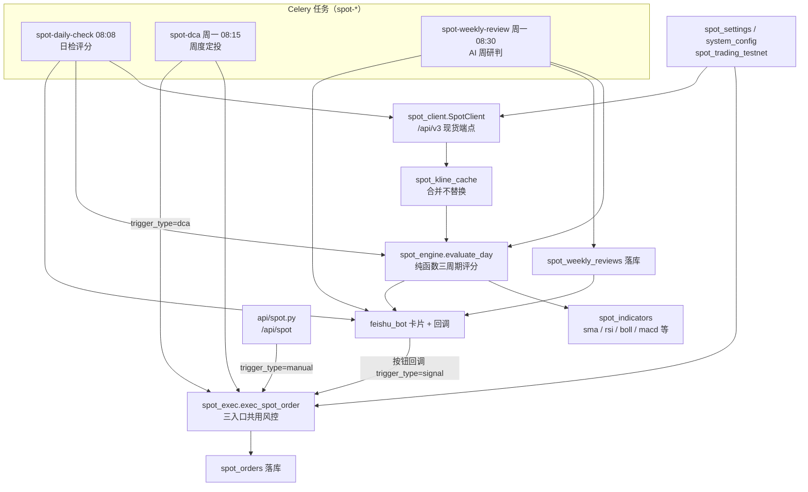
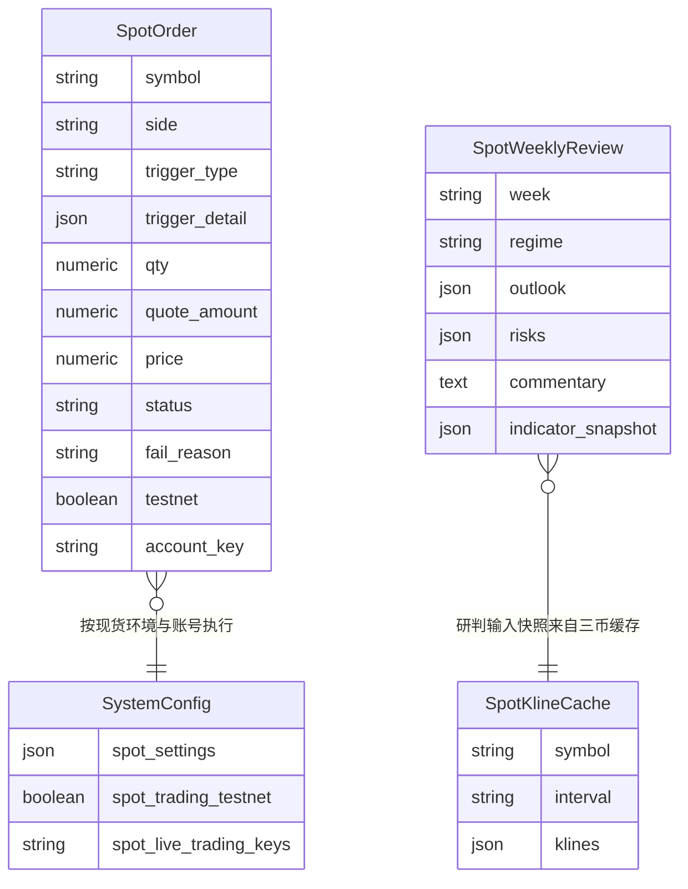
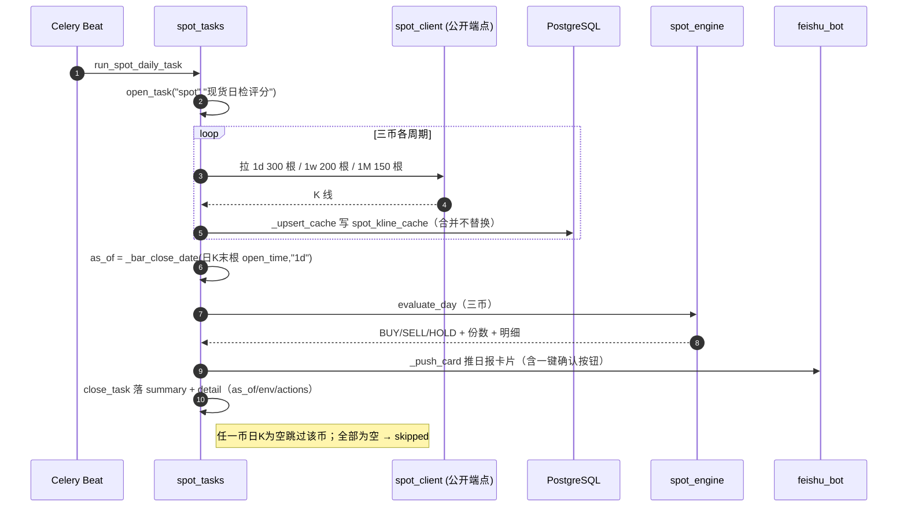
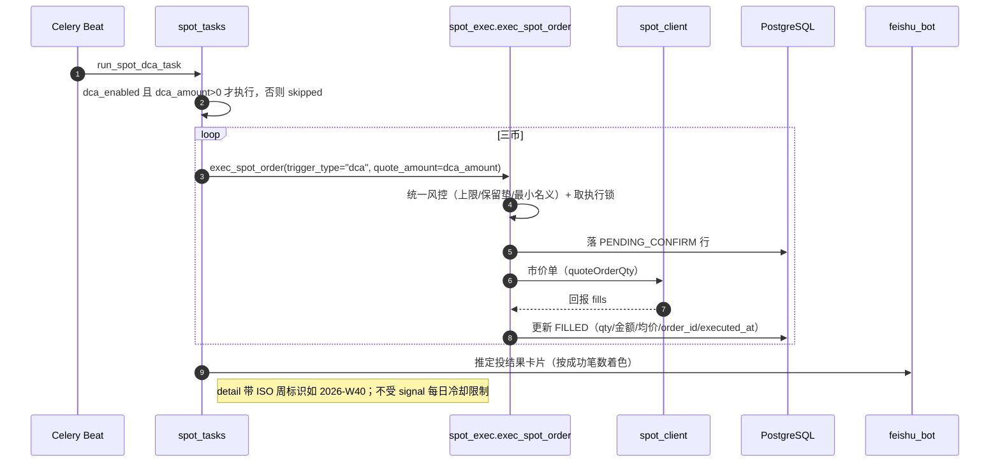
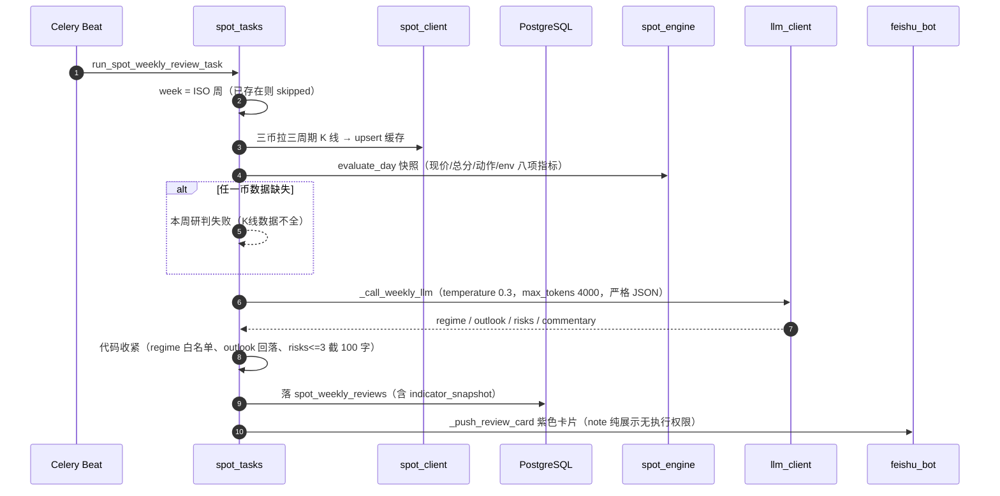
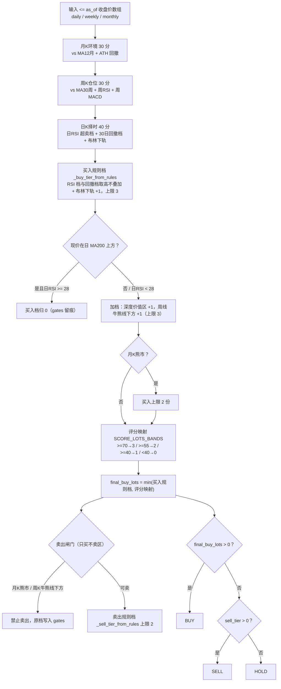

# 技术文档 07 — 现货屯币（对照 功能流程/07-现货屯币.md）

> 现行版本：RULE_VERSION v2026-10-18（2026-10-18）。本文从功能文档 07 提炼**技术实现细节**，以代码为准；功能口径与拍板记录见 [功能文档](../功能流程/07-现货屯币.md)。

## 1. 模块与分层

现货是挂载式独立模块（`backend/app/main.py` 注释「独立模块」），与合约系统零侵入隔离。

| 模块 | 路径 | 职责 / 关键符号 |
|---|---|---|
| 决策引擎 | `backend/app/services/spot_engine.py` | `evaluate_day` 纯函数：三周期评分 + 档位 + 闸门 → BUY/SELL/HOLD 与份数；常量 `RSI_BUY_TIERS` / `DRAWDOWN_TIERS` / `RSI_SELL_TIERS` / `REBOUND_SELL_TIERS` / `SCORE_LOTS_BANDS` / `ABOVE_MA200_RSI_GATE` / `BULL_LINE_DEVIATION_SELL` / `MIN_NOTIONAL_USDT` / `SpotDefaults` |
| 指标库 | `backend/app/services/spot_indicators.py` | `sma` / `rsi`（Wilder）/ `boll` / `macd` / `macd_golden_cross` / `drawdown_from_high` / `rebound_from_low` / `price_vs_ma`，全纯函数 |
| 执行 | `backend/app/services/spot_exec.py` | `exec_spot_order` 三入口共用风控 + 市价单 + 落库；常量 `SWING_SELL_CAP=0.30` / `_SPOT_LOCK_TTL_S=30` / `MIN_NOTIONAL_USDT` |
| 客户端 | `backend/app/services/spot_client.py` | 币安现货 REST；`SPOT_TESTNET_BASE` / `SPOT_KLINE_INTERVALS=("1d","1w","1M")` / `SpotClient` |
| 设置 | `backend/app/services/spot_settings.py` | `load_spot_settings` / `merge_spot_settings`；字段白名单 `_FIELD_SPECS` |
| 任务 | `backend/app/tasks/spot_tasks.py` | `run_spot_daily_task` / `run_spot_dca_task` / `run_spot_weekly_review_task` / `run_spot_backfill_task` / `_push_card` / `_push_review_card` |
| API | `backend/app/api/spot.py` | 总览 / 评分 / 执行 / 配置 / 时间轴 / K线缓存端点 |
| 模型 | `backend/app/models/spot.py` | `SpotOrder` / `SpotWeeklyReview` / `SpotKlineCache`；`SPOT_SYMBOLS=("BTCUSDT","ETHUSDT","BNBUSDT")` |
| 调度 | `backend/app/celery_app.py` | spot-daily-check 每日 08:08 / spot-dca 周一 08:15 / spot-weekly-review 周一 08:30（北京时间） |
| 飞书回调 | `backend/app/services/feishu_bot.py` | 卡片按钮 `spot_buy` / `spot_sell` → `exec_spot_order(trigger_type="signal")` |
| 前端 | `frontend/src/pages/ScanResult.tsx` 业务域「现货」+ `frontend/src/components/Spot*Panel.tsx` + `frontend/src/api/spot.ts` | 持仓总览 / 历史记录 / 策略配置 / 日志 |

**与合约系统的隔离边界（逐条落进代码）**：

| 隔离维度 | 现货侧做法 | 代码依据 |
|---|---|---|
| 交易所客户端 | 独立 `SpotClient` 走 `/api/v3` 现货端点，不复用合约 fapi 客户端 | `spot_client.py` |
| 执行锁 | 自写 `lock:spot_open:{account_key}`（SET NX PX + 自旋） | `spot_exec.py` |
| 数据表 | 3 张全新表（`spot_orders` 等），不读写合约任何表 | `models/spot.py` |
| 环境开关 | `spot_trading_testnet` 独立列，与合约 `trading_testnet` 互不影响 | `models/system_config.py` |
| 定时任务 | 独立任务命名 `spot-*` | `celery_app.py` beat |
| API 路由 | 独立 router `/api/spot`，不引用合约 task/trade_engine 服务 | `api/spot.py` |
| 日志命名空间 | 统一走 `app.spot.*` | `spot_exec.py` |

允许的复用仅限基础设施：`task_log`、`notify`/`feishu_bot`、`account_registry`、`llm_client`。

## 2. 数据结构

| 表 / 载体 | 关键列 | 说明 |
|---|---|---|
| `spot_orders` | `side`(BUY/SELL)、`trigger_type`(signal/dca/manual)、`trigger_detail`(JSONB 快照：score/rule_hits/env/risk_notes)、`qty`/`quote_amount`/`price`(Numeric)、`status`(PENDING_CONFIRM/FILLED/CANCELLED/FAILED)、`fail_reason`、`testnet`、`account_key`、`binance_order_id`、`executed_at` | 全部实盘成交流水；`account_key` NULL 旧行按 `testnet` 回落 |
| `spot_weekly_reviews` | `week`（ISO 周唯一）、`regime`、`outlook`、`risks`、`commentary`、`indicator_snapshot` | AI 周度研判留档 |
| `spot_kline_cache` | `symbol` + `interval`（唯一索引）、`klines`(JSONB `{t,o,h,l,c,v}` 精简列) | 三币 × 1d/1w/1M 共 9 行，日检/周研判/评分共用 |

`SystemConfig` 新增现货列（零侵入）：`spot_settings`(JSONB)、`spot_trading_testnet`(默认 true)、`spot_live_trading_keys`(逗号分隔 live key)。

**`evaluate_day` 返回结构（可解释决策 dict）**：`score.{env,position,timing}`（每项带当前值/阈值/得分）、`rules.{buy_hits,sell_hits,gates,plan_text}`、`monthly_bear` / `deep_value` / `weekly_above` / `final_buy_lots` / `action` / `lots`。

## 3. 核心流程

### 3.1 日检（`spot_tasks.run_spot_daily_task`，每日 08:08 北京）

### 3.2 周度定投（`spot_tasks.run_spot_dca_task`，周一 08:15 北京）

### 3.3 AI 周度研判（`spot_tasks.run_spot_weekly_review_task`，周一 08:30 北京）

### 3.4 `evaluate_day` 决策闸门与份数合成

## 4. 关键算法与常量

**三周期评分（`evaluate_day`，满分 100 = 环境 30 + 仓位 30 + 择时 40）**：

| 层 | 计分 | 分值 |
|---|---|---|
| 月K环境 | vs MA12月 >0（牛市）/ ≤0（`monthly_bear`）；距 ATH 回撤 ≤−50%（`deep_value`） | 20 / 5，深度价值 +10 |
| 周K仓位 | vs MA30周 >0（`weekly_above`）/ ≤0；周RSI(14) <40；周MACD 金叉后 | 15 / 5，+10，+5 |
| 日K择时 | 日RSI 超卖档（`RSI_BUY_TIERS`）；30日回撤档（`DRAWDOWN_TIERS`）；收盘 < 布林下轨 | 见下 |

**档位常量**：

| 常量 | 取值 | 说明 |
|---|---|---|
| `RSI_BUY_TIERS` | `((20.0,3),(25.0,2),(30.0,1))` | 日RSI 超卖买入档（20分/15分/10分） |
| `DRAWDOWN_TIERS` | `((-0.35,3),(-0.25,2),(-0.15,1))` | 30日回撤买入档（15分/10分/5分） |
| `RSI_SELL_TIERS` | `((80.0,2),(70.0,1))` | 日RSI 超买卖出档 |
| `REBOUND_SELL_TIERS` | `((0.50,2),(0.30,1))` | 30日反弹卖出档 |
| `SCORE_LOTS_BANDS` | `((70.0,3),(55.0,2),(40.0,1))` | 评分 → 买入份数映射 |
| `ABOVE_MA200_RSI_GATE` | 28.0 | MA200 上方时的更严日RSI 门槛 |
| `BULL_LINE_DEVIATION_SELL` | 0.30 | 现价 > MA30周 ×1.3 乖离卖出 +1 |
| `MIN_NOTIONAL_USDT` | 10.0 | 买入裁剪后最小名义门槛 |
| `SWING_SELL_CAP` | 0.30 | 波段仓可卖上限（该币 free × 30%） |

**买入档合成规则**：RSI 档与回撤档**取高不叠加**；布林下轨 +1；单日上限 3。**加档**：深度价值区 +1、周线牛熊线下方 +1（合计上限 3）。**月K熊市**买入上限 2 份。**份数**：`final_buy_lots = min(买入规则档, 评分映射)`，规则档被评分拦下时写 `gates`。

**卖出档合成规则**：RSI 超买档与 30 日反弹档取高；收盘 > 布林上轨 +1；现价 > MA30周 ×1.3 乖离 +1；上限 2 档。**卖出闸门**：月K熊市禁止卖出、周K牛熊线下方只买不卖，被拦原档写入 `gates`。

**执行侧分量公式（`spot_exec`）**：BUY 用 `quote_amount` 优先，否则 `lots × per_order_usdt`；SELL 用 `qty` 优先（先过波段仓 30% 裁剪），否则 `lots × per_order_usdt ÷ 现价`；单币投入上限裁剪 `math.floor` 到分；保留垫 `本笔 <= 买入前 free USDT × (1 − usdt_reserve_pct)`；`round_qty` 按 `LOT_SIZE.stepSize` 向下取整。

**屯币 KPI（`_spot_kpi`，`api/spot.py`）**：净增币 = FILLED BUY 币数 − FILLED SELL 币数；定投基准自首笔 FILLED 单所在周一起每周一买入 `dca_amount`（买入价 = 该周周K收盘，未收盘周 = 现价口径）；`excess_qty` = 净增币 − 基准币数。

## 5. API 契约

`backend/app/api/spot.py`（prefix `/api/spot`）：

| 方法 | 路径 | 说明 |
|---|---|---|
| GET | `/overview` | 持仓总览：三币持仓 + 现金池（跨启用账号聚合，单账号失败降级计 0 并记 error）+ 实时评分 + 屯币 KPI；`account_key` 可切单账号 |
| GET | `/score/{symbol}` | 单币评分明细（评分实时算，缓存缺失/过旧现场拉一次币安并回写） |
| POST | `/execute` | 手动执行市价单（第三入口，统一 `exec_spot_order` 风控；拒绝返回 ok=false 不抛 4xx） |
| GET | `/timeline` | 运营时间轴：order + review + daily_check（task_records）按时间倒序合并 |
| GET/PUT | `/config` | 现货环境 + 启用账号读写（`spot_trading_testnet` / `spot_enabled_keys`） |
| GET/PUT | `/settings` | 屯币配置读写（字段白名单 + 范围校验，非法键返回 rejected） |
| GET | `/kline-cache-status` | 各币各周期根数/覆盖区间/新鲜度 |
| POST | `/kline-backfill` | 触发 K线全量回填（异步 celery，免费公开行情） |

> 模块 docstring 写有 `GET /spot/orders` 订单列表，实际代码未实现该端点——订单流水经 `/timeline`（order 事件）与任务面板查看，以代码为准。

**评分实时计算的缓存新鲜度（`_ensure_klines`）**：日K缓存末根必须已是「本日收盘」（收盘时刻 UTC+1天 ≤ 现在）才免刷新，否则现场拉一次并回写；周/月K容忍不刷新。拉取失败降级用旧缓存，无缓存可降才返回 502。

## 6. 配置项

**`spot_settings`（`spot_settings.py` `_FIELD_SPECS` 范围校验，NULL 回落 `SpotDefaults`）**：

| 字段 | 默认 | 允许范围 | 含义 |
|---|---|---|---|
| `per_order_usdt` | 100 | 10–1000 | 单份金额（信号/手动按份折算基准） |
| `max_total_usdt` | 3000 | 100–100000 | 单币累计投入上限（FILLED BUY 之和口径） |
| `dca_enabled` | true | — | 周度定投开关 |
| `dca_amount` | 50 | 0–1000 | 每周每币定投金额 |
| `usdt_reserve_pct` | 0.2 | 0–0.9 | 买入后 USDT 保留垫比例（占现货现金池） |
| `fee_rate` | 0.001 | 0–0.01 | 手续费假设 |

**`system_config` 现货列**：`spot_settings`(JSONB)、`spot_trading_testnet`（默认 true）、`spot_live_trading_keys`（逗号分隔 live key）。

**`.env`**：`BINANCE_SPOT_TESTNET_API_KEY/SECRET_KEY`（现货测试网专用，可选，未配置回落 `BINANCE_TESTNET_*`）；账号注册表与合约共用 `BINANCE_LIVE_{N}_*` / `BINANCE_TESTNET_*`。**Feishu**：`FEISHU_ACTION_TOKEN`（卡片一键确认按钮的令牌）。

**环境语义**：`spot_trading_testnet=true` → `testnet-1`，`SPOT_TESTNET_BASE=testnet.binance.vision`；`false` → 现货正式网，启用账号取 `spot_live_trading_keys ∩ 注册表`，空回落 `live-1`（`account_registry.spot_enabled_accounts`）。K线属公开事实数据，全量回填强制走正式网公开端点（`SpotClient(public=True)`）。

## 7. 并发、幂等与异常处理

- **执行锁**：`lock:spot_open:{account_key}`，`SET NX PX` TTL 30s（防进程崩溃死锁，`_SPOT_LOCK_TTL_S`）+ 自旋等待 10s；只释放自己持有的 ident。
- **落库顺序**：风控通过后先落 `PENDING_CONFIRM` 行（执行中崩溃可追溯，`risk_notes` 随 `trigger_detail` 落库）→ 币安市价单 → 按回报更新 FILLED/FAILED。风控过程中的裁剪（投入上限/保留垫/波段 30%）写入 `trigger_detail.risk_notes`。
- **幂等/冷却**：signal 单同一币同一账号、北京日历日内已有 signal FILLED 单则拒绝（每日最多一次）；manual/dca 不受限。
- **异常处理**：`exec_spot_order` 不抛异常，失败也返回 `{ok:false, reason}`；**纯风控拒绝不落库**（不留噪音行），币安下单抛错才落 FAILED 行（`fail_reason` 截 500 字，`db.rollback` 后重挂状态再提交）；返回的 `status` 非 FILLED 按回报原值落库，缺省兜底 FILLED。
- **精度与过滤器**：exchangeInfo 类级缓存 1h（step/tick/minNotional）；`?symbol=` 返回包在 `symbols` 数组里（2026-09-24 实证修复）——**过滤器拿不到必须报错拒绝下单**（错误精度会超卖，静默兜底比失败更危险）。
- **缓存合并不替换**：`spot_kline_cache` 按 t 去重、远端覆盖同 t，保住全量回填深历史不被日检最近 300 根覆盖。
- **无未来函数（纯函数铁律）**：`evaluate_day` 只收 ≤ as_of 的收盘价数组，内部不读时钟、不做日期过滤；防线在调用方截断 + `test_no_future.py` CI 一票否决。

## 8. 测试覆盖

| 测试 | 文件 | 覆盖 |
|---|---|---|
| 无未来函数四命题 | `backend/tests/test_no_future.py` | ① 截断不变性：同一末根 T 砍更早历史（保留 >=MA200 窗口）输出一致；② 确定性：同输入两次调用输出相同；③ 指标纯度：重复计算稳定、Wilder/EMA 递归残差有界（< 1e-4 / 1e-9）；④ 窗口敏感性：末根变化输出随新收盘合理变化 |

执行风控（投入上限/保留垫/波段仓 30%/冷却）、设置校验、周度研判 JSON 收紧等暂无专门单测，靠代码内注释与实盘测试网验证——补充时优先落在 `exec_spot_order` 的拒绝分支。
