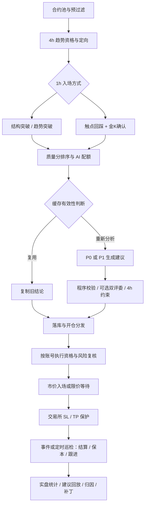

# 系统定位与端到端逻辑审计

> 审计日期：2026-10-21  
> 代码基线：`0bbb0aa`（`feat: 重建4h定向1h入场筛选与AI提示词`）  
> 范围：合约扫描、信号、AI、执行、持仓管理与复盘；现货仅讨论产品边界。  
> 方法：静态代码审计、两组独立子模块核查及建议回放函数最小复现。未读取线上生效配置、未做完整收益回测、未修改策略代码。  
> 证据路径相对本文所在的 `docs` 目录；行号以本次代码基线为准。

## 一、结论摘要

**系统交易主线已经比较清楚，但外围判断与保护逻辑持续叠加，形成了“执行工程较丰富、策略验证与规则一致性不足”的状态。下一阶段应先收敛职责、补齐验证闭环，再决定增删指标或 AI 环节。**

建议定位为：

> **以 4h 趋势资格和方向为基础，在 1h 寻找突破或回踩入场机会，由 AI 提议交易参数、程序执行风险约束的加密合约交易系统。**

### 结论分级

| 类别 | 结论 | 优先级 |
|---|---|---|
| 已确认实现缺陷 | 缓存复制遗漏 `stop_anchor`，可能取消近锚风险折价 | P0 |
| 已确认控制缺口 | 保护失败后紧急平仓若再失败，缺少可靠的最终闭环 | P0 |
| 已确认验证缺陷 | 建议回放存在无结论样本过窗遗漏；不检查入场成交 | P1 |
| 已确认契约缺口 | 缓存有效性缺少上下文和版本约束，复用跳过部分当前复核 | P1 |
| 已确认契约缺口 | 60/70/85 档位主要由提示词约束，程序仍接受连续分数 | P1 |
| 设计与统计口径问题 | 风险字段混用、补丁缺少统一决策版本、组合热度不等于当前剩余风险 | P1 |
| 待实证的策略判断 | 4h 仅排列放行是否过严；质量分是否压制健康深回踩 | P2 |
| 待验证增量价值 | 双评委、P1 Agent、战法标签及归因补丁的成本收益 | P2 |

> P0 表示优先处理的资金安全问题，不表示已观测到对应线上损失。静态控制缺口与已发生事故必须分开。

## 二、系统定位与边界

### 2.1 核心职责

| 层级 | 应承担的职责 | 不应混淆的职责 |
|---|---|---|
| 4h 趋势层 | 决定是否有参与资格、参与哪个方向 | 不直接决定 1h 入场时点 |
| 1h 触发层 | 找突破或回踩入场机会 | 回踩期间反向动量不应自动等同趋势反转 |
| 候选排序层 | 在有限 AI 配额中分配分析机会 | 不是无关紧要的展示分；它会改变实际候选集合 |
| AI 层 | suggest/skip、结构解释、三价及推荐档位 | 不直接掌握最终仓位和风险权限 |
| 程序校验层 | 校验三价、RR、锚点及输出契约 | 不应依赖模型自觉遵守硬约束 |
| 执行与风险层 | 按账号确定能否开仓、预算、数量和交易所可成交性 | 计划预算不等于保证最大实际亏损 |
| 持仓管理层 | 交易所保护、保本、跟进止损、异常处置 | 自动动作与人工建议应有明确边界 |
| 复盘层 | 对照计划与成交，验证规则和 AI 的增量价值 | 价格路径命中率不能代替真实扣费收益 |

### 2.2 不是哪些系统

- 不是纯黑箱 AI 交易：AI 输出仍受程序与账号执行闸门限制。
- 不是纯确定性规则系统：LLM 裁决与参数生成不是完全确定的。
- 不是高频、做市、套利或独立均值回归系统。
- 不是已证明具有稳定正期望的策略；代码完备程度不能证明收益能力。
- 现货屯币是独立产品旁路，不宜混入合约策略效果统计。

### 2.3 文档定位已经落后于代码

旧总览仍以 1h 三票定向为核心，部分描述没有限价入场、交易行为完全确定；实际代码已经采用 4h 定向，并支持等待限价成交。

证据：[系统总览](<总览与索引/功能流程/12-交易系统总览.md#L30-L105>)、[扫描定向](<../backend/app/services/scanner.py#L401-L434>)、[限价等待入场](<../backend/app/services/trade_engine.py#L746-L763>)。

## 三、端到端真实逻辑

### 3.1 扫描与信号

1. 获取 USDT 永续合约池，执行成交额、新币、风险档位、黑名单等预过滤。
2. 获取 4h 数据，经趋势资格检查并定向；当前仅多头/空头排列态放行。
3. 在 1h 寻找结构突破、趋势突破或触点回踩金K确认。
4. 突破受 1h 动量与震荡硬门约束；回踩不再因反向票直接拒绝，部分因素转为扣排序分。
5. 按质量分及成交额排序，记录假设分池名次，执行去重并落库。
6. AI 配额选择候选。质量分影响是否获得分析机会，因此本身就是策略选择层。

证据：[4h 定向与缺数拒绝](<../backend/app/services/scanner.py#L391-L434>)、[质量分计算](<../backend/app/services/strategy/technical.py#L1547-L1668>)。

**已排除的误判：**全局按同一排序键排好后，按类别分别累计得到池内名次，与分别排序等价；类别交错不会导致名次错误。

### 3.2 AI 与校验

- 批量分析固定走 P0；只有开启管线开关且手动强制重分析时才走 P1 Agent。
- 生成建议后，程序校验三价、近锚、止损宽度、RR、止盈距离等。
- 可选双评委只能 keep/veto，不应修改交易参数。
- 4h 程序约束提供兜底，但缺数处理与扫描阶段并不完全一致。
- 缓存复用是独立短路路径，不经过完整的新分析链。

证据：[管线选择](<../backend/app/tasks/ai_tasks.py#L430-L478>)、[缓存短路](<../backend/app/tasks/ai_tasks.py#L350-L387>)、[4h 约束](<../backend/app/services/strategy/technical.py#L1020-L1103>)。

### 3.3 执行与退出

- suggest 通过静态评分门槛后，分发到账号级执行；账号再复核动态门槛、余额、持仓、组合风险和熔断。
- 按止损距离和风险预算推导数量，再检查交易所数量、名义价值、杠杆、保证金和盘口等条件。
- 可市价入场；现价 RR 不足时，符合条件可限价等待。
- 成交后挂 SL/TP，建立交易记录。
- 事件流与定时巡检共同推进结算、TP 状态、保本和跟进止损；事件开关关闭时主要依赖定时路径。
- AI 持仓顾问可自动触发规则化收紧；reduce/exit 主要留给人工执行。

证据：[调度与事件兜底](<../backend/app/celery_app.py#L84-L100>)、[成交与保护单](<../backend/app/services/trade_engine.py#L861-L935>)、[持仓顾问边界](<../backend/app/services/position_advisor.py#L15-L32>)。

## 四、优先修复的实现与控制问题

### 4.1 P0：缓存复制丢失近锚风险属性

**事实：**缓存复制遗漏 `stop_anchor`，落库为 `None`；执行层只有明确等于 `near` 才应用近锚折价。

**影响：**默认系数为 0.7 时，同样三价的旧建议可能由 `0.7 × 预算` 恢复到 `1.0 × 预算`，相对增幅约 42.9%。同时遗漏战法、4h 阶段等字段，破坏归因完整性。

**建议：**定义可复用决策完整契约；复制时保留风险与归因字段，增加缓存前后语义等价测试。

证据：[复制字段](<../backend/app/tasks/ai_tasks.py#L565-L591>)、[落库字段](<../backend/app/tasks/ai_tasks.py#L663-L686>)、[近锚折价](<../backend/app/services/trade_engine.py#L238-L250>)。

### 4.2 P0：保护失败没有可靠的最终闭环

**事实：**保护单失败后会尝试紧急平仓，但紧急平仓再失败主要记录错误；SL 被拒且现价越过 SL 时，有仅告警并等待人工的路径。

**影响：**正常路径有保护，不等于异常情况下保证仓位最终被平掉或重新受保护。

**建议：**建立独立异常持仓状态、持续重试、交易所对账、停开新仓和升级告警；先确认实际仓位，再决定平仓或恢复保护，不以一次日志作为终态。

证据：[紧急处置](<../backend/app/services/trade_engine.py#L936-L962>)、[SL 被拒后的处置](<../backend/app/services/trade_engine.py#L2017-L2054>)。

### 4.3 P1：缓存有效性不足以代表上下文不变

**事实：**指纹主要包含币种、信号类型、形态、触点和价格桶，缺少方向、信号根、配置/提示词版本和 4h 上下文；复用仅做有限价格区校验，并跳过后续新分析约束。复制产生的新记录还可能成为下一次缓存来源。

**边界：**扫描时的 4h 前置门仍有效，不能据此断言所有缓存必然绕过扫描资格。风险在于扫描至分析的状态变化、旧结论方向或规则改变等场景。

**建议：**固定原始生成时刻和到期时间；区分内容缓存与决策复用；补充上下文哈希，并在复用前重做必要硬门。

证据：[指纹](<../backend/app/tasks/ai_tasks.py#L86-L98>)、[缓存复用](<../backend/app/tasks/ai_tasks.py#L350-L360>)、[查询来源](<../backend/app/tasks/ai_tasks.py#L550-L562>)。

### 4.4 P1：建议回放不能当作真实策略收益验证

**事实与最小复现：**

| 输入情形 | 当前函数输出 | 问题 |
|---|---|---|
| 24 根 K 线均未触及 SL/TP | `('open', False, 24)` | 任务继续等待，但查询仅覆盖创建后 24～26h，过窗可能无结论 |
| 多单 entry=100，之后一根 K 线范围 111～115，TP1=110 | `('win_tp1', True, 1)` | 未校验入场成交；价格路径触目标被记作命中 |

回放也不等价于真实分批止盈、保本、跟进、费用与成交过程。

**建议：**明确区分“信号价格路径”“计划订单回放”“真实交易账本”；实现观察窗终态、成交判定和失败补跑。若用于比较 veto 等模块，必须采用对称且可成交的反事实口径。

证据：[回放函数](<../backend/app/tasks/review_tasks.py#L31-L59>)、[查询窗口](<../backend/app/tasks/review_tasks.py#L69-L95>)、[无结论继续等待](<../backend/app/tasks/review_tasks.py#L130-L145>)。

## 五、规则不一致与不合适的口径

### 5.1 质量排序与 AI 对健康回踩的价值判断有张力

回踩不再因 1h 反向票直接拒绝，但同向票数量、OBV/ST、结构门及震荡扣分仍可能让其在 AI 配额前落后。候选硬门放行不等于最终有机会交易。

这不是已证实的算分 bug。低确认回踩也可能确实更差，需要按触点、反向票数、质量分、AI 入选率及后续表现做对照，而不是直接取消扣分或直接实施分池。

证据：[回踩基础分](<../backend/app/services/strategy/technical.py#L1547-L1554>)、[风险与结构扣分](<../backend/app/services/strategy/technical.py#L1598-L1644>)。

### 5.2 评分档位只有软契约

提示词要求仅取 60/70/85，但程序实际接受 50～100 的连续分数，因此 58 分 suggest 被静态门槛挡住的情形仍可存在。同时“只取三档”与“同档上下限”等文案不一致。

建议先明确评分含义，再由程序校验契约；不要将 85 理解成经过校准的胜率概率。

证据：[档位纪律](<../backend/app/services/ai_analyzer.py#L216-L246>)、[程序连续评分处理](<../backend/app/services/risk_guard.py#L486-L505>)。

### 5.3 4h 数据缺失在不同阶段处理不一致

扫描阶段无 4h 方向直接拒绝；分析阶段 4h 获取失败只打降级标记，最终约束无数据或无法计算时可原样返回 suggest。AI 兜底也并非重新执行完整扫描资格。

建议定义“扫描、分析、执行三个时刻”的资格、时效和故障契约：何时允许使用最近有效快照、何时重算、何时禁止新开仓。不能把缺失标记误当成执行保护。

证据：[扫描缺数拒绝](<../backend/app/services/scanner.py#L420-L427>)、[分析缺数降级](<../backend/app/tasks/ai_tasks.py#L373-L387>)、[兜底直接返回](<../backend/app/services/strategy/technical.py#L1051-L1056>)。

### 5.4 固定风险预算不是保证最大亏损

成交滑点后实际风险超预算 15% 主要触发告警，交易记录仍使用成交前参考风险；手续费、资金费、跳空和保护失败也会造成预算外损失。

建议分开记录：计划风险、成交后初始风险、当前剩余风险、已实现净收益。不能让一个 `risk_amount` 同时承担所有口径。

证据：[计划风险](<../backend/app/services/trade_engine.py#L738-L739>)、[成交风险与落库](<../backend/app/services/trade_engine.py#L861-L933>)。

### 5.5 组合热度不是当前组合最大损失

当前热度主要使用原始风险金额乘 beta，不能直接代表部分止盈、止损上移后的剩余风险。总止损风险、方向集中度和 BTC 因子暴露是不同指标，宜分别管理。默认组合热度/同向限制允许关闭，也不能据此推定线上实际关闭。

证据：[组合风控计算](<../backend/app/services/trade_engine.py#L1515-L1599>)。

## 六、哪些模块可能多余，如何收敛

不能把“独立安全防线”和“重复决策”混为一谈。执行前重算现价 RR、数量与交易所规则应保留；下面这些模块应证明自己的增量价值。

| 模块 | 当前价值 | 建议 |
|---|---|---|
| 双评委 | 多角度复核，只有 keep/veto 权 | 保留开关，衡量扣费期望、误否决、延迟和调用成本；未验证前不视作必需主链 |
| P0/P1 双管线 | 自动交易成本控制与手动探索 | 明确 P1 实验性质，不能把两管线结果混算后归因为同一策略 |
| 战法库 | 用户策略解释、标签与研究 | 降级为辅助标签，不包装为独立交易引擎；方向等配置须真正进入匹配契约 |
| AI 归因与补丁 | 帮助提出研究假设 | 不把标签热度下降当作因果收益证明；人工审核与版本化必需 |
| 退役参数、历史分支说明 | 兼容历史记录 | 保留读取兼容，但从当前配置和主规则说明中移除无效入口 |
| 现货旁路 | 独立持有与定投产品 | 在界面、资金和收益统计上与合约主链隔离 |

证据：[双评委权限与成本](<../backend/app/services/dual_judge.py#L1-L12>)、[战法仅参考](<../backend/app/services/tactics_match.py#L42-L57>)、[管线选择](<../backend/app/tasks/ai_tasks.py#L430-L478>)。

## 七、最欠缺的能力

### 7.1 完整决策快照与版本

每笔决策应能还原行情时点、信号根、配置、提示词、模型、缓存来源、各层否决及最终执行。当前代码版本标记不能独自覆盖数据库参数与提示词补丁的即时变化。

补丁合入会写配置并提交，但没有在同一函数中形成新的统一决策版本；参数回滚恢复 NULL/默认，也不等价于恢复此前任意自定义值。

证据：[补丁合入与回滚](<../backend/app/services/patch_service.py#L298-L350>)。

### 7.2 可回答“每一层是否有用”的对照体系

至少对照：规则基线、加入 AI、加入双评委、不同质量排序、不同退出方式。

主指标应包括：扣费期望 R、最大回撤、风险超额、成交率、决策延迟、机会损失、异常保护时长。胜率与建议通过率只能作为辅助指标。

目前补丁评估主要比较前后窗口的标签热度、单笔绝对盈亏、胜率与通过率，容易受到行情、仓位规模、其它规则同时变化的影响，不能当作严格因果验证。

证据：[补丁统计口径](<../backend/app/services/patch_service.py#L64-L108>)、[补丁判定](<../backend/app/services/patch_service.py#L356-L445>)。

### 7.3 订单与资金安全的可恢复状态机

需要对“订单已提交但响应丢失、成交后保护失败、紧急平仓失败、数据库落库失败”等状态提供可持续恢复的状态机及对账，而非只靠正常执行路径和日志。

### 7.4 自动与人工职责边界

当前 AI 顾问可自动收紧，但退出/减仓仍主要交人工。若维持该选择，产品应明确是“自动交易加人工干预”，并定义人工响应时限、无人响应策略与异常状态。

证据：[持仓顾问边界](<../backend/app/services/position_advisor.py#L15-L32>)。

## 八、建议的目标架构

| 层级 | 建议的单一输出 |
|---|---|
| 市场数据与快照 | 带时间、来源和版本的不可变事实 |
| 策略资格 | 方向、允许触发类型、拒绝原因及证据 |
| 入场候选 | 触发根、触点、结构锚和候选证据 |
| 排序与配额 | 可复现排序与未入选原因 |
| AI 建议 | 符合明确 schema 的提案，不包含最终仓位权限 |
| 统一决策校验 | 验证后的交易计划、风险属性与有效期 |
| 账号执行 | 账号级预算、订单状态与保护状态 |
| 持仓管理 | 当前剩余风险、退出动作和异常恢复状态 |
| 评估研究 | 同版本、同口径、可成交、扣费后的真实与反事实读数 |

原则：**一项业务规则只有一个权威定义；多阶段可以复核，但必须调用同源规则，使用明确时间戳和故障策略。**

## 九、实施顺序与验收建议

| 阶段 | 主要动作 | 最低验收 |
|---|---|---|
| 第一阶段：资金与数据正确性 | 修缓存风险字段、保护异常闭环、复盘终态与成交判断 | 缓存风险语义等价；保护失败可恢复；所有回放样本有可解释终态 |
| 第二阶段：契约一致性 | 统一档位校验、4h 时效、缓存版本、风险字段与补丁版本 | 同一输入可追溯；配置变化不复用旧决策；评分不出现隐藏弃单 |
| 第三阶段：基线验证 | 冻结一个版本，对比规则/AI/评委/排序/退出 | 同版本前向数据、扣费结果、样本量与不确定性均可报告 |
| 第四阶段：减法优化 | 删除无增量价值模块，收敛退役配置和过时文档 | 删除有数据依据，兼容历史读取，不削弱执行安全 |

不建议现在同时增加新指标、新评分、新退出腿与新 AI 角色。多项行为一起改变，会让下一轮仍无法判断收益变化来自哪里。

## 十、审计边界与未决问题

- 本文不是上线验收报告，也不是完整安全审计。
- 没有依据线上数据库确认实际参数、事件开关和账号配置。
- 没有证明严格 4h 排列门过严，也没有证明深回踩扣分不合理；这些需要可成交反事实与稳定前向样本。
- 没有证明双评委、Agent 或战法模块无价值；建议先测量，后删减。
- 建议回放两项边界已做最小函数复现；其它缺陷主要依据静态数据流判断，不应描述为全部完成运行级复现。
- 此次未修改业务代码，以上改造均为后续建议。

## 最终判断

**系统核心方向已成形。当前最重要的问题不是指标数量，而是缓存、规则、风险与复盘尚未形成一致且可验证的契约。**

优先保障资金安全与数据正确，随后固定稳定版本，测量每一层的净贡献，再做减法。这比继续增加判断层更有价值。
