# Trading Workbench | 交易工作台 — Code Wiki

> 本文档从代码视角梳理项目整体架构、模块职责、关键类与函数、依赖关系与运行方式，作为代码仓库的结构化知识库。
>
> **免责声明**：本软件仅供学习与研究使用，不构成任何投资建议。

---

## 目录

1. [项目概述](#1-项目概述)
2. [技术栈](#2-技术栈)
3. [整体架构](#3-整体架构)
4. [目录结构](#4-目录结构)
5. [后端核心模块](#5-后端核心模块)
   - [配置与基础设施](#51-配置与基础设施)
   - [数据模型层](#52-数据模型层)
   - [API 路由层](#53-api-路由层)
   - [服务层 — 扫描筛选](#54-服务层--扫描筛选)
   - [服务层 — 策略引擎](#55-服务层--策略引擎)
   - [服务层 — AI 分析](#56-服务层--ai-分析)
   - [服务层 — 风控](#57-服务层--风控)
   - [服务层 — 交易执行](#58-服务层--交易执行)
   - [服务层 — 复盘归因](#59-服务层--复盘归因)
   - [服务层 — 现货子系统](#510-服务层--现货子系统)
   - [服务层 — 通知与基建](#511-服务层--通知与基建)
   - [Celery 任务层](#512-celery-任务层)
6. [前端结构](#6-前端结构)
7. [数据模型总览](#7-数据模型总览)
8. [API 接口清单](#8-api-接口清单)
9. [定时任务调度](#9-定时任务调度)
10. [核心时序图](#10-核心时序图)
11. [依赖关系图](#11-依赖关系图)
12. [项目运行方式](#12-项目运行方式)
13. [配置说明](#13-配置说明)

---

## 1. 项目概述

**Trading Workbench** 是一个面向加密货币 USDT-M 永续合约的**指标驱动筛选 + AI 辅助分析 + 自动化交易**工作台，数据源为币安（Binance）合约 API。

核心业务链路（每小时闭环）：

```
全量合约扫描 ──→ 7指标多数决定向 ──→ 触发双确认 ──→ 质量分排序 ──→ AI 分析 ──→ 风控闸门 ──→ 自动开单 ──→ 半小时结算巡检 ──→ 复盘归因
     │                                                                                          │
     └── 观察池（仅方向无触发）/ 待确认池（回踩无金K）                                          └── 止损/分批止盈/跟踪止损/保本
```

系统同时包含一个与合约零侵入隔离的**现货屯币子系统**（日检评分、周度定投、AI 周度研判），以及一套**影子模式**（只打标不决策，事后评估特征表现以决定是否升格为规则）。

---

## 2. 技术栈

| 层 | 技术 |
|---|---|
| 前端 | React 18、TypeScript、Vite 5、Ant Design 5、Zustand、axios、dayjs、lightweight-charts、ECharts |
| 后端 | FastAPI、SQLAlchemy 2.0、Pydantic 2、Celery 5、Redis、httpx、numpy、openai |
| 数据库 | PostgreSQL 15 |
| 任务队列 | Celery + Redis 7（broker + backend） |
| 部署 | Docker、Docker Compose |
| 通知 | 飞书自建应用机器人（卡片 + 长连接回调） |
| 数据源 | 币安 USDT-M 合约 API（公开行情；交易需 API Key）/ 多交易所 K 线故障转移（币安/OKX/Bitget） |

---

## 3. 整体架构

系统采用**前后端分离 + 异步任务队列**的分层架构：

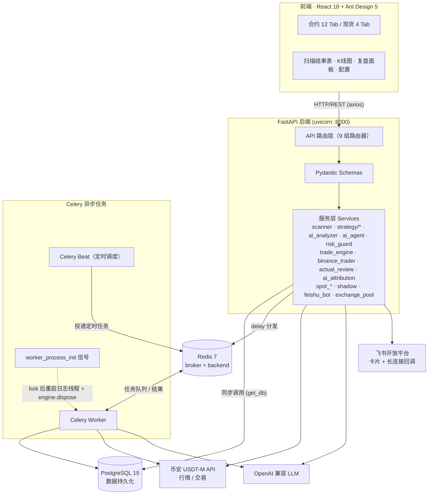

关键设计原则：
- **以代码为准、文档对照**：规则变更必须 bump `RULE_VERSION`，复盘按版本分组隔离
- **幂等迁移**：`_run_migrations` 用 `ALTER TABLE ... IF NOT EXISTS` 补列，不依赖 Alembic
- **影子铁律**：影子打标独立事务，失败绝不拖累主流程（扫描结果/交易记录）
- **事件流 + 巡检兜底**：user-data-stream 事件秒级触发结算，30 分钟巡检永久保留兜底

---

## 4. 目录结构

```
trading-workbench/
├── backend/
│   ├── app/
│   │   ├── api/                  # FastAPI 路由（9 组路由器）
│   │   ├── models/               # SQLAlchemy ORM 模型
│   │   ├── schemas/              # Pydantic 请求/响应 schema
│   │   ├── services/             # 业务服务层
│   │   │   ├── strategy/         # 策略引擎（指标/形态/触发/摆动点）
│   │   │   ├── strategies/       # 可插拔策略（golden_k_ai 等）
│   │   │   ├── scanner.py        # 扫描编排器
│   │   │   ├── ai_analyzer.py    # P0 AI 分析管线
│   │   │   ├── ai_agent.py       # P1 Agent 工具调用管线
│   │   │   ├── risk_guard.py     # 风控闸门
│   │   │   ├── trade_engine.py   # 交易执行引擎
│   │   │   ├── binance_trader.py # 币安合约交易客户端
│   │   │   ├── actual_review.py  # 实盘归因统计
│   │   │   ├── ai_attribution.py # 亏损单 AI 错误归因
│   │   │   ├── spot_*.py         # 现货子系统（5 个文件）
│   │   │   ├── shadow.py         # 影子模式打标与评估
│   │   │   ├── feishu_bot.py     # 飞书通知
│   │   │   └── exchange_pool.py  # 多交易所 K 线故障转移
│   │   ├── tasks/                # Celery 任务（9 个任务模块）
│   │   ├── celery_app.py         # Celery + beat 调度配置
│   │   ├── config.py             # Settings（pydantic-settings）
│   │   ├── database.py           # 引擎 + 幂等迁移
│   │   └── main.py               # FastAPI 入口
│   ├── scripts/                  # 回放/研究脚本
│   ├── skills/                   # 提示词技能（5 个 SKILL.md）
│   ├── tests/                    # pytest 测试（70+ 文件）
│   ├── tools/                    # 冒烟测试工具
│   ├── requirements.txt
│   ├── .env.example
│   ├── Dockerfile
│   └── celery_worker.py          # worker 启动入口
├── frontend/
│   ├── src/
│   │   ├── api/                  # axios API 封装（9 个模块）
│   │   ├── components/           # 40+ 组件
│   │   ├── pages/ScanResult.tsx  # 主页面（合约/现货双模式）
│   │   ├── stores/               # Zustand 状态管理
│   │   ├── types/                # TypeScript 类型定义
│   │   ├── utils/                # 工具函数
│   │   ├── constants/            # 常量
│   │   └── App.tsx
│   ├── package.json
│   ├── vite.config.ts
│   └── nginx.conf
├── docs/                         # 功能文档（中文，21 篇 + archive）
├── docker-compose.yml
├── deploy.sh
└── README.md
```

---

## 5. 后端核心模块

### 5.1 配置与基础设施

#### [config.py](file:///Users/wangwei/Documents/github/trading-workbench/backend/app/config.py)

`Settings(BaseSettings)` — 基于 `pydantic-settings` 的配置类，从 `.env` 文件和环境变量读取。关键配置分组：

| 分组 | 关键变量 | 说明 |
|---|---|---|
| 应用 | `APP_NAME`, `DEBUG` | 应用名与调试模式 |
| 数据库 | `DATABASE_URL` | PostgreSQL DSN |
| Redis/Celery | `REDIS_URL`, `CELERY_BROKER_URL`, `CELERY_RESULT_BACKEND` | Redis 连接 |
| 币安 | `BINANCE_BASE_URL`, `BINANCE_FUTURES_URL`, `BINANCE_CONCURRENCY` | 行情基址与并发 |
| 扫描 | `KLINE_INTERVAL`, `KLINE_WINDOW`, `MIN_VOLUME_24H`, `STRUCTURE_1H_GATE`, `DAILY_LOSS_STOP_PCT`, `RULE_VERSION` | 扫描周期、窗口、过滤、熔断、规则版本 |
| AI | `AI_API_KEY`, `AI_BASE_URL`, `AI_MODEL`, `AI_MAX_PER_SCAN`, `AI_RR_MIN`, `LLM_CONCURRENCY` | LLM 端点与配额 |
| 交易 | `BINANCE_API_KEY/SECRET_KEY`, `BINANCE_LIVE_{N}_*`, `TRADING_MIN_RECOMMENDATION`, `TRADING_LEVERAGE`, `RISK_BUDGET_PCT` | 交易凭据与闸门 |
| 止盈 | `TP1_QTY_PCT_WITH_TP2`, `TP2_QTY_PCT`, `TP1_QTY_PCT_NO_TP2` | 分批止盈比例 |

> **`RULE_VERSION`** 是规则集的版本标记（当前 `v2026-10-11-4`），开仓与分析时快照到 `trade_records`/`ai_analyses`，复盘按版本分组对比。

#### [database.py](file:///Users/wangwei/Documents/github/trading-workbench/backend/app/database.py)

- `engine` / `SessionLocal` / `Base` — SQLAlchemy 2.0 基础
- `get_db()` — FastAPI 依赖注入，请求级 session
- `_run_migrations(engine)` — **幂等迁移**：用 `ALTER TABLE ... ADD COLUMN IF NOT EXISTS` 补列，含大量历史演进的列补充与唯一索引重建（如双网开单的复合唯一索引 `uq_trade_analysis_account`）
- `init_db()` — `create_all` + 迁移，启动时调用

#### [main.py](file:///Users/wangwei/Documents/github/trading-workbench/backend/app/main.py)

FastAPI 应用入口：
- `lifespan` 上下文：`init_db()` → 飞书卡片长连接监听 → 事件流启动
- 中间件：CORS（全开放）、请求级访问日志（慢请求 ≥2s / ≥400 落库）
- 全局异常处理器：未处理异常落「系统日志」并返回 500
- 挂载 9 组路由器

---

### 5.2 数据模型层

#### [models/__init__.py](file:///Users/wangwei/Documents/github/trading-workbench/backend/app/models/__init__.py)

导出全部 ORM 模型。核心模型：

| 模型 | 表名 | 职责 |
|---|---|---|
| `ScanRecord` | `scan_records` | 一次扫描的元数据（类型/状态/计数/筛选漏斗） |
| `ScanResult` | `scan_results` | 扫描命中的币种信号（方向/触发/质量分/票数） |
| `AIAnalysis` | `ai_analyses` | AI 分析结论（决策/三价/盈亏比/推荐度/战法） |
| `TradeReview` | `trade_reviews` | AI 建议 24h 逐 K 回放定论 |
| `TradeRecord` | `trade_records` | 交易记录（全生命周期 + 盈亏 + AI 快照） |
| `TradeEvent` | `trade_events` | 订单事件时间线 |
| `SystemConfig` | `system_config` | 运行时配置单行表（id=1） |
| `SymbolBlacklist` | `symbol_blacklist` | 币种黑名单（手动/自动/永久） |
| `PullbackPending` | `pullback_pendings` | 回踩两段式待确认池 |
| `BreakoutEvent` | `breakout_events` | Donchian 破轨事件（回测触点事实源） |
| `Watchlist` | `watchlist` | 关注列表 |
| `PromptPatch` | `prompt_patches` | 规则补丁（提示词覆盖/闸门参数） |
| `Tactic` | `tactics` | 用户自建战法 |
| `ShadowMark` | `shadow_marks` | 影子模式打标 |
| `SpotOrder` / `SpotWeeklyReview` / `SpotKlineCache` | `spot_*` | 现货子系统 |
| `AppLog` / `TaskRecord` | `app_logs` / `task_records` | 系统日志与任务记录 |

---

### 5.3 API 路由层

[api/__init__.py](file:///Users/wangwei/Documents/github/trading-workbench/backend/app/api/__init__.py) 聚合 9 组路由器：

| 路由 | 前缀 | 职责 |
|---|---|---|
| `health_router` | `/api/health` | 健康检查 |
| `market_router` | `/api/market` | 大盘环境/市场情绪（恐惧贪婪指数、BTC/ETH 涨跌） |
| `scan_router` | `/api/scans` | 扫描触发/结果/配置/AI 分析/复盘统计/补丁 |
| `watchlist_router` | `/api/watchlist` | 关注列表 CRUD + 刷新 |
| `trades_router` | `/api/trades` | 交易记录/事件/复盘K线/划转/黑名单/开仓/平仓 |
| `ops_router` | `/api/ops` | 系统配置/账号/任务记录/日志/系统操作 |
| `spot_router` | `/api/spot` | 现货屯币（设置/订单/周研判） |
| `tactics_router` | `/api/tactics` | 战法管理 |
| `shadow_router` | `/api/shadow` | 影子模式评估报告 |

---

### 5.4 服务层 — 扫描筛选

#### [scanner.py](file:///Users/wangwei/Documents/github/trading-workbench/backend/app/services/scanner.py)

**`Scanner` 类** — 扫描编排器，线程池并发扫描全量合约。

核心方法：
- `run(scan_record_id)` — 主流程：
  1. 读取扫描配置与筛选参数组
  2. 预过滤四层：24h 成交额 → 新币冷静期 → 风险档位 → 黑名单
  3. 线程池并发 `scan_one(symbol)` → `detect_indicator_candidate`
  4. 质量分降序排序
  5. 重复命中抑制（仅定时扫描）
  6. 写入结果 + 影子打标
  7. pending/破轨事件处置
  8. 满仓判定 → 分发 AI 分析（或跳过）
  9. 组装筛选漏斗 `funnel_json`

**`detect_indicator_candidate(...)`** — 单币五步判定链（核心）：
1. **4h 趋势闸门** `gate_4h` — 一票否决（EMA144 斜率/缠绕/ADX 三重）
2. **7 指标多数决** `compute_indicator_votes` — |net|≥3 才出方向
3. **闸门方向一致性** — 4h 方向须与多数决一致
4. **震荡评分卡** `range_score` — ≥3 不入场
5. **两段式触发确认** `detect_trigger` — 突破/回踩+金K/回踩两段式
（1H 结构门 `structure_1h` 已从筛选链退役（2026-10-12），现为 trigger 层 **1h EMA21 触点硬门**——仅当回踩触点为 ema21 时校验，其余触点豁免）

#### [scan_filters.py](file:///Users/wangwei/Documents/github/trading-workbench/backend/app/services/scan_filters.py)

`ScanFilters` — 筛选参数组（DB JSONB > env > 代码默认），`resolve_scan_filters(cfg)` 解析生效值。含 `allowed_triggers`（触发类型白名单）、`new_coin_cooldown_days` 等（`structure_1h_gate` 为已退役的兼容键，无消费方）。

#### [exchange_pool.py](file:///Users/wangwei/Documents/github/trading-workbench/backend/app/services/exchange_pool.py)

`ExchangePool` — 多交易所 K 线故障转移（币安/OKX/Bitget），`get_klines(symbol, interval, limit)` 按顺序回退。

#### [market_data.py](file:///Users/wangwei/Documents/github/trading-workbench/backend/app/services/market_data.py)

行情数据工具：`build_market_context`（AI 事实包注入 BTC 状态/资金费率）、`screen_klines`（尾窗幽灵根视图）、`in_forming_tail`、`classify_volume`（量能分档）。

---

### 5.5 服务层 — 策略引擎

[strategy/](file:///Users/wangwei/Documents/github/trading-workbench/backend/app/services/strategy) 目录，按职责拆分：

| 模块 | 职责 |
|---|---|
| [technical.py](file:///Users/wangwei/Documents/github/trading-workbench/backend/app/services/strategy/technical.py) | `compute_indicator_votes`（7 指标投票）、`compute_quality_score`（质量分）、`analyze_htf_background`（4h EMA 状态机 11 态）、`enforce_htf_constraint`（4h 锁单矩阵） |
| [trigger.py](file:///Users/wangwei/Documents/github/trading-workbench/backend/app/services/strategy/trigger.py) | `detect_trigger` — 两段式决策矩阵：T1 突破/趋势突破、T3 回踩+金K确认、回踩两段式 pending 状态机 |
| [candlestick.py](file:///Users/wangwei/Documents/github/trading-workbench/backend/app/services/strategy/candlestick.py) | 8 种金K形态判定（看涨 4 + 看跌 4）、`GOLDEN_PATTERNS` 白名单、影线质量门 |
| [ema.py](file:///Users/wangwei/Documents/github/trading-workbench/backend/app/services/strategy/ema.py) | `analyze_ema` — EMA21/55/144 排列形态分析 |
| [ema_gate.py](file:///Users/wangwei/Documents/github/trading-workbench/backend/app/services/strategy/ema_gate.py) | `gate_4h`（4h 趋势闸门）、`structure_1h`（1H 结构门）、`range_score`（震荡评分卡） |
| [swing.py](file:///Users/wangwei/Documents/github/trading-workbench/backend/app/services/strategy/swing.py) | `find_swing_points`、`merge_swings` — 摆动点检测与 HH/LH/HL/LL 分类 |
| [indicators.py](file:///Users/wangwei/Documents/github/trading-workbench/backend/app/services/strategy/indicators.py) | `volume_ratio` 等量能指标 |

7 个投票指标：MACD(12,26,9)、布林带(20,2)、RSI(14)、SuperTrend(10,3)、ADX(14)、OBV(20)、4h EMA21/55 背景。

---

### 5.6 服务层 — AI 分析

#### [ai_analyzer.py](file:///Users/wangwei/Documents/github/trading-workbench/backend/app/services/ai_analyzer.py)

**P0 单次调用管线**：
- 构建上下文：K 线 + 指标票数 + 摆动结构 + 市场环境
- 系统提示词纪律段（`_RULE_HTF_HARD` / `_RULE_VOTE` / `_RULE_SL` / `_RULE_TP`）
- 调用 LLM → `parse_and_validate`（Pydantic `TradeDecision` 契约 + RR 铁律复算）
- 指纹缓存（`fingerprint`，价格分桶）

#### [ai_agent.py](file:///Users/wangwei/Documents/github/trading-workbench/backend/app/services/ai_agent.py)

**P1 Agent 工具调用管线**：多轮工具循环（stage_trace 记录），可选双评委辩论。

#### [dual_judge.py](file:///Users/wangwei/Documents/github/trading-workbench/backend/app/services/dual_judge.py)

双评委辩论：对 suggest 决策做多空辩论复核，veto 强制 skip 前快照 `veto_original` 供复盘对比。

#### [risk_guard.py](file:///Users/wangwei/Documents/github/trading-workbench/backend/app/services/risk_guard.py)

AI 决策确定性校验：
- `TradeDecision` Pydantic 契约
- **RR 铁律**：按三价复算盈亏比 ≥ `AI_RR_MIN`(1.5)
- 方向-价格一致性（多单 SL<entry<TP1）
- `liquidation_gate_pct` — 强平保证金闸门口径
- `parse_and_validate` / `build_forced_skip`

#### [llm_client.py](file:///Users/wangwei/Documents/github/trading-workbench/backend/app/services/llm_client.py)

`get_client`（OpenAI 兼容客户端）、`parse_llm_json`（json-repair 容错解析）、`stream_completion`（流式输出）。

#### [skill_library.py](file:///Users/wangwei/Documents/github/trading-workbench/backend/app/services/skill_library.py)

提示词技能库（`backend/skills/` 下 5 个 SKILL.md），按场景注入 AI 上下文。

---

### 5.7 服务层 — 风控

#### [risk_guard.py](file:///Users/wangwei/Documents/github/trading-workbench/backend/app/services/risk_guard.py)（见 5.6）

#### [risk_budget.py](file:///Users/wangwei/Documents/github/trading-workbench/backend/app/services/risk_budget.py)

风险预算解析：`pct`（风险基数 ×3%）/ `fixed`（固定 USDT）两种模式。

#### [blacklist_service.py](file:///Users/wangwei/Documents/github/trading-workbench/backend/app/services/blacklist_service.py)

`active_symbols(db)` — 生效黑名单集合（手动永久 / 自动冷却 / 止损≥1.5R 永久）。

#### 组合风控参数（SystemConfig）

`portfolio_heat_cap`（组合热度上限）、`same_direction_cap`（同向持仓上限）、`daily_loss_stop_pct`（当日亏损熔断）、`weekly_dd_stop_pct` / `monthly_dd_stop_pct`（周/月回撤分层熔断）、`btc_crash_pause_pct`（BTC 急跌 AI 提示词警示阈值；原普跌闸门与大盘单边闸门 `market_wide_pause_pct` 均于 2026-10-13 移除）。

---

### 5.8 服务层 — 交易执行

#### [trade_engine.py](file:///Users/wangwei/Documents/github/trading-workbench/backend/app/services/trade_engine.py)

**自动交易引擎**，核心函数：

- `try_open_for_analysis(ai_analysis_id)` — 开仓唯一通道（AI 分析落库即分发）：
  - 14 道下单闸门：在跑单上限 / 余额风控 / 同币无仓 / 方向价格复验 / 现价偏离 / RR 复算 / 强平闸门 / 可交易性 / 盘口价差 / 熔断 / 组合热度 / 同向上限 / 推荐度门槛
  - 固定亏损法定仓位：`仓位 = 风险预算 ÷ 止损距离%`
  - `_adaptive_leverage` — 按止损距离反推逐仓安全杠杆
  - 市价开仓 + 挂 SL/TP1/TP2 → 入库
- `settle_trades()` — 半小时巡检结算：
  - 以交易所为真源推断成交事件
  - TP1 成交 → 止损移保本（±往返费缓冲）
  - 无 TP2：TP1 止盈 80%，剩余 20% 跟进止损
  - 有 TP2：TP1 60% / TP2 20% / 剩余 20% 跟进
  - 跟踪止损：最近 3 根已收盘 K 线极值，只收紧不放松
  - ATR 跟进止损（Chandelier Exit，`ATR_TRAIL_K=3`）
- `breaker_status_by_net()` — 当日/周/月亏损熔断状态

#### [binance_trader.py](file:///Users/wangwei/Documents/github/trading-workbench/backend/app/services/binance_trader.py)

`BinanceTrader` — 币安 USDT-M 合约交易客户端（同步 httpx）：
- 双网基址（测试网/正式网，按账号 `testnet` 属性决定）
- 下单/撤单/查询持仓/挂单/资金费率/杠杆档位/交易规则/上市时间
- 进程内缓存：`_filters_cache`（stepSize/tickSize）、`_bracket_cache`（MMR 分档）、`_risk_tier_cache`、`_listed_cache`、`_onboard_cache`

#### [account_registry.py](file:///Users/wangwei/Documents/github/trading-workbench/backend/app/services/account_registry.py)

多账号注册表：扫描 `BINANCE_LIVE_{N}_*` 环境变量，生成 `live-N` / `testnet-1` 账号 key，支持扇出开仓。

#### [trade_recon.py](file:///Users/wangwei/Documents/github/trading-workbench/backend/app/services/trade_recon.py)

逐笔 R 泄漏对账：滑点/手续费/资金费/止损击穿/TP1 滑点分解，理论 R vs 实际 R。

#### [position_advisor.py](file:///Users/wangwei/Documents/github/trading-workbench/backend/app/services/position_advisor.py)

AI 持仓诊断：浮亏在跑单 → `advice_due` 触发 AI 建议（hold/tighten/reduce/exit）。

---

### 5.9 服务层 — 复盘归因

#### [actual_review.py](file:///Users/wangwei/Documents/github/trading-workbench/backend/app/services/actual_review.py)

实盘归因统计：胜率、盈亏比、每笔期望（R 倍数）、计划 vs 实际差值（手续费+资金费+滑点），按打法/方向/出场原因/北京时段/规则版本分组。

#### [ai_attribution.py](file:///Users/wangwei/Documents/github/trading-workbench/backend/app/services/ai_attribution.py)

亏损单 AI 错误归因：打标签（追高追空/止损过宽过窄/逆指标多数…）、生成教训。

#### [patch_service.py](file:///Users/wangwei/Documents/github/trading-workbench/backend/app/services/patch_service.py)

规则补丁闭环：AI 生成补丁草稿（提示词覆盖段或闸门参数）→ 人工确认合入 → 三态评估（valid/invalid/worse）→ 一键回滚。

---

### 5.10 服务层 — 现货子系统

与合约零侵入隔离的屯币系统，独立账号集合与配置：

| 文件 | 职责 |
|---|---|
| [spot_engine.py](file:///Users/wangwei/Documents/github/trading-workbench/backend/app/services/spot_engine.py) | 现货引擎（日检评分/定投/周研判编排） |
| [spot_exec.py](file:///Users/wangwei/Documents/github/trading-workbench/backend/app/services/spot_exec.py) | 现货下单执行 |
| [spot_client.py](file:///Users/wangwei/Documents/github/trading-workbench/backend/app/services/spot_client.py) | 币安现货 API 客户端 |
| [spot_indicators.py](file:///Users/wangwei/Documents/github/trading-workbench/backend/app/services/spot_indicators.py) | 现货指标 |
| [spot_settings.py](file:///Users/wangwei/Documents/github/trading-workbench/backend/app/services/spot_settings.py) | 现货配置解析 |

底仓 ≥70% 不卖，日检评分推送不下单，周度定投需 `dca_enabled`。

---

### 5.11 服务层 — 通知与基建

| 文件 | 职责 |
|---|---|
| [feishu_bot.py](file:///Users/wangwei/Documents/github/trading-workbench/backend/app/services/feishu_bot.py) | 飞书自建应用机器人：卡片发送 + 长连接回调（平仓按钮），13 类通知 |
| [log_sink.py](file:///Users/wangwei/Documents/github/trading-workbench/backend/app/services/log_sink.py) | WARNING+ 日志落库（前端「系统日志」），fork 后重启 |
| [task_log.py](file:///Users/wangwei/Documents/github/trading-workbench/backend/app/services/task_log.py) | 任务记录 `open_task`/`close_task` |
| [event_stream.py](file:///Users/wangwei/Documents/github/trading-workbench/backend/app/services/event_stream.py) | user-data-stream + mark price 长连接（事件驱动结算，`EVENT_EXEC_ENABLED` 开关） |
| [event_executor.py](file:///Users/wangwei/Documents/github/trading-workbench/backend/app/services/event_executor.py) | 事件驱动结算执行 |
| [notify.py](file:///Users/wangwei/Documents/github/trading-workbench/backend/app/services/notify.py) | 通知封装 |
| [narrator.py](file:///Users/wangwei/Documents/github/trading-workbench/backend/app/services/narrator.py) | 自然语言叙述生成 |
| [shadow.py](file:///Users/wangwei/Documents/github/trading-workbench/backend/app/services/shadow.py) | 影子模式：特征注册表 + 打标 + 每日评估 + 预注册标准卡（CARD-01~09） |
| [tactics_match.py](file:///Users/wangwei/Documents/github/trading-workbench/backend/app/services/tactics_match.py) | 战法匹配 + 白名单闸门防幻觉 |
| [sequential.py](file:///Users/wangwei/Documents/github/trading-workbench/backend/app/services/sequential.py) | 序贯判读（SPRT 早停，影子模式用） |
| [ai_progress.py](file:///Users/wangwei/Documents/github/trading-workbench/backend/app/services/ai_progress.py) | AI 分析进度事件流（Redis 发布） |

---

### 5.12 Celery 任务层

[celery_app.py](file:///Users/wangwei/Documents/github/trading-workbench/backend/app/celery_app.py) — Celery 应用 + beat 调度表。

| 任务模块 | 关键任务 | 调度 |
|---|---|---|
| [scan_tasks.py](file:///Users/wangwei/Documents/github/trading-workbench/backend/app/tasks/scan_tasks.py) | `run_scan_task` | 每小时 :00（整点） |
| [ai_tasks.py](file:///Users/wangwei/Documents/github/trading-workbench/backend/app/tasks/ai_tasks.py) | `run_ai_analysis_task` | 扫描后即时分发 |
| [trade_tasks.py](file:///Users/wangwei/Documents/github/trading-workbench/backend/app/tasks/trade_tasks.py) | `run_auto_trade_task` | 每半小时 :00/:30 |
| [review_tasks.py](file:///Users/wangwei/Documents/github/trading-workbench/backend/app/tasks/review_tasks.py) | `run_trade_review_task`, `run_ai_attribution_task`, `run_patch_trigger_task`, `run_patch_evaluate_task` | 每小时整点/:14 / 每日 11:40/11:45 |
| [spot_tasks.py](file:///Users/wangwei/Documents/github/trading-workbench/backend/app/tasks/spot_tasks.py) | `run_spot_daily_task`, `run_spot_dca_task`, `run_spot_weekly_review_task` | 每日 08:08 / 周一 08:15 / 周一 08:30 |
| [shadow_tasks.py](file:///Users/wangwei/Documents/github/trading-workbench/backend/app/tasks/shadow_tasks.py) | `run_shadow_evaluate_task`, `run_reentry_backfill_task` | 每日 08:00 / 08:25 |
| [daily_report.py](file:///Users/wangwei/Documents/github/trading-workbench/backend/app/tasks/daily_report.py) | `notify_daily_report` | 每日 08:05 |

`worker_process_init` 信号：fork 后重启日志写库线程 + 丢弃父进程数据库连接池（`engine.dispose(close=False)`）。

---

## 6. 前端结构

### 技术栈

React 18 + TypeScript + Vite 5 + Ant Design 5 + Zustand + lightweight-charts + ECharts。

### 核心文件

| 文件 | 职责 |
|---|---|
| [App.tsx](file:///Users/wangwei/Documents/github/trading-workbench/frontend/src/App.tsx) | 顶层布局：Header（Logo + 标题 + 大盘条 + 合约/现货切换）+ Content |
| [pages/ScanResult.tsx](file:///Users/wangwei/Documents/github/trading-workbench/frontend/src/pages/ScanResult.tsx) | 主页面：合约 12 Tab + 现货 4 Tab |
| [stores/scanStore.ts](file:///Users/wangwei/Documents/github/trading-workbench/frontend/src/stores/scanStore.ts) | Zustand 状态管理 |
| [api/](file:///Users/wangwei/Documents/github/trading-workbench/frontend/src/api) | 6 个 axios 模块（scan/trades/market/spot/shadow/tactics） |
| [types/index.ts](file:///Users/wangwei/Documents/github/trading-workbench/frontend/src/types/index.ts) | 全部 TypeScript 类型定义 |
| [components/](file:///Users/wangwei/Documents/github/trading-workbench/frontend/src/components) | 40+ 组件 |

### 主要组件

| 组件 | 职责 |
|---|---|
| `ResultTable` | 扫描结果表（15 列，按质量分排序） |
| `KlineChart` / `ChartCore` | K 线图 + 摆动点标注 + 入场/止损/止盈区 |
| `AiAnalysisCard` | AI 分析卡（决策/三价/推荐度/战法） |
| `TradesPanel` | 交易记录 + 事件时间线 + 复盘弹窗 |
| `WatchlistPanel` | 关注列表 |
| `ReviewActualPanel` / `ReviewStatsPanel` / `ReviewPatchesPanel` | 复盘归因三页签 |
| `ScanConfigPanel` / `SystemConfigPanel` / `TradingConfigPanel` | 配置面板 |
| `ShadowPanel` | 影子实验面板 |
| `SpotOverviewPanel` / `SpotHistoryPanel` / `SpotSettingsPanel` | 现货子系统面板 |
| `FunnelPanel` | 筛选漏斗（卡在哪一步） |
| `FundAnalysisPanel` | 资金分析（权益曲线/盈亏分布/划转） |
| `TacticsPanel` | 战法管理 |
| `BlacklistPanel` | 黑名单管理 |
| `TaskList` / `LogsPanel` | 任务记录与系统日志 |
| `MarketOverviewBar` | 大盘环境条（恐惧贪婪 + BTC/ETH 涨跌与现价） |

---

## 7. 数据模型总览

核心实体关系（简化）：

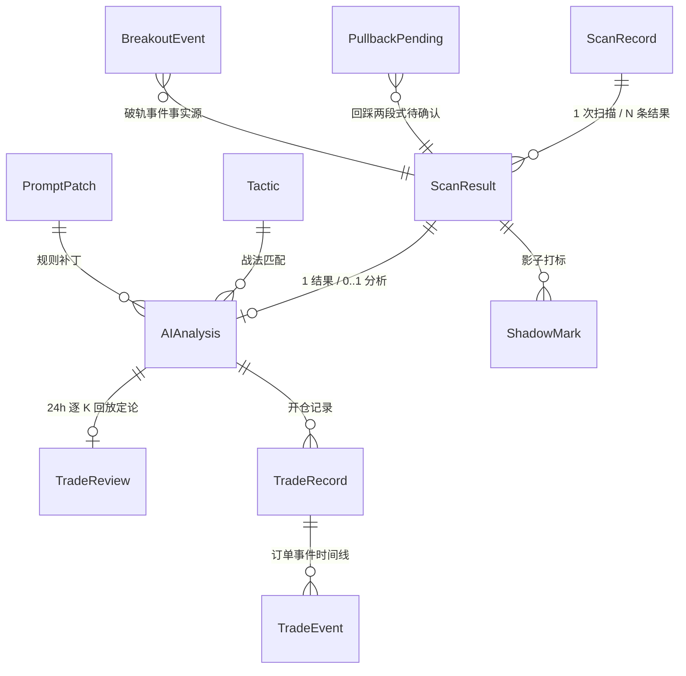

独立配置 / 运维表（无强外键关系）：
- 运行时配置：`SystemConfig`（单行 id=1）
- 过滤与关注：`SymbolBlacklist`、`Watchlist`
- 运维：`AppLog`、`TaskRecord`
- 现货子系统：`SpotOrder`、`SpotWeeklyReview`、`SpotKlineCache`

关键表索引：
- `scan_results`：`symbol+created_at`、`scan_record_id`、`ema_state`、`touch_ref`、`volume_type`
- `ai_analyses`：`fingerprint`、`scan_result_id`
- `trade_records`：`uq_trade_analysis_account`（ai_analysis_id + account_key + testnet 复合唯一）

---

## 8. API 接口清单

### 扫描 (`/api/scans`)
- `POST /api/scans` — 手动触发扫描
- `GET /api/scans` — 扫描记录列表
- `GET /api/scans/{id}` — 扫描详情
- `GET /api/scans/{id}/results` — 扫描结果列表
- `GET /api/scans/{id}/funnel` — 筛选漏斗
- `GET /api/scans/{id}/ai-analyses` — AI 分析列表
- `POST /api/scans/{result_id}/analyze` — 单币重新分析
- `POST /api/scans/manual-analyze` — 手动搜索即时 AI 分析
- `GET /api/scans/config` — 扫描配置
- `PUT /api/scans/config` — 更新配置
- `GET /api/scans/review/stats` — 复盘统计
- `GET /api/scans/review/funnel` — 全漏斗转化率
- `GET /api/scans/actual-review` — 实盘归因
- `POST /api/scans/attribution/trigger` — 触发 AI 归因
- `GET /api/scans/patches` — 补丁列表
- `POST /api/scans/patches/{id}/merge` — 合入补丁
- `POST /api/scans/patches/{id}/rollback` — 回滚补丁

### 交易 (`/api/trades`)
- `GET /api/trades` — 交易记录列表
- `GET /api/trades/{id}` — 交易详情
- `GET /api/trades/{id}/events` — 事件时间线
- `GET /api/trades/{id}/klines` — 复盘 K 线
- `POST /api/trades/{id}/close` — 市价平仓
- `GET /api/trades/transfers` — 资金划转
- `GET /api/trades/transfers/stats` — 划转统计
- `GET /api/trades/blacklist` — 黑名单
- `POST /api/trades/blacklist` — 加入黑名单
- `DELETE /api/trades/blacklist/{id}` — 移出黑名单

### 关注 (`/api/watchlist`)
- `GET /api/watchlist` — 列表
- `POST /api/watchlist` — 添加
- `DELETE /api/watchlist/{symbol}` — 删除
- `POST /api/watchlist/{symbol}/refresh` — 手动刷新

### 系统操作 (`/api/ops`)
- `GET /api/ops/config` — 系统配置
- `PUT /api/ops/config` — 更新配置
- `GET /api/ops/accounts` — 账号列表
- `GET /api/ops/tasks` — 任务记录
- `GET /api/ops/logs` — 系统日志
- `GET /api/ops/breaker-status` — 熔断状态

### 其他
- `GET /api/health` — 健康检查
- `GET /api/market/overview` — 大盘环境
- `/api/spot/*` — 现货子系统
- `/api/tactics/*` — 战法管理
- `/api/shadow/*` — 影子模式

---

## 9. 定时任务调度

Celery Beat 调度表（timezone=Asia/Shanghai）：

| 任务 | 调度 | 说明 |
|---|---|---|
| `run_scan_task` | 每小时 :00（整点） | 全量合约扫描 |
| `run_trade_review_task` | 每小时 :00 | 超 24h AI 建议逐 K 回放 |
| `run_ai_attribution_task` | 每小时 :14 | 已平仓交易 AI 错误归因 |
| `run_auto_trade_task` | 每半小时 :00/:30 | 结算巡检 + 持仓诊断 |
| `run_patch_trigger_task` | 每日 11:40 | 标签热度 → 补丁草稿 |
| `run_patch_evaluate_task` | 每日 11:45 | active 补丁三态评估 |
| `notify_daily_report` | 每日 08:05 | 日报推送 |
| `run_shadow_evaluate_task` | 每日 08:00 | 影子特征评估 |
| `run_reentry_backfill_task` | 每日 08:25 | 止损单 48h 观察窗补打标 |
| `run_spot_daily_task` | 每日 08:08 | 现货日检评分 |
| `run_spot_dca_task` | 周一 08:15 | 现货周度定投 |
| `run_spot_weekly_review_task` | 周一 08:30 | 现货 AI 周研判 |

---

## 10. 核心时序图

以下时序图描述系统核心运行时链路：主链路四条（扫描 → 分析 → 开仓 → 结算）、辅助链路两条（现货、飞书），以及复盘归因、影子模式、手动 API 与行情容灾四条补充链路（10.7 ~ 10.10）。

### 10.1 定时扫描与候选判定（每小时 :00 整点）

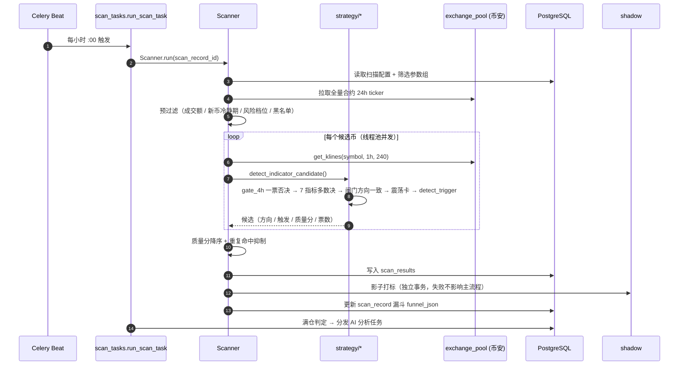

### 10.2 AI 分析管线（P0 / P1）

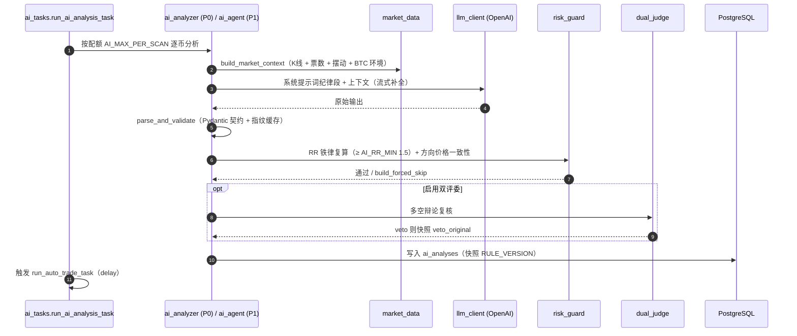

### 10.3 自动开仓（14 道闸门）

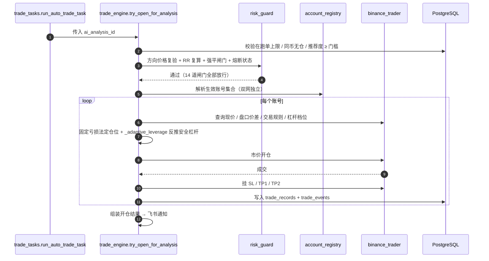

### 10.4 结算与风控动作（巡检 + 事件驱动）

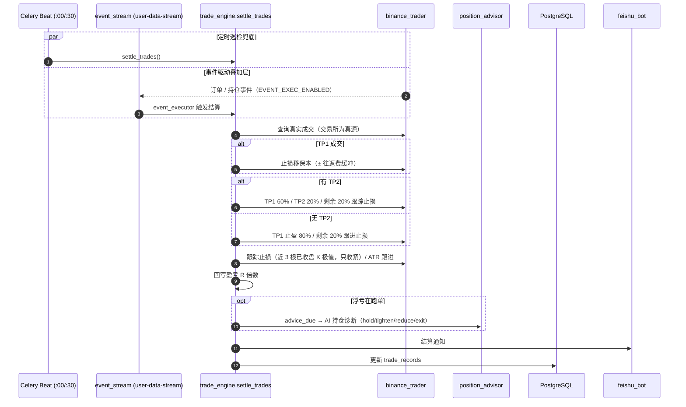

### 10.5 现货周度定投与 AI 周研判（周一 08:15 / 08:30）

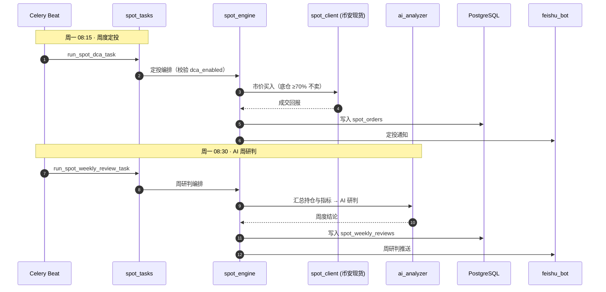

### 10.6 飞书通知与平仓回调

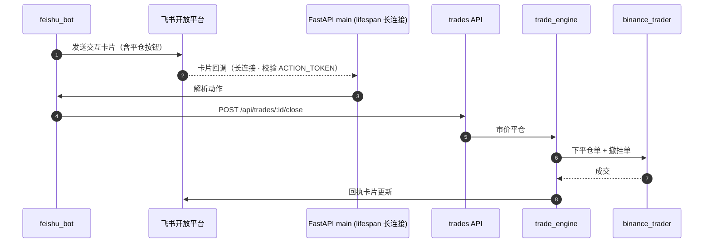

### 10.7 复盘归因与规则补丁闭环

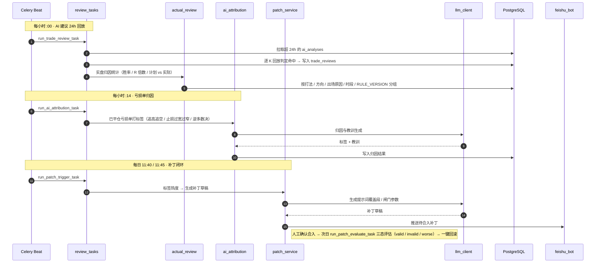

### 10.8 影子模式打标与评估

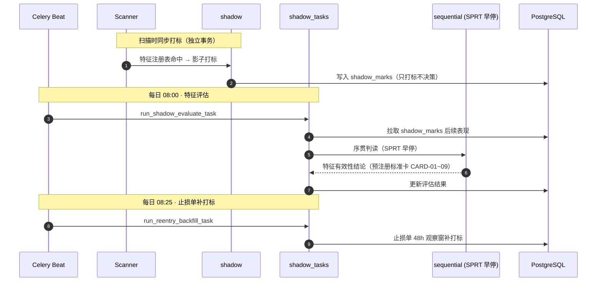

### 10.9 手动触发扫描与即时 AI 分析（API 链路）

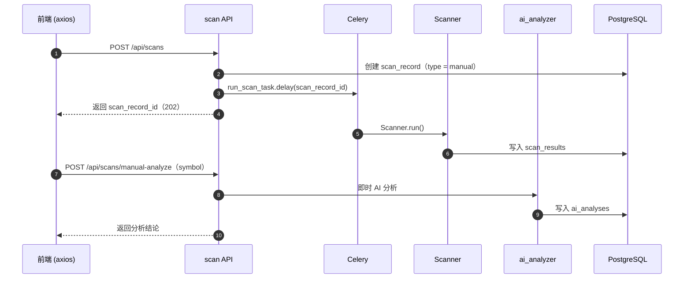

### 10.10 K 线多交易所故障转移

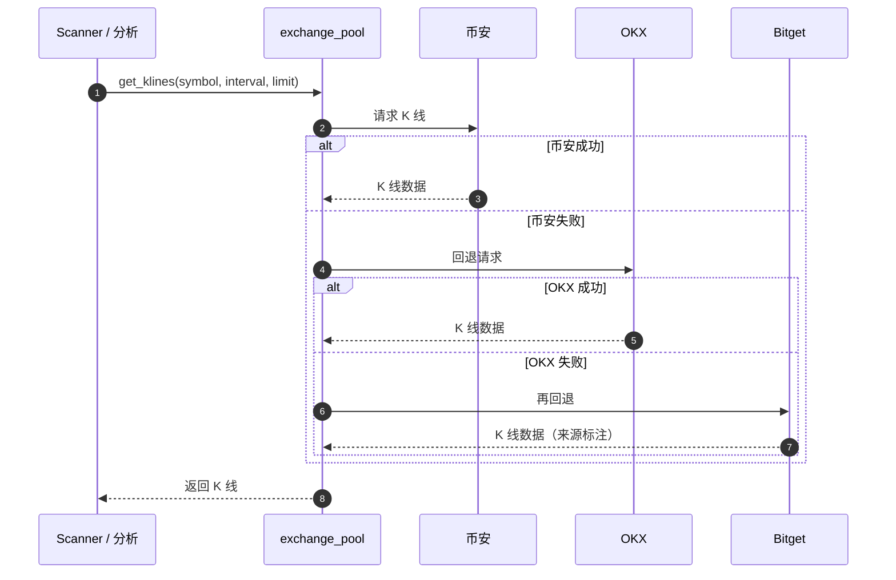

---

## 11. 依赖关系图

### 后端服务依赖（核心链路）

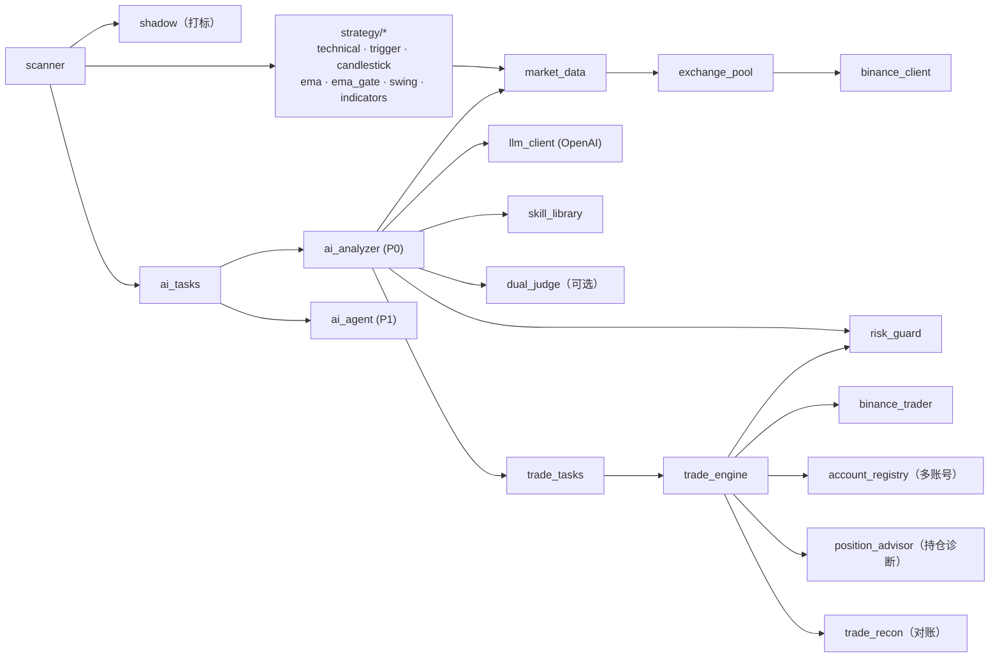

### 外部依赖

- **币安 API**：行情（fapi.binance.com）+ 交易（testnet.binancefuture.com / fapi.binance.com）
- **OpenAI 兼容 LLM**：AI 分析
- **飞书开放平台**：通知卡片 + 长连接回调
- **PostgreSQL 15**：数据持久化
- **Redis 7**：Celery broker + backend + LLM 并发信号量

---

## 12. 项目运行方式

### 方式一：Docker 部署（推荐）

```bash
# 1. 克隆仓库
git clone <repo-url> trading-workbench
cd trading-workbench

# 2. 配置环境变量
cp backend/.env.example backend/.env
# 编辑 backend/.env：至少设置 AI_API_KEY（AI 分析）
# 自动交易需配置 BINANCE_LIVE_1_API_KEY/SECRET_KEY

# 3. 构建并启动
./deploy.sh up
# 或：docker compose up -d --build

# 4. 访问
# 前端:    http://localhost:8088
# 后端:    http://localhost:8082
# API 文档: http://localhost:8082/docs
```

`deploy.sh` 子命令：`status` / `logs` / `restart` / `build` / `down`

### 方式二：本地开发

**后端**（Python 3.9+）：
```bash
cd backend
python -m venv .venv && source .venv/bin/activate
pip install -r requirements.txt
cp .env.example .env          # 改为指向本机 postgres/redis
# 确保 PostgreSQL(5432) 和 Redis(6379) 运行
uvicorn app.main:app --reload --port 8000
# 另开终端：
celery -A app.celery_app worker --loglevel=info --concurrency=2
celery -A app.celery_app beat --loglevel=info
```

**前端**（Node 18+）：
```bash
cd frontend
npm install
npm run dev          # http://localhost:5173
```

### Docker 服务与端口

| 服务 | 容器端口 | 宿主端口 |
|---|---|---|
| 前端 (nginx) | 80 | 8088 |
| 后端 (uvicorn) | 8000 | 8082 |
| PostgreSQL | 5432 | 5433 |
| Redis | 6379 | 6380 |
| Celery worker | — | — |
| Celery beat | — | — |

---

## 13. 配置说明

### 环境变量（backend/.env）

| 变量 | 默认值 | 说明 |
|---|---|---|
| `DATABASE_URL` | `postgresql://postgres:postgres@db:5432/trading_workbench` | PostgreSQL DSN |
| `REDIS_URL` / `CELERY_BROKER_URL` / `CELERY_RESULT_BACKEND` | redis 服务名 | Redis / Celery |
| `BINANCE_BASE_URL` | `https://api.binance.com` | 币安行情基址 |
| `BINANCE_FUTURES_URL` | `https://fapi.binance.com` | 币安合约基址 |
| `KLINE_INTERVAL` | `1h` | 扫描周期 |
| `KLINE_WINDOW` | `240` | 每币 K 线数量 |
| `MIN_VOLUME_24H` | `3000000` | 24h 成交额下限 |
| `AI_API_KEY` / `AI_BASE_URL` / `AI_MODEL` | 空 / openai / gpt-4o-mini | LLM 端点 |
| `AI_MAX_PER_SCAN` | `10` | 单次扫描 AI 配额 |
| `AI_RR_MIN` | `1.5` | 盈亏比铁律下限 |
| `RISK_BUDGET_PCT` | `3.0` | 单笔亏损预算 % |
| `BINANCE_LIVE_{N}_API_KEY/SECRET_KEY` | 空 | 正式网多账号 |
| `TRADING_MIN_RECOMMENDATION` | `60.0` | 开单推荐度门槛 |
| `TRADING_LEVERAGE` | `20` | 逐仓杠杆上限 |
| `FEISHU_APP_ID/SECRET/TARGET_ID/ACTION_TOKEN` | 空 | 飞书通知四件套 |

### 运行时配置（system_config 表，页面可改）

大部分开关运行时化：AI 开关、P0/P1 管线、双评委、TP2 开关、分批比例、双网自动交易开关、扫描参数组、风控参数（熔断/盈亏比/杠杆/费率/近锚折价/组合热度/同向上限）、周/月回撤阈值、ATR 跟进倍数、筛选参数组等。DB 值为 NULL 时回落 env 默认。

---

## 附录：关键设计约定

1. **规则版本隔离**：`RULE_VERSION` 随规则集变更递增，开仓/分析时快照，复盘按版本分组对比。
2. **影子铁律**：影子打标独立事务，失败绝不拖累主流程结果。
3. **幂等迁移**：`ALTER TABLE ... IF NOT EXISTS` 补列，历史列保留不 DROP。
4. **事件流 + 巡检兜底**：事件驱动结算为叠加层，30 分钟巡检永久保留兜底。
5. **双网独立**：测试网/正式网账号集合独立，可同时开启自动交易，复合唯一索引防双网镜像单冲突。
6. **以代码为准**：文档与代码不一致时先改代码或确认口径，再更新文档。
